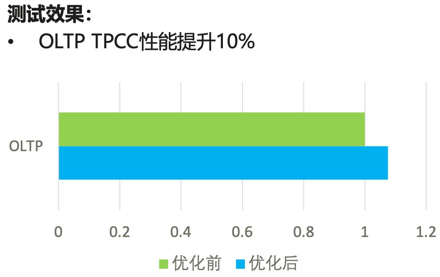
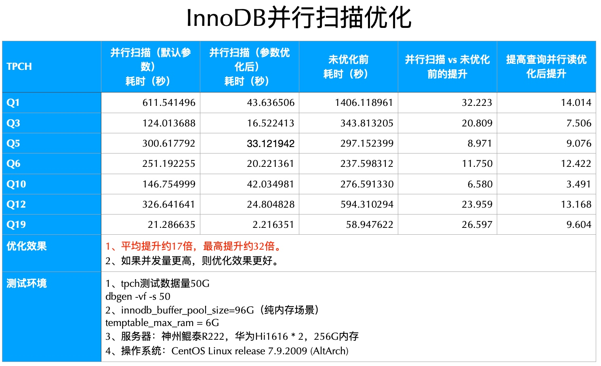

# Changes in GreatSQL 8.0.25 (2021-8-26)
---

## New Features
### New Node Zone Tags

A zone tag can be set for each node, mainly to solve the problem of data synchronization across multiple data centers.
A new option `group_replication_zone_id` has been added to mark the zone tag of a node. The value range of this option is 0 ~ 8, with a default value of 0.
When the option value is set differently among cluster nodes, the nodes are considered to have different zone tags.
In a same-city multi-data-center deployment, nodes in the same data center can be set to the same value, while nodes in another data center are set to a different value. In this way, when a transaction commits, at least one node in each `group_replication_zone_id` group is required to acknowledge the transaction before the next transaction can be processed. This ensures that a node in every data center always has the latest transactions.

| System Variable Name	| group_replication_zone_id |
| --- | --- | 
| Variable Scope	| global |
| Dynamic Variable	| YES |
| Permitted Values |	[0 ~ 8] |
| Default	| 0 |
| Description	| Sets different zone tags for MGR nodes, mainly to solve the problem of data synchronization across multiple data centers.<br/>After modifying the value of this option, you need to restart the MGR threads for it to take effect. |

### A New Flow Control Mechanism
The native flow control algorithm has significant flaws: after the flow control threshold is triggered, there is a brief flow control pause, after which transactions are allowed through again. This causes a 1-second performance jitter and does not really provide sustained flow control.

In GreatSQL, the flow control algorithm has been redesigned. The source-replica delay is added to calculate the flow control threshold, and large transaction processing and synchronization between the primary and secondary nodes are also taken into account. The flow control granularity is finer, and the 1-second small jitter problem of the official community version does not occur.

The new option `group_replication_flow_control_replay_lag_behind` is used to control the replication delay threshold of MGR primary and secondary nodes. When the delay between MGR primary and secondary nodes exceeds the threshold due to large transactions or other reasons, the flow control mechanism is triggered.

| System Variable Name	| group_replication_flow_control_replay_lag_behind |
| --- | --- | 
| Variable Scope	| global |
| Dynamic Variable	| YES |
| Permitted Values |	[0 ~ ULONG_MAX] |
| Default	| 60 |
| Description	| Used to control the replication delay threshold of MGR primary and secondary nodes. When the delay between MGR primary and secondary nodes exceeds the threshold due to large transactions or other reasons, the flow control mechanism is triggered. |

The default value of this option is 60 seconds, and it can be modified dynamically online, for example:
```sql
mysql> SET GLOBAL group_replication_flow_control_replay_lag_behind = 60;
```
Under normal circumstances, this parameter does not need to be adjusted.

## Stability Improvements
### Majority Write Mechanism in AFTER Mode
This ensures the high availability of the cluster even when network partitioning occurs.

When a network partition failure occurs, as long as the majority of nodes have finished replay, the cluster can continue processing new transactions.

### Solving the Problem of MGR Cluster Blocking Caused by Full Disk Space
In the official community version, once a node's disk is full, the entire cluster is blocked. In this case, the more nodes there are, the worse the availability.

In GreatSQL, once a node's disk is found to be full, the node actively leaves the cluster, avoiding the problem of blocking the entire cluster.

### Solving the Problem of Possible Data Loss in Multi-Primary Mode or During Primary Switchover
In the official community version, transaction certification data is processed in advance.

In GreatSQL, the transaction certification processing flow has been adjusted to put transactions into the **applier queue** for processing in Paxos order, which solves the problem of possible data loss in multi-primary mode or during primary switchover.

### Solving the Performance Jitter Problem When Nodes Exit the Cluster Abnormally
In the official community version, the Paxos communication mechanism is relatively crude. When a node exits abnormally, it causes performance jitter for a long period (about 20~30 seconds), and in the worst case, TPS may drop to 0 for several seconds.

After optimization in GreatSQL, only a small performance jitter of about 1~3 seconds occurs, and in the worst case, TPS may only lose about 20%~30%.

### More Complete Abnormal Node State Detection
When a node crashes abnormally or a network partition occurs, GreatSQL can detect these abnormal states faster. The official version takes 5 seconds to detect, while GreatSQL takes only about 1 second, effectively reducing the waiting time for primary switchover and abnormal nodes.

### Optimized Log Output Format
Added more DEBUG information to facilitate troubleshooting of problems encountered during MGR operation.

## Performance Improvements
### Redesigned Transaction Certification Queue Cleanup Algorithm
In the official community version, a full-table-scan-like algorithm is used to clean up the transaction certification queue, resulting in low cleanup efficiency and large performance jitter.

In GreatSQL, an index-like mechanism has been added to the transaction certification queue, and the time of each cleanup is controlled, effectively solving the problems of low cleanup efficiency and large performance jitter.

### Improved MGR Throughput
In high-latency scenarios such as cross-city IDC deployments, the throughput of applications accessing MGR is improved, minimizing the impact of network latency on access performance.

### Improved Strong Consistency Read Performance
The strong consistency read performance is improved, greatly reducing the read-only latency on replicas.

## Two Patches Contributed by Huawei Kunpeng Computing Team
### InnoDB Transaction Object Mapping Data Structure Optimization
In the official community implementation, a red-black tree structure is used to implement the fast mapping from transaction IDs to transaction objects. However, in high-concurrency application scenarios, heavy lock contention on this data structure can become a bottleneck in transaction processing.

GreatSQL uses a new lock-free hash structure, which significantly reduces lock critical-section consumption and improves transaction processing capability by at least 10%.


### InnoDB Parallel Query Optimization
Based on the characteristics of the B+ tree, the B+ tree can be divided into several subtrees, allowing multiple threads to scan different parts of the same InnoDB table in parallel. The execution plan is transformed into a multi-threaded one: each sub-thread executes an execution plan identical to the original MySQL execution plan, but each sub-thread only scans part of the table data, and results are aggregated after the sub-threads complete scanning. Through multi-threading, multi-core resources can be fully utilized to improve query performance.

After optimization, excellent results were achieved in TPC-H testing, with up to a 30x improvement and an average of 15x improvement. This feature is suitable for businesses such as SAP and financial statistics that require periodic data aggregation reports.

Usage restrictions:
- Subqueries are not supported for now; they can be rewritten as JOINs.
- For now, only ARM architecture platforms are supported; X86 architecture platform optimization will also be completed as soon as possible.


## Bug Fixes

- Fixed multiple bugs in AFTER mode, improving the reliability of strong consistency writes in AFTER mode. For example, when a new node joins, improper message handling, thread synchronization and other issues could easily cause a series of abnormal exits from the cluster.
- Fixed the view update problem caused by different types of abnormal exits of majority nodes. When node crash and node exit happen at the same time, the MGR view may not match the actual situation, causing a series of abnormal problems.
- Fixed the TCP self-connect problem of multiple MGR nodes deployed on a single machine. Related [BUG#98151](https://bugs.mysql.com/bug.php?id=98151).
- Fixed the long wait problem during recovery. Starting multiple nodes simultaneously may cause them to remain stuck in the recovering state for a long time (possibly even several hours). Several unreasonable sleep practices were fixed to solve this problem.
- Fixed the infinite loop in logic determination that could be caused by transferring large amounts of data.
- Fixed several coredump problems
    - a) When `start group_replication` and querying `replication_group_member_stats` were executed concurrently, `start group_replication` could fail to start, and the node could even coredump.
    - b) During the startup of `start group_replication`, if `replication_group_member_stats` was queried while internal objects were being destroyed, a coredump could occur.

## Usage Notes
- When any node in the MGR cluster is in the recovering state and there is still business traffic, 【do NOT】execute `stop group_replication` to stop the MGR service, otherwise it may cause GTID disorder or even data loss.
- The option `slave_parallel_workers` is recommended to be set to twice the number of logical CPUs to improve the concurrency efficiency of replica replay.
- After setting the `group_replication_flow_control_replay_lag_behind` parameter, the flow control parameters of native MGR no longer take effect. GreatSQL automatically performs flow control based on queue length and size.
- Before MGR nodes are formally brought up, be sure to set `super_read_only=ON` (or ensure that no one modifies data at that time).
- The option `group_replication_unreachable_majority_timeout` is recommended not to be set; otherwise, when a network partition occurs, errors are returned to users even though the majority of nodes in other partitions have already committed the transactions.
- For problem diagnosis purposes, it is recommended to set `log_error_verbosity=3`.
- When the InnoDB parallel query optimization feature is enabled (force_parallel_execute = ON), it is recommended to also increase the `parallel_default_dop` option value to improve the parallelism of a single SQL query.
- When the InnoDB parallel query optimization feature is enabled, it is recommended to also increase the `parallel_max_threads` option value to improve the query parallelism of the entire instance.
- When the InnoDB parallel query optimization feature is enabled, if temporary tables need to be generated during SQL execution, a `table...full` error may be reported. This is MySQL [BUG#99100](https://bugs.mysql.com/bug.php?id=99100) and can be solved by increasing the `temptable_max_ram` option value.

## GreatSQL Release Notes
### GreatSQL 8.0
- [Changes in GreatSQL 8.0.32-25 (2023-12-28)](changes-greatsql-8-0-32-25-20231228.md)
- [Changes in GreatSQL 8.0.32-24 (2023-6-5)](changes-greatsql-8-0-32-24-20230605.md)
- [Changes in GreatSQL 8.0.25-17 (2023-3-13)](changes-greatsql-8-0-25-17-20230313.md)
- [Changes in GreatSQL 8.0.25-16 (2022-5-16)](changes-greatsql-8-0-25-16-20220516.md)
- [Changes in GreatSQL 8.0.25-15 (2021-8-26)](changes-greatsql-8-0-25-20210820.md)

### GreatSQL 5.7
- [Changes in GreatSQL 5.7.36-39 (2022-4-7)](changes-greatsql-5-7-36-20220407.md)


**Scan the QR code to follow our WeChat Official Account**


