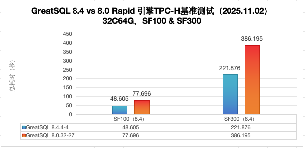
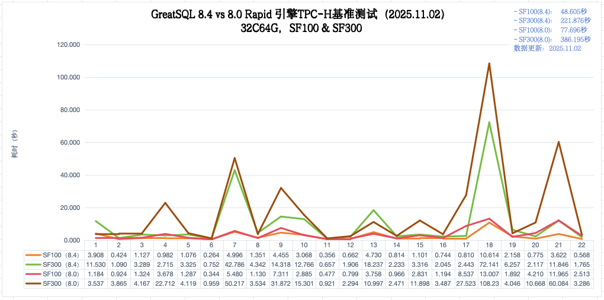
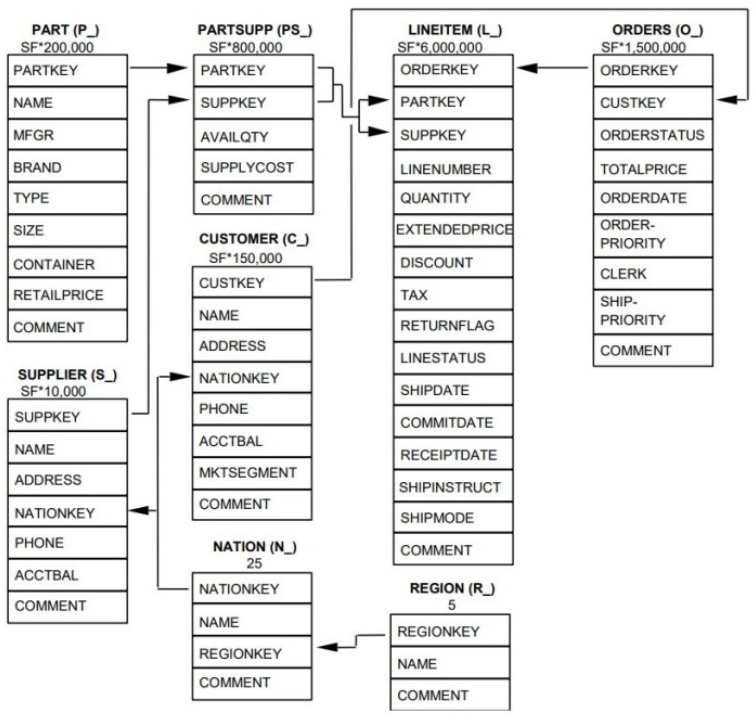

# GreatSQL TPC-H Performance Benchmark Report
---

**GreatSQL TPC-H Performance Benchmark Report**

**(November 2, 2024)**

**GreatSQL Community**

## 【Document Statement】

The GreatSQL Community reminds you to carefully read and fully understand the terms of this legal statement before reading or using this document. If you read or use this document, your reading or use behavior will be deemed as acceptance of all the content of this statement. You should download and obtain this document through the GreatSQL Community website or other authorized channels provided by the GreatSQL Community, and use it only for your own lawful and compliant business activities. The content of this document is regarded as confidential information of the GreatSQL Community, and you should strictly comply with the confidentiality obligations; without the prior written consent of the GreatSQL Community, you may not disclose the content of this manual to any third party or provide it to any third party for use.

Without the prior written permission of the GreatSQL Community, no unit, company, or individual may extract, translate, or copy part or all of the content of this document without authorization, and may not replace or promote it in any way or channel.

Due to product version upgrades, adjustments, or other reasons, the content of this document may change. The GreatSQL Community reserves the right to modify the content of this document without any notice or prompt, and periodically publishes updated user documents in the GreatSQL Community authorized channels. You should pay real-time attention to the version changes of the user documents and download and obtain the latest version of the user documents through the GreatSQL Community authorized channels.

This document is only a reference guide for users using GreatSQL Community products and services. The GreatSQL Community makes its best efforts to provide corresponding introductions and operation guidelines based on existing technology, but the GreatSQL Community hereby explicitly declares that it does not make any express or implied warranties regarding the accuracy, completeness, applicability, or reliability of the content of this document. Any unit, company, or individual that suffers any error or economic loss because of downloading, using, or relying on this document shall not be held legally liable by the GreatSQL Community. Under no circumstances shall the GreatSQL Community be liable for any indirect, consequential, punitive, incidental, special, or penal damages, including lost profits suffered by users using or relying on this document (even if the GreatSQL Community has been informed of the possibility of such losses).

All content in GreatSQL Community documents, including but not limited to images, architecture designs, page layouts, and text descriptions, is legally owned by the GreatSQL Community and/or its affiliated companies for its intellectual property rights, including but not limited to trademark rights, patent rights, copyrights, and trade secrets. Without the written consent of the GreatSQL Community and/or its affiliated companies, no one may use, modify, copy, publicly replace, change, distribute, issue, or publicly publish the GreatSQL Community website, product programs, or content without authorization. In addition, without the prior written consent of the GreatSQL Community, no one may use, publish, or copy the name of the GreatSQL Community (including but not limited to brands containing "GreatSQL Community", "GreatSQL", etc., of the GreatSQL Community and/or its affiliated companies, alone or in combination, the affiliated logos and patterns of the above brands, or any similar company name, trade name, trademark, product or service name, domain name, pattern mark, logo, mark, or identifier through which third parties can identify the GreatSQL Community and/or its affiliated companies) for any marketing, advertising, promotion, or other purposes.

If any error is found in this document, please contact the GreatSQL Community directly.

GreatSQL Community official website: [https://greatsql.cn](https://greatsql.cn).

## Overview

This test is a test of the GreatSQL database based on the standard TPC-H scenario.

TPC-H (Business Intelligence Computing Benchmark) is a benchmark set formulated by the US Transaction Processing Performance Council (TPC) organization to simulate decision support applications. At present, academia and industry generally use TPC-H to evaluate the performance of decision support technology applications. This commercial benchmark can comprehensively evaluate the overall commercial computing capability of the system, placing higher requirements on vendors, and also has universal commercial practical significance. It is currently widely used in bank credit analysis and credit card analysis, telecom operation analysis, tax analysis, and tobacco industry decision analysis. TPC-H queries include eight data tables and 22 complex SQL queries, and most queries include multi-table joins (JOIN), subqueries, and aggregate queries.

The GreatSQL database is an **open source and free** database that can meet financial-grade application scenarios on commodity hardware. It features **High Availability**, **High Performance**, **High Compatibility**, and **High Security**, and can serve as an ideal drop-in replacement for MySQL or Percona.

## Test Results

From the results of this test, the following conclusions can be drawn:

**The test results show that: compared with GreatSQL 8.0.32-27, GreatSQL 8.4.4-4 has significantly improved performance in TPC-H test scenarios, with improvements of 37.44% and 42.55% in SF100 and SF300 respectively, and the performance is even better when the data volume is larger.**

The above conclusion is only a summary based on the several scenarios of this test.

The comparison diagram of the GreatSQL 8.4.4-4 vs 8.0.32-27 Rapid Engine TPC-H baseline test is as follows:



For the GreatSQL 8.0.32-27 test results, see: [GreatSQL 8.0.32-27 TPC-H Performance Benchmark Report](https://greatsql.cn/docs/8.0.32-27/10-optimize/3-3-benchmark-greatsql-tpch-report.html).

Test environment:

| Configuration | Remarks | 
|   ---    | --- |
| Operating System | OS: CentOS Linux release 8.5.2111<br/>Kernel: 4.18.0-240.el8.x86_64 |
| CPU      | Intel(R) Xeon(R) Gold 6238 CPU @ 2.10GHz * 4                              |
| Memory     | 256G                                                                      |
| Disk     | INTEL SSDPE2KE032T8                                      |
| Database   | GreatSQL 8.4.4-4 Revision d73de75905d      |
| Test Tool | tpch 3.0.1 |
| Test Data Volume | SF100 & SF300 |

## Detailed Test Result Data

The detailed time consumption of each SQL is shown in the following table:

| TPC-H Query | GreatSQL 8.4.4-4<br/>SF100 Duration (seconds)| GreatSQL 8.4.4-4<br/>SF300 Duration (seconds)| GreatSQL 8.0.32-27<br/>SF100 Duration (seconds)| GreatSQL 8.0.32-27<br/>SF300 Duration (seconds)|
| :---  | :---    | :---     | :---    | :---     |
| Q1	| 3.908 	| 11.530 	| 1.184 	| 3.537   |
| Q2	| 0.424 	| 1.090 	| 0.924 	| 3.865   |
| Q3	| 1.127 	| 3.289 	| 1.324 	| 4.167   |
| Q4	| 0.982 	| 2.715 	| 3.678 	| 22.712  |
| Q5	| 1.076 	| 3.325 	| 1.287 	| 4.119   |
| Q6	| 0.264 	| 0.752 	| 0.344 	| 0.959   |
| Q7	| 4.996 	| 42.786 	| 5.480 	| 50.217  |
| Q8	| 1.351 	| 4.342 	| 1.130 	| 3.534   |
| Q9	| 4.455 	| 14.318 	| 7.311 	| 31.872  |
| Q10	| 3.068 	| 12.766 	| 2.885 	| 15.301  |
| Q11	| 0.356 	| 0.657 	| 0.477 	| 0.921   |
| Q12	| 0.662 	| 1.906 	| 0.799 	| 2.294   |
| Q13	| 4.730 	| 18.237 	| 3.758 	| 10.997  |
| Q14	| 0.814 	| 2.233 	| 0.966 	| 2.471   |
| Q15	| 1.101 	| 3.316 	| 2.831 	| 11.898  |
| Q16	| 0.744 	| 2.045 	| 1.194 	| 3.487   |
| Q17	| 0.810 	| 2.443 	| 8.537 	| 27.523  |
| Q18	| 10.614 	| 72.141 	| 13.007 	| 108.237 |
| Q19	| 2.158 	| 6.257 	| 1.892 	| 4.046   |
| Q20	| 0.775 	| 2.117 	| 4.210 	| 10.668  |
| Q21	| 3.622 	| 11.846 	| 11.965 	| 60.084  |
| Q22	| 0.568 	| 1.765 	| 2.513 	| 3.286   |
| Total Duration| **48.605** 	| **221.876** 	| **77.696** 	| **386.195**|

The comparison diagram of the time consumption of each SQL in the GreatSQL 8.4.4-4 vs 8.0.32-27 Rapid Engine TPC-H baseline test is as follows:



## Appendix

### Test Steps

Refer to the manual content [TPC-H Performance Benchmark](./3-2-benchmark-tpch.md) to execute the TPC-H test. The detailed process is not repeated here.

### Test Tool

[TPC-H 3.0.1](https://www.tpc.org/tpch/).

The SQL query files suitable for the Rapid Engine and the auxiliary batch data generation and import tool code repository: [https://gitee.com/GreatSQL/tpch](https://gitee.com/GreatSQL/tpch).

### Test Mode

- Execute the [tpch-create-table.sql](https://gitee.com/GreatSQL/tpch/blob/master/tpch-create-table.sql) script to create the corresponding database. 
- Call the [pdbgen.sh](https://gitee.com/GreatSQL/tpch/blob/master/pdbgen.sh) script to construct test datasets at SF100 and SF300 scales respectively.
- Call the [pload.sh](https://gitee.com/GreatSQL/tpch/blob/master/pload.sh) script to import the test datasets into the GreatSQL database in parallel.
- Adjust the two Rapid Engine parameters: `rapid_memory_limit=64G` and `rapid_worker_threads=32`.
- Execute `ALTER TABLE x SECONDARY_LOAD;` on each table respectively to load the InnoDB engine data into the Rapid Engine. This process takes some time; please wait patiently.
- Modify the variables in the script [run-tpch.sh](https://gitee.com/GreatSQL/tpch/blob/master/run-tpch.sh) and execute the test.

### Main Related Parameters of GreatSQL

```ini
innodb_buffer_pool_size=128G
rapid_memory_limit=64G
rapid_worker_threads=32
```

### Test Table Structure and Data Volume

Data volume comparison of each table:

|Table Name|TPC-H SF100 Data Volume|TPC-H SF300 Data Volume|Remarks|
| ---       | ---      | ---       | ---        | 
|region     |5         |5          |Region information    |
|nation     |25        |25         |Nation table      |
|supplier   |1000000   |3000000    |Supplier information  |
|part       |20000000  |60000000   |Part table      |
|customer   |15000000  |45000000   |Customer table    |
|partsupp   |80000000  |240000000  |Part supplier table  |
|orders     |150000000 |450000000  |Order table      |
|lineitem   |600037902 |1799989091 |Order line item table  |

Rapid Engine tablespace compression ratio:

|Database Name|InnoDB Tablespace File Total Size|Rapid Engine Tablespace Total Size|Compression Ratio|
| ---        | ---         | ---        | --- |
|TPC-H SF100 |184570593436 |28728373248 |6.42 |
|TPC-H SF300 |591644573888 |74334864443 |7.96 |

The relationship between the table structures is shown in the following figure:



### Test Environment

**Server Detailed Information**

- 1. Operating System

```bash
$ cat /etc/os-release

NAME="CentOS Linux"
VERSION="8"
ID="centos"
ID_LIKE="rhel fedora"
VERSION_ID="8"
PLATFORM_ID="platform:el8"
PRETTY_NAME="CentOS Linux 8"
ANSI_COLOR="0;31"
CPE_NAME="cpe:/o:centos:centos:8"
HOME_URL="https://centos.org/"
BUG_REPORT_URL="https://bugs.centos.org/"
CENTOS_MANTISBT_PROJECT="CentOS-8"
CENTOS_MANTISBT_PROJECT_VERSION="8"
```

- 2. CPU

```bash
$ lscpu

Architecture:        x86_64
CPU op-mode(s):      32-bit, 64-bit
Byte Order:          Little Endian
CPU(s):              176
On-line CPU(s) list: 0-175
Thread(s) per core:  2
Core(s) per socket:  22
Socket(s):           4
NUMA node(s):        1
Vendor ID:           GenuineIntel
BIOS Vendor ID:      Intel
CPU family:          6
Model:               85
Model name:          Intel(R) Xeon(R) Gold 6238 CPU @ 2.10GHz
BIOS Model name:     Intel(R) Xeon(R) Gold 6238 CPU @ 2.10GHz
Stepping:            7
CPU MHz:             2799.999
CPU max MHz:         3700.0000
CPU min MHz:         1000.0000
BogoMIPS:            4200.00
Virtualization:      VT-x
L1d cache:           32K
L1i cache:           32K
L2 cache:            1024K
L3 cache:            30976K
NUMA node0 CPU(s):   0-175
Flags:               fpu vme de pse tsc msr pae mce cx8 apic sep mtrr pge mca cmov pat pse36 clflush dts acpi mmx fxsr sse sse2 ss ht tm pbe syscall nx pdpe1gb rdtscp lm constant_tsc art arch_perfmon pebs bts rep_good nopl xtopology nonstop_tsc cpuid aperfmperf pni pclmulqdq dtes64 monitor ds_cpl vmx smx est tm2 ssse3 sdbg fma cx16 xtpr pdcm pcid dca sse4_1 sse4_2 x2apic movbe popcnt tsc_deadline_timer aes xsave avx f16c rdrand lahf_lm abm 3dnowprefetch cpuid_fault epb cat_l3 cdp_l3 invpcid_single intel_ppin ssbd mba ibrs ibpb stibp ibrs_enhanced tpr_shadow vnmi flexpriority ept vpid ept_ad fsgsbase tsc_adjust bmi1 hle avx2 smep bmi2 erms invpcid cqm mpx rdt_a avx512f avx512dq rdseed adx smap clflushopt clwb intel_pt avx512cd avx512bw avx512vl xsaveopt xsavec xgetbv1 xsaves cqm_llc cqm_occup_llc cqm_mbm_total cqm_mbm_local dtherm ida arat pln pts pku ospke avx512_vnni md_clear flush_l1d arch_capabilities
```

- 3. Memory

```bash
$ free -ht
              total        used        free      shared  buff/cache   available
Mem:          251Gi       146Gi       1.7Gi        17Mi       102Gi       102Gi
Swap:         4.0Gi       318Mi       3.7Gi
Total:        255Gi       146Gi       5.4Gi
```

- 4. Disk

Disk device model

```bash
$ nvme list

Node             SN                   Model                                    Namespace Usage                      Format           FW Rev
---------------- -------------------- ---------------------------------------- --------- -------------------------- ---------------- --------
/dev/nvme0n1          PHLN018200FD3P2BGN   INTEL SSDPE2KE032T8                      1           3.20  TB /   3.20  TB    512   B +  0 B   VDV10152
```

Disk mount parameters, file system, ioscheduler

```bash
$ df -hT | grep /ssd1
/dev/nvme0n1        xfs       3.0T  682G  2.3T  23% /ssd1

$ mount | grep ssd1
/dev/nvme0n1 on /ssd1 type xfs (rw,noatime,nodiratime,seclabel,attr2,inode64,logbufs=8,logbsize=32k,noquota)

$ cat /sys/block/nvme0n1/queue/scheduler
[mq-deadline] kyber bfq none
```

Simple speed test of the NVMe SSD device

```bash
$ dd oflag=direct if=/dev/zero of=./zero bs=1M count=20480

20480+0 records in
20480+0 records out
21474836480 bytes (21 GB, 20 GiB) copied, 11.389 s, 1.9 GB/s
```

- 5. The server has NUMA disabled

```bash
$ cat /etc/default/grub

GRUB_TIMEOUT=5
GRUB_DISTRIBUTOR="$(sed 's, release .*$,,g' /etc/system-release)"
GRUB_DEFAULT=saved
GRUB_DISABLE_SUBMENU=true
GRUB_TERMINAL_OUTPUT="console"
GRUB_CMDLINE_LINUX="crashkernel=auto resume=/dev/mapper/cl-swap rd.lvm.lv=cl/root rd.lvm.lv=cl/swap numa=off"
GRUB_DISABLE_RECOVERY="true"
GRUB_ENABLE_BLSCFG=true

$ dmesg | grep -i numa

[    0.000000] Command line: BOOT_IMAGE=(hd0,gpt2)/vmlinuz-4.18.0-240.el8.x86_64 root=/dev/mapper/cl-root ro crashkernel=auto resume=/dev/mapper/cl-swap rd.lvm.lv=cl/root rd.lvm.lv=cl/swap numa=off
[    0.000000] NUMA turned off
[    0.000000] Kernel command line: BOOT_IMAGE=(hd0,gpt2)/vmlinuz-4.18.0-240.el8.x86_64 root=/dev/mapper/cl-root ro crashkernel=auto resume=/dev/mapper/cl-swap rd.lvm.lv=cl/root rd.lvm.lv=cl/swap numa=off
```

### Test Table DDL

```sql
-- DROP DATABASE IF EXISTS tpch;
-- CREATE DATABASE IF NOT EXISTS tpch DEFAULT CHARACTER SET latin1;
-- USE tpch;

drop table if exists nation;
create table nation  ( n_nationkey  integer not null,
                                n_name       char(25) not null,
                                n_regionkey  integer not null,
                                n_comment    varchar(152),
                                primary key(n_nationkey),
                                key nation_fk1 (n_regionkey) ) secondary_engine = rapid;

drop table if exists region;
create table region  ( r_regionkey  integer not null,
                                r_name       char(25) not null,
                                r_comment    varchar(152),
                                primary key(r_regionkey) ) secondary_engine = rapid;

drop table if exists part;
create table part  ( p_partkey     integer not null,
                                p_name        varchar(55) not null,
                                p_mfgr        char(25) not null,
                                p_brand       char(10) not null,
                                p_type        varchar(25) not null,
                                p_size        integer not null,
                                p_container   char(10) not null,
                                p_retailprice decimal(15,2) not null,
                                p_comment     varchar(23) not null,
                                primary key(p_partkey) ) secondary_engine = rapid;

drop table if exists supplier;
create table supplier ( s_suppkey     integer not null,
                                s_name        char(25) not null,
                                s_address     varchar(40) not null,
                                s_nationkey   integer not null,
                                s_phone       char(15) not null,
                                s_acctbal     decimal(15,2) not null,
                                s_comment     varchar(101) not null,
                                primary key(s_suppkey),
                                key supplier_fk1 (s_nationkey) ) secondary_engine = rapid;

drop table if exists partsupp;
create table partsupp ( ps_partkey     integer not null,
                                ps_suppkey     integer not null,
                                ps_availqty    integer not null,
                                ps_supplycost  decimal(15,2)  not null,
                                ps_comment     varchar(199) not null,
                                primary key(ps_partkey,ps_suppkey),
                                key partsupp_fk1 (ps_suppkey),
                                key partsupp_fk2 (ps_partkey) ) secondary_engine = rapid;


drop table if exists customer;
create table customer ( c_custkey     integer not null,
                                c_name        varchar(25) not null,
                                c_address     varchar(40) not null,
                                c_nationkey   integer not null,
                                c_phone       char(15) not null,
                                c_acctbal     decimal(15,2)   not null,
                                c_mktsegment  char(10) not null,
                                c_comment     varchar(117) not null,
                                primary key(c_custkey),
                                key customer_fk1 (c_nationkey) ) secondary_engine = rapid;

drop table if exists orders;
create table orders  ( o_orderkey       integer not null,
                                o_custkey        integer not null,
                                o_orderstatus    char(1) not null,
                                o_totalprice     decimal(15,2) not null,
                                o_orderdate      date not null,
                                o_orderpriority  char(15) not null,
                                o_clerk          char(15) not null,
                                o_shippriority   integer not null,
                                o_comment        varchar(79) not null,
                                primary key(o_orderkey),
                                key orders_fk1 (o_custkey) ) secondary_engine = rapid;

drop table if exists lineitem;
create table lineitem ( l_orderkey    integer not null,
                                l_partkey     integer not null,
                                l_suppkey     integer not null,
                                l_linenumber  integer not null,
                                l_quantity    decimal(15,2) not null,
                                l_extendedprice  decimal(15,2) not null,
                                l_discount    decimal(15,2) not null,
                                l_tax         decimal(15,2) not null,
                                l_returnflag  char(1) not null,
                                l_linestatus  char(1) not null,
                                l_shipdate    date not null,
                                l_commitdate  date not null,
                                l_receiptdate date not null,
                                l_shipinstruct char(25) not null,
                                l_shipmode     char(10) not null,
                                l_comment      varchar(44) not null,
                                primary key(l_orderkey,l_linenumber),
                                key lineitem_fk1 (l_orderkey) ,
                                key lineitem_fk2 (l_partkey,l_suppkey) ) secondary_engine = rapid;
```

### 22 TPC-H Test SQLs

```sql
-- tpch_queries_1.sql
SELECT /*+ SET_VAR(use_secondary_engine=1) SET_VAR(secondary_engine_cost_threshold=0) */ /*+ Q1 */
    l_returnflag,
    l_linestatus,
    sum(l_quantity) AS sum_qty,
    sum(l_extendedprice) AS sum_base_price,
    sum(l_extendedprice * (1 - l_discount)) AS sum_disc_price,
    sum(l_extendedprice * (1 - l_discount) * (1 + l_tax)) AS sum_charge,
    avg(l_quantity) AS avg_qty,
    avg(l_extendedprice) AS avg_price,
    avg(l_discount) AS avg_disc,
    count(*) AS count_order
FROM
    lineitem
WHERE
    l_shipdate <= CAST('1998-09-02' AS date)
GROUP BY
    l_returnflag,
    l_linestatus
ORDER BY
    l_returnflag,
    l_linestatus;


-- tpch_queries_2.sql
SELECT /*+ SET_VAR(use_secondary_engine=1) SET_VAR(secondary_engine_cost_threshold=0) */ /*+ Q2 */
    s_acctbal,
    s_name,
    n_name,
    p_partkey,
    p_mfgr,
    s_address,
    s_phone,
    s_comment
FROM
    part,
    supplier,
    partsupp,
    nation,
    region
WHERE
    p_partkey = ps_partkey
    AND s_suppkey = ps_suppkey
    AND p_size = 15
    AND p_type LIKE '%BRASS'
    AND s_nationkey = n_nationkey
    AND n_regionkey = r_regionkey
    AND r_name = 'EUROPE'
    AND ps_supplycost = (
        SELECT
            min(ps_supplycost)
        FROM
            partsupp,
            supplier,
            nation,
            region
        WHERE
            p_partkey = ps_partkey
            AND s_suppkey = ps_suppkey
            AND s_nationkey = n_nationkey
            AND n_regionkey = r_regionkey
            AND r_name = 'EUROPE')
ORDER BY
    s_acctbal DESC,
    n_name,
    s_name,
    p_partkey
LIMIT 100;


-- tpch_queries_3.sql
SELECT /*+ SET_VAR(use_secondary_engine=1) SET_VAR(secondary_engine_cost_threshold=0) */ /*+ Q3 */
    l_orderkey,
    sum(l_extendedprice * (1 - l_discount)) AS revenue,
    o_orderdate,
    o_shippriority
FROM
    customer,
    orders,
    lineitem
WHERE
    c_mktsegment = 'BUILDING'
    AND c_custkey = o_custkey
    AND l_orderkey = o_orderkey
    AND o_orderdate < CAST('1995-03-15' AS date)
    AND l_shipdate > CAST('1995-03-15' AS date)
GROUP BY
    l_orderkey,
    o_orderdate,
    o_shippriority
ORDER BY
    revenue DESC,
    o_orderdate
LIMIT 10;


-- tpch_queries_4.sql
SELECT /*+ SET_VAR(use_secondary_engine=1) SET_VAR(secondary_engine_cost_threshold=0) */ /*+ Q4 */
    o_orderpriority,
    count(*) AS order_count
FROM
    orders
WHERE
    o_orderdate >= CAST('1993-07-01' AS date)
    AND o_orderdate < CAST('1993-10-01' AS date)
    AND EXISTS (
        SELECT
            *
        FROM
            lineitem
        WHERE
            l_orderkey = o_orderkey
            AND l_commitdate < l_receiptdate)
GROUP BY
    o_orderpriority
ORDER BY
    o_orderpriority;


-- tpch_queries_5.sql
SELECT /*+ SET_VAR(use_secondary_engine=1) SET_VAR(secondary_engine_cost_threshold=0) */ /*+ Q5 */
    n_name,
    sum(l_extendedprice * (1 - l_discount)) AS revenue
FROM
    customer,
    orders,
    lineitem,
    supplier,
    nation,
    region
WHERE
    c_custkey = o_custkey
    AND l_orderkey = o_orderkey
    AND l_suppkey = s_suppkey
    AND c_nationkey = s_nationkey
    AND s_nationkey = n_nationkey
    AND n_regionkey = r_regionkey
    AND r_name = 'ASIA'
    AND o_orderdate >= CAST('1994-01-01' AS date)
    AND o_orderdate < CAST('1995-01-01' AS date)
GROUP BY
    n_name
ORDER BY
    revenue DESC;


-- tpch_queries_6.sql
SELECT /*+ SET_VAR(use_secondary_engine=1) SET_VAR(secondary_engine_cost_threshold=0) */ /*+ Q6 */
    sum(l_extendedprice * l_discount) AS revenue
FROM
    lineitem
WHERE
    l_shipdate >= CAST('1994-01-01' AS date)
    AND l_shipdate < CAST('1995-01-01' AS date)
    AND l_discount BETWEEN 0.05
    AND 0.07
    AND l_quantity < 24;


-- tpch_queries_7.sql
SELECT /*+ SET_VAR(use_secondary_engine=1) SET_VAR(secondary_engine_cost_threshold=0) */ /*+ Q7 */
    supp_nation,
    cust_nation,
    l_year,
    sum(volume) AS revenue
FROM (
    SELECT
        n1.n_name AS supp_nation,
        n2.n_name AS cust_nation,
        extract(year FROM l_shipdate) AS l_year,
        l_extendedprice * (1 - l_discount) AS volume
    FROM
        supplier,
        lineitem,
        orders,
        customer,
        nation n1,
        nation n2
    WHERE
        s_suppkey = l_suppkey
        AND o_orderkey = l_orderkey
        AND c_custkey = o_custkey
        AND s_nationkey = n1.n_nationkey
        AND c_nationkey = n2.n_nationkey
        AND ((n1.n_name = 'FRANCE'
                AND n2.n_name = 'GERMANY')
            OR (n1.n_name = 'GERMANY'
                AND n2.n_name = 'FRANCE'))
        AND l_shipdate BETWEEN CAST('1995-01-01' AS date)
        AND CAST('1996-12-31' AS date)) AS shipping
GROUP BY
    supp_nation,
    cust_nation,
    l_year
ORDER BY
    supp_nation,
    cust_nation,
    l_year;


-- tpch_queries_8.sql
SELECT /*+ SET_VAR(use_secondary_engine=1) SET_VAR(secondary_engine_cost_threshold=0) */ /*+ Q8 */
    o_year,
    sum(
        CASE WHEN nation = 'BRAZIL' THEN
            volume
        ELSE
            0
        END) / sum(volume) AS mkt_share
FROM (
    SELECT
        extract(year FROM o_orderdate) AS o_year,
        l_extendedprice * (1 - l_discount) AS volume,
        n2.n_name AS nation
    FROM
        part,
        supplier,
        lineitem,
        orders,
        customer,
        nation n1,
        nation n2,
        region
    WHERE
        p_partkey = l_partkey
        AND s_suppkey = l_suppkey
        AND l_orderkey = o_orderkey
        AND o_custkey = c_custkey
        AND c_nationkey = n1.n_nationkey
        AND n1.n_regionkey = r_regionkey
        AND r_name = 'AMERICA'
        AND s_nationkey = n2.n_nationkey
        AND o_orderdate BETWEEN CAST('1995-01-01' AS date)
        AND CAST('1996-12-31' AS date)
        AND p_type = 'ECONOMY ANODIZED STEEL') AS all_nations
GROUP BY
    o_year
ORDER BY
    o_year;


-- tpch_queries_9.sql
SELECT /*+ SET_VAR(use_secondary_engine=1) SET_VAR(secondary_engine_cost_threshold=0) */ /*+ Q9 */
    nation,
    o_year,
    sum(amount) AS sum_profit
FROM (
    SELECT
        n_name AS nation,
        extract(year FROM o_orderdate) AS o_year,
        l_extendedprice * (1 - l_discount) - ps_supplycost * l_quantity AS amount
    FROM
        part,
        supplier,
        lineitem,
        partsupp,
        orders,
        nation
    WHERE
        s_suppkey = l_suppkey
        AND ps_suppkey = l_suppkey
        AND ps_partkey = l_partkey
        AND p_partkey = l_partkey
        AND o_orderkey = l_orderkey
        AND s_nationkey = n_nationkey
        AND p_name LIKE '%green%') AS profit
GROUP BY
    nation,
    o_year
ORDER BY
    nation,
    o_year DESC;


-- tpch_queries_10.sql
SELECT /*+ SET_VAR(use_secondary_engine=1) SET_VAR(secondary_engine_cost_threshold=0) */ /*+ Q10 */
    c_custkey,
    c_name,
    sum(l_extendedprice * (1 - l_discount)) AS revenue,
    c_acctbal,
    n_name,
    c_address,
    c_phone,
    c_comment
FROM
    customer,
    orders,
    lineitem,
    nation
WHERE
    c_custkey = o_custkey
    AND l_orderkey = o_orderkey
    AND o_orderdate >= CAST('1993-10-01' AS date)
    AND o_orderdate < CAST('1994-01-01' AS date)
    AND l_returnflag = 'R'
    AND c_nationkey = n_nationkey
GROUP BY
    c_custkey,
    c_name,
    c_acctbal,
    c_phone,
    n_name,
    c_address,
    c_comment
ORDER BY
    revenue DESC
LIMIT 20;


-- tpch_queries_11.sql
SELECT /*+ SET_VAR(use_secondary_engine=1) SET_VAR(secondary_engine_cost_threshold=0) */ /*+ Q11 */
    ps_partkey,
    sum(ps_supplycost * ps_availqty) AS value
FROM
    partsupp,
    supplier,
    nation
WHERE
    ps_suppkey = s_suppkey
    AND s_nationkey = n_nationkey
    AND n_name = 'GERMANY'
GROUP BY
    ps_partkey
HAVING
    sum(ps_supplycost * ps_availqty) > (
        SELECT
            sum(ps_supplycost * ps_availqty) * 0.0001000000 /* SF1 */
            /* sum(ps_supplycost * ps_availqty) * 0.0000100000 /* SF10 */
            /* sum(ps_supplycost * ps_availqty) * 0.0000010000 /* SF100 */
            /* sum(ps_supplycost * ps_availqty) * 0.0000003333 /* SF300 */
            /* sum(ps_supplycost * ps_availqty) * 0.0000001000 /* SF1000 */
        FROM
            partsupp,
            supplier,
            nation
        WHERE
            ps_suppkey = s_suppkey
            AND s_nationkey = n_nationkey
            AND n_name = 'GERMANY')
ORDER BY
    value DESC;


-- tpch_queries_12.sql
SELECT /*+ SET_VAR(use_secondary_engine=1) SET_VAR(secondary_engine_cost_threshold=0) */ /*+ Q12 */
    l_shipmode,
    sum(
        CASE WHEN o_orderpriority = '1-URGENT'
            OR o_orderpriority = '2-HIGH' THEN
            1
        ELSE
            0
        END) AS high_line_count,
    sum(
        CASE WHEN o_orderpriority <> '1-URGENT'
            AND o_orderpriority <> '2-HIGH' THEN
            1
        ELSE
            0
        END) AS low_line_count
FROM
    orders,
    lineitem
WHERE
    o_orderkey = l_orderkey
    AND l_shipmode IN ('MAIL', 'SHIP')
    AND l_commitdate < l_receiptdate
    AND l_shipdate < l_commitdate
    AND l_receiptdate >= CAST('1994-01-01' AS date)
    AND l_receiptdate < CAST('1995-01-01' AS date)
GROUP BY
    l_shipmode
ORDER BY
    l_shipmode;


-- tpch_queries_13.sql
SELECT /*+ SET_VAR(use_secondary_engine=1) SET_VAR(secondary_engine_cost_threshold=0) */ /*+ Q13 */
    c_count,
    count(*) AS custdist
FROM (
    SELECT
        c_custkey,
        count(o_orderkey)
    FROM
        customer
    LEFT OUTER JOIN orders ON c_custkey = o_custkey
    AND o_comment NOT LIKE '%special%requests%'
GROUP BY
    c_custkey) AS c_orders (c_custkey,
        c_count)
GROUP BY
    c_count
ORDER BY
    custdist DESC,
    c_count DESC;


-- tpch_queries_14.sql
SELECT /*+ SET_VAR(use_secondary_engine=1) SET_VAR(secondary_engine_cost_threshold=0) */ /*+ Q14 */
    100.00 * sum(
        CASE WHEN p_type LIKE 'PROMO%' THEN
            l_extendedprice * (1 - l_discount)
        ELSE
            0
        END) / sum(l_extendedprice * (1 - l_discount)) AS promo_revenue
FROM
    lineitem,
    part
WHERE
    l_partkey = p_partkey
    AND l_shipdate >= date '1995-09-01'
    AND l_shipdate < CAST('1995-10-01' AS date);


-- tpch_queries_15.sql
SELECT /*+ SET_VAR(use_secondary_engine=1) SET_VAR(secondary_engine_cost_threshold=0) */ /*+ Q15 */
    s_suppkey,
    s_name,
    s_address,
    s_phone,
    total_revenue
FROM
    supplier,
    (
        SELECT
            l_suppkey AS supplier_no,
            sum(l_extendedprice * (1 - l_discount)) AS total_revenue
        FROM
            lineitem
        WHERE
            l_shipdate >= CAST('1996-01-01' AS date)
            AND l_shipdate < CAST('1996-04-01' AS date)
        GROUP BY
            supplier_no) revenue0
WHERE
    s_suppkey = supplier_no
    AND total_revenue = (
        SELECT
            max(total_revenue)
        FROM (
            SELECT
                l_suppkey AS supplier_no,
                sum(l_extendedprice * (1 - l_discount)) AS total_revenue
            FROM
                lineitem
            WHERE
                l_shipdate >= CAST('1996-01-01' AS date)
                AND l_shipdate < CAST('1996-04-01' AS date)
            GROUP BY
                supplier_no) revenue1)
ORDER BY
    s_suppkey;


-- tpch_queries_16.sql
SELECT /*+ SET_VAR(use_secondary_engine=1) SET_VAR(secondary_engine_cost_threshold=0) */ /*+ Q16 */
    p_brand,
    p_type,
    p_size,
    count(DISTINCT ps_suppkey) AS supplier_cnt
FROM
    partsupp,
    part
WHERE
    p_partkey = ps_partkey
    AND p_brand <> 'Brand#45'
    AND p_type NOT LIKE 'MEDIUM POLISHED%'
    AND p_size IN (49, 14, 23, 45, 19, 3, 36, 9)
    AND ps_suppkey NOT IN (
        SELECT
            s_suppkey
        FROM
            supplier
        WHERE
            s_comment LIKE '%Customer%Complaints%')
GROUP BY
    p_brand,
    p_type,
    p_size
ORDER BY
    supplier_cnt DESC,
    p_brand,
    p_type,
    p_size;


-- tpch_queries_17.sql
SELECT /*+ SET_VAR(use_secondary_engine=1) SET_VAR(secondary_engine_cost_threshold=0) */ /*+ Q17 */
    sum(l_extendedprice) / 7.0 AS avg_yearly
FROM
    lineitem,
    part
WHERE
    p_partkey = l_partkey
    AND p_brand = 'Brand#23'
    AND p_container = 'MED BOX'
    AND l_quantity < (
        SELECT
            0.2 * avg(l_quantity)
        FROM
            lineitem
        WHERE
            l_partkey = p_partkey);


-- tpch_queries_18.sql
SELECT /*+ SET_VAR(use_secondary_engine=1) SET_VAR(secondary_engine_cost_threshold=0) */ /*+ Q18 */
    c_name,
    c_custkey,
    o_orderkey,
    o_orderdate,
    o_totalprice,
    sum(l_quantity)
FROM
    customer,
    orders,
    lineitem
WHERE
    o_orderkey IN (
        SELECT
            l_orderkey
        FROM
            lineitem
        GROUP BY
            l_orderkey
        HAVING
            sum(l_quantity) > 300)
    AND c_custkey = o_custkey
    AND o_orderkey = l_orderkey
GROUP BY
    c_name,
    c_custkey,
    o_orderkey,
    o_orderdate,
    o_totalprice
ORDER BY
    o_totalprice DESC,
    o_orderdate
LIMIT 100;


-- tpch_queries_19.sql
SELECT /*+ SET_VAR(use_secondary_engine=1) SET_VAR(secondary_engine_cost_threshold=0) */ /*+ Q19 */
    sum(l_extendedprice * (1 - l_discount)) AS revenue
FROM
    lineitem,
    part
WHERE (p_partkey = l_partkey
    AND p_brand = 'Brand#12'
    AND p_container IN ('SM CASE', 'SM BOX', 'SM PACK', 'SM PKG')
    AND l_quantity >= 1
    AND l_quantity <= 1 + 10
    AND p_size BETWEEN 1 AND 5
    AND l_shipmode IN ('AIR', 'AIR REG')
    AND l_shipinstruct = 'DELIVER IN PERSON')
    OR (p_partkey = l_partkey
        AND p_brand = 'Brand#23'
        AND p_container IN ('MED BAG', 'MED BOX', 'MED PKG', 'MED PACK')
        AND l_quantity >= 10
        AND l_quantity <= 10 + 10
        AND p_size BETWEEN 1 AND 10
        AND l_shipmode IN ('AIR', 'AIR REG')
        AND l_shipinstruct = 'DELIVER IN PERSON')
    OR (p_partkey = l_partkey
        AND p_brand = 'Brand#34'
        AND p_container IN ('LG CASE', 'LG BOX', 'LG PACK', 'LG PKG')
        AND l_quantity >= 20
        AND l_quantity <= 20 + 10
        AND p_size BETWEEN 1 AND 15
        AND l_shipmode IN ('AIR', 'AIR REG')
        AND l_shipinstruct = 'DELIVER IN PERSON');


-- tpch_queries_20.sql
SELECT /*+ SET_VAR(use_secondary_engine=1) SET_VAR(secondary_engine_cost_threshold=0) */ /*+ Q20 */
    s_name,
    s_address
FROM
    supplier,
    nation
WHERE
    s_suppkey IN (
        SELECT
            ps_suppkey
        FROM
            partsupp
        WHERE
            ps_partkey IN (
                SELECT
                    p_partkey
                FROM
                    part
                WHERE
                    p_name LIKE 'forest%')
                AND ps_availqty > (
                    SELECT
                        0.5 * sum(l_quantity)
                    FROM
                        lineitem
                    WHERE
                        l_partkey = ps_partkey
                        AND l_suppkey = ps_suppkey
                        AND l_shipdate >= CAST('1994-01-01' AS date)
                        AND l_shipdate < CAST('1995-01-01' AS date)))
            AND s_nationkey = n_nationkey
            AND n_name = 'CANADA'
        ORDER BY
            s_name;


-- tpch_queries_21.sql
SELECT /*+ SET_VAR(use_secondary_engine=1) SET_VAR(secondary_engine_cost_threshold=0) */ /*+ Q21 */
    s_name,
    count(*) AS numwait
FROM
    supplier,
    lineitem l1,
    orders,
    nation
WHERE
    s_suppkey = l1.l_suppkey
    AND o_orderkey = l1.l_orderkey
    AND o_orderstatus = 'F'
    AND l1.l_receiptdate > l1.l_commitdate
    AND EXISTS (
        SELECT
            *
        FROM
            lineitem l2
        WHERE
            l2.l_orderkey = l1.l_orderkey
            AND l2.l_suppkey <> l1.l_suppkey)
    AND NOT EXISTS (
        SELECT
            *
        FROM
            lineitem l3
        WHERE
            l3.l_orderkey = l1.l_orderkey
            AND l3.l_suppkey <> l1.l_suppkey
            AND l3.l_receiptdate > l3.l_commitdate)
    AND s_nationkey = n_nationkey
    AND n_name = 'SAUDI ARABIA'
GROUP BY
    s_name
ORDER BY
    numwait DESC,
    s_name
LIMIT 100;


-- tpch_queries_22.sql
SELECT /*+ SET_VAR(use_secondary_engine=1) SET_VAR(secondary_engine_cost_threshold=0) */ /*+ Q22 */
    cntrycode,
    count(*) AS numcust,
    sum(c_acctbal) AS totacctbal
FROM (
    SELECT
        substring(c_phone FROM 1 FOR 2) AS cntrycode,
        c_acctbal
    FROM
        customer
    WHERE
        substring(c_phone FROM 1 FOR 2) IN ('13', '31', '23', '29', '30', '18', '17')
        AND c_acctbal > (
            SELECT
                avg(c_acctbal)
            FROM
                customer
            WHERE
                c_acctbal > 0.00
                AND substring(c_phone FROM 1 FOR 2) IN ('13', '31', '23', '29', '30', '18', '17'))
            AND NOT EXISTS (
                SELECT
                    *
                FROM
                    orders
                WHERE
                    o_custkey = c_custkey)) AS custsale
GROUP BY
    cntrycode
ORDER BY
    cntrycode;
```

### Reference Materials

- TPC-H official website: [http://www.tpc.org/tpch](http://www.tpc.org/tpch)
- GreatSQL installation guide: [https://greatsql.cn/docs/4-install-guide/0-install-guide.html](https://greatsql.cn/docs/4-install-guide/0-install-guide.html)
- TPC-H performance benchmark guide: [https://greatsql.cn/docs/10-optimize/3-2-benchmark-tpch.html](https://greatsql.cn/docs/10-optimize/3-2-benchmark-tpch.html)
- TPC-H test table DDL and query SQL: [https://gitee.com/GreatSQL/GreatSQL-Doc/tree/master/tpch/3.0.1](https://gitee.com/GreatSQL/GreatSQL-Doc/tree/master/tpch/3.0.1)
- duckdb_dbgen.py script: [https://gitee.com/GreatSQL/GreatSQL-Doc/blob/master/tpch/3.0.1/duckdb_dbgen.py](https://gitee.com/GreatSQL/GreatSQL-Doc/blob/master/tpch/3.0.1/duckdb_dbgen.py)


**Scan the QR code to follow our WeChat Official Account**


