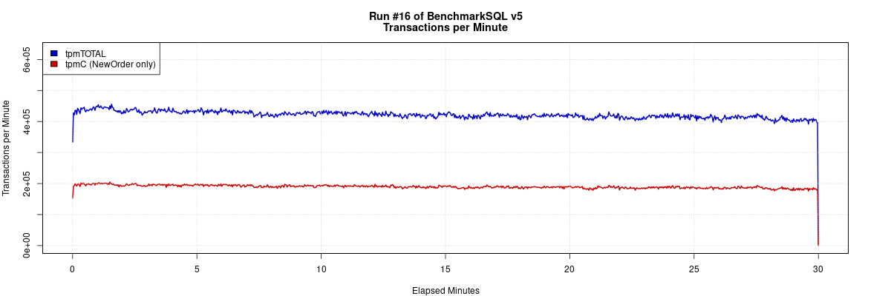
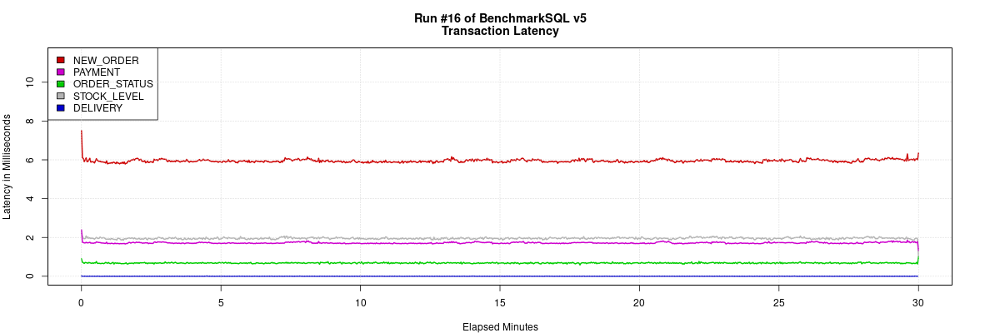

# BenchmarkSQL Performance Benchmark

BenchmarkSQL is an open source Java application used to evaluate the performance of database systems in OLTP scenarios. It is a TPC-C benchmark stress testing compliant tool. It was originally developed by the author of HammerDB and later maintained by Cloud V LLC.

The TPC-C model simulates the sales model of a commodity wholesale company. This model covers the process of a wholesale company selling a series of commodities to customers, including operations such as managing orders, managing inventory, and managing account income and expenses. These operations involve concepts such as warehouses, commodities, customers, and orders. Around these concepts, data tables and corresponding database operations are constructed.

BenchmarkSQL supports MySQL (Percona, GreatSQL), PostgreSQL, Oracle, SQL Server, etc.

## Main Features
- **Standardized testing**: based on the standard benchmarks of TPC-C and TPC-E, providing a fair testing solution.
- **Scalability**: supports multi-client concurrent testing, and the test scale can be adjusted as needed.
- **Detailed reports**: generates detailed performance reports after the test is completed, including transaction throughput, latency, resource usage, etc.
- **Cross-platform**: since it is based on Java, BenchmarkSQL can run on multiple operating systems.

## How to Use BenchmarkSQL to Test GreatSQL

Taking the CentOS 8.x x86_64 environment as an example, the following introduces how to install, configure, and use BenchmarkSQL.

### 1. Preparing the Environment
- **Download BenchmarkSQL**: [download the latest official version of BenchmarkSQL here](https://sourceforge.net/projects/benchmarksql/files/).

Here is a detour: you can choose to download the [BenchmarkSQL branch version modified by the GreatSQL community](https://gitee.com/GreatSQL/benchmarksql), which has several advantages:

- No need to do the modifications mentioned below again;
- Added support for MySQL/GreatSQL databases;
- Added the MySQL connection driver mysql-connector-j-8.0.33.jar;
- Fixed the issue where a dead loop could occur after the test ends in RR mode due to imprecise logic (the logic judgment error caused by reading already-deleted data);
- Modified the AFTER_LOAD action in runDatabaseBuild.sh, so there is no need to create indexes, foreign keys, etc.

You can use the git client to download the code to the local machine:

```bash
$ cd /usr/local
$ git clone https://gitee.com/GreatSQL/benchmarksql.git
$ cd benchmarksql
```
After that, you can skip the modifications to several java files in the src directory and the `tableCreates.sql` SQL script mentioned below, and start directly from modifying the `props.mysql` configuration file.

Back to the native BenchmarkSQL path: after downloading the BenchmarkSQL compressed package, decompress it and place it in the /usr/local directory

```bash
$ cd /usr/local
$ curl -OL -o benchmarksql-5.0.zip "https://jaist.dl.sourceforge.net/project/benchmarksql/benchmarksql-5.0.zip?viasf=1"
$ unzip benchmarksql-5.0.zip
$ cd benchmarksql-5.0
$ ls
build.xml  doc  HOW-TO-RUN.txt  lib  README.md  run  src
```

- **Install Java**: BenchmarkSQL requires a Java runtime environment. Ensure that JDK 8 or higher is installed on the system.

In addition, Apache Ant also needs to be installed. It is a tool that automates steps such as software compilation, testing, and deployment, linking them together. It is used to compile BenchmarkSQL.

```bash
yum install -y java-1.8.0-openjdk ant
```

Configure the environment variables of Apache-Ant:

```bash
echo 'export APACH_HOME=/usr/share/doc/ant-1.9.4' >> ~/.bash_profile
echo 'export PATH=${ANT_HOME}/bin:$PATH' >> ~/.bash_profile
source ~/.bash_profile
```

Check whether the Java runtime environment is available:

```bash
$ java -version
openjdk version "1.8.0_312"
OpenJDK Runtime Environment (build 1.8.0_312-b07)
OpenJDK 64-Bit Server VM (build 25.312-b07, mixed mode)

$ ant -version
Apache Ant(TM) version 1.10.5 compiled on June 24 2019
```

### 2. Configuring BenchmarkSQL

1. Modify the `src/client/jTPCC.java` file around line 119 to add MySQL/GreatSQL database related content.

```java
117         if (iDB.equals("firebird"))
118             dbType = DB_FIREBIRD;
119         else if (iDB.equals("mysql"))
120             dbType = DB_MYSQL;
121         else if (iDB.equals("oracle"))
122             dbType = DB_ORACLE;
123         else if (iDB.equals("postgres"))
124             dbType = DB_POSTGRES;
```

Modify the `src/client/jTPCCConfig.java` file around line 17 to add the MySQL/GreatSQL database type.

```java
 16     public final static int     DB_UNKNOWN = 0,
 17                                 DB_FIREBIRD = 1,
 18                                 DB_MYSQL = 4,
 19                                 DB_ORACLE = 2,
 20                                 DB_POSTGRES = 3;
```

2. Modify the `src/client/jTPCCConnection.java` file around line 225 to add the `AS L` alias in the SQL subquery.

```java
211             default:
212                 stmtStockLevelSelectLow = dbConn.prepareStatement(
213                     "SELECT count(*) AS low_stock FROM (" +
214                     "    SELECT s_w_id, s_i_id, s_quantity " +
215                     "        FROM bmsql_stock " +
216                     "        WHERE s_w_id = ? AND s_quantity < ? AND s_i_id IN (" +
217                     "            SELECT ol_i_id " +
218                     "                FROM bmsql_district " +
219                     "                JOIN bmsql_order_line ON ol_w_id = d_w_id " +
220                     "                 AND ol_d_id = d_id " +
221                     "                 AND ol_o_id >= d_next_o_id - 20 " +
222                     "                 AND ol_o_id < d_next_o_id " +
223                     "                WHERE d_w_id = ? AND d_id = ? " +
224                     "        ) " +
225                     "    ) AS L");
226                 break;
```

3. Edit a table DDL file suitable for MySQL/GreatSQL.

```bash
cd /usr/local/benchmarksql-5.0/run
cp -rf sql.common/ sql.mysql
```

Edit the `sql.mysql/tableCreates.sql` file, adding the declaration of using the InnoDB engine for each table, and each table must have an explicit primary key definition. In addition, an extra index needs to be added to the `bmsql_oorder` table. According to the analysis of the slow query log generated during the test, adding this index can effectively improve test performance.

```sql
create table bmsql_config (
  cfg_name    varchar(30) primary key,
  cfg_value   varchar(50)
) engine = innodb;

create table bmsql_warehouse (
  w_id        integer   not null,
  w_ytd       decimal(12,2),
  w_tax       decimal(4,4),
  w_name      varchar(10),
  w_street_1  varchar(20),
  w_street_2  varchar(20),
  w_city      varchar(20),
  w_state     char(2),
  w_zip       char(9),
  primary key (w_id)
) engine = innodb;

create table bmsql_district (
  d_w_id       integer       not null,
  d_id         integer       not null,
  d_ytd        decimal(12,2),
  d_tax        decimal(4,4),
  d_next_o_id  integer,
  d_name       varchar(10),
  d_street_1   varchar(20),
  d_street_2   varchar(20),
  d_city       varchar(20),
  d_state      char(2),
  d_zip        char(9),
  primary key (d_w_id, d_id)
) engine = innodb;

create table bmsql_customer (
  c_w_id         integer        not null,
  c_d_id         integer        not null,
  c_id           integer        not null,
  c_discount     decimal(4,4),
  c_credit       char(2),
  c_last         varchar(16),
  c_first        varchar(16),
  c_credit_lim   decimal(12,2),
  c_balance      decimal(12,2),
  c_ytd_payment  decimal(12,2),
  c_payment_cnt  integer,
  c_delivery_cnt integer,
  c_street_1     varchar(20),
  c_street_2     varchar(20),
  c_city         varchar(20),
  c_state        char(2),
  c_zip          char(9),
  c_phone        char(16),
  c_since        timestamp,
  c_middle       char(2),
  c_data         varchar(500),
  primary key (c_w_id, c_d_id, c_id)
) engine = innodb;

create table bmsql_history (
  hist_id  integer AUTO_INCREMENT,
  h_c_id   integer,
  h_c_d_id integer,
  h_c_w_id integer,
  h_d_id   integer,
  h_w_id   integer,
  h_date   timestamp,
  h_amount decimal(6,2),
  h_data   varchar(24),
  primary key (hist_id,h_w_id)
) engine = innodb;

create table bmsql_new_order (
  no_w_id  integer   not null,
  no_d_id  integer   not null,
  no_o_id  integer   not null,
  primary key (no_w_id, no_d_id, no_o_id)
) engine = innodb;

create table bmsql_oorder (
  o_w_id       integer      not null,
  o_d_id       integer      not null,
  o_id         integer      not null,
  o_c_id       integer,
  o_carrier_id integer,
  o_ol_cnt     integer,
  o_all_local  integer,
  o_entry_d    timestamp,
  primary key (o_w_id, o_d_id, o_id),
  k1 (o_c_id)
) engine = innodb;

create table bmsql_order_line (
  ol_w_id         integer   not null,
  ol_d_id         integer   not null,
  ol_o_id         integer   not null,
  ol_number       integer   not null,
  ol_i_id         integer   not null,
  ol_delivery_d   timestamp,
  ol_amount       decimal(6,2),
  ol_supply_w_id  integer,
  ol_quantity     integer,
  ol_dist_info    char(24),
  primary key (ol_w_id, ol_d_id, ol_o_id, ol_number)
) engine = innodb;

create table bmsql_item (
  i_id     integer      not null,
  i_name   varchar(24),
  i_price  decimal(5,2),
  i_data   varchar(50),
  i_im_id  integer,
  primary key (i_id)
) engine = innodb;

create table bmsql_stock (
  s_w_id       integer       not null,
  s_i_id       integer       not null,
  s_quantity   integer,
  s_ytd        integer,
  s_order_cnt  integer,
  s_remote_cnt integer,
  s_data       varchar(50),
  s_dist_01    char(24),
  s_dist_02    char(24),
  s_dist_03    char(24),
  s_dist_04    char(24),
  s_dist_05    char(24),
  s_dist_06    char(24),
  s_dist_07    char(24),
  s_dist_08    char(24),
  s_dist_09    char(24),
  s_dist_10    char(24),
  primary key (s_w_id, s_i_id)
) engine = innodb;
```

4. Modify the `run/runDatabaseBuild.sh` file around line 17 to define the follow-up work when data loading ends.

```bash
 17 #AFTER_LOAD="indexCreates foreignKeys extraHistID buildFinish"
 18 AFTER_LOAD="indexCreates buildFinish"
```

5. Modify the `run/funcs.sh` file around lines 31 and 54 to add the MySQL/GreatSQL database type.

```bash
 28         firebird)
 29             cp="../lib/firebird/*:../lib/*"
 30             ;;
 31         mysql)
 32             cp="../lib/mysql/*:../lib/*"
 33             ;;
 34         oracle)
...
 53 case "$(getProp db)" in
 54     firebird|mysql|oracle|postgres)
 55         ;;
```

Visit the [MySQL official website download page](https://downloads.mysql.com/archives/c-j/) and download the MySQL driver jar package:

```bash
$ cd /usr/local/benchmarksql-5.0/lib
$ mkdir -p mysql
$ cd mysql
$ curl -OL -o mysql-connector-j-8.0.33.tar.gz https://downloads.mysql.com/archives/get/p/3/file/mysql-connector-j-8.0.33.tar.gz
$ tar xf mysql-connector-j-8.0.33.tar.gz mysql-connector-j-8.0.33/mysql-connector-j-8.0.33.jar
$ mv mysql-connector-j-8.0.33/mysql-connector-j-8.0.33.jar .
$ pwd
/usr/local/benchmarksql-5.0/lib/mysql

$ ls -l
-rw-r--r-- 1 root root 2481560 Mar  8  2023 mysql-connector-j-8.0.33.jar
```

If an older version of the driver is still used (for example *mysql-connector-java-8.0.30.jar*), a prompt similar to the following may appear:

```log
Loading class `com.mysql.jdbc.Driver'. This is deprecated. The new driver class is `com.mysql.cj.jdbc.Driver'. The driver is automatically registered via the SPI and manual loading of the driver class is generally unnecessary.
```

6. Recompile the modified source code.

```bash
$ cd /usr/local/benchmarksql-5.0
$ ant
Buildfile: /usr/local/benchmarksql-5.0/build.xml

init:

compile:
    [javac] Compiling 11 source files to /usr/local/benchmarksql-5.0/build

dist:
      [jar] Building jar: /usr/local/benchmarksql-5.0/dist/BenchmarkSQL-5.0.jar

BUILD SUCCESSFUL
Total time: 0 seconds
```

7. Edit the configuration file `run/props.greatsql` to configure the connection information of the GreatSQL database, such as database address, port, username, and password.

Referring to the content below, edit the `/usr/local/benchmarksql-5.0/run/props.greatsql` file:
```ini
db=mysql
driver=com.mysql.jdbc.Driver
conn=jdbc:mysql://localhost:3306/bmsql
user=bmsql
password=bmsql

warehouses=1000
loadWorkers=32

terminals=32
runTxnsPerTerminal=0
runMins=10
limitTxnsPerMin=0

terminalWarehouseFixed=true

newOrderWeight=45
paymentWeight=43
orderStatusWeight=4
deliveryWeight=4
stockLevelWeight=4

resultDirectory=my_result_%tY-%tm-%td_%tH%tM%tS
osCollectorScript=./misc/os_collector_linux.py
osCollectorInterval=1
```

Main parameter description
- `db=mysql`, specifies the database type.
- `driver=com.mysql.jdbc.Driver`, specifies the driver file. Here it is the MySQL JDBC driver.
- `conn`, `user`, `password`, specify the GreatSQL database connection IP, port, account name, password, default database, etc.
- `warehouses`, specifies the number of warehouses. The number of warehouses determines the performance test score. For high-configuration servers (32C96G and above), it is recommended to use at least 1000 warehouses or higher.
- `loadWorkers`, specifies the concurrency when loading data. For high-configuration servers, this value can be set larger, for example 100. Generally, it is the same as the logical CPU core count of the server. Excessive concurrency may cause memory to be consumed too quickly, resulting in errors, and the data loading may need to be redone.
- `terminals`, specifies the concurrency during the performance stress test. It is recommended that the concurrency not be higher than the logical CPU core count of the server. Otherwise, too many lock waits may occur.
- `runTxnsPerTerminal`, specifies the number of transactions executed by each terminal. If this parameter is configured as non-zero, the `runMins` parameter must be set to 0.
- `runMins`, specifies the duration of the performance test (minutes). If this value is set to non-zero, the runTxnsPerTerminal parameter must be set to 0. The longer the time, the more the database performance and stability are tested. It is recommended not to be less than 10 minutes, and for production environment machines, not less than 1 hour.
- `limitTxnsPerMin`, the total transaction limit per minute. This parameter mainly controls the number of transactions processed per minute. The transaction count is affected by the `terminals` parameter, and the result of `limitTxnsPerMin/terminals` must be a positive integer.
- `terminalWarehouseFixed`, the binding mode of terminals and warehouses. When set to **true**, the 4.x compatible mode can be run, meaning each terminal has a fixed warehouse. When set to **false**, the overall database configuration can be used evenly. The TPC-C rules require that each terminal must have a bound warehouse, so the default value **true** is generally used.
- The sum of the following five values must equal 100. The default values are: 45, 43, 4, 4, 4, consistent with the proportions defined in the TPC-C test. In actual operation, the proportions can be adjusted to suit various scenarios.
  - `newOrderWeight=45`, new order transactions account for 45% of total transactions.
  - `paymentWeight=43`, payment order transactions account for 43% of total transactions.
  - `orderStatusWeight=4`, order status transactions account for 4% of total transactions.
  - `deliveryWeight=4`, delivery date transactions account for 4% of total transactions.
  - `stockLevelWeight=4`, stock level check transactions account for 4% of total transactions.
- `resultDirectory`, the directory for collecting system performance data during the stress test.
- `osCollectorScript`, the operating system performance collection script.
- `osCollectorInterval`, the operating system collection interval (unit: seconds), default is 1 second.
- `osCollectorSSHAddr`, the host whose system performance needs to be collected.
- `osCollectorDevices`, the network card names and disk names of the collected server in the operating system.

### 3. Running the BenchmarkSQL Test

- **Initialize the database**

Create the test database, the corresponding account, and grants:

```sql
greatsql> CREATE DATABASE bmsql;
greatsql> CREATE USER bmsql IDENTIFIED BY 'bmsql';
greatsql> GRANT ALL ON bmsql.* TO bmsql;
greatsql> SHOW GRANTS FOR bmsql;
+--------------------------------------------------+
| Grants for bmsql@%                               |
+--------------------------------------------------+
| GRANT USAGE ON *.* TO `bmsql`@`%`                |
| GRANT ALL PRIVILEGES ON `bmsql`.* TO `bmsql`@`%` |
+--------------------------------------------------+
```

Run `run/runDatabaseBuild.sh` to create the test data tables and fill in the data.

```bash
$ cd /usr/local/benchmarksql-5.0/run
$ ./runDatabaseBuild.sh ./props.greatsql

# ------------------------------------------------------------
# Loading SQL file ./sql.mysql/tableCreates.sql
# ------------------------------------------------------------
Loading class `com.mysql.jdbc.Driver'. This is deprecated. The new driver class is `com.mysql.cj.jdbc.Driver'. The driver is automatically registered via the SPI and manual loading of the driver class is generally unnecessary.
create table bmsql_config (
cfg_name    varchar(30) primary key,
cfg_value   varchar(50)
);
...
Starting BenchmarkSQL LoadData

driver=com.mysql.jdbc.Driver
Loading class `com.mysql.jdbc.Driver'. This is deprecated. The new driver class is `com.mysql.cj.jdbc.Driver'. The driver is automatically registered via the SPI and manual loading of the driver class is generally unnecessary.
conn=jdbc:mysql://localhost:3306/bmsql
user=bmsql
password=***********
warehouses=5
loadWorkers=2
fileLocation (not defined)
csvNullValue (not defined - using default 'NULL')

Worker 000: Loading ITEM
Worker 001: Loading Warehouse      1
Worker 000: Loading ITEM done
...
# ------------------------------------------------------------
# Loading SQL file ./sql.mysql/indexCreates.sql
# ------------------------------------------------------------
...
# ------------------------------------------------------------
# Loading SQL file ./sql.mysql/buildFinish.sql
# ------------------------------------------------------------
Loading class `com.mysql.jdbc.Driver'. This is deprecated. The new driver class is `com.mysql.cj.jdbc.Driver'. The driver is automatically registered via the SPI and manual loading of the driver class is generally unnecessary.
-- ----
-- Extra commands to run after the tables are created, loaded,
-- indexes built and extra's created.
-- ----
```

The test data loading is complete.

::: tip Tip
If the installed Java runtime version (JRE) is too old, error information similar to the following may appear

```log
# ------------------------------------------------------------
# Loading SQL file ./sql.mysql/tableCreates.sql
# ------------------------------------------------------------
Error: A JNI error has occurred, please check your installation and try again
Exception in thread "main" java.lang.UnsupportedClassVersionError: ExecJDBC has been compiled by a more recent version of the Java Runtime (class file version 61.0), this version of the Java Runtime only recognizes class file versions up to 52.0
    at java.lang.ClassLoader.defineClass1(Native Method)
    at java.lang.ClassLoader.defineClass(ClassLoader.java:756)
    at java.security.SecureClassLoader.defineClass(SecureClassLoader.java:142)
    at java.net.URLClassLoader.defineClass(URLClassLoader.java:473)
    at java.net.URLClassLoader.access$100(URLClassLoader.java:74)
    at java.net.URLClassLoader$1.run(URLClassLoader.java:369)
    at java.net.URLClassLoader$1.run(URLClassLoader.java:363)
    at java.security.AccessController.doPrivileged(Native Method)
    at java.net.URLClassLoader.findClass(URLClassLoader.java:362)
    at java.lang.ClassLoader.loadClass(ClassLoader.java:418)
    at sun.misc.Launcher$AppClassLoader.loadClass(Launcher.java:352)
    at java.lang.ClassLoader.loadClass(ClassLoader.java:351)
    at sun.launcher.LauncherHelper.checkAndLoadMain(LauncherHelper.java:621)
```

In this case, upgrading the Java version is sufficient. Refer to the following operations:

```bash
# First uninstall the old version
$ yum remove -y java-1.8.0-openjdk

# Search for other new versions
$ yum search java*openjdk
java-1.8.0-openjdk.x86_64 : OpenJDK 8 Runtime Environment
java-11-openjdk.x86_64 : OpenJDK 11 Runtime Environment
java-17-openjdk.x86_64 : OpenJDK 17 Runtime Environment

# Install the new version
$ yum install -y java-17-openjdk.x86_64
```

Compile the java code again:

```bash
$ cd /usr/local/benchmarksql-5.0
$ ant
```

This should work.
:::

2. Run the test

Run `bin/runBenchmark.sh` to start the stress test.

::: tip Tip
1. When running the BenchmarkSQL stress test, the OSCollector component requires Python 2.x, so Python 2.x also needs to be installed first (execute `yum install -y python2`).

2. If the set terminals parameter value is large, i.e., when the stress test concurrency is large, row lock wait timeouts may be more likely to occur. At this time, the `innodb_lock_wait_timeout` parameter value in GreatSQL can be appropriately increased (for example `SET GLOBAL innodb_lock_wait_timeout = 60`).
:::

```bash
$ cd /usr/local/benchmarksql-5.0/run
$ ./runBenchmark.sh ./props.greatsql

[main] INFO   jTPCC : Term-00,
[main] INFO   jTPCC : Term-00, +-------------------------------------------------------------+
[main] INFO   jTPCC : Term-00,      BenchmarkSQL v5.0
[main] INFO   jTPCC : Term-00, +-------------------------------------------------------------+
[main] INFO   jTPCC : Term-00,  (c) 2003, Raul Barbosa
[main] INFO   jTPCC : Term-00,  (c) 2004-2016, Denis Lussier
[main] INFO   jTPCC : Term-00,  (c) 2016, Jan Wieck
[main] INFO   jTPCC : Term-00, +-------------------------------------------------------------+
[main] INFO   jTPCC : Term-00,
[main] INFO   jTPCC : Term-00, db=mysql
[main] INFO   jTPCC : Term-00, driver=com.mysql.jdbc.Driver
[main] INFO   jTPCC : Term-00, conn=jdbc:mysql://localhost:3306/bmsql
[main] INFO   jTPCC : Term-00, user=bmsql
...
[main] INFO   jTPCC : Term-00, copied ./props.greatsql to my_result_2024-08-16_095115/run.properties
[main] INFO   jTPCC : Term-00, created my_result_2024-08-16_095115/data/runInfo.csv for runID 9
[main] INFO   jTPCC : Term-00, writing per transaction results to my_result_2024-08-16_095115/data/result.csv
[main] INFO   jTPCC : Term-00, osCollectorScript=./misc/os_collector_linux.py
...
Term-00, Running Average tpmTOTAL: 421384.59    Current tpmTOTAL: 83449452    Memory Usage: 1814MB / 3135MB
[Thread-15] INFO   jTPCC : Term-00,
[Thread-15] INFO   jTPCC : Term-00,
[Thread-15] INFO   jTPCC : Term-00, Measured tpmTOTAL = 189675.86
[Thread-15] INFO   jTPCC : Term-00, Measured tpmTOTAL = 421368.54
[Thread-15] INFO   jTPCC : Term-00, Session Start     = 2024-08-16 10:40:10
[Thread-15] INFO   jTPCC : Term-00, Session End       = 2024-08-16 11:10:10
[Thread-15] INFO   jTPCC : Term-00, Transaction Count = 12641575
```

In the above test results
- `Measured tpmTOTAL`, indicates the number of transactions executed per minute (only NewOrders transactions are counted).
- `Measured tpmTOTAL`, indicates the average number of transactions executed per minute (all transactions).
- `Transaction Count`, indicates the total number of transactions.

The final performance test result is based on the `Measured tpmTOTAL` metric, i.e., the commonly called **tpmC** (average transactions per minute).

3. Clean up the database

After the test is completed, run `bin/unDatabaseDestroy.sh` to clean up the test database.

```bash
$ cd /usr/local/benchmarksql-5.0/run
$ ./runDatabaseDestroy.sh ./props.greatsql

# ------------------------------------------------------------
# Loading SQL file ./sql.mysql/tableDrops.sql
# ------------------------------------------------------------
Loading class `com.mysql.jdbc.Driver'. This is deprecated. The new driver class is `com.mysql.cj.jdbc.Driver'. The driver is automatically registered via the SPI and manual loading of the driver class is generally unnecessary.
drop table bmsql_config;
drop table bmsql_new_order;
drop table bmsql_order_line;
drop table bmsql_oorder;
drop table bmsql_history;
drop table bmsql_customer;
drop table bmsql_stock;
drop table bmsql_item;
drop table bmsql_district;
drop table bmsql_warehouse;
drop sequence bmsql_hist_id_seq;
```

### 4. Viewing the Results

After the test is completed, test result files are generated, including transaction throughput, latency, CPU and memory usage, and other information.

```bash
$ cd /usr/local/benchmarksql-5.0/run
$ ls -ltr | grep my_result
drwxr-xr-x 3 root root   40 Aug 16 09:51 my_result_2024-08-16_095115
$ cd my_result_2024-08-16_095115
$ ls -l
drwxr-xr-x. 2 root root  103 Aug 16 10:10 data
-rw-r--r--. 1 root root 1002 Aug 16 10:10 run.properties

$ ls -l data/
-rw-r--r--. 1 root root    15910 Aug 16 10:15 blk_md127.csv
-rw-r--r--. 1 root root    15268 Aug 16 10:15 net_em1.csv
-rw-r--r--. 1 root root 35529136 Aug 16 10:15 result.csv
-rw-r--r--. 1 root root      218 Aug 16 10:10 runInfo.csv
-rw-r--r--. 1 root root    34612 Aug 16 10:15 sys_info.csv
```

The `run/generateReport.sh` script can be used to generate graphical test reports.

Before that, the R language runtime environment needs to be installed first.

```bash
yum install -y epel-release
yum makecache 
yum install -y R
```

Generate the test report:

```bash
$ cd /usr/local/benchmarksql-5.0/run
$ ./generateReport.sh ./my_result_2024-08-16_104010

Generating my_result_2024-08-16_104010/tpm_nopm.png ...  OK
Generating my_result_2024-08-16_104010/latency.png ... OK
Generating my_result_2024-08-16_104010/cpu_utilization.png ... OK
Generating my_result_2024-08-16_104010/dirty_buffers.png ... OK
Generating my_result_2024-08-16_104010/blk_md127_iops.png ... OK
Generating my_result_2024-08-16_104010/blk_md127_kbps.png ... OK
Generating my_result_2024-08-16_104010/net_em1_iops.png ... OK
Generating my_result_2024-08-16_104010/net_em1_kbps.png ... OK
Generating my_result_2024-08-16_104010/report.html ... OK

$ ls my_result_2024-08-16_104010/

blk_md127_iops.png  cpu_utilization.png  dirty_buffers.png  net_em1_iops.png  report.html     tpm_nopm.png
blk_md127_kbps.png  data                 latency.png        net_em1_kbps.png  run.properties
```

After that, the test report can be opened in the browser, like this:





## Summary

BenchmarkSQL is a powerful and flexible tool for evaluating the performance of database systems in OLTP scenarios. Through correct configuration and optimization, you can obtain a detailed performance report of the database under a specific workload, which is very helpful for performance tuning and capacity planning.


**Scan the QR code to follow our WeChat Official Account**


