# GreatSQL vs MySQL TPC-C Performance Benchmark
---

**GreatSQL vs MySQL TPC-C Performance Benchmark Report**

**(August 28, 2024)**

**GreatSQL Community**

## 【Document Statement】

The GreatSQL Community reminds you to carefully read and fully understand the terms of this legal statement before reading or using this document. If you read or use this document, your reading or use behavior will be deemed as acceptance of all the content of this statement. You should download and obtain this document through the GreatSQL Community website or other authorized channels provided by the GreatSQL Community, and use it only for your own lawful and compliant business activities. The content of this document is regarded as confidential information of the GreatSQL Community, and you should strictly comply with the confidentiality obligation; without the prior written consent of the GreatSQL Community, you may not disclose the content of this manual to any third party or provide it to any third party for use.

Without the prior written permission of the GreatSQL Community, no unit, company or individual may excerpt, translate, copy the content of this document in part or in whole, or replace and publicize it in any way or manner.

Due to product version upgrades, adjustments or other reasons, the content of this document may change. The GreatSQL Community reserves the right to modify the content of this document without any notice or prompt, and will periodically release updated user documents through the authorized channels of the GreatSQL Community. You should pay close attention to the version changes of the user documents and download and obtain the latest user documents through the authorized channels of the GreatSQL Community.

This document is only a reference guide for users using GreatSQL Community products and services. The GreatSQL Community makes its best efforts to provide corresponding introductions and operation guides based on existing technology, but the GreatSQL Community hereby expressly declares that it makes no express or implied warranties as to the accuracy, completeness, applicability, reliability, etc. of the content of this document. Any unit, company or individual shall not hold the GreatSQL Community legally liable for any errors or economic losses incurred as a result of downloading, using or relying on this document. In no event shall the GreatSQL Community be liable for any indirect, consequential, punitive, incidental, special or penal damages, including loss of profits suffered by users as a result of using or relying on this document (even if the GreatSQL Community has been advised of the possibility of such damages).

All content in the GreatSQL Community documentation, including but not limited to images, architecture designs, page layouts, and text descriptions, is owned by the GreatSQL Community and/or its affiliates with respect to its intellectual property rights, including but not limited to trademark rights, patent rights, copyrights, and trade secrets. Without the written consent of the GreatSQL Community and/or its affiliates, no one may use, modify, copy, publicly replace, alter, distribute, issue or publicly publish the GreatSQL Community website, product programs or content. In addition, without the prior written consent of the GreatSQL Community, no one may use, publish or copy the name of the GreatSQL Community (including but not limited to the "GreatSQL Community", "GreatSQL" and other brands of the GreatSQL Community and/or its affiliates, the affiliated marks and designs of the above brands or any similar company names, trade names, trademarks, product or service names, domain names, pattern designs, marks, logos or descriptions that enable third parties to identify the GreatSQL Community and/or its affiliates) for any marketing, advertising, promotional or other purposes.

If any error is found in this document, please contact the GreatSQL Community directly.

GreatSQL Community official website: [https://greatsql.cn](https://greatsql.cn).

## Overview

This test is a test of the GreatSQL database based on the standard TPC-C scenario of [BenchmarkSQL](./3-4-benchmarksql.md).

BenchmarkSQL is an open source Java application used to evaluate the performance of database systems in OLTP scenarios. It is a tool compliant with the TPC-C benchmark stress test. It was originally developed by the author of HammerDB, and is now maintained by Cloud V LLC.

The TPC-C model simulates the sales model of a commodity wholesale company. This model covers the process of a wholesale company selling a series of commodities to customers, including operations such as managing orders, managing inventory, and managing account income and expenses. These operations involve concepts such as warehouses, commodities, customers, and orders. Around these concepts, data tables and corresponding database operations are constructed.

BenchmarkSQL supports MySQL (Percona, GreatSQL), PostgreSQL, Oracle, SQL Server, etc.

The GreatSQL database is an **open source and free** database that can meet financial-grade application scenarios on commodity hardware. It features **High Availability**, **High Performance**, **High Compatibility**, and **High Security**, and can serve as an ideal drop-in replacement for MySQL or Percona.

## Test Environment

| Configuration | Remarks |
|   ---    | --- |
| Operating System | OS: CentOS Linux release 7.9.2009 (Core)<br/>Kernel: 3.10.0-1160.el7.x86_64 |
| CPU      | Intel(R) Xeon(R) Gold 6238 CPU @ 2.10GHz * 4                              |
| Memory     | 377G                                                                      |
| Disk     | Dell Express Flash CD5 3.84T SFF * 2                                      |
| Database   | GreatSQL 8.0.32-26 GreatSQL, Release 26, Revision a68b3034c3d<br/>MySQL 8.0.32 MySQL Community Server        |
| Test Tool | BenchmarkSQL 5.0 |
| Test Data Volume | warehouses = 2000 (the physical size after test database initialization is about 182 GB)|

**Server Detailed Information**

- 1. Operating System

```bash
$ cat /etc/os-release

NAME="CentOS Linux"
VERSION="7 (Core)"
ID="centos"
ID_LIKE="rhel fedora"
VERSION_ID="7"
PRETTY_NAME="CentOS Linux 7 (Core)"
ANSI_COLOR="0;31"
CPE_NAME="cpe:/o:centos:centos:7"
HOME_URL="https://www.centos.org/"
BUG_REPORT_URL="https://bugs.centos.org/"

CENTOS_MANTISBT_PROJECT="CentOS-7"
CENTOS_MANTISBT_PROJECT_VERSION="7"
REDHAT_SUPPORT_PRODUCT="centos"
REDHAT_SUPPORT_PRODUCT_VERSION="7"
```

- 2. CPU

```bash
$ lscpu

Architecture:          x86_64
CPU op-mode(s):        32-bit, 64-bit
Byte Order:            Little Endian
CPU(s):                176
On-line CPU(s) list:   0-175
Thread(s) per core:    2
Core(s) per socket:    22
Socket(s):             4
NUMA node(s):          1
Vendor ID:             GenuineIntel
CPU family:            6
Model:                 85
Model name:            Intel(R) Xeon(R) Gold 6238 CPU @ 2.10GHz
Stepping:              7
CPU MHz:               2799.957
CPU max MHz:           3700.0000
CPU min MHz:           1000.0000
BogoMIPS:              4200.00
Virtualization:        VT-x
L1d cache:             32K
L1i cache:             32K
L2 cache:              1024K
L3 cache:              30976K
NUMA node0 CPU(s):     0-175
Flags:                 fpu vme de pse tsc msr pae mce cx8 apic sep mtrr pge mca cmov pat pse36 clflush dts acpi mmx fxsr sse sse2 ss ht tm pbe syscall nx pdpe1gb rdtscp lm constant_tsc art arch_perfmon pebs bts rep_good nopl xtopology nonstop_tsc aperfmperf eagerfpu pni pclmulqdq dtes64 monitor ds_cpl vmx smx est tm2 ssse3 sdbg fma cx16 xtpr pdcm pcid dca sse4_1 sse4_2 x2apic movbe popcnt tsc_deadline_timer aes xsave avx f16c rdrand lahf_lm abm 3dnowprefetch epb cat_l3 cdp_l3 invpcid_single intel_ppin intel_pt ssbd mba ibrs ibpb stibp ibrs_enhanced tpr_shadow vnmi flexpriority ept vpid fsgsbase tsc_adjust bmi1 hle avx2 smep bmi2 erms invpcid rtm cqm mpx rdt_a avx512f avx512dq rdseed adx smap clflushopt clwb avx512cd avx512bw avx512vl xsaveopt xsavec xgetbv1 cqm_llc cqm_occup_llc cqm_mbm_total cqm_mbm_local dtherm ida arat pln pts pku ospke avx512_vnni md_clear spec_ctrl intel_stibp flush_l1d arch_capabilities
```

- 3. Memory

```bash
$ free -ht
              total        used        free      shared  buff/cache   available
Mem:           377G        159G        3.4G         67M        214G        215G
Swap:          4.0G        230M        3.8G
Total:         381G        159G        7.1G
```

- 4. Disk

Disk device model

```bash
$ nvme list

Node             SN                   Model                                    Namespace Usage                      Format           FW Rev
---------------- -------------------- ---------------------------------------- --------- -------------------------- ---------------- --------
/dev/nvme0n1     70L0A03YTAHR         Dell Express Flash CD5 3.84T SFF         1           3.24  TB /   3.84  TB    512   B +  0 B   1.1.1
/dev/nvme1n1     11D0A0C3TAHR         Dell Express Flash CD5 3.84T SFF         1           3.24  TB /   3.84  TB    512   B +  0 B   1.2.0
```

Disk mount parameters, file system, ioscheduler

```bash
$ df -hT | grep /ssd1
/dev/md127              xfs       7.0T  2.5T  4.6T  35% /ssd1

$ mount | grep ssd1
/dev/md127 on /ssd1 type xfs (rw,noatime,nodiratime,seclabel,attr2,inode64,sunit=1024,swidth=2048,noquota)

$ cat /sys/block/md127/queue/scheduler
none
```

Simple speed test of the NVMe SSD device

```bash
$ dd oflag=direct if=/dev/zero of=./zero bs=1M count=20480

20480+0 records in
20480+0 records out
21474836480 bytes (21 GB) copied, 12.0639 s, 1.8 GB/s
```

- 5. The server has NUMA disabled

```bash
$ cat /etc/default/grub

GRUB_TIMEOUT=5
GRUB_DISTRIBUTOR="$(sed 's, release .*$,,g' /etc/system-release)"
GRUB_DEFAULT=saved
GRUB_DISABLE_SUBMENU=true
GRUB_TERMINAL_OUTPUT="console"
GRUB_CMDLINE_LINUX="crashkernel=auto spectre_v2=retpoline rd.lvm.lv=centos/root rd.lvm.lv=centos/swap rhgb quiet numa=off"
GRUB_DISABLE_RECOVERY="true"

$ dmesg | grep -i numa
[    0.000000] Command line: BOOT_IMAGE=/vmlinuz-3.10.0-1160.el7.x86_64 root=/dev/mapper/centos-root ro crashkernel=auto spectre_v2=retpoline rd.lvm.lv=centos/root rd.lvm.lv=centos/swap rhgb quiet LANG=en_US.UTF-8 numa=off
[    0.000000] NUMA turned off
```

## Test Results

From the results of this test, the following conclusions can be drawn:

1. Whether or not innodb_buffer_pool_size (hereinafter referred to as IBP) is sufficient, the TPC-C test performance of GreatSQL 8.0.32-26 is higher than that of MySQL 8.0.32.
2. **In the test with 32 concurrent clients, the TPC-C test performance of GreatSQL 8.0.32-26 is 30%+ higher than that of MySQL 8.0.32**.
3. **In the test with 64 concurrent clients, the TPC-C test performance of GreatSQL 8.0.32-26 is about 20% higher than that of MySQL 8.0.32**.
4. GreatSQL 8.0.32-26 performs better and is more stable than MySQL 8.0.32 in the TPC-C test (stable performance and small jitter during the test).
5. The performance data comparison between GreatSQL 8.0.32-26 and MySQL 8.0.32 in the TPC-C test is shown in the following table
  - Comparison of GreatSQL 8.0.32-26 vs MySQL 8.0.32 BenchmarkSQL TPC-C test results with 32 concurrent clients

  | tpmC | IBP = 128G | IBP = 256G |
  | :--- | ---: | ---: |
  | GreatSQL 8.0.32-26 | 456518.08 | 451563.90 |
  | MySQL 8.0.32 | 346493.57 | 337568.95 |
  | GreatSQL performance improvement | 31.75% | 33.77% |

  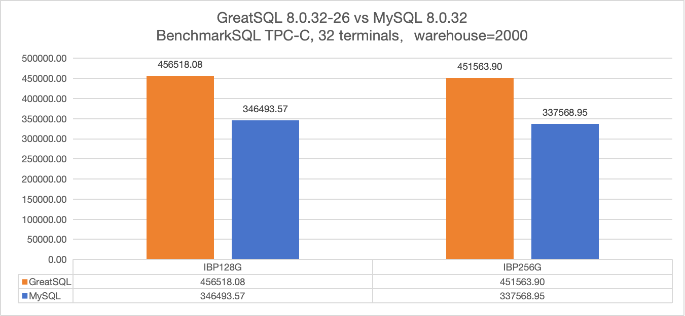

  - Comparison of GreatSQL 8.0.32-26 vs MySQL 8.0.32 BenchmarkSQL TPC-C test results with 64 concurrent clients

  | tpmC | IBP = 128G | IBP = 256G |
  | :--- | ---: | ---: |
  | GreatSQL 8.0.32-26 | 686652.31 | 677036.36 |
  | MySQL 8.0.32 | 573634.69 | 554112.65 |
  | GreatSQL performance improvement | 19.70% | 22.18% |

  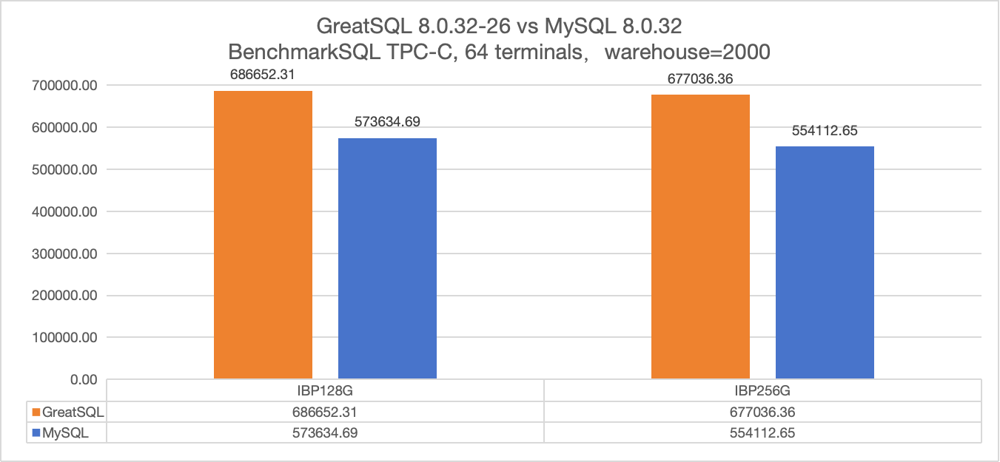

## Detailed Test Data

### TPC-C Test Data with 32 Concurrent Clients

A total of 8 rounds of tests were run, each lasting 20 minutes.

- IBP = 128G

| IBP = 128G | Round 1 | Round 2 | Round 3 | Round 4 | Round 5 | Round 6 | Round 7 | Round 8 |
| :--- | ---: | ---: | ---: | ---: | ---: | ---: | ---: | ---: |
| GreatSQL 8.0.32-26 | 450620.65 | 456953.65 | 419828.7 | 459993.95 | 459402.05 | 455620.10 | 414715.60 | 418527.60 |
| MySQL 8.0.32 | 343997.05 | 345936.55 | 324826.95 | 352615.80 | 352121.45 | 348762.30 | 335528.25 | 319743.10 |

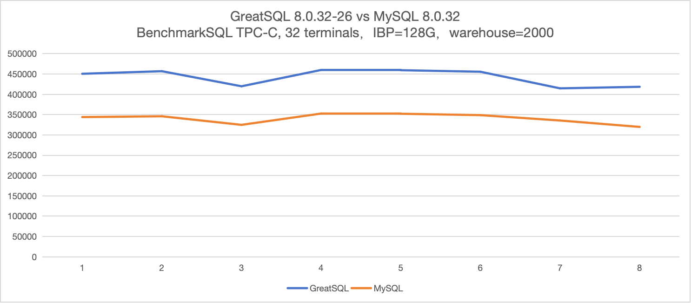

- IBP = 256G

| IBP = 256G | Round 1 | Round 2 | Round 3 | Round 4 | Round 5 | Round 6 | Round 7 | Round 8 |
| :--- | ---: | ---: | ---: | ---: | ---: | ---: | ---: | ---: |
| GreatSQL 8.0.32-26 | 452826.00 | 449903.40 | 451065.25 | 453021.50 | 451434.85 | 450367.00 | 450668.80 | 448747.20 |
| MySQL 8.0.32 | 339873.70 | 311245.45 | 339739.45 | 344684.40 | 329512.20 | 332257.85 | 331289.35 | 306099.75 |

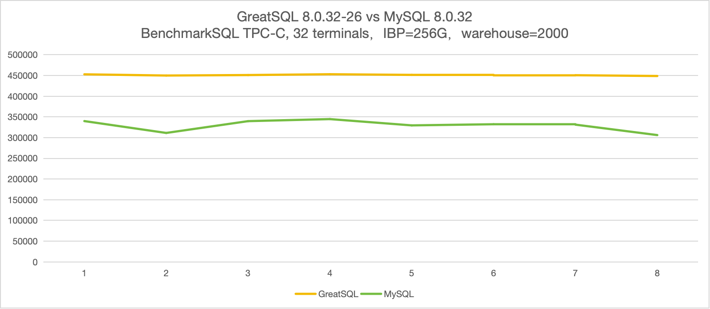

### TPC-C Test Data Curve Charts with 32 Concurrent Clients

- GreatSQL 8.0.32-26 with 32-terminals & IBP=128G
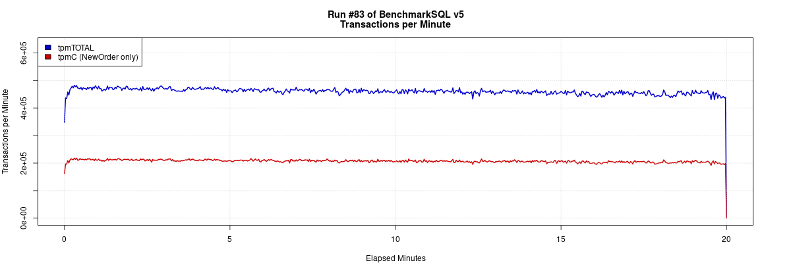

- MySQL 8.0.32 with 32-terminals & IBP=128G
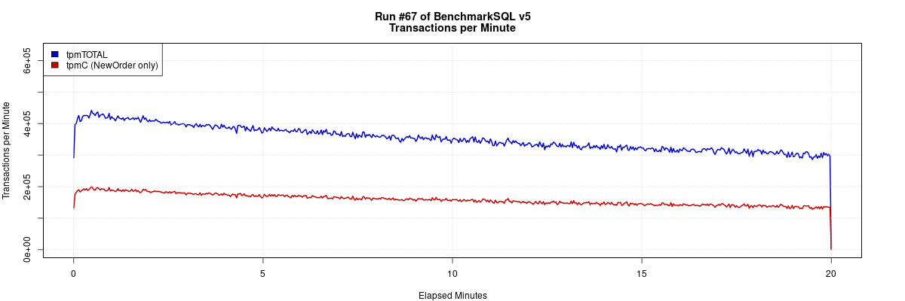

- GreatSQL 8.0.32-26 with 32-terminals & IBP=256G
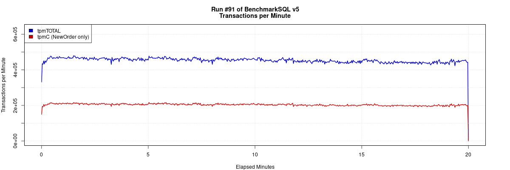

- MySQL 8.0.32 with 32-terminals & IBP=256G
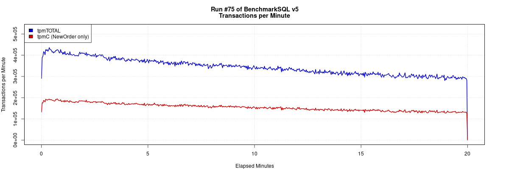

### TPC-C Test Data with 64 Concurrent Clients

A total of 8 rounds of tests were run, each lasting 20 minutes.

- IBP = 128G

| IBP = 128G | Round 1 | Round 2 | Round 3 | Round 4 | Round 5 | Round 6 | Round 7 | Round 8 |
| :--- | ---: | ---: | ---: | ---: | ---: | ---: | ---: | ---: |
| GreatSQL 8.0.32-26 | 644678.45 | 661334.00 | 695643.15 | 695282.70 | 697940.00 | 678463.00 | 698050.35 | 679853.00 |
| MySQL 8.0.32 | 588542.00 | 601269.00 | 551370.40 | 572702.75 | 573581.35 | 562770.30 | 542034.95 | 565207.05 |

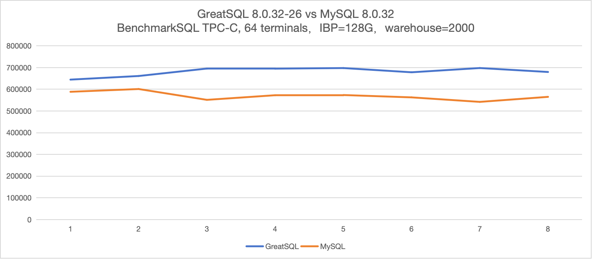

- IBP = 256G

| IBP = 256G | Round 1 | Round 2 | Round 3 | Round 4 | Round 5 | Round 6 | Round 7 | Round 8 |
| :--- | ---: | ---: | ---: | ---: | ---: | ---: | ---: | ---: |
| GreatSQL 8.0.32-26 | 664553.00 | 693832.95 | 653430.00 | 653009.20 | 662021.00 | 681223.00 | 694121.40 | 690073.20 |
| MySQL 8.0.32 | 530745.10 | 557727.85 | 495667.35 | 582648.00 | 540697.10 | 537221.80 | 568941.60 | 560807.10 |

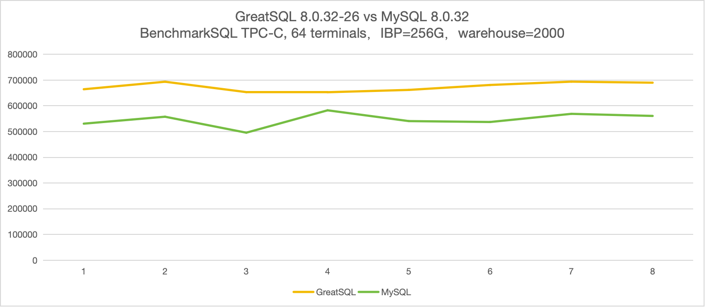

### TPC-C Test Data Curve Charts with 64 Concurrent Clients

- GreatSQL 8.0.32-26 with 64-terminals & IBP=128G
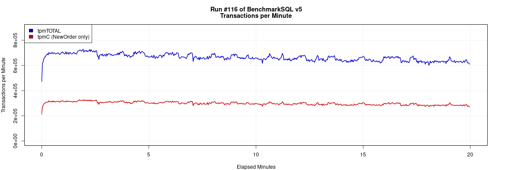

- MySQL 8.0.32 with 64-terminals & IBP=128G
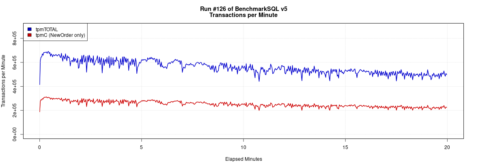

- GreatSQL 8.0.32-26 with 64-terminals & IBP=256G
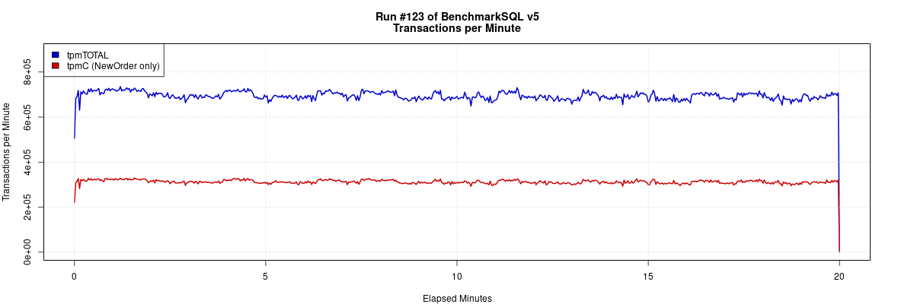

- MySQL 8.0.32 with 64-terminals & IBP=256G
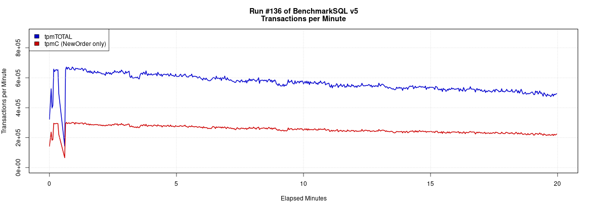

### Summary

Several points can be seen from the above test data and the multiple curve charts:
1. When IBP is sufficient (IBP=256G), GreatSQL 8.0.32-26 shows more stable overall performance in the TPC-C test.
2. When IBP is insufficient (IBP=128G), individual test results may even be better than when IBP is sufficient, but the overall performance is not stable enough and fluctuates greatly.
3. Regardless of whether IBP is sufficient, the performance fluctuation of MySQL 8.0.32 is greater than that of GreatSQL 8.0.32-26. The longer the stress test lasts, the more its performance degrades.

## Test Steps

Refer to the manual content [BenchmarkSQL Performance Benchmark](./3-4-benchmarksql.md) to execute the TPC-C stress test. The detailed process is not repeated here.

## Appendix
### Test Tool

BenchmarkSQL 5.0, download address: [https://sourceforge.net/projects/benchmarksql/files/](https://sourceforge.net/projects/benchmarksql/files/)

### Test Mode/Parameters

- BenchmarkSQL related parameters are as follows

```ini
warehouses=2000
loadWorkers=128

terminals=32
//terminals=64
runTxnsPerTerminal=0
runMins=20
limitTxnsPerMin=0

terminalWarehouseFixed=true

report-on-new-line=0

table-engine=innodb

newOrderWeight=45
paymentWeight=43
orderStatusWeight=4
deliveryWeight=4
stockLevelWeight=4
```

- The total size after database initialization is about 182G.

```bash
$ du -sch /data/GreatSQL/bmsql/
182G	/data/GreatSQL/bmsql/
182G	total
```

- Due to limited test resources, BenchmarkSQL and mysqld run on the same server, so the number of concurrent connections of BenchmarkSQL is controlled at 32 and 64, without setting a larger value, and taskset is used to limit CPU resources.

```bash
$ cat bmsql-taskset.sh

ps -ef|grep -v grep|grep java
bmsql_pid=`ps -ef|grep -v grep|grep java|awk '{print $2}'`
taskset -pc 111-175 ${bmsql_pid} && taskset -pc ${bmsql_pid}

ps -ef|grep -v grep|grep mysqld
mysqld_pid=`ps -ef|grep -v grep|grep mysqld|awk '{print $2}'`
taskset -pc 0-110 ${mysqld_pid} && taskset -pc ${mysqld_pid}
```

- Due to limited test resources, only the single-machine mode was tested this time, and scenarios such as source-replica replication and MGR were not tested.

### Main Related Database Parameter Configuration

```ini
[mysqld]
skip_name_resolve = ON
default_time_zone = "+8:00"
lock_wait_timeout = 3600
open_files_limit    = 65535
back_log = 1024
max_connections = 1024
max_connect_errors = 1000000
table_open_cache = 2048
table_definition_cache = 2048
sort_buffer_size = 4M
join_buffer_size = 4M
read_buffer_size = 8M
read_rnd_buffer_size = 4M
bulk_insert_buffer_size = 64M
thread_cache_size = 768
tmp_table_size = 96M
max_heap_table_size = 96M
max_allowed_packet = 64M
sql_generate_invisible_primary_key = ON

log_bin = binlog
binlog_format = ROW
sync_binlog = 1
binlog_cache_size = 4M
max_binlog_cache_size = 6G
max_binlog_size = 1G
binlog_checksum = CRC32
gtid_mode = ON
enforce_gtid_consistency = ON

innodb_buffer_pool_size = 128G
innodb_buffer_pool_instances = 24
innodb_data_file_path = ibdata1:12M:autoextend
innodb_flush_log_at_trx_commit = 1
innodb_log_buffer_size = 32M
innodb_redo_log_capacity = 16G
innodb_doublewrite_files = 2
innodb_max_undo_log_size = 4G
innodb_io_capacity = 40000
innodb_io_capacity_max = 80000
innodb_open_files = 65534
innodb_flush_method = O_DIRECT
innodb_lru_scan_depth = 4000
innodb_lock_wait_timeout = 120
innodb_rollback_on_timeout = ON
innodb_print_all_deadlocks = ON
innodb_online_alter_log_max_size = 4G
innodb_print_ddl_logs = ON
innodb_status_file = ON
innodb_status_output = OFF
innodb_status_output_locks = ON
innodb_sort_buffer_size = 64M
innodb_adaptive_hash_index = OFF
innodb_numa_interleave = OFF
innodb_spin_wait_delay = 20

performance_schema = OFF
```

### Reference Materials

- [TPC-C official website](https://www.tpc.org/tpcc/)
- [GreatSQL Installation Guide](../4-install-guide/0-install-guide.md)
- [BenchmarkSQL Performance Benchmark](./3-4-benchmarksql.md)


**Scan the QR code to follow our WeChat official account**


