# GreatSQL vs MySQL TPC-C Performance Benchmark

**GreatSQL TPC-C Performance Benchmark Report**

**(October 28, 2025)**

**GreatSQL Community**

## 【Document Statement】

The GreatSQL Community reminds you to carefully read and fully understand the terms of this legal statement before reading or using this document. If you read or use this document, your reading or use behavior will be deemed as acceptance of all the content of this statement. You should download and obtain this document through the GreatSQL Community website or other authorized channels provided by the GreatSQL Community, and use it only for your own lawful and compliant business activities. The content of this document is regarded as confidential information of the GreatSQL Community, and you should strictly comply with the confidentiality obligations; without the prior written consent of the GreatSQL Community, you may not disclose the content of this manual to any third party or provide it to any third party for use.

Without the prior written permission of the GreatSQL Community, no unit, company, or individual may extract, translate, or copy part or all of the content of this document without authorization, and may not replace or promote it in any way or channel.

Due to product version upgrades, adjustments, or other reasons, the content of this document may change. The GreatSQL Community reserves the right to modify the content of this document without any notice or prompt, and periodically publishes updated user documents in the GreatSQL Community authorized channels. You should pay real-time attention to the version changes of the user documents and download and obtain the latest version of the user documents through the GreatSQL Community authorized channels.

This document is only a reference guide for users using GreatSQL Community products and services. The GreatSQL Community makes its best efforts to provide corresponding introductions and operation guidelines based on existing technology, but the GreatSQL Community hereby explicitly declares that it does not make any express or implied warranties regarding the accuracy, completeness, applicability, or reliability of the content of this document. Any unit, company, or individual that suffers any error or economic loss because of downloading, using, or relying on this document shall not be held legally liable by the GreatSQL Community. Under no circumstances shall the GreatSQL Community be liable for any indirect, consequential, punitive, incidental, special, or penal damages, including lost profits suffered by users using or relying on this document (even if the GreatSQL Community has been informed of the possibility of such losses).

All content in GreatSQL Community documents, including but not limited to images, architecture designs, page layouts, and text descriptions, is legally owned by the GreatSQL Community and/or its affiliated companies for its intellectual property rights, including but not limited to trademark rights, patent rights, copyrights, and trade secrets. Without the written consent of the GreatSQL Community and/or its affiliated companies, no one may use, modify, copy, publicly replace, change, distribute, issue, or publicly publish the GreatSQL Community website, product programs, or content without authorization. In addition, without the prior written consent of the GreatSQL Community, no one may use, publish, or copy the name of the GreatSQL Community (including but not limited to brands containing "GreatSQL Community", "GreatSQL", etc., of the GreatSQL Community and/or its affiliated companies, alone or in combination, the affiliated logos and patterns of the above brands, or any similar company name, trade name, trademark, product or service name, domain name, pattern mark, logo, mark, or identifier through which third parties can identify the GreatSQL Community and/or its affiliated companies) for any marketing, advertising, promotion, or other purposes.

If any error is found in this document, please contact the GreatSQL Community directly.

GreatSQL Community official website: [https://greatsql.cn](https://greatsql.cn).

## Overview

This test is a test of the GreatSQL database based on the standard TPC-C scenario of [BenchmarkSQL](./3-4-benchmarksql.md).

BenchmarkSQL is an open source Java application used to evaluate the performance of database systems in OLTP scenarios. It is a TPC-C benchmark stress testing compliant tool. It was originally developed by the author of HammerDB and later maintained by Cloud V LLC.

The TPC-C model simulates the sales model of a commodity wholesale company. This model covers the process of a wholesale company selling a series of commodities to customers, including operations such as managing orders, managing inventory, and managing account income and expenses. These operations involve concepts such as warehouses, commodities, customers, and orders. Around these concepts, data tables and corresponding database operations are constructed.

BenchmarkSQL supports MySQL (Percona, GreatSQL), PostgreSQL, Oracle, SQL Server, etc.

The GreatSQL database is an **open source and free** database that can meet financial-grade application scenarios on commodity hardware. It features **High Availability**, **High Performance**, **High Compatibility**, and **High Security**, and can serve as an ideal drop-in replacement for MySQL or Percona.

The **ibp** mentioned below refers to the abbreviation of the *innodb_buffer_pool_size* parameter.

## Test Results

From the results of this test, the following conclusions can be drawn:

**The test results show that: compared with MySQL 8.4.4, GreatSQL 8.4.4-4 has a performance improvement of 13%~36% in TPC-C test scenarios, with more stable performance and lower latency.**

The above conclusion is only a summary based on the several scenarios of this test.

MySQL 8.4.4 vs GreatSQL 8.4.4-4 performance data comparison (average after removing the highest and lowest data points):

|  | ibp128g-32th	| ibp128g-64th	| ibp256g-32th	| ibp256g-64th |
| :--- | :--- | :--- | :--- | :--- |
|MySQL 8.4.4	 | 280041.12  | 498345.31 | 275587.43 | 465716.99 |
|GreatSQL 8.4.4-4| 381572.51  | 563634.77 | 327745.89 | 565273.27 |
|GreatSQL 8.4.4-4 Performance Improvement| 36.26%	  | 13.10%	    | 18.93%  |	21.38%    |

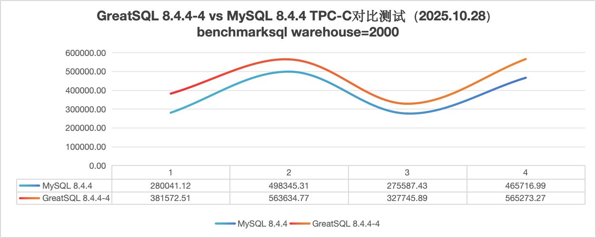

Test environment:

| Configuration | Remarks | 
|   ---    | --- |
| Operating System | OS: CentOS Linux release 8.5.2111<br/>Kernel: 4.18.0-240.el8.x86_64 |
| CPU      | Intel(R) Xeon(R) Gold 6238 CPU @ 2.10GHz * 4                              |
| Memory     | 256G                                                                      |
| Disk     | INTEL SSDPE2KE032T8                                      |
| Database   | GreatSQL 8.4.4-4 Revision d73de75905d<br/>MySQL 8.4.4 Community Server       |
| Test Tool | BenchmarkSQL 5.0 |
| Test Data Volume | warehouses = 2000 (the physical size of the test database after initialization is about 182 GB)|

## Detailed Test Result Data

### ibp=128G, 32 concurrent threads

|  | MySQL | GreatSQL |
|:---| :--- | :--- |
| Round 1  | 286969.41  | 382516.68 |
| Round 2  | 279723.36  | 382302.13 |
| Round 3  | 280372.18  | 381040.98 |
| Round 4  | 274132.02  | 381374.43 |
| Round 5  | 280027.81  | 378869.58 |
| Average | 280244.956 | 381220.76 |

- In IBP=128G & 32 concurrency mode, comparison of the average tpmC values of GreatSQL vs MySQL stress tests

**Note**: The following figure is the result of averaging after removing the highest and lowest values from the 5 results. The same applies below.


- GreatSQL vs MySQL tpmC curve charts during the stress test (the first chart is GreatSQL, the second is MySQL; the same applies below)

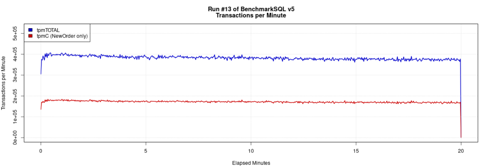

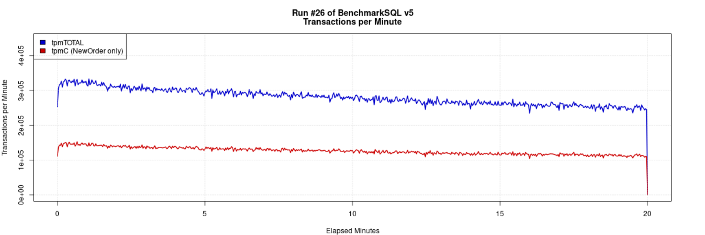

- GreatSQL vs MySQL Latency curve charts during the stress test

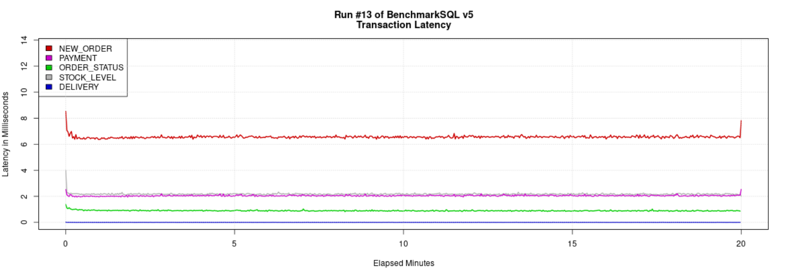

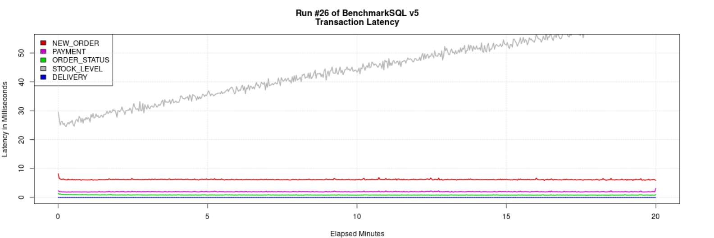

### ibp=128G, 64 concurrent threads

|  | MySQL | GreatSQL |
|:---| :--- | :--- |
| Round 1  | 506900.77 | 566486.67  |
| Round 2  | 512427.77 | 579877.81  |
| Round 3  | 491107.14 | 555160.13  |
| Round 4  | 487895.74 | 569257.52  |
| Round 5  | 497028.03 | 546783.18  |
| Average | 499071.89 | 563513.062 |

- In IBP=128G & 64 concurrency mode, comparison of the average tpmC values of GreatSQL vs MySQL stress tests


GreatSQL vs MySQL tpmC curve charts during the stress test

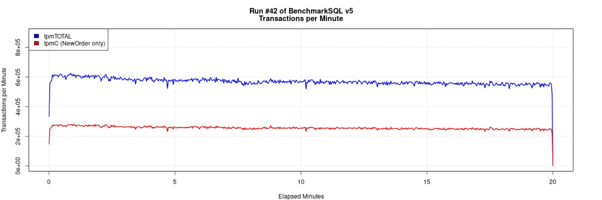

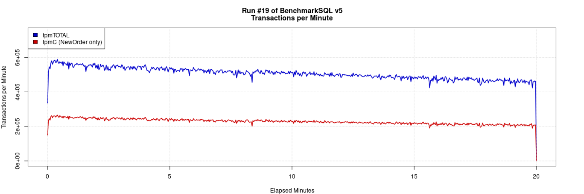

GreatSQL vs MySQL Latency curve charts during the stress test

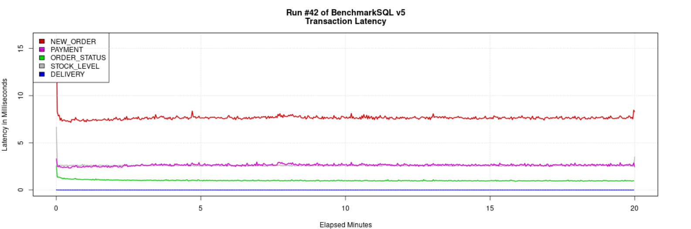

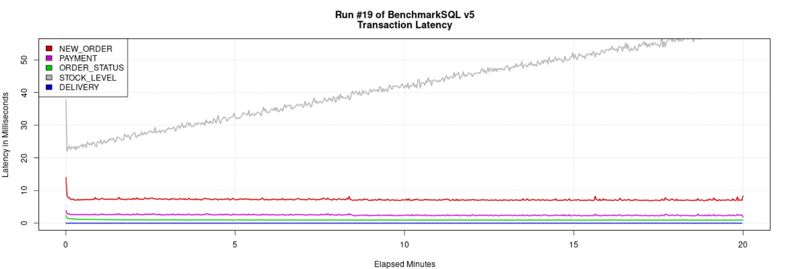

### ibp=256G, 32 concurrent threads

|  | MySQL | GreatSQL |
|:---| :--- | :--- |
| Round 1  | 276821.06  | 333481.77  |
| Round 2  | 283915.16  | 328236.77  |
| Round 3  | 276522.46  | 324354.07  |
| Round 4  | 270659.67  | 330646.82  |
| Round 5  | 273418.77  | 308513.04  |
| Average | 276267.424 | 325046.494 |

- In IBP=256G & 32 concurrency mode, comparison of the average tpmC values of GreatSQL vs MySQL stress tests


GreatSQL vs MySQL tpmC curve charts during the stress test

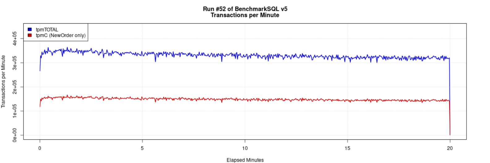

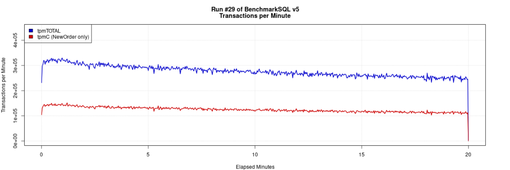

GreatSQL vs MySQL Latency curve charts during the stress test

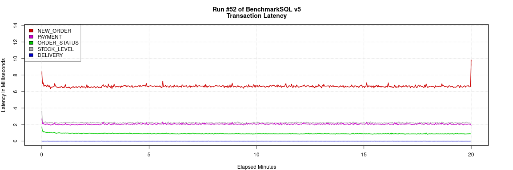

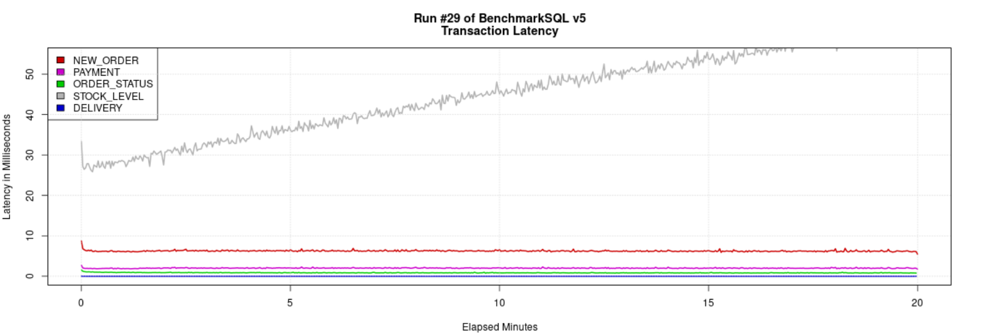

### ibp=256G, 64 concurrent threads

|  | MySQL | GreatSQL |
|:---| :--- | :--- |
| Round 1  | 475981.6	  | 568142.02  |
| Round 2  | 481056.84  | 573354.02  |
| Round 3  | 466132.71  | 558700.58  |
| Round 4  | 455036.67  | 560343.33  |
| Round 5  | 451479.67  | 567334.47  |
| Average | 465937.498 | 565574.884 |

- In IBP=256G & 64 concurrency mode, comparison of the average tpmC values of GreatSQL vs MySQL stress tests

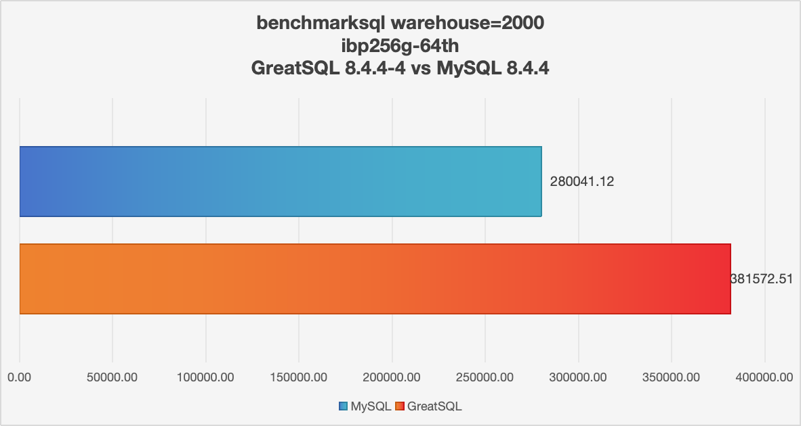

GreatSQL vs MySQL tpmC curve charts during the stress test

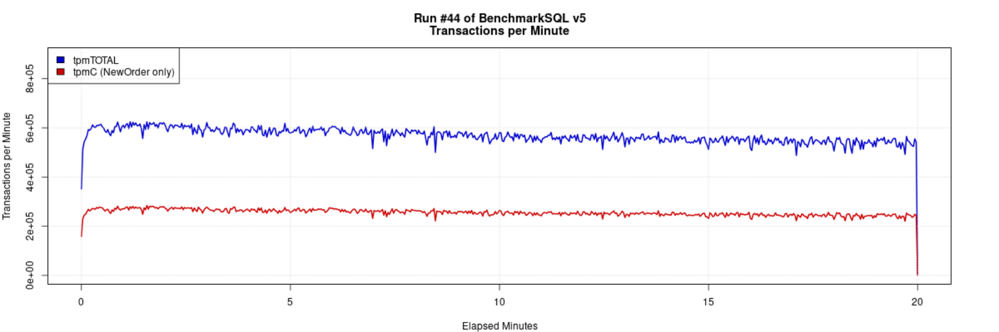

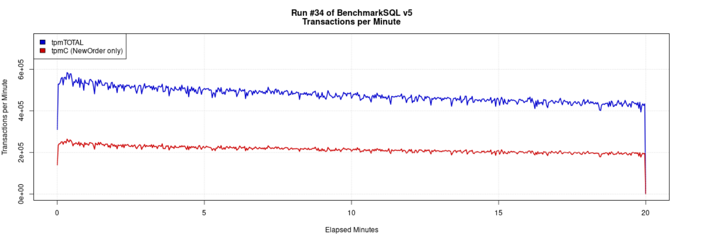

GreatSQL vs MySQL Latency curve charts during the stress test

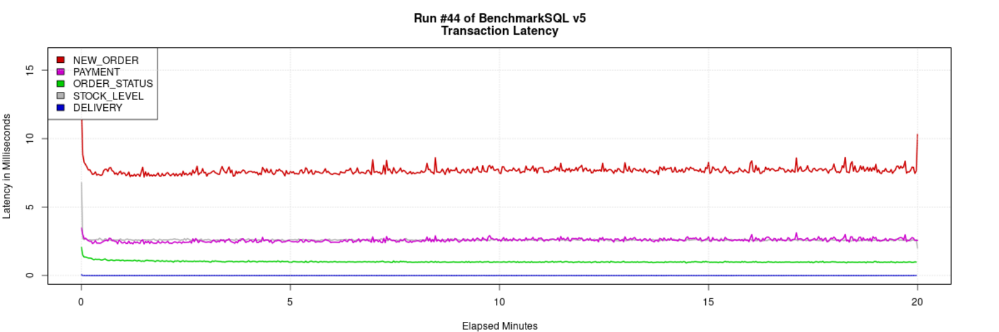

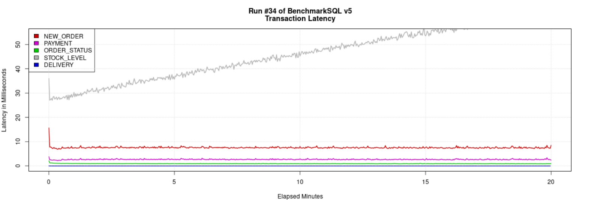

## Appendix

### Test Steps

Refer to the manual content [BenchmarkSQL Performance Benchmark](./3-4-benchmarksql.md) to execute the TPC-C stress test. The detailed process is not repeated here.

### Test Tool

BenchmarkSQL 5.0.

The corresponding code repository: [https://gitee.com/GreatSQL/benchmarksql](https://gitee.com/GreatSQL/benchmarksql).

### Test Mode

- Use BenchmarkSQL to construct test data, setting the parameter warehouses=2000.
- The initial size of the test database is about 182G.
- Because there is no additional test machine, the BenchmarkSQL test program and the MySQL/GreatSQL database service run on the same server.
- During the test, only the innodb_buffer_pool_size parameter is modified to 128G and 256G respectively.
- During the test, Binlog and double 1 mode are enabled. The other main parameters are described later.

### BenchmarkSQL Related Parameters

```ini
warehouses=2000
loadWorkers=128

terminals=32
//terminals=64
runTxnsPerTerminal=0
runMins=20
limitTxnsPerMin=0

terminalWarehouseFixed=true

report-on-new-line=0
table-engine=innodb

newOrderWeight=45
paymentWeight=43
orderStatusWeight=4
deliveryWeight=4
stockLevelWeight=4
```

### Main Related Database Parameter Configuration

```ini
[mysqld]
user=mysql
port=3306
server_id=3306
basedir=/usr/local/GreatSQL
#basedir=/usr/local/mysql
datadir=/data/GreatSQL
socket=/data/GreatSQL/mysql.sock
pid-file=mysql.pid
character-set-server=UTF8MB4
skip_name_resolve=ON
default_time_zone="+8:00"
bind_address="0.0.0.0"
secure_file_priv=/data/GreatSQL
mysql_native_password=ON

# Performance
lock_wait_timeout=3600
open_files_limit=65535
back_log=1024
max_connections=1024
max_connect_errors=1000000
table_open_cache=4096
table_definition_cache=2048
sort_buffer_size=4M
join_buffer_size=4M
read_buffer_size=8M
read_rnd_buffer_size=4M
bulk_insert_buffer_size=64M
thread_cache_size=768
interactive_timeout=600
wait_timeout=600
tmp_table_size=96M
max_heap_table_size=96M
max_allowed_packet=64M
loose-net_buffer_shrink_interval=180
sql_generate_invisible_primary_key=ON
loose-lock_ddl_polling_mode=ON
loose-lock_ddl_polling_runtime=200

# Logs
log_timestamps=SYSTEM
log_error=error.log
log_error_verbosity=3
slow_query_log=ON
log_slow_extra=ON
slow_query_log_file=slow.log
long_query_time=0.01
log_queries_not_using_indexes=ON
log_throttle_queries_not_using_indexes=60
min_examined_row_limit=100
log_slow_admin_statements=ON
log_slow_replica_statements=ON
loose-log_slow_verbosity=FULL
log_bin=binlog
binlog_format=ROW
sync_binlog=1
binlog_cache_size=4M
max_binlog_cache_size=6G
max_binlog_size=1G
loose-binlog_space_limit=500G
binlog_rows_query_log_events=ON
binlog_expire_logs_seconds=604800
binlog_checksum=CRC32
binlog_order_commits=OFF
gtid_mode=ON
enforce_gtid_consistency=ON

# Replication
relay-log=relaylog
relay_log_recovery=ON
replica_parallel_type=LOGICAL_CLOCK
replica_parallel_workers=16
replica_preserve_commit_order=ON
replica_checkpoint_period=2
loose-rpl_read_binlog_speed_limit=100

# InnoDB
innodb_buffer_pool_size=128G
innodb_buffer_pool_instances=24
innodb_data_file_path=ibdata1:12M:autoextend
innodb_flush_log_at_trx_commit=1
innodb_log_buffer_size=64M
innodb_redo_log_capacity=16G
innodb_doublewrite_files=2
innodb_doublewrite_pages=128
innodb_max_undo_log_size=4G
innodb_io_capacity=40000
innodb_io_capacity_max=80000
innodb_open_files=65534
innodb_flush_method=O_DIRECT
innodb_use_fdatasync=ON
innodb_lru_scan_depth=4000
innodb_lock_wait_timeout=10
innodb_rollback_on_timeout=ON
innodb_print_all_deadlocks=ON
innodb_online_alter_log_max_size=4G
innodb_print_ddl_logs=ON
innodb_status_file=ON
innodb_status_output=OFF
innodb_status_output_locks=ON
innodb_sort_buffer_size=64M
innodb_adaptive_hash_index=OFF
innodb_numa_interleave=OFF
innodb_spin_wait_delay=20
loose-innodb_print_lock_wait_timeout_info=ON
innodb_change_buffering=none
loose-kill_idle_transaction=300
loose-innodb_data_file_async_purge=ON
```
### Test Environment

**Server Detailed Information**

- 1. Operating System

```bash
$ cat /etc/os-release

NAME="CentOS Linux"
VERSION="8"
ID="centos"
ID_LIKE="rhel fedora"
VERSION_ID="8"
PLATFORM_ID="platform:el8"
PRETTY_NAME="CentOS Linux 8"
ANSI_COLOR="0;31"
CPE_NAME="cpe:/o:centos:centos:8"
HOME_URL="https://centos.org/"
BUG_REPORT_URL="https://bugs.centos.org/"
CENTOS_MANTISBT_PROJECT="CentOS-8"
CENTOS_MANTISBT_PROJECT_VERSION="8"
```

- 2. CPU

```bash
$ lscpu

Architecture:        x86_64
CPU op-mode(s):      32-bit, 64-bit
Byte Order:          Little Endian
CPU(s):              176
On-line CPU(s) list: 0-175
Thread(s) per core:  2
Core(s) per socket:  22
Socket(s):           4
NUMA node(s):        1
Vendor ID:           GenuineIntel
BIOS Vendor ID:      Intel
CPU family:          6
Model:               85
Model name:          Intel(R) Xeon(R) Gold 6238 CPU @ 2.10GHz
BIOS Model name:     Intel(R) Xeon(R) Gold 6238 CPU @ 2.10GHz
Stepping:            7
CPU MHz:             2799.999
CPU max MHz:         3700.0000
CPU min MHz:         1000.0000
BogoMIPS:            4200.00
Virtualization:      VT-x
L1d cache:           32K
L1i cache:           32K
L2 cache:            1024K
L3 cache:            30976K
NUMA node0 CPU(s):   0-175
Flags:               fpu vme de pse tsc msr pae mce cx8 apic sep mtrr pge mca cmov pat pse36 clflush dts acpi mmx fxsr sse sse2 ss ht tm pbe syscall nx pdpe1gb rdtscp lm constant_tsc art arch_perfmon pebs bts rep_good nopl xtopology nonstop_tsc cpuid aperfmperf pni pclmulqdq dtes64 monitor ds_cpl vmx smx est tm2 ssse3 sdbg fma cx16 xtpr pdcm pcid dca sse4_1 sse4_2 x2apic movbe popcnt tsc_deadline_timer aes xsave avx f16c rdrand lahf_lm abm 3dnowprefetch cpuid_fault epb cat_l3 cdp_l3 invpcid_single intel_ppin ssbd mba ibrs ibpb stibp ibrs_enhanced tpr_shadow vnmi flexpriority ept vpid ept_ad fsgsbase tsc_adjust bmi1 hle avx2 smep bmi2 erms invpcid cqm mpx rdt_a avx512f avx512dq rdseed adx smap clflushopt clwb intel_pt avx512cd avx512bw avx512vl xsaveopt xsavec xgetbv1 xsaves cqm_llc cqm_occup_llc cqm_mbm_total cqm_mbm_local dtherm ida arat pln pts pku ospke avx512_vnni md_clear flush_l1d arch_capabilities
```

- 3. Memory

```bash
$ free -ht
              total        used        free      shared  buff/cache   available
Mem:          251Gi       146Gi       1.7Gi        17Mi       102Gi       102Gi
Swap:         4.0Gi       318Mi       3.7Gi
Total:        255Gi       146Gi       5.4Gi
```

- 4. Disk

Disk device model

```bash
$ nvme list

Node             SN                   Model                                    Namespace Usage                      Format           FW Rev
---------------- -------------------- ---------------------------------------- --------- -------------------------- ---------------- --------
/dev/nvme0n1          PHLN018200FD3P2BGN   INTEL SSDPE2KE032T8                      1           3.20  TB /   3.20  TB    512   B +  0 B   VDV10152
```

Disk mount parameters, file system, ioscheduler

```bash
$ df -hT | grep /ssd1
/dev/nvme0n1        xfs       3.0T  682G  2.3T  23% /ssd1

$ mount | grep ssd1
/dev/nvme0n1 on /ssd1 type xfs (rw,noatime,nodiratime,seclabel,attr2,inode64,logbufs=8,logbsize=32k,noquota)

$ cat /sys/block/nvme0n1/queue/scheduler
[mq-deadline] kyber bfq none
```

Simple speed test of the NVMe SSD device

```bash
$ dd oflag=direct if=/dev/zero of=./zero bs=1M count=20480

20480+0 records in
20480+0 records out
21474836480 bytes (21 GB, 20 GiB) copied, 11.389 s, 1.9 GB/s
```

- 5. The server has NUMA disabled

```bash
$ cat /etc/default/grub

GRUB_TIMEOUT=5
GRUB_DISTRIBUTOR="$(sed 's, release .*$,,g' /etc/system-release)"
GRUB_DEFAULT=saved
GRUB_DISABLE_SUBMENU=true
GRUB_TERMINAL_OUTPUT="console"
GRUB_CMDLINE_LINUX="crashkernel=auto resume=/dev/mapper/cl-swap rd.lvm.lv=cl/root rd.lvm.lv=cl/swap numa=off"
GRUB_DISABLE_RECOVERY="true"
GRUB_ENABLE_BLSCFG=true

$ dmesg | grep -i numa

[    0.000000] Command line: BOOT_IMAGE=(hd0,gpt2)/vmlinuz-4.18.0-240.el8.x86_64 root=/dev/mapper/cl-root ro crashkernel=auto resume=/dev/mapper/cl-swap rd.lvm.lv=cl/root rd.lvm.lv=cl/swap numa=off
[    0.000000] NUMA turned off
[    0.000000] Kernel command line: BOOT_IMAGE=(hd0,gpt2)/vmlinuz-4.18.0-240.el8.x86_64 root=/dev/mapper/cl-root ro crashkernel=auto resume=/dev/mapper/cl-swap rd.lvm.lv=cl/root rd.lvm.lv=cl/swap numa=off
```

## Reference Materials

- [TPC-C official website](https://www.tpc.org/tpcc/)
- [GreatSQL installation guide](../4-install-guide/0-install-guide.md)
- [BenchmarkSQL Performance Benchmark](./3-4-benchmarksql.md)

**Scan the QR code to follow our WeChat Official Account**


