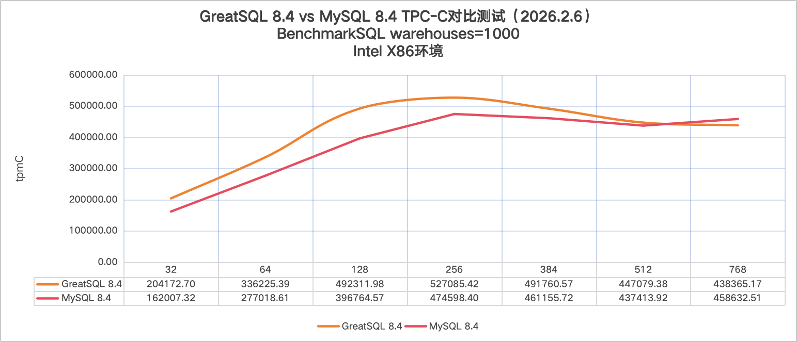
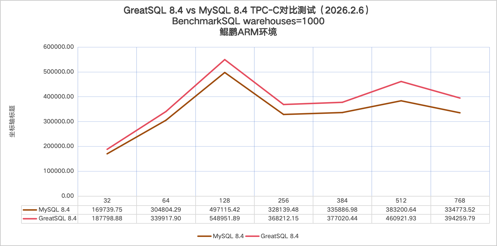
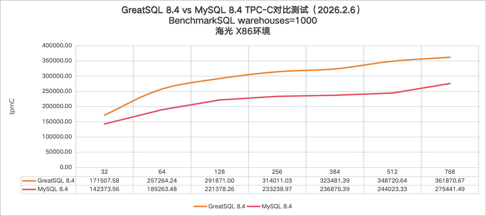
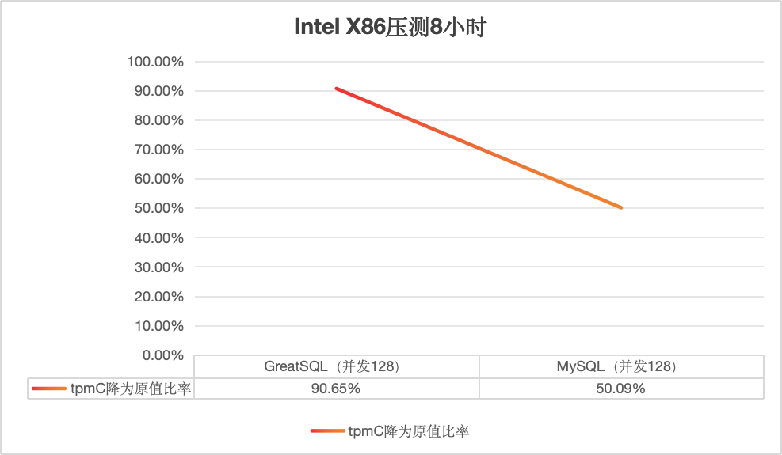
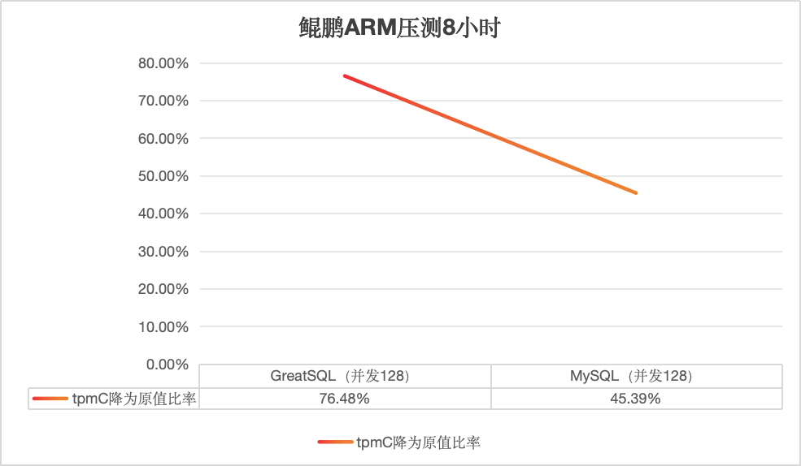
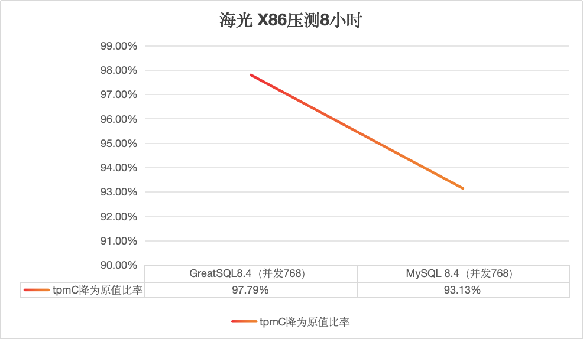

# GreatSQL vs MySQL TPC-C Performance Benchmark (2026.2.6)

**GreatSQL TPC-C Performance Benchmark Report**

**(February 6, 2026)**

**GreatSQL Community**

## 1.【Document Statement】

The GreatSQL Community reminds you to carefully read and fully understand the terms of this legal statement before reading or using this document. If you read or use this document, your reading or use behavior will be deemed as acceptance of all the content of this statement. You should download and obtain this document through the GreatSQL Community website or other authorized channels provided by the GreatSQL Community, and use it only for your own lawful and compliant business activities. The content of this document is regarded as confidential information of the GreatSQL Community, and you should strictly comply with the confidentiality obligations; without the prior written consent of the GreatSQL Community, you may not disclose the content of this manual to any third party or provide it to any third party for use.

Without the prior written permission of the GreatSQL Community, no unit, company, or individual may extract, translate, or copy part or all of the content of this document without authorization, and may not replace or promote it in any way or channel.

Due to product version upgrades, adjustments, or other reasons, the content of this document may change. The GreatSQL Community reserves the right to modify the content of this document without any notice or prompt, and periodically publishes updated user documents in the GreatSQL Community authorized channels. You should pay real-time attention to the version changes of the user documents and download and obtain the latest version of the user documents through the GreatSQL Community authorized channels.

This document is only a reference guide for users using GreatSQL Community products and services. The GreatSQL Community makes its best efforts to provide corresponding introductions and operation guidelines based on existing technology, but the GreatSQL Community hereby explicitly declares that it does not make any express or implied warranties regarding the accuracy, completeness, applicability, or reliability of the content of this document. Any unit, company, or individual that suffers any error or economic loss because of downloading, using, or relying on this document shall not be held legally liable by the GreatSQL Community. Under no circumstances shall the GreatSQL Community be liable for any indirect, consequential, punitive, incidental, special, or penal damages, including lost profits suffered by users using or relying on this document (even if the GreatSQL Community has been informed of the possibility of such losses).

All content in GreatSQL Community documents, including but not limited to images, architecture designs, page layouts, and text descriptions, is legally owned by the GreatSQL Community and/or its affiliated companies for its intellectual property rights, including but not limited to trademark rights, patent rights, copyrights, and trade secrets. Without the written consent of the GreatSQL Community and/or its affiliated companies, no one may use, modify, copy, publicly replace, change, distribute, issue, or publicly publish the GreatSQL Community website, product programs, or content without authorization. In addition, without the prior written consent of the GreatSQL Community, no one may use, publish, or copy the name of the GreatSQL Community (including but not limited to brands containing "GreatSQL Community", "GreatSQL", etc., of the GreatSQL Community and/or its affiliated companies, alone or in combination, the affiliated logos and patterns of the above brands, or any similar company name, trade name, trademark, product or service name, domain name, pattern mark, logo, mark, or identifier through which third parties can identify the GreatSQL Community and/or its affiliated companies) for any marketing, advertising, promotion, or other purposes.

If any error is found in this document, please contact the GreatSQL Community directly.

GreatSQL Community official website: [https://greatsql.cn](https://greatsql.cn).

## 2. Overview

This test is a test of the GreatSQL database based on the standard TPC-C scenario of [BenchmarkSQL](./3-4-benchmarksql.md).

BenchmarkSQL is an open source Java application used to evaluate the performance of database systems in OLTP scenarios. It is a TPC-C benchmark stress testing compliant tool. It was originally developed by the author of HammerDB and later maintained by Cloud V LLC.

The TPC-C model simulates the sales model of a commodity wholesale company. This model covers the process of a wholesale company selling a series of commodities to customers, including operations such as managing orders, managing inventory, and managing account income and expenses. These operations involve concepts such as warehouses, commodities, customers, and orders. Around these concepts, data tables and corresponding database operations are constructed.

BenchmarkSQL supports MySQL (Percona, GreatSQL), PostgreSQL, Oracle, SQL Server, etc.

The GreatSQL database is an **open source and free** database that can meet financial-grade application scenarios on commodity hardware. It features **High Availability**, **High Performance**, **High Compatibility**, and **High Security**, and can serve as an ideal drop-in replacement for MySQL or Percona.

The **ibp** mentioned below refers to the abbreviation of the *innodb_buffer_pool_size* parameter.

The purpose of this test: to conduct TPC-C performance tests on GreatSQL 8.4.4-4 (referred to as GreatSQL) and MySQL 8.4.4 (referred to as MySQL), comparing the different performance of these two databases on the Intel X86 and Kunpeng ARM platforms respectively.

## 3. Test Results

From the results of this test, the following conclusions can be drawn:

1. Overall, GreatSQL's performance improvement relative to MySQL is quite considerable, up to 42% at the highest, and starting from 10% in most concurrency scenarios.

2. GreatSQL has less performance jitter relative to MySQL, and both tpmC and Latency data are more stable.

3. After 8 hours of continuous stress testing, on the Intel X86 platform, GreatSQL's tpmC dropped to 90% of the original; on the Kunpeng ARM platform, it dropped to 76% of the original; on the Hygon X86 platform, it dropped to 97% of the original; while MySQL correspondingly dropped to 50%, 45%, and 93% respectively; proving that GreatSQL is more stable and reliable than MySQL.

The above conclusions are only a summary based on the scenarios of this test.

The TPC-C performance comparison charts are as follows:

- Comparison chart under Intel X86



- Comparison chart under Kunpeng ARM



- Comparison chart under Hygon X86



- Test server information

|        | Intel X86                                                           | Kunpeng ARM |                                                                 Hygon X86 |
| :---   | :---                                                                | :--- | :--- |
| Server | Dell R840<br/>Intel 6238 x 4, 176 cores in total; 256Gi memory; Nvme SSD, 3TB * 1 | Huawei TS200-2280 V2<br/>Kunpeng 920 7270Z x 2, 256 cores in total; Memory: 2TB; Storage: Nvme SSD, 3TB | Hygon 7490<br/>Hygon C86-4G (OPN:7490) * 2, 256 cores in total; Memory: 1.5GB; Storage: Nvme SSD, 3TB |
| Client | Dell R840<br/>Intel 6238 x 4, 176 cores in total; 377Gi memory; Nvme SSD, 3TB * 1 | Huawei TS200-2280 V2<br/>Kunpeng 920 7270Z x 2, 128 cores in total; Memory: 2TB; Storage: Nvme SSD, 3TB | Huawei TS200-2280<br/>Kunpeng 920 x 2, 128 cores in total; Memory: 470G; Storage: Nvme SSD, 8TB     |

- Test mode

| Database     | - GreatSQL-8.4.4-4-Linux-glibc2.28<br/> - mysql-8.4.4-linux-glibc2.17 |
| :---       | :--- |
| Test Tool   | BenchmarkSQL 5.0 |
| Test Data Volume | warehouses = 1000<br/> The physical size of the test database after initialization is about 90GB |

## 4. Detailed Test Result Data
### 4.1 Intel X86 Platform Test Data

1. GreatSQL 8.4.4-4
- innodbbufferpool_size=180G
- Only NUMA enabled, no NIC interrupt binding, double 1 mode + Slow Query Log enabled + PFS

| Concurrency  | 32         | 64         | 128        | 256        | 384        | 512        | 768        |
|---------|------------|------------|------------|------------|------------|------------|------------|
| Round 1 | 203076.76  | 332984.55  | 488054.97  | 523207.42  | 479477.02  | 428375.64  | 433399.25  |
| Round 2 | 203682.18  | 334184.79  | 491608.93  | 526782.45  | 493533.43  | 439765.11  | 437654.64  |
| Round 3 | 203949.17  | 335139.59  | 492393.93  | 527856.68  | 493442.13  | 443816.97  | 438641.8   |
| Round 4 | 204570.76  | 338542.96  | 493886.09  | 528678.41  | 494862.84  | 448130.37  | 440079.64  |
| Round 5 | 205584.63  | 340275.05  | 495615.97  | 528902.13  | 497487.42  | 475308.81  | 442050.52  |
| Avg     | **204172.76** | **336225.39** | **492311.98** | **527085.42** | **491760.57** | **447079.38** | **438365.17** |

2. MySQL 8.4.4
- innodbbufferpool_size=180G
- Only NUMA enabled, no NIC interrupt binding, double 1 mode + Slow Query Log enabled + PFS

| Concurrency  | 32         | 64         | 128        | 256        | 384        | 512        | 768        |
|---------|------------|------------|------------|------------|------------|------------|------------|
| Round 1 | 156110.47  | 262799.11  | 385478.94  | 459070.91  | 442072.99  | 414013.36  | 442050.52  |
| Round 2 | 162735.65  | 276969.75  | 389364.69  | 463834.48  | 455029.77  | 427281.38  | 442050.52  |
| Round 3 | 162765.30  | 277795.95  | 394744.22  | 480302.58  | 464610.22  | 442331.82  | 442050.52  |
| Round 4 | 163458.46  | 282947.50  | 401869.24  | 484189.69  | 471868.69  | 451571.49  | 442050.52  |
| Round 5 | 164966.72  | 284580.72  | 412365.76  | 485594.32  | 472196.95  | 451871.54  | 442050.52  |
| Avg     | **162007.32** | **277018.61** | **396764.57** | **474598.40** | **461155.72** | **437413.92** | **442050.52** |

| Comparison with GreatSQL as the baseline (concurrency)  | 32 | 64 | 128     | 256     | 384     | 512     | 768     |
|-----------------------|---------|---------|---------|---------|---------|---------|---------|
| Compared with MySQL             | **26.03%** | **21.37%** | **24.08%** | **11.06%** | **6.64%** | **2.21%** | **-4.42%** |

Conclusion: **On the X86 platform, GreatSQL performs better than MySQL in most concurrency scenarios, with the best tpmC result 26% higher; it only performs slightly worse than MySQL at concurrency 768**.

### 4.2 Kunpeng ARM Platform Test Data

1. GreatSQL 8.4.4-4
- innodb_buffer_pool_size=180G
- NUMA and NIC interrupt binding enabled, double 1 mode + Slow Query Log enabled + PFS

| Concurrency  | 32         | 64         | 128        | 256        | 384        | 512        | 768        |
|---------|------------|------------|------------|------------|------------|------------|------------|
| Round 1 | 179402.52  | 336006.71  | 543341.77  | 341168.62  | 375060.08  | 449849.11  | 388444.04  |
| Round 2 | 187574.45  | 338985.38  | 547766.34  | 342307.33  | 375826.13  | 457579.96  | 391517.38  |
| Round 3 | 189302.81  | 339620.65  | 549039.52  | 342867.17  | 376617.37  | 460930.00  | 392838.51  |
| Round 4 | 190417.68  | 341710.79  | 549561.12  | 344120.32  | 377824.86  | 466876.29  | 396247.13  |
| Round 5 | 192296.94  | 343265.96  | 555050.69  | 470597.33  | 379773.78  | 469374.28  | 402251.89  |
| Avg     | **187798.88** | **339917.90** | **548951.89** | **368212.15** | **377020.44** | **460921.93** | **394259.79** |

2. MySQL 8.4.4
- innodb_buffer_pool_size=180G
- NUMA and NIC interrupt binding enabled, double 1 mode + Slow Query Log enabled + PFS. 

| Concurrency  | 32         | 64         | 128        | 256        | 384        | 512        | 768        |
|---------|------------|------------|------------|------------|------------|------------|------------|
| Round 1 | 168770.24  | 302410.89  | 491520.78  | 323778.25  | 333552.38  | 381161.67  | 331701.16  |
| Round 2 | 169072.51  | 302682.72  | 495234.28  | 324030.23  | 335690.91  | 382482.97  | 331718.13  |
| Round 3 | 169587.21  | 304935.51  | 496005.96  | 328414.69  | 335796.34  | 383243.77  | 333856.2   |
| Round 4 | 170617.79  | 306967.69  | 497659.32  | 328608.03  | 336111.10  | 383485.45  | 337922.5   |
| Round 5 | 170650.99  | 307024.62  | 505156.74  | 335866.19  | 338284.19  | 385629.35  | 338669.63  |
| Avg     | **169739.75** | **304804.29** | **497115.42** | **328139.48** | **335886.98** | **383200.64** | **334773.52** |


| Comparison with GreatSQL as the baseline (concurrency)  | 32 | 64 | 128     | 256     | 384     | 512     | 768     |
|-----------------------|---------|---------|---------|---------|---------|---------|---------|
| Compared with MySQL             | **10.64%** | **11.52%** | **10.43%** | **12.21%** | **12.25%** | **20.28%** | **17.77%** |

Conclusion: **On the Kunpeng ARM platform, GreatSQL performs better than MySQL in all concurrency scenarios, with tpmC results 10% ~ 20% higher, which is quite considerable**.

### 4.3 Hygon X86 Platform Test Data

1. GreatSQL 8.4.4-4
- innodb_buffer_pool_size=180G
- NUMA and NIC interrupt binding enabled, double 1 mode + Slow Query Log enabled + PFS

| Concurrency  | 32         | 64         | 128        | 256        | 384        | 512        | 768        |
|---------|------------|------------|------------|------------|------------|------------|------------|
| Round 1 | 168524.44  | 255680.34  | 290356.06  | 311072.19  | 321101.23  | 347455.66  | 360110.57  |  
| Round 2 | 170183.16  | 256274.21  | 291327.54  | 312782.24  | 323003.83  | 348087.80  | 361023.74  |  
| Round 3 | 171818.62  | 256281.18  | 291431.13  | 313190.33  | 323746.99  | 348500.71  | 362370.74  |  
| Round 4 | 172745.97  | 256427.47  | 292701.34  | 315635.62  | 324770.95  | 348694.18  | 362629.10  |  
| Round 5 | 174265.70  | 261658.00  | 293538.94  | 317374.76  | 324783.94  | 350864.86  | 363219.18  |  
| Avg | **171507.58** | **257264.24** | **291871.00** | **314011.03** | **323481.39** | **348720.64** | **361870.67** |

2. MySQL 8.4.4
- innodb_buffer_pool_size=180G
- NUMA and NIC interrupt binding enabled, double 1 mode + Slow Query Log enabled + PFS. 

| Concurrency  | 32       | 64       | 128      | 256      | 384      | 512      | 768      |
|-------- |----------|----------|----------|----------|----------|----------|----------|
| Round 1 | 138301.42 | 186540.58 | 213010.6 | 225025.92 | 228769.95 | 237837.16 | 270922.83 |
| Round 2 | 141695.6 | 186810.06 | 218952.19 | 227999.09 | 233709.03 | 241560.59 | 271462.62 |
| Round 3 | 143576.76 | 186837.71 | 220611.91 | 232451.64 | 237996.87 | 244398.16 | 274278.95 |
| Round 4 | 143699.59 | 192074.73 | 224645.8 | 237100.89 | 239518.31 | 247889.31 | 276113.28 |
| Round 5 | 144594.43 | 194054.31 | 229670.81 | 243617.29 | 244382.8 | 248431.44 | 284429.78 |
| Avg | **142373.56** | **189263.48** | **221378.26** | **233238.97** | **236875.39** | **244023.33** | **275441.49** |

| Comparison with GreatSQL as the baseline (concurrency)  | 32 | 64 | 128     | 256     | 384     | 512     | 768     |
|-----------------------|---------|---------|---------|---------|---------|---------|---------|
| Compared with MySQL             | **20.46%** | **35.93%** | **31.84%** | **34.63%** | **36.56%** | **42.90%** | **31.38%** |


Conclusion: **On the Hygon X86 platform, GreatSQL performs better than MySQL in all concurrency scenarios, with tpmC results 20% ~ 42% higher, which is quite considerable**.

**Note**: For the tpmC and Latency curves at each concurrency in each platform environment, please see the **[full report](https://gitee.com/GreatSQL/GreatSQL-Doc/blob/master/Presentations/41、benchmarksql-greatsql84-vs-mysql84-tpcc-wh1000-report-20260206.pdf)**.

### 4.4 tpmC Changes After Running for 8 Hours

#### 4.4.1 Intel X86 Platform

|                    | Run 20 minutes (tpmC) | Run 8 hours (tpmC) | tpmC Decrease | Ratio of Remaining Value | Initial Tablespace | Tablespace after 8 hours | Tablespace Growth Ratio | Total Transactions |
|--------------------|------------------|-----------------|------------|--------------|------------|---------------|----------------|----------|
| GreatSQL (concurrency 256)| 523153.21        | 474228.51       | 48924.70   | 90.65%       | 90G        | 350G          | 388.89%        | 505879211|
| MySQL (concurrency 256)   | 474598.40        | 237711.26       | 236887.14  | 50.09%       | 90G        | 222G          | 246.67%        | 253552583|

tpmC comparison chart



#### 4.4.2 Kunpeng ARM Platform

|                    | Run 20 minutes (tpmC) | Run 8 hours (tpmC) | tpmC Decrease | Ratio of Remaining Value | Initial Tablespace | Tablespace after 8 hours | Tablespace Growth Ratio | Total Transactions  |
|---------------------|------------------|-----------------|------------|--------------|------------|---------------|----------------|----------|
| GreatSQL (concurrency 128) | 548951.89        | 419824.97       | 129126.92  | 76.48%       | 90G        | 320G          | 255.56%        | 447823234|
| MySQL (concurrency 128)    | 497115.42        | 225635.72       | 271479.70  | 45.39%       | 90G        | 218G          | 142.22%        | 240701779|

tpmC comparison chart



#### 4.4.3 Hygon X86 Platform

|                    | Run 20 minutes (tpmC) | Run 8 hours (tpmC) | tpmC Decrease | Ratio of Remaining Value | Initial Tablespace | Tablespace after 8 hours | Tablespace Growth Ratio | Total Transactions |
|---------------------|------------------|-----------------|-----------|--------------|------------|---------------|----------------|----------|
| GreatSQL (concurrency 768) | 361870.67        | 353889.88       | 7980.79   | 97.79%       | 90G        | 286G          | 217.78%        | 377483276|
| MySQL (concurrency 768)    | 275441.49        | 256531.68       | 18909.810 | 93.13%       | 90G        | 233G          | 158.89%        | 273629874|

tpmC comparison chart



**Note**: For the tpmC and Latency curves after 8 hours of continuous stress testing in each platform environment, please see the **[full report](https://gitee.com/GreatSQL/GreatSQL-Doc/blob/master/Presentations/41、benchmarksql-greatsql84-vs-mysql84-tpcc-wh1000-report-20260206.pdf)**.

## 5. Appendix

### 5.1 Test Steps

Refer to the manual content [BenchmarkSQL Performance Benchmark](./3-4-benchmarksql.md) to execute the TPC-C stress test. The detailed process is not repeated here.

### 5.2 Test Tool

BenchmarkSQL 5.0.

The corresponding code repository: [https://gitee.com/GreatSQL/benchmarksql](https://gitee.com/GreatSQL/benchmarksql).

### 5.3 Test Mode

- Use BenchmarkSQL to construct test data, setting the parameter warehouses=1000.
- The initial size of the test database is about 90G.
- NUMA is enabled on the server side, and innodb_numa_interleave=ON is set (enabled by default in version 8.4).
- In the Kunpeng ARM environment, NIC interrupt binding is performed. The binding script content is shown in the server-side detailed information below.
- During the test, Binlog and double 1 mode are enabled. The other main parameters are described later.

### 5.4 BenchmarkSQL Related Parameters

```ini
conn=jdbc:mysql://DBIP:3306/bmsql?useServerPrepStmts=false&prepStmtCacheSize=250&allowPublicKeyRetrieval=true&useSSL=false&serverTimezone=GMT&useLocalSessionState=true&maintainTimeStats=false&useUnicode=true&characterEncoding=utf8&rewriteBatchedStatements=true&cacheResultSetMetadata=true&metadataCacheSize=1024&useConfigs=maxPerformance
warehouses=2000
loadWorkers=128

terminals=32
//terminals=32\64\128\256\384\512\768
runTxnsPerTerminal=0
runMins=20
limitTxnsPerMin=0

terminalWarehouseFixed=true

report-on-new-line=0
table-engine=innodb

newOrderWeight=45
paymentWeight=43
orderStatusWeight=4
deliveryWeight=4
stockLevelWeight=4
```

### 5.5 Main Related Database Parameter Configuration

```ini
[mysqld]
user=mysql
port=3306
server_id=3306
basedir=/usr/local/GreatSQL
#basedir=/usr/local/mysql
datadir=/data/GreatSQL
socket=/data/GreatSQL/mysql.sock
pid-file=mysql.pid
character-set-server=UTF8MB4
skip_name_resolve=ON
default_time_zone="+8:00"
bind_address="0.0.0.0"
secure_file_priv=/data/GreatSQL
mysql_native_password=ON

# Performance
lock_wait_timeout=3600
open_files_limit=65535
back_log=1024
max_connections=1024
max_connect_errors=1000000
table_open_cache=4096
table_definition_cache=2048
sort_buffer_size=4M
join_buffer_size=4M
read_buffer_size=8M
read_rnd_buffer_size=4M
bulk_insert_buffer_size=64M
thread_cache_size=768
interactive_timeout=600
wait_timeout=600
tmp_table_size=96M
max_heap_table_size=96M
max_allowed_packet=64M
loose-net_buffer_shrink_interval=180
sql_generate_invisible_primary_key=ON
loose-lock_ddl_polling_mode=ON
loose-lock_ddl_polling_runtime=200

# Logs
log_timestamps=SYSTEM
log_error=error.log
log_error_verbosity=3
slow_query_log=ON
log_slow_extra=ON
slow_query_log_file=slow.log
long_query_time=0.01
log_queries_not_using_indexes=ON
log_throttle_queries_not_using_indexes=60
min_examined_row_limit=100
log_slow_admin_statements=ON
log_slow_replica_statements=ON
loose-log_slow_verbosity=FULL
log_bin=binlog
binlog_format=ROW
sync_binlog=1
binlog_cache_size=4M
max_binlog_cache_size=6G
max_binlog_size=1G
loose-binlog_space_limit=500G
binlog_rows_query_log_events=ON
binlog_expire_logs_seconds=604800
binlog_checksum=CRC32
binlog_order_commits=OFF
gtid_mode=ON
enforce_gtid_consistency=ON

# Replication
relay-log=relaylog
relay_log_recovery=ON
replica_parallel_type=LOGICAL_CLOCK
replica_parallel_workers=16
replica_preserve_commit_order=ON
replica_checkpoint_period=2
loose-rpl_read_binlog_speed_limit=100

# InnoDB
innodb_buffer_pool_size=180G
innodb_buffer_pool_instances=24
innodb_data_file_path=ibdata1:12M:autoextend
innodb_flush_log_at_trx_commit=1
innodb_log_buffer_size=64M
innodb_redo_log_capacity=16G
innodb_doublewrite_files=64
innodb_doublewrite_pages=64
innodb_max_undo_log_size=4G
innodb_io_capacity=40000
innodb_io_capacity_max=80000
innodb_open_files=65534
innodb_flush_method=O_DIRECT
innodb_use_fdatasync=ON
innodb_lru_scan_depth=4000
innodb_lock_wait_timeout=10
innodb_rollback_on_timeout=ON
innodb_print_all_deadlocks=ON
innodb_online_alter_log_max_size=4G
innodb_print_ddl_logs=OFF
innodb_status_file=ON
innodb_status_output=OFF
innodb_status_output_locks=ON
innodb_sort_buffer_size=64M
innodb_adaptive_hash_index=OFF
innodb_numa_interleave=ON
innodb_spin_wait_delay=6
innodb_spin_wait_pause_multiplier=50
innodb_sync_spin_loops=30
loose-innodb_print_lock_wait_timeout_info=OFF
innodb_change_buffering=none
loose-kill_idle_transaction=300
loose-innodb_data_file_async_purge=ON
```

**Note**: For the tpmC and Latency curves at each concurrency in each platform environment, please see the **[full report](https://gitee.com/GreatSQL/GreatSQL-Doc/blob/master/Presentations/41、benchmarksql-greatsql84-vs-mysql84-tpcc-wh1000-report-20260206.pdf)**.

## Reference Materials

- [TPC-C official website](https://www.tpc.org/tpcc/)
- [GreatSQL installation guide](../4-install-guide/0-install-guide.md)
- [BenchmarkSQL Performance Benchmark](./3-4-benchmarksql.md)

**Scan the QR code to follow our WeChat Official Account**


