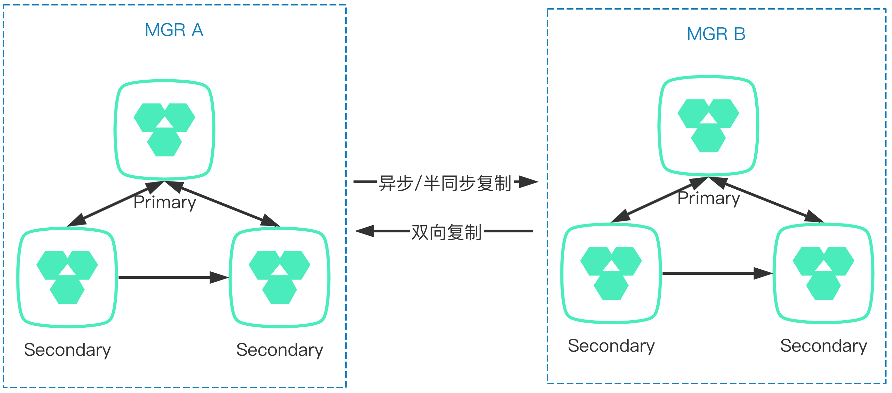

# FAQ - MGR-Based Architecture Solutions
---

## 1. Does GreatSQL support read/write splitting
You can use MySQL Router to implement read/write splitting.

You can also use the GreatSQL MGR feature of binding separate VIPs to read-write nodes and read-only nodes to implement read/write splitting. For details, see: [Built-in dynamic VIP in GreatSQL HA features](../5-enhance/5-2-ha-mgr-vip.md).

## 2. Does MGR support read load balancing
Yes. You can mount MySQL Router in front of the MGR cluster to implement read load balancing.

## 3. Does MGR support write load balancing
No. Since MGR adopts a shared-nothing mode and each node stores the full data, every write must be applied again on each node.

## 4. Can source-replica replication be built between two MGR clusters
First, the answer is yes, it can.

Second, to ensure the data security of MGR, the requirements for nodes with different roles are as follows:
- In single-primary mode, a Secondary node cannot simultaneously act as a Slave in Master-Slave replication
- In single-primary mode, the Primary node can simultaneously act as the Slave in M-S replication
- In multi-primary mode, any node can act as the Slave in M-S replication. Reminder: strongly recommend not to use multi-primary mode
- All tables must be InnoDB tables, with no data conflicts (e.g., duplicate data, missing data), and no foreign keys
- When a node restarts, note that the MGR service should be started first, then the M-S service. You can set `group_replication_start_on_boot=ON` and `skip_slave_start=ON` to guarantee this

The source-replica replication between the two MGR clusters can use asynchronous replication or semi-synchronous replication, mainly depending on the network latency between the two clusters and the architecture design. In this case, the overall architecture is similar to the following:

In this architecture, the two MGR clusters are independent of each other. If MySQL Router is mounted in front, you need to create the corresponding connections separately.

If you are worried about MGR node switchovers, as long as the originally pointed Master has not left the MGR cluster, the source-replica replication relationship still exists and is not affected. If you are worried that the original Master node leaving the MGR cluster will interrupt replication, you can use the new feature **Async Replication Auto failover** introduced after MySQL 8.0.22, adding each node to the replication sources. You can refer to the following materials:
- [MGR architecture solution across data centers in financial application scenarios](https://mp.weixin.qq.com/s/A3yJUz6DNvCgIfqD78t_qQ)
- [Switching Sources and Replicas with Asynchronous Connection Failover](https://dev.mysql.com/doc/refman/8.0/en/replication-asynchronous-connection-failover.html)
- [Video: How MGR guarantees data consistency](https://www.bilibili.com/video/BV1NT4y1R7Zi)

## 5. Can MGR be started with only two nodes like source-replica replication
When MGR is initialized and started, it can be started with only two nodes, or even one node, but this defeats the purpose of MGR. **Because as long as there are fewer than three nodes, majority voting cannot be performed.** When network failures or other situations occur, it cannot vote to confirm which nodes should be expelled from the cluster.

If you want to save server costs, you can choose GreatSQL 8.0.25-16 and later versions, which support the arbitrator node role. A low-spec server can be used to run it, meaning you can run a three-node MGR cluster at a cost close to two servers. For details, refer to: [New arbitrator (voting node) role](../5-enhance/5-2-ha-mgr-arbitrator.md).

## 6. Can MySQL Router be configured to poll between MGR primary and secondary nodes
MySQL Router uses two ports to distinguish read-write service requests. By default, port 6446 provides read-write services and port 6447 provides read-only services.
In single-primary mode, read-write services only connect to the Primary node. For the read-write service port, the optional strategies are as follows:
- first-available, only connects to the first available node
- round-robin (default), polls between multiple primary nodes

The read-only service polls all Secondary nodes by default. For the read-only service port, there are 3 optional strategies:
- first-available, only connects to the first available node
- round-robin, polls among all available Secondary nodes. If all Secondary nodes are unavailable, the read-only service is unavailable and will not connect to the Primary node
- round-robin-with-fallback (default), polls among all Secondary nodes, skipping unavailable nodes. If all Secondary nodes are unavailable, it will connect to the Primary node

Now we know that MySQL Router only connects to the Primary node to read data when all Secondary nodes are unavailable. It cannot connect to both primary and secondary nodes simultaneously when issuing read-only requests.

For more available strategies of MySQL Router, please refer to the documentation **[routing_strategy parameter/option](https://dev.mysql.com/doc/mysql-router/8.0/en/mysql-router-conf-options.html#option_mysqlrouter_routing_strategy)**.

## 7. Can MySQL Shell be used to manage GreatSQL MGR clusters

As long as the major version is the same, for example, MySQL Shell 8.0.32 can manage MGR clusters built with GreatSQL 8.0.32-24/8.0.32-25 versions.

Note that when the GreatSQL MGR cluster contains Arbitrator (arbitration) nodes, MySQL Shell cannot recognize them. In this case, only GreatSQL Shell can be used to manage it.

For more details, refer to: [How to use shell to take over a manually built GreatSQL MGR cluster (including arbitrator nodes)](https://greatsql.cn/thread-503-1-1.html).

## 8. Why is single-primary MGR architecture recommended, and why is multi-primary architecture not recommended

Simply put, single-primary is simpler and has better performance.

Multi-primary is more complex, has worse performance, and can easily cause transaction conflicts from multi-node writes. It requires application-side coordination and control, such as distinguishing different businesses writing to different nodes.

## 9. Why is it recommended to add the report_host option when configuring MGR

There are two reasons.

1. Because the servers where MGR member nodes reside may have multiple different hostnames, to avoid confusion or duplication, you need to edit `/etc/hosts` on each server to set the corresponding hostnames, or set the `report_host` option.

2. If you want to use the GreatSQL dynamic VIP binding feature, it also depends on the `report_host` setting. For details, see: [Built-in dynamic VIP](../5-enhance/5-2-ha-mgr-vip.md).

**Scan the QR code to follow the WeChat official account**

