# Connect via GUI Client
---

To connect with a GUI client, you need to modify the current host configuration information of the user.

```sql
greatsql> SELECT Host,User FROM mysql.user; 
+-----------+------------------+
| Host      | User             |
+-----------+------------------+
| localhost | root             |
| localhost | mysql.infoschema |
| localhost | mysql.session    |
| localhost | mysql.sys        |
+-----------+------------------+
4 rows in set (0.00 sec)
```

The `Host` column specifies the IP from which the user is allowed to log in.

- If `user=root, Host=192.168.1.1`, it means the root user accesses the database from a client at `192.168.1.1`
- If `user=root, Host=localhost`, it means the user can only access the database from a local client
- If `Host=192.168.1.%`, where `%` is a wildcard, it means any client in the `192.168.1.%` network segment can connect
- If `Host=%`, it means all IPs have permission to connect

::: warning Warning

Do not modify the Host of the root user! Unpredictable consequences may occur.

It is recommended to create a new user authorized for remote connection instead.
:::

Create a new user `greatsql` with the password `GreatSQL@2024`. This user has the same privileges as root and supports remote connection:

```sql
CREATE USER 'greatsql'@'%' IDENTIFIED BY 'GreatSQL@2024';
```

Here `%` means the user is allowed to connect from any host. Use the `GRANT` statement to give `newuser` the same privileges as `root`, and then flush the privileges:

```sql
GRANT ALL PRIVILEGES ON *.* TO 'greatsql'@'%' WITH GRANT OPTION;
FLUSH PRIVILEGES;
```

::: warning Note
Granting a user the same privileges as `root` may introduce security risks. Make sure you understand these risks and do so only when necessary.
:::

In the following examples, the `greatsql` user is used to connect.

### Connecting with Navicat

The process of downloading and installing Navicat is omitted here. Navicat is a paid tool; you can use the trial version if needed.

Open the Navicat tool, click `连接` (Connect) in the upper left corner, and select `MySQL`.

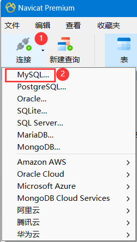

Fill in the connection name (any name of your choice), set the host to the IP of the machine where GreatSQL runs, keep the default port 3306, use the `greatsql` user created above, and set the password to `GreatSQL@2024`.

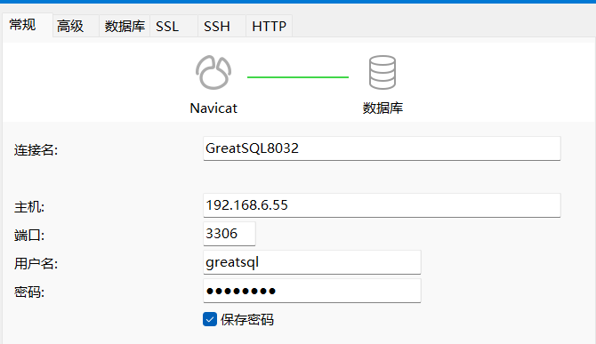

After filling in the information, click `测试连接` (Test Connection) in the lower left corner. If `连接成功` (Connection Successful) is displayed, click `确认` (OK) in the lower right corner.

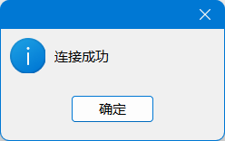

At this point, connecting to the GreatSQL server with Navicat is complete.

### Connecting with MySQL workbench

Open the MySQL workbench tool and click the `+` sign.

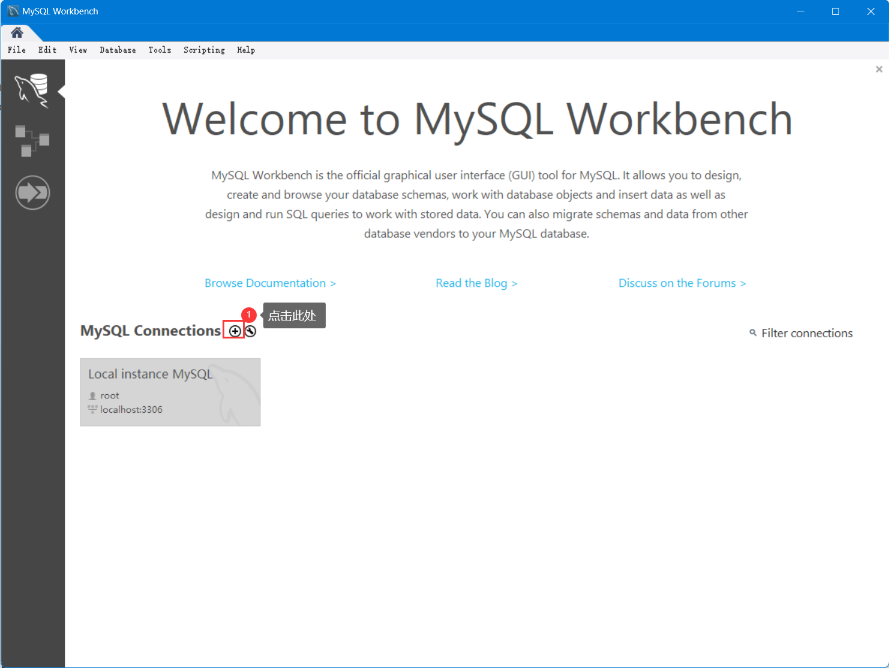

Fill in the connection name (any name of your choice), set the host to the IP of the machine where GreatSQL runs, keep the default port 3306, use the `greatsql` user created above, and when filling in the password, click `Store in Vault` and enter the password `GreatSQL@2024` in the pop-up window.

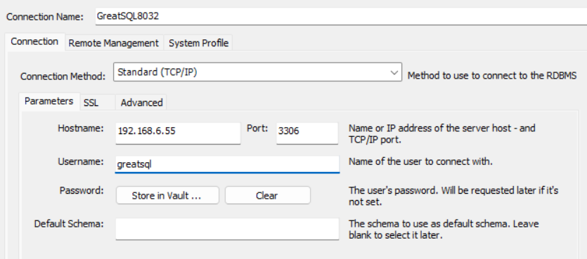

After filling in the information, click `Test Connection` to test the connection. The message `Successfully made the MySQL connection` indicates a successful connection.

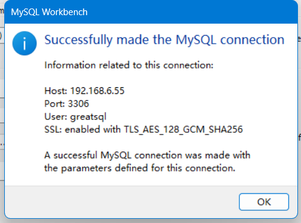

The connection information can also be seen on the home page; double-click it to enter the GreatSQL client.

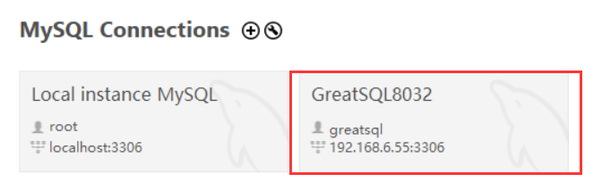

At this point, connecting to the GreatSQL server with MySQL workbench is complete.

### Connecting with ATOMDB

ATOMDB™ is a database management client for developers. It lets developers run queries conveniently, create and manage databases, and supports managing the mainstream database management systems on the market.

Download and install ATOMDB.

- [https://atomdb.com/product/download.html](https://atomdb.com/product/download.html)

Open the ATOMDB tool, click `File` in the upper left corner, and select `New project`. A dialog box appears asking for the project name; fill it in as you need.

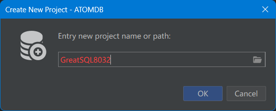

After the project is created, click to add a data source.

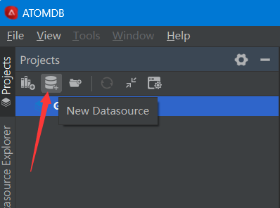

Select GreatDB and click Next.

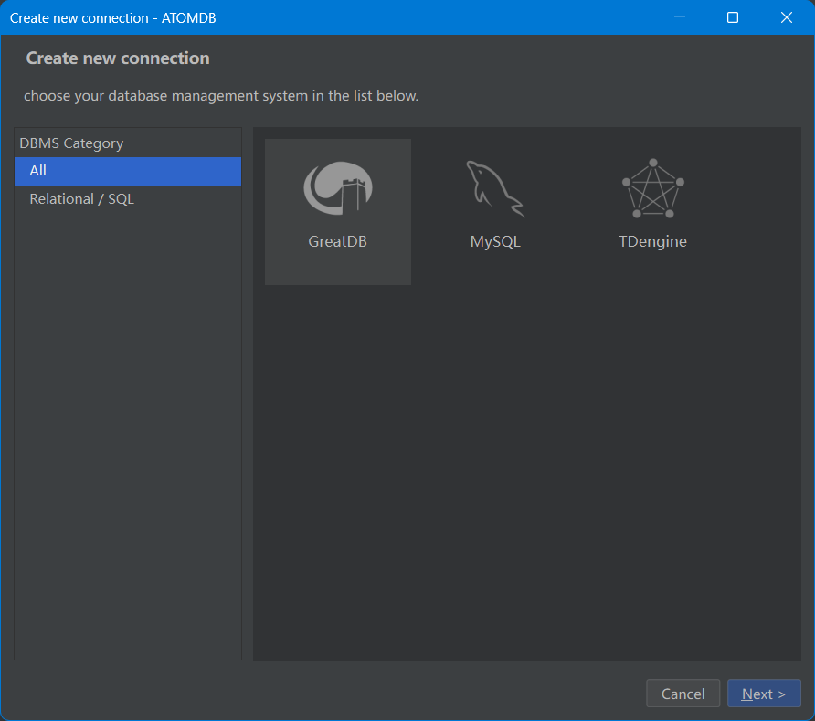

Fill in the connection name (any name of your choice), set the host to the IP of the machine where GreatSQL runs, keep the default port 3306, use the `greatsql` user created above, set the password to `GreatSQL@2024`, and click `test`.

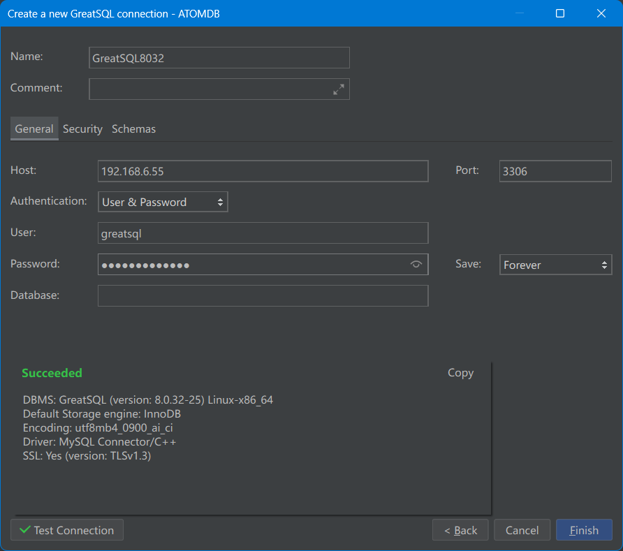

At this point, connecting to the GreatSQL server with ATOMDB is complete.


**Scan the QR code to follow our WeChat Official Account**


