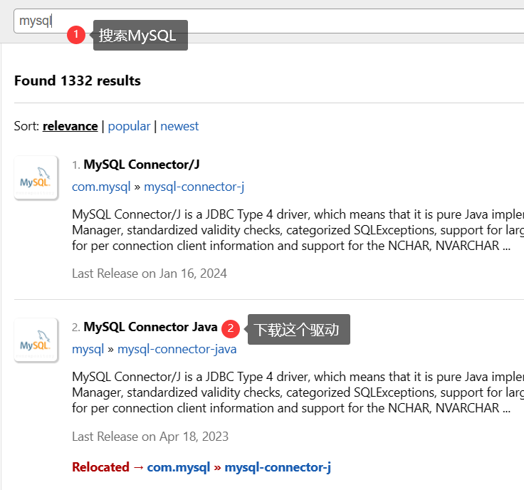
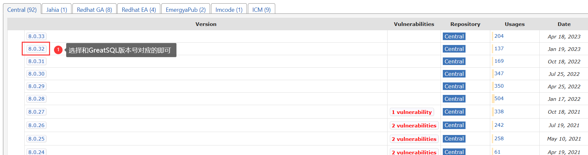
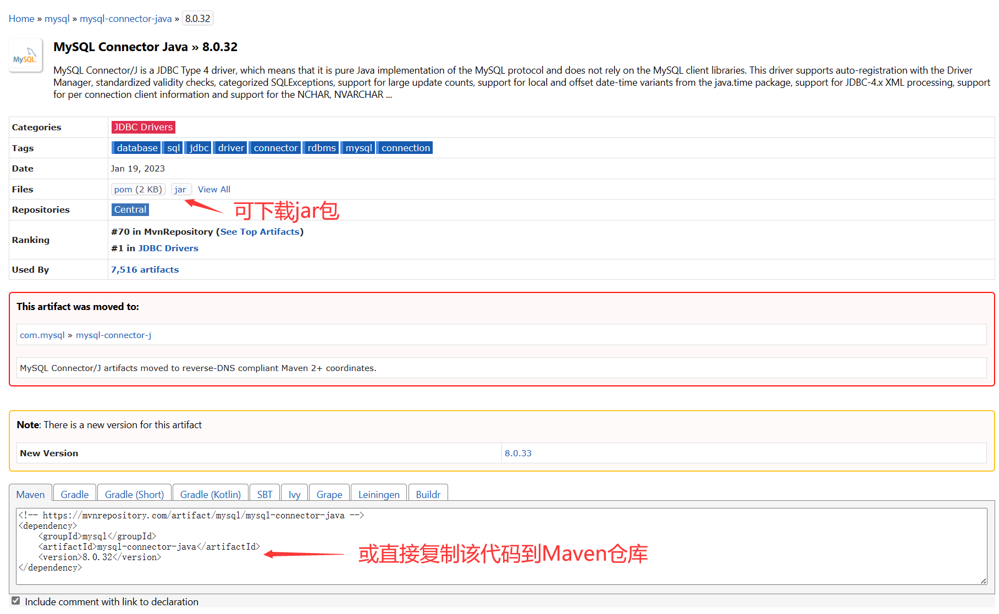

# Choosing a Driver
---

## Connecting with Java

Prerequisites

- GreatSQL database installed.
- JDK and Maven installed.
- IntelliJ IDEA installed.

### Example

Go to the Maven official website: [https://mvnrepository.com/](https://mvnrepository.com/).

Search for MySQL and download the driver package that matches MySQL/GreatSQL.



Click `MySQL Connector Java` and select the driver version that corresponds to your GreatSQL version.



After entering the corresponding driver version:

1. You can download the jar package used for connection.

2. Or copy the Maven code below directly into the Maven repository.



If you use **Maven**, add the following to your `<dependencies></dependencies>`.

```java
<dependency>
    <groupId>mysql</groupId>
    <artifactId>mysql-connector-java</artifactId>
    <version>8.0.32</version>
</dependency>
```

Then fill in the URL information in the `application.properties` file.

```java
jdbc:mysql://host:port/schema_name?useSSL=false&serverTimezone=Asia/Shanghai&user=$user_name&password=$password&characterEncoding=UTF-8
```

- `host`: the IP address for connecting to the GreatSQL database
- `port`: the connection port of the GreatSQL database
- `schema_name`: the name of the database to access
- `useSSL=false`: do not encrypt the connection; required for versions 8.0 and later
- `&serverTimezone=Asia/Shanghai`: Shanghai, China time zone
- `user_name`: the user name for the connection
- `password`: the password for the connection
- `characterEncoding`: the character encoding, UTF-8 by default

## Connecting with Golang

Prerequisites

- GreatSQL database installed.
- GO installed.

### Example

Import the package in the `import` section of the Go project.

```go
import (
	"database/sql"
	"fmt"
	_ "github.com/go-sql-driver/mysql" // blank import
	"log"
)
```

Fill in the database connection information.

```go
const (
	username = "root"
	password = "GreatSQL@2024"
	hostname = "127.0.0.1:3306"
	dbname   = "employees"
)
```

- `user`: the user name for the connection

- `password`: the password for the connection
- `host`: the IP address for connecting to the GreatSQL database

- `dbname`: the name of the database to connect to

Add the following code in the `main` function.

```go
func main() {
	// Build the database connection string
	dataSourceName:= fmt.Sprintf("%s:%s@tcp(%s)/%s", username, password, hostname, dbname)
	// Connect to the database
	db, err:= sql.Open("GreatSQL", dataSourceName)
	if err != nil {
		log.Fatal(err)
	}
 
	defer db.Close() // Defer closing of the connection
 
	// Test the connection
	// The Ping() method tries to send a simple query to the database to check whether the database responds properly.
	// If the connection is valid, the Ping() method returns no error; otherwise, it returns the corresponding error message.
	if err = db.Ping(); err != nil {
		log.Fatal(err)
	}
 
	fmt.Println("Connected to the database!")
}
```

The output `Connected to the database!` means the connection to GreatSQL succeeded.

## Connecting with Python

Prerequisites

- GreatSQL database installed.
- Python installed.

### Example

Run the following command to install the driver with the `pip` command.

```python
pip install mysql-connector-python
```

And configure the database connection parameters in the code.

```python
db = mysql.connector.connect(
    host="localhost",
    user="root",
    password="GreatSQL@2024",
    database="employees"
)
```

- `host`: the IP address for connecting to the GreatSQL database

- `user`: the user name for the connection

- `password`: the password for the connection

- `database`: the name of the database to connect to

Below is a simple example code.

```python
import mysql.connector

# Create a database connection
db = mysql.connector.connect(
    host="localhost",
    user="root",
    password="GreatSQL@2024",
    database="employees"
)

# Create a cursor object
cursor = db.cursor()

# Create a data table named "python_greatsql"
cursor.execute("CREATE TABLE python_greatsql (id INT AUTO_INCREMENT PRIMARY KEY, name VARCHAR(255), address VARCHAR(255))")

# Insert records
sql = "INSERT INTO python_greatsql (name, address) VALUES (%s, %s)"
values = [("KAiTO", "ABC"), ("GreatSQL", "EFG")]
cursor.executemany(sql, values)
db.commit()

# Query records
cursor.execute("SELECT * FROM python_greatsql")
results = cursor.fetchall()
for row in results:
    print(row)

# Update records
sql = "UPDATE python_greatsql SET address = %s WHERE name = %s"
values = ("HIJ", "GreatSQL")
cursor.execute(sql, values)
db.commit()

# Delete records
sql = "DELETE FROM python_greatsql WHERE name = %s"
values = ("KAITO",)
cursor.execute(sql, values)
db.commit()

# Close the cursor and the database connection
cursor.close()
db.close()
```


**Scan the QR code to follow our WeChat Official Account**


