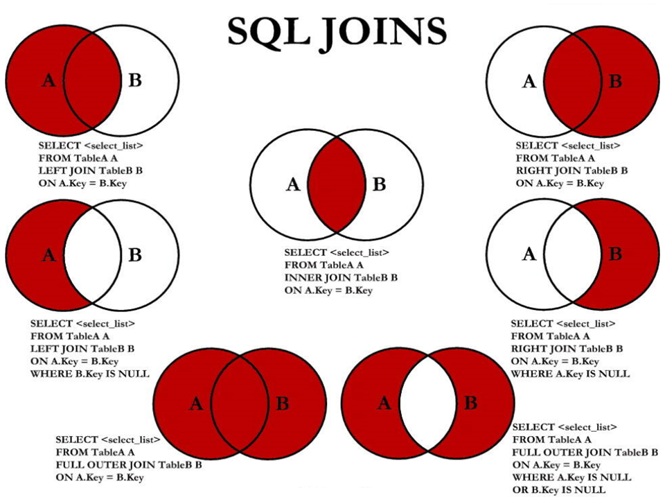

# Multi-Table Join Query

This section uses the sample databases mentioned in [Documentation Conventions](./12-dev-guide.md):
- employee data (large dataset, includes data and test/verification suite)
- world database
- sakila database


When querying data, applications often need to combine data from multiple tables. In such cases, the JOIN statement makes it easy to merge multi-table data and achieve efficient data retrieval.

Multi-table join query is one of the most important operations in a relational database, and also one of the most complex. Let's first look at a diagram showing the types of multi-table join queries.



As the diagram shows, multi-table join queries fall into seven types:
- Inner join (INNER JOIN) [center of the diagram]
- Left outer join (LEFT OUTER JOIN) [top-left of the diagram]
- Left outer join excluding part B (LEFT OUTER JOIN EXCLUDING B) [middle-left of the diagram]
- Right outer join (RIGHT OUTER JOIN) [top-right of the diagram]
- Right outer join excluding part A (RIGHT OUTER JOIN EXCLUDING A) [middle-right of the diagram]
- Full join (FULL JOIN) [bottom-left of the diagram]
- Full outer join (FULL OUTER JOIN) [bottom-right of the diagram]

Next, let's go through each type of multi-table join query one by one.

## Inner Join (INNER JOIN)

The basic syntax of an inner join is as follows:
```sql
SELECT * FROM A INNER JOIN B ON A.key = B.key;
```
The pseudocode is as follows:
```sql
SELECT column list
  FROM table A INNER JOIN table B
  ON join condition
  WHERE other clauses;
```
For example, a simple inner join (INNER JOIN) query that joins the `city` table and the `country` table and retrieves data based on the fields they have in common (that is, the CountryCode field of the city table and the Code field of the country table):
```sql
SELECT     
  city.Name AS CityName,  
  country.Name AS CountryName  
FROM city    
  INNER JOIN country   
  ON city.CountryCode = country.Code
  LIMIT 5;
```

::: details View the execution result
```sql
+----------------+-------------+
| CityName       | CountryName |
+----------------+-------------+
| Oranjestad     | Aruba       |
| Kabul          | Afghanistan |
| Qandahar       | Afghanistan |
| Herat          | Afghanistan |
| Mazar-e-Sharif | Afghanistan |
+----------------+-------------+
5 rows in set (0.00 sec)
```
:::

Here is a more complex example:

A three-table join that queries the `city` table, the `country` table, and the `countrylanguage` table, and retrieves data based on the fields they have in common (that is, the CountryCode field of the city table and the Code field of the country table, as well as the CountryCode field of the countrylanguage table).

The result tells, for each city, whether the corresponding language of its country is an official language.
```sql
greatsql> SELECT   
    city.Name AS CityName,  
    country.Name AS CountryName,  
    countrylanguage.Language  
FROM   
    city  
INNER JOIN   
    country ON city.CountryCode = country.Code  
INNER JOIN   
    countrylanguage ON country.Code = countrylanguage.CountryCode  
WHERE   
    countrylanguage.IsOfficial = 'T' -- Assume that we only care about official languages
LIMIT 5;
```

::: details View the execution result
```sql
+----------------+-------------+----------+
| CityName       | CountryName | Language |
+----------------+-------------+----------+
| Oranjestad     | Aruba       | Dutch    |
| Kabul          | Afghanistan | Dari     |
| Qandahar       | Afghanistan | Dari     |
| Herat          | Afghanistan | Dari     |
| Mazar-e-Sharif | Afghanistan | Dari     |
+----------------+-------------+----------+
5 rows in set (0.01 sec)
```
:::

## Left Outer Join (LEFT OUTER JOIN)
The basic syntax of a left outer join is as follows:
```sql
SELECT * FROM A LEFT JOIN B ON A.key = B.key;
```
The pseudocode is as follows:
```sql
SELECT column list
  FROM table A LEFT JOIN table B
  ON join condition
  WHERE other clauses;
```

With a left outer join, all records from the left table are selected, and only the matching records from the right table are selected. If there is no matching record in the right table, the corresponding fields in the result set contain NULL.

For example, a simple left outer join query that joins the `city` table and the `country` table and retrieves data based on the fields they have in common (that is, the CountryCode field of the city table and the Code field of the country table):
```sql
SELECT   
    city.Name AS CityName,
    country.Name AS CountryName  
FROM   
    city  
LEFT JOIN country 
  ON city.CountryCode = country.Code
  LIMIT 5;
```

::: details View the execution result
```sql
+----------------+-------------+
| CityName       | CountryName |
+----------------+-------------+
| Kabul          | Afghanistan |
| Qandahar       | Afghanistan |
| Herat          | Afghanistan |
| Mazar-e-Sharif | Afghanistan |
| Amsterdam      | Netherlands |
+----------------+-------------+
5 rows in set (0.01 sec)
```
:::

Here is a more complex example:

With the city, country, and countrylanguage tables of the world database, perform a left outer join to obtain all cities together with their countries and official languages.
```sql
SELECT city.name AS 城市名称,
       country.name AS 国家名称,
       countrylanguage.language AS 官方语言,
       countrylanguage.percentage AS 说官方语言的人的百分比
FROM country
  INNER JOIN city ON country.capital = city.id
  INNER JOIN countrylanguage ON country.code = countrylanguage.countrycode
  WHERE countrylanguage.isofficial = 'T'
  LIMIT 5;
```

::: details View the execution result
```sql
+--------------+--------------+--------------+-----------------------------------+
| 城市名称      | 国家名称     | 官方语言      | 说官方语言的人的百分比             |
+--------------+--------------+--------------+-----------------------------------+
| Oranjestad   | Aruba        | Dutch        |                               5.3 |
| Kabul        | Afghanistan  | Dari         |                              32.1 |
| Kabul        | Afghanistan  | Pashto       |                              52.4 |
| The Valley   | Anguilla     | English      |                               0.0 |
| Tirana       | Albania      | Albaniana    |                              97.9 |
+--------------+--------------+--------------+-----------------------------------+
5 rows in set (0.00 sec)
```
:::
### Left Outer Join Excluding Part B
To exclude part B, add the `IS NULL` condition to the WHERE statement, as shown below:
```sql
SELECT * FROM A LEFT JOIN B ON A.key = B.key WHERE B.key IS NULL;
```
For example, query the cities that have no corresponding country:
```sql
SELECT   
    city.Name AS CityName,  
    country.Name AS CountryName  
FROM   
    city  
LEFT JOIN   
    country ON city.CountryCode = country.Code  
WHERE   
    country.Code IS NULL;
```

The query result is as follows:
```sql
Empty set (0.01 sec)
```
This shows that every city has a corresponding country.

Insert a row to test whether the statement can query data with a NULL value:
```sql
-- Remove the NOT NULL constraint from the original table
greatsql> ALTER TABLE city MODIFY COLUMN CountryCode CHAR(3)
  CHARACTER SET utf8mb4 COLLATE utf8mb4_0900_ai_ci;

-- Insert a row that has no corresponding country
greatsql> INSERT INTO CITY VALUES(4080, 'greatsql', NULL, 'GREATSQL', 6666);
```
The execution result is as follows:
```sql
greatsql> SELECT city.Name AS CityName,country.Name AS CountryName
  FROM city LEFT JOIN country 
  ON city.CountryCode = country.Code  
  WHERE country.Code IS NULL;
+----------+-------------+
| CityName | CountryName |
+----------+-------------+
| greatsql | NULL        |
+----------+-------------+
1 row in set (0.00 sec)
```
Restore the data after the test:
```sql
-- Delete the inserted row
greatsql> DELETE FROM CITY WHERE ID=4080;

-- Restore the NOT NULL constraint of the original table
greatsql> ALTER TABLE city MODIFY COLUMN CountryCode CHAR(3)
  CHARACTER SET utf8mb4 COLLATE utf8mb4_0900_ai_ci NOT NULL;
```

## Right Outer Join (RIGHT OUTER JOIN)
The basic syntax of a right outer join is as follows:
```sql
SELECT * FROM A RIGHT JOIN B ON A.key = B.key;
```
The pseudocode is as follows:
```sql
SELECT column list
  FROM table A RIGHT JOIN table B
  ON join condition
  WHERE other clauses;
```
With a right outer join, all records from the right table are selected, and only the matching records from the left table are selected. If there is no matching record in the left table, the corresponding fields in the result set contain NULL.

For example, query the cities of every country:
```sql
SELECT   
    country.Name AS CountryName,  
    city.Name AS CityName  
FROM   
    country  
RIGHT JOIN   
    city ON country.Code = city.CountryCode
LIMIT 5;
```

::: details View the execution result
```sql
+-------------+----------------+
| CountryName | CityName       |
+-------------+----------------+
| Afghanistan | Kabul          |
| Afghanistan | Qandahar       |
| Afghanistan | Herat          |
| Afghanistan | Mazar-e-Sharif |
| Netherlands | Amsterdam      |
+-------------+----------------+
5 rows in set (0.01 sec)
```
:::

### Right Outer Join Excluding Part A
To exclude part A, add the `IS NULL` condition to the WHERE statement, as shown below:
```sql
SELECT * FROM A RIGHT JOIN B ON A.key = B.key WHERE A.key IS NULL;
```
For example, query the countries that have no corresponding city:
```sql
SELECT   
    country.Name AS CountryName,  
    city.Name AS CityName  
FROM   
    country  
RIGHT JOIN   
    city ON country.Code = city.CountryCode
WHERE 
    city.CountryCode IS NULL;
```

The query result is as follows:
```sql
Empty set (0.01 sec)
```
This shows that every country has a corresponding city.

Insert a row to test whether the statement can query data with a NULL value:
```sql
-- Remove the NOT NULL constraint from the original table
greatsql> ALTER TABLE city MODIFY COLUMN CountryCode CHAR(3)
  CHARACTER SET utf8mb4 COLLATE utf8mb4_0900_ai_ci;

-- Insert a row that has no corresponding country
greatsql> INSERT INTO CITY VALUES(4080,'greatsql',NULL,'GREATSQL',6666);
```
The execution result is as follows:
```sql
greatsql> SELECT country.Name AS CountryName,city.Name AS CityName  
  FROM country RIGHT JOIN city 
  ON country.Code = city.CountryCode
  WHERE city.CountryCode IS NULL;
+-------------+----------+
| CountryName | CityName |
+-------------+----------+
| NULL        | greatsql |
+-------------+----------+
1 row in set (0.00 sec)
```

Restore the data after the test:
```sql
-- Delete the inserted row
greatsql> DELETE FROM CITY WHERE ID=4080;

-- Restore the NOT NULL constraint of the original table
greatsql> ALTER TABLE city MODIFY COLUMN CountryCode CHAR(3)
  CHARACTER SET utf8mb4 COLLATE utf8mb4_0900_ai_ci NOT NULL;
```
## Full Join
In GreatSQL, a full join is produced by combining the result of the left outer join of A with the result of the right outer join of B using `UNION`.

The format is as follows:
```sql
SELECT column list
  FROM table A LEFT JOIN table B
  ON join condition
  WHERE and other clauses

UNION 

SELECT column list
  FROM table A RIGHT JOIN table B
  ON join condition
  WHERE and other clauses;
```

For example, use GreatSQL to emulate a full join: query the city and country tables to obtain all cities together with their countries (if any), as well as the countries without a corresponding city (if any):
```sql
-- Combine the results of the left join and the right join with UNION to emulate a full join
SELECT   
    city.Name AS CityName,  
    country.Name AS CountryName  
FROM   
    city  
LEFT JOIN   
    country ON city.CountryCode = country.Code  

UNION  
  
SELECT   
    NULL AS CityName, -- Or use a specific value to indicate that this is a country without a city
    country.Name AS CountryName  
FROM   
    country  
LEFT JOIN   
    city ON country.Code = city.CountryCode
LIMIT 5;
```

::: details View the execution result
```sql
+----------------+-------------+
| CityName       | CountryName |
+----------------+-------------+
| Kabul          | Afghanistan |
| Qandahar       | Afghanistan |
| Herat          | Afghanistan |
| Mazar-e-Sharif | Afghanistan |
| Amsterdam      | Netherlands |
+----------------+-------------+
5 rows in set (0.00 sec)
```
:::

### Full Outer Join
A full outer join combines the result of the left outer join (A - A∩B) with the result of the right outer join (B - A∩B) using `UNION`.
The syntax is as follows:
```sql
SELECT column list
  FROM table A LEFT JOIN table B
  ON join condition
  WHERE joined field of the right table IS NULL AND other clauses

UNION

SELECT column list
  FROM table A RIGHT JOIN table B
  ON join condition
  WHERE joined field of the left table IS NULL AND other clauses
```

For example, query the cities of every country, as well as the countries that have no corresponding city:
```sql
greatsql> SELECT   
    city.Name AS CityName,  
    country.Name AS CountryName  
FROM city LEFT JOIN country 
ON city.CountryCode = country.Code
WHERE country.Code IS NULL

UNION  
  
SELECT   
    NULL AS CityName, -- Or use a specific value to indicate that this is a country without a city
    country.Name AS CountryName  
FROM country LEFT JOIN city 
ON country.Code = city.CountryCode
WHERE country.Code IS NULL
LIMIT 5;
```

The query result is as follows:
```sql
Empty set (0.01 sec)
```
This shows that there is no country without a corresponding city.

Insert a row to test whether the statement can query data with a NULL value:
```sql
-- Remove the NOT NULL constraint from the original table
greatsql> ALTER TABLE city MODIFY COLUMN CountryCode CHAR(3)
  CHARACTER SET utf8mb4 COLLATE utf8mb4_0900_ai_ci;

-- Insert a row that has no corresponding country
greatsql> INSERT INTO CITY VALUES(4080,'greatsql',NULL,'GREATSQL',6666);
```
The execution result is as follows:
```sql
greatsql> SELECT   
    city.Name AS CityName,  
    country.Name AS CountryName  
FROM city LEFT JOIN country 
ON city.CountryCode = country.Code
WHERE country.Code IS NULL

UNION  
  
SELECT   
    NULL AS CityName, -- Or use a specific value to indicate that this is a country without a city
    country.Name AS CountryName  
FROM country LEFT JOIN city 
ON country.Code = city.CountryCode
WHERE country.Code IS NULL
LIMIT 5;
+----------+-------------+
| CityName | CountryName |
+----------+-------------+
| greatsql | NULL        |
+----------+-------------+
1 row in set (0.05 sec)
```

Restore the data after the test:
```sql
-- Delete the inserted row
greatsql> DELETE FROM CITY WHERE ID=4080;

-- Restore the NOT NULL constraint of the original table
greatsql> ALTER TABLE city MODIFY COLUMN CountryCode CHAR(3)
  CHARACTER SET utf8mb4 COLLATE utf8mb4_0900_ai_ci NOT NULL;
```

**Scan the QR code to follow our WeChat Official Account**


