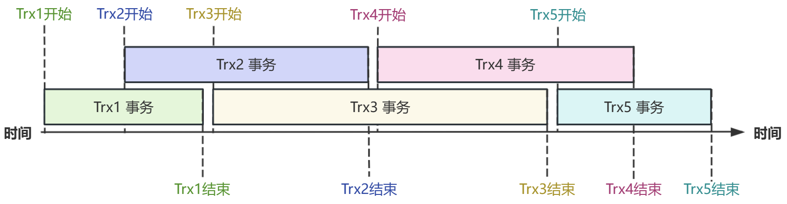

# Transaction Concurrency & Locking
---

This section describes transaction concurrency control, different transaction reads, and locking mechanisms.

## Introduction

MySQL/GreatSQL transactions support **MVCC (multi-version concurrency control)**, implement **consistent nonlocking reads** based on the MVCC mechanism, and use MVCC and row-level locking to implement transaction concurrency control.

The MVCC mechanism is a technique used in database management systems to implement transaction concurrency control. It keeps historical versions to support multiple transactions reading and writing at the same time, thereby improving database concurrency performance and transaction isolation.

Consistent reads of a transaction are guaranteed by the read view and the data versions: by reading the version number, all committed transaction data whose version is less than the read version number is returned. This process requires no locking, which is how consistent nonlocking reads are achieved.

Unlike other databases, InnoDB implements row-level locking based on indexes, so its locking behavior also differs.

## MVCC

The MVCC mechanism of the MySQL/GreatSQL InnoDB engine keeps historical versions in the [Undo Log](../2-about-greatsql/4-6-greatsql-undo-log.md) to support concurrent read and write operations of transactions, improving database performance and transaction isolation so that read operations do not block write operations.

For different transaction versions, semantics must be defined for this multi-version data so that users see a consistent database state, that is, a consistent snapshot of the data.

In InnoDB, `trx_id` (transaction ID) is used to determine the visibility of transaction versions, as shown in the following figure.



As shown in the figure above, there are 5 transactions in total. Their mutual visibility is as follows:

- Trx5 can see the data modified by Trx1, Trx2, and Trx3, but not the data modified by Trx4.
- Trx4 can see the data modified by Trx1 and Trx2, but not the data modified by Trx3.
- Trx3 can see the data modified by Trx1, but not the data modified by Trx2.
- Trx2 can see the data of its own transaction, but not the data modified by Trx1.

## Transaction Reads

First, understand a few concepts.
1. **Snapshot**: a list built from a set of active InnoDB transactions at a certain point in time, used to implement the MVCC mechanism to ensure transaction consistency and isolation.
2. **Consistent nonlocking read**: data is read without locking, and the consistency of the data is achieved through the MVCC mechanism, ensuring that the data read stays consistent throughout the transaction.
3. **Current read**: the latest version of the data is read directly without using the MVCC mechanism, which may cause uncommitted data changes to be read; a current read usually requires locking.
4. **Semi-consistent read**: a read operation used by `UPDATE` statements; it is a combination of **READ COMMITTED** and a consistent read.

The following examples demonstrate and explain these different concepts.

### Transaction Reads Under RR

Question 1: under the RR isolation level, when is the snapshot created?

- Test 1
```sql
---------------------------------------------------------------------------------------------------------------------------------------
                               trx1                                │ trx2
---------------------------------------------------------------------------------------------------------------------------------------
greatsql> SET SESSION TRANSACTION ISOLATION LEVEL REPEATABLE READ; │greatsql> SET SESSION TRANSACTION ISOLATION LEVEL REPEATABLE READ;
greatsql> BEGIN;                                                   │greatsql> BEGIN;
                                                                   │
greatsql> SELECT * FROM city WHERE ID = 3;                         │
+----+-------+-------------+----------+------------+               │
| ID | Name  | CountryCode | District | Population |               │
+----+-------+-------------+----------+------------+               │
|  3 | Herat | AFG         | Herat    |     186800 |               │
+----+-------+-------------+----------+------------+               │
                                                                   │
greatsql> UPDATE city SET Population=206800 WHERE ID = 3;          │
---------------------------------------------------------------------------------------------------------------------------------------
                                                                   │/* trx2 starts after trx1 updated (but has not committed), yet still reads the old data */
                                                                   │greatsql> SELECT * FROM city WHERE ID=3;
                                                                   │+----+-------+-------------+----------+------------+
                                                                   │| ID | Name  | CountryCode | District | Population |
                                                                   │+----+-------+-------------+----------+------------+
                                                                   │|  3 | Herat | AFG         | Herat    |     186800 |
                                                                   │+----+-------+-------------+----------+------------+
```

- Test 2
```sql
---------------------------------------------------------------------------------------------------------------------------------------
                               trx1                                │ trx2
---------------------------------------------------------------------------------------------------------------------------------------
greatsql> SET SESSION TRANSACTION ISOLATION LEVEL REPEATABLE READ; │greatsql> SET SESSION TRANSACTION ISOLATION LEVEL REPEATABLE READ;
greatsql> BEGIN;                                                   │greatsql> BEGIN;
greatsql> SELECT * FROM city WHERE ID = 3;                         │
+----+-------+-------------+----------+------------+               │
| ID | Name  | CountryCode | District | Population |               │
+----+-------+-------------+----------+------------+               │
|  3 | Herat | AFG         | Herat    |     186800 |               │
+----+-------+-------------+----------+------------+               │
                                                                   │
greatsql> UPDATE city SET Population=206800 WHERE ID = 3;          │
greatsql> COMMIT;                                                  │
---------------------------------------------------------------------------------------------------------------------------------------
                                                                   │/* trx2 issues the SELECT only after trx1 commits, so it reads the latest committed data */
                                                                   │greatsql> SELECT * FROM city WHERE ID=3;
                                                                   │+----+-------+-------------+----------+------------+
                                                                   │| ID | Name  | CountryCode | District | Population |
                                                                   │+----+-------+-------------+----------+------------+
                                                                   │|  3 | Herat | AFG         | Herat    |     206800 |
                                                                   │+----+-------+-------------+----------+------------+
```

- Test 3

```sql
---------------------------------------------------------------------------------------------------------------------------------------
                               trx1                                │ trx2
---------------------------------------------------------------------------------------------------------------------------------------
greatsql> SET SESSION TRANSACTION ISOLATION LEVEL REPEATABLE READ; │greatsql> SET SESSION TRANSACTION ISOLATION LEVEL REPEATABLE READ;
greatsql> BEGIN;                                                   │greatsql> BEGIN;
greatsql> SELECT * FROM city WHERE ID = 3;                         │greatsql> SELECT * FROM city WHERE ID=3;
+----+-------+-------------+----------+------------+               │+----+-------+-------------+----------+------------+
| ID | Name  | CountryCode | District | Population |               │| ID | Name  | CountryCode | District | Population |
+----+-------+-------------+----------+------------+               │+----+-------+-------------+----------+------------+
|  3 | Herat | AFG         | Herat    |     186800 |               │|  3 | Herat | AFG         | Herat    |     186800 |
+----+-------+-------------+----------+------------+               │+----+-------+-------------+----------+------------+
                                                                   │
greatsql> UPDATE city SET Population=206800 WHERE ID = 3;          │
greatsql> COMMIT;                                                  │
------------------------------------------------------------------------------------------------------------------------------------
                                                                   │/* after trx1 commits, the snapshot version is still read, which is "repeatable read" */
                                                                   │+----+-------+-------------+----------+------------+
                                                                   │| ID | Name  | CountryCode | District | Population |
                                                                   │+----+-------+-------------+----------+------------+
                                                                   │|  3 | Herat | AFG         | Herat    |     186800 |
                                                                   │+----+-------+-------------+----------+------------+
                                                                   │
                                                                   │/* with FOR UPDATE it is a current read and the latest version can be read */
                                                                   │greatsql> SELECT * FROM city WHERE ID=3 FOR UPDATE;
                                                                   │+----+-------+-------------+----------+------------+
                                                                   │| ID | Name  | CountryCode | District | Population |
                                                                   │+----+-------+-------------+----------+------------+
                                                                   │|  3 | Herat | AFG         | Herat    |     206800 |
                                                                   │+----+-------+-------------+----------+------------+
                                                                   │
                                                                   │/* without FOR UPDATE, repeatable read is restored */
                                                                   │greatsql> SELECT * FROM city WHERE ID=3;
                                                                   │+----+-------+-------------+----------+------------+
                                                                   │| ID | Name  | CountryCode | District | Population |
                                                                   │+----+-------+-------------+----------+------------+
                                                                   │|  3 | Herat | AFG         | Herat    |     186800 |
                                                                   │+----+-------+-------------+----------+------------+
```

From the experiments above, we can draw the following conclusions:
1. **Under the RR isolation level, the snapshot is created when the first read request is issued**.
2. **Under the RR isolation level, after the snapshot is created, all reads in the transaction are based on the snapshot to achieve repeatable read**.
3. **Under the RR isolation level, a current read can read the latest committed data**.

### Transaction Reads Under RC

Question 2: under the RC isolation level, when is the snapshot created?

- Test 1

```sql
---------------------------------------------------------------------------------------------------------------------------------------
                        session1                          │ session2
---------------------------------------------------------------------------------------------------------------------------------------
greatsql> SELECT * FROM city WHERE ID = 3;                │greatsql> SET SESSION TRANSACTION ISOLATION LEVEL READ COMMITTED;
+----+-------+-------------+----------+------------+      │
| ID | Name  | CountryCode | District | Population |      │greatsql> BEGIN;
+----+-------+-------------+----------+------------+      │greatsql> SELECT * FROM city WHERE ID=3;
|  3 | Herat | AFG         | Herat    |     186800 |      │+----+-------+-------------+----------+------------+
+----+-------+-------------+----------+------------+      │| ID | Name  | CountryCode | District | Population |
                                                          │+----+-------+-------------+----------+------------+
                                                          │|  3 | Herat | AFG         | Herat    |     186800 |
                                                          │+----+-------+-------------+----------+------------+
---------------------------------------------------------------------------------------------------------------------------------------
greatsql> UPDATE city SET Population=196800 WHERE ID = 3; │/* session1 uses autocommit mode */
                                                          │/* after session1 updates, session2 reads the change immediately */
                                                          │
                                                          │greatsql> SELECT * FROM city WHERE ID=3;
                                                          │+----+-------+-------------+----------+------------+
                                                          │| ID | Name  | CountryCode | District | Population |
                                                          │+----+-------+-------------+----------+------------+
                                                          │|  3 | Herat | AFG         | Herat    |     196800 |
                                                          │+----+-------+-------------+----------+------------+
---------------------------------------------------------------------------------------------------------------------------------------
greatsql> UPDATE city SET Population=206800 WHERE ID = 3; │greatsql> SELECT * FROM city WHERE ID=3;
                                                          │+----+-------+-------------+----------+------------+
                                                          │| ID | Name  | CountryCode | District | Population |
                                                          │+----+-------+-------------+----------+------------+
                                                          │|  3 | Herat | AFG         | Herat    |     206800 |
                                                          │+----+-------+-------------+----------+------------+
                                                          │
---------------------------------------------------------------------------------------------------------------------------------------
greatsql> UPDATE city SET Population=216800 WHERE ID = 3; │greatsql> SELECT * FROM city WHERE ID=3;
                                                          │+----+-------+-------------+----------+------------+
                                                          │| ID | Name  | CountryCode | District | Population |
                                                          │+----+-------+-------------+----------+------------+
                                                          │|  3 | Herat | AFG         | Herat    |     216800 |
                                                          │+----+-------+-------------+----------+------------+
```

From the experiment above, we can conclude: **under the RC isolation level, every SELECT in a transaction obtains the latest committed transaction data**.


### Semi-Consistent Read

A semi-consistent read is specific to the InnoDB engine. It is a read operation used by `UPDATE` statements and is a combination of **READ COMMITTED** and a consistent read.

If an `UPDATE` statement reads a row that is already locked, it returns the latest (committed) version of that row and checks again whether this version satisfies the `WHERE` condition of the `UPDATE` request. If the condition is satisfied, the row needs to be updated, so another read operation is issued: the latest version of the row is read and locked.

Semi-consistent reads occur in a transaction when:
- the transaction isolation level is less than or equal to RC, that is, the RU or RC isolation level, or when `innodb_locks_unsafe_for_binlog = 1` (this option is deprecated after 8.0);
- and the statement is an `UPDATE` request (requests such as `INSERT` and `DELETE` are not supported).

The following examples demonstrate the characteristics of semi-consistent reads. In these examples, the `trx.t1` table created in [Transaction Management](./12-6-1-trx-control.md) is used.

- Test 1

```sql
---------------------------------------------------------------------------------------------------------------------------------------
                              trx1                                │ trx2
---------------------------------------------------------------------------------------------------------------------------------------
greatsql> SET SESSION TRANSACTION ISOLATION LEVEL READ COMMITTED; │greatsql> SET SESSION TRANSACTION ISOLATION LEVEL READ COMMITTED;
greatsql> BEGIN;                                                  │greatsql> BEGIN;
                                                                  │
greatsql> SELECT * FROM t1 WHERE c2 = 'row3' FOR UPDATE;          │
+----+----+------+                                                │
| id | c1 | c2   |                                                │
+----+----+------+                                                │
|  3 |  3 | row3 |                                                │
+----+----+------+                                                │
---------------------------------------------------------------------------------------------------------------------------------------
                                                                  │/* the WHERE condition in trx1 has no index, so all records are locked */
                                                                  │/* but the UPDATE request from trx2 is not blocked */
                                                                  │greatsql> UPDATE t1 SET c2 = 'row22' WHERE ID=2;
                                                                  │Query OK, 1 row affected (0.00 sec)
                                                                  │Rows matched: 1  Changed: 1  Warnings: 0
```

- Test 2

```sql
---------------------------------------------------------------------------------------------------------------------------------------
                            session1                              │ session2
---------------------------------------------------------------------------------------------------------------------------------------
greatsql> SET SESSION TRANSACTION ISOLATION LEVEL READ COMMITTED; │greatsql> SET SESSION TRANSACTION ISOLATION LEVEL READ COMMITTED;
greatsql> BEGIN;                                                  │greatsql> BEGIN;
greatsql> SELECT * FROM t1 WHERE c2 = 'row3' FOR UPDATE;          │
+----+----+------+                                                │/* change the row lock wait timeout in session2 */
| id | c1 | c2   |                                                │greatsql> set innodb_lock_wait_timeout=5;
+----+----+------+                                                │
|  3 |  3 | row3 |                                                │
+----+----+------+                                                │
------------------------------------------------------------------------------------------------------------------------------------
                                                                  │/* session2 is blocked until the row lock wait times out */
                                                                  │/* it is a DELETE, not an UPDATE, so semi-consistent read does not apply */
                                                                  │greatsql> DELETE FROM t1 WHERE c2='row2';
                                                                  │ERROR 1205 (HY000): Lock wait timeout exceeded; try restarting transact
                                                                  │ion
```


## Locking Mechanisms

### Introduction

The commonly used storage engines in MySQL/GreatSQL are InnoDB and MyISAM. The former supports table locks and row locks, while the latter supports only table locks.

Besides table locks and row locks, there are many other locks, such as the global read lock (**FLUSH TABLES WITH READ LOCK**), the backup lock (**LOCK INSTANCE FOR BACKUP**), the metadata lock (**Metadata LOCK**), and the AUTO_INCREMENT lock (**AUTO_INCREMENT Lock**).

Here we focus on InnoDB row locks. For the other locks above, refer to the following parts of the MySQL manual:
- [FLUSH TABLES WITH READ LOCK](https://dev.mysql.com/doc/refman/8.0/en/flush.html#flush-tables-with-read-lock)
- [LOCK INSTANCE FOR BACKUP](https://dev.mysql.com/doc/refman/8.0/en/lock-instance-for-backup.html)
- [Metadata Locking](https://dev.mysql.com/doc/refman/8.0/en/metadata-locking.html)
- [LOCK TABLES](https://dev.mysql.com/doc/refman/8.0/en/lock-tables.html)
- [InnoDB AUTO_INCREMENT Lock Modes](https://dev.mysql.com/doc/refman/8.0/en/innodb-auto-increment-handling.html#innodb-auto-increment-lock-modes)

### InnoDB Locking

Every database has its own row lock implementation, and there is no absolute optimum; whatever fits is good enough.

InnoDB row locks are implemented based on indexes. This implementation differs from that of other database systems, so some locking behavior also differs.

Another implication of index-based locking is that when a lock is requested and no usable index exists, the index cannot be used to filter the matching rows, so a full table scan is performed; this means all rows are locked with row locks, and the result is almost equivalent to a table lock. Of course, the two are still different, and the locking cost also differs.

InnoDB row lock modes include:
- **Shared lock (S lock)**: S locks can be requested at the same time and do not conflict.
- **Exclusive lock (X lock)**: it cannot be requested together with other locks and conflicts with any other lock.

InnoDB also supports multi-granularity locking, which allows row locks and table locks to coexist. For this purpose, intention locks are introduced. Intention locks are also divided into two types:
- **Intention shared lock (IS lock)**: indicates that the transaction wants to acquire S locks on some rows of the table, in which case an IS lock must be placed on the table.
- **Intention exclusive lock (IX lock)**: indicates that the transaction wants to acquire X locks on some rows of the table, in which case an IX lock must be placed on the table.

With intention locks, finer-grained locking can be supported, for example:
- When an intention lock is placed on a table, it indicates that some rows in the table are also locked with row locks;
- To place X locks on some rows, an IX lock must be placed on the table first, and then X locks are placed on those rows.

The lock compatibility modes of InnoDB tables are shown in the following table:

|   |IS |IX | S | X |
|---|---|---|---|---|
|IS |Compatible |Compatible |Compatible |Conflict |
|IX |Compatible |Compatible |Conflict |Conflict |
|S  |Compatible |Conflict |Compatible |Conflict |
|X  |Conflict |Conflict |Conflict |Conflict |

In summary, the compatibility modes are:
- Intention locks are compatible with each other;
- A table IX lock conflicts with all row-level locks (whether S or X locks);
- A table IS lock is compatible with row-level S locks and conflicts with row-level X locks;
- X locks are incompatible with all locks.

Table-level intention locks allow fast conflict detection between table locks and row locks. Imagine that without table-level intention locks, requesting a table lock would require scanning all rows to check for row lock conflicts; with intention locks, only the existence of a conflict needs to be checked, which is extremely efficient.

### Locking Differences Between Indexes

InnoDB locking behavior also differs between transaction isolation levels. InnoDB row lock types include the following:
- **record lock (`LOCK_REC_NOT_GAP`)**: locks only a single record itself, excluding the gaps before and after it.
- **gap lock (`LOCK_GAP`)**: locks a range (usually the gap between two records, or the gap before or after a record).
- **next-key lock (`LOCK_ORDINARY`)**: also called the ordinary lock; it combines the two lock types above and locks the record itself as well as the matching gap range. Its purpose is to solve the phantom read problem of transactions.
- **insert intention lock (`LOCK_INSERT_INTENTION`)**: a special gap lock that guarantees safety when concurrent inserts or updates exist. When two transactions both hold insert intention locks, they do not block each other, but they are blocked by record-level exclusive locks.

Under the default **[RR (Repeatable Read) isolation level](./12-6-2-trx-isolation.md#repeatable-read)**, for equality condition queries (such as `WHERE id = ?`), the default locking is as follows:
- If the id column is the primary key index, a `LOCK_REC_NOT_GAP` lock is placed.
- If the id column is a unique constraint index, a `LOCK_REC_NOT_GAP` lock is placed.
- If the id column is an ordinary secondary index, a `LOCK_ORDINARY` lock is placed.
- If the id column has no index, a `LOCK_ORDINARY` lock is placed on all records of the table.

Under the **[RC (Read Committed) isolation level](./12-6-2-trx-isolation.md#read-committed)**, for equality condition queries (such as `WHERE id = ?`), the default locking is as follows:
- Regardless of whether the id column is the primary key index, a unique constraint index, or an ordinary secondary index, a `LOCK_REC_NOT_GAP` lock is placed.
- If the id column has no index, a `LOCK_REC_NOT_GAP` lock is placed on all records of the table, and it may be downgraded when necessary, as described in **[Semi-Consistent Read](#semi-consistent-read)** above.

Finally, when foreign key constraint checks or uniqueness constraint checks are involved, a `LOCK_ORDINARY|LOCK_S` lock must be placed first; after the check is complete, it is converted into the corresponding lock.

The following creates a test table and writes data to demonstrate the locking differences in several scenarios.

```sql
greatsql> CREATE DATABASE trx;
greatsql> USE trx;
greatsql> CREATE TABLE `t1` (
  `id` int unsigned NOT NULL AUTO_INCREMENT,
  `c1` int unsigned NOT NULL DEFAULT '0',
  `c2` int unsigned NOT NULL DEFAULT '0',
  `c3` varchar(20) NOT NULL DEFAULT '',
  PRIMARY KEY (`id`),
  UNIQUE KEY `k1` (`c1`),
  KEY `k2` (`c2`)
) ENGINE=InnoDB

greatsql> INSERT INTO t1 VALUES (1,1,1,'row1'),(2,2,2,'row2'),(3,3,3,'row3'),(4,4,4,'row4'),(5,5,5,'row5'),(6,6,6,'row6');
greatsql> SELECT * FROM t1;
+----+----+----+------+
| id | c1 | c2 | c3   |
+----+----+----+------+
|  1 |  1 |  1 | row1 |
|  2 |  2 |  2 | row2 |
|  3 |  3 |  3 | row3 |
|  4 |  4 |  4 | row4 |
|  5 |  5 |  5 | row5 |
|  6 |  6 |  6 | row6 |
+----+----+----+------+
```

- Scenario 1: primary key column + equality condition

```sql
greatsql> BEGIN;
greatsql> SELECT * FROM t1 WHERE id = 3 FOR UPDATE;
+----+----+----+------+
| id | c1 | c2 | c3   |
+----+----+----+------+
|  3 |  3 |  3 | row3 |
+----+----+----+------+

greatsql> SELECT ENGINE_LOCK_ID,OBJECT_NAME,INDEX_NAME,LOCK_TYPE,LOCK_MODE,LOCK_STATUS,LOCK_DATA FROM performance_schema.data_locks;
+----------------------------------------+-------------+------------+-----------+---------------+-------------+-----------+
| ENGINE_LOCK_ID                         | OBJECT_NAME | INDEX_NAME | LOCK_TYPE | LOCK_MODE     | LOCK_STATUS | LOCK_DATA |
+----------------------------------------+-------------+------------+-----------+---------------+-------------+-----------+
| 139691667119480:1113:139691596764208   | t1          | NULL       | TABLE     | IX            | GRANTED     | NULL      | <- table-level IX lock
| 139691667119480:51:4:4:139691596761216 | t1          | PRIMARY    | RECORD    | X,REC_NOT_GAP | GRANTED     | 3         | <- LOCK_REC_NOT_GAP|X on id = 3
+----------------------------------------+-------------+------------+-----------+---------------+-------------+-----------+
```

From the query result above, besides the row lock, there is also a table-level IX lock. They are explained as follows:

  - `ENGINE_LOCK_ID`: the unique lock identifier;
  - `OBJECT_NAME`: the locked object, here the table `t1`;
  - `INDEX_NAME`: the index that is locked; for table locks and MDL locks it is **NULL**, so here it is **NULL** and **PRIMARY** respectively;
  - `LOCK_TYPE`: the lock type, here **TABLE** and **RECORD** respectively;
  - `LOCK_MODE`: the lock mode, here a table IX lock and a row-level **LOCK_REC_NOT_GAP|X**;
  - `LOCK_STATUS`: the lock status; **GRANTED** means the lock has been granted; **PENDING** means waiting, that is, the lock request is blocked;
  - `LOCK_DATA`: the locked data; for table locks and MDL locks it is **NULL**; for row locks it is the value of the locked row, here 3.

Conclusion 1: **for a "primary key column + equality condition", a LOCK_REC_NOT_GAP lock is placed**.

- Scenario 2: unique constraint index column + equality condition

```sql
greatsql> BEGIN;
greatsql> SELECT * FROM t1 WHERE c1 = 3 FOR UPDATE;
+----+----+----+------+
| id | c1 | c2 | c3   |
+----+----+----+------+
|  3 |  3 |  3 | row3 |
+----+----+----+------+

greatsql> SELECT ENGINE_LOCK_ID,OBJECT_NAME,INDEX_NAME,LOCK_TYPE,LOCK_MODE,LOCK_STATUS,LOCK_DATA FROM performance_schema.data_locks;
+----------------------------------------+-------------+------------+-----------+---------------+-------------+-----------+
| ENGINE_LOCK_ID                         | OBJECT_NAME | INDEX_NAME | LOCK_TYPE | LOCK_MODE     | LOCK_STATUS | LOCK_DATA |
+----------------------------------------+-------------+------------+-----------+---------------+-------------+-----------+
| 139691667119480:1115:139691596764208   | t1          | NULL       | TABLE     | IX            | GRANTED     | NULL      | <- table-level IX lock
| 139691667119480:53:5:4:139691596761216 | t1          | k1         | RECORD    | X,REC_NOT_GAP | GRANTED     | 3, 3      | <- LOCK_REC_NOT_GAP|X on c1 = 3
| 139691667119480:53:4:4:139691596761560 | t1          | PRIMARY    | RECORD    | X,REC_NOT_GAP | GRANTED     | 3         | <- LOCK_REC_NOT_GAP|X on id = 3
+----------------------------------------+-------------+------------+-----------+---------------+-------------+-----------+
```

The following locks can be seen:
  - The table t1 is locked with an **IX** lock;
  - The unique secondary index k1 places a **LOCK_REC_NOT_GAP|X** lock on the row with c1 = 3; the locked record is (3,3), because all secondary indexes contain the primary key column value;
  - The primary key index **PRIMARY** places a **LOCK_REC_NOT_GAP|X** lock on the row with id = 3.

Conclusion 2: **for a "unique secondary index column + equality condition", besides placing a LOCK_REC_NOT_GAP lock on the matching record, the primary key index must also be accessed and locked with LOCK_REC_NOT_GAP**.


- Scenario 3: ordinary secondary index column + equality condition

```sql
greatsql> BEGIN;
greatsql> SELECT * FROM t1 WHERE c2 = 3 FOR UPDATE;
+----+----+----+------+
| id | c1 | c2 | c3   |
+----+----+----+------+
|  3 |  3 |  3 | row3 |
+----+----+----+------+

greatsql> SELECT ENGINE_LOCK_ID,OBJECT_NAME,INDEX_NAME,LOCK_TYPE,LOCK_MODE,LOCK_STATUS,LOCK_DATA FROM performance_schema.data_locks;
+----------------------------------------+-------------+------------+-----------+---------------+-------------+-----------+
| ENGINE_LOCK_ID                         | OBJECT_NAME | INDEX_NAME | LOCK_TYPE | LOCK_MODE     | LOCK_STATUS | LOCK_DATA |
+----------------------------------------+-------------+------------+-----------+---------------+-------------+-----------+
| 139691667119480:1115:139691596764208   | t1          | NULL       | TABLE     | IX            | GRANTED     | NULL      | <- table-level IX lock
| 139691667119480:53:6:4:139691596761216 | t1          | k2         | RECORD    | X             | GRANTED     | 3, 3      | <- LOCK_ORDINARY|X on c2 = 3
| 139691667119480:53:4:4:139691596761560 | t1          | PRIMARY    | RECORD    | X,REC_NOT_GAP | GRANTED     | 3         | <- LOCK_REC_NOT_GAP|X on id = 3
| 139691667119480:53:6:5:139691596761904 | t1          | k2         | RECORD    | X,GAP         | GRANTED     | 4, 4      | <- LOCK_GAP|X on the gap before c2 = 4
+----------------------------------------+-------------+------------+-----------+---------------+-------------+-----------+
```

The following locks can be seen:
  - The table t1 is locked with an **IX** lock;
  - The primary key index PRIMARY places a **LOCK_REC_NOT_GAP|X** lock on the row with id = 3;
  - The secondary index k2 places a **LOCK_ORDINARY|X** lock on the row with c2 = 3 (including the GAP before c2 = 3 as well as the row itself);
  - The secondary index k2 places a **LOCK_GAP|X** lock on the gap before c2 = 4.

Conclusion 3: **for an "ordinary secondary index column + equality condition", besides placing a LOCK_ORDINARY lock on the matching record, the primary key index must also be accessed and locked with LOCK_REC_NOT_GAP**.

- Scenario 4: no index column + equality condition

```sql
greatsql> BEGIN;
greatsql> SELECT * FROM t1 WHERE c3 = 'row3' FOR UPDATE;
+----+----+----+------+
| id | c1 | c2 | c3   |
+----+----+----+------+
|  3 |  3 |  3 | row3 |
+----+----+----+------+

greatsql> SELECT ENGINE_LOCK_ID,ENGINE_TRANSACTION_ID,OBJECT_NAME,INDEX_NAME,LOCK_TYPE,LOCK_MODE,LOCK_STATUS,LOCK_DATA FROM performance_schema.data_locks;
+-----------------------------------------+-----------------------+-------------+------------+-----------+-----------+-------------+------------------------+
| ENGINE_LOCK_ID                          | ENGINE_TRANSACTION_ID | OBJECT_NAME | INDEX_NAME | LOCK_TYPE | LOCK_MODE | LOCK_STATUS | LOCK_DATA              |
+-----------------------------------------+-----------------------+-------------+------------+-----------+-----------+-------------+------------------------+
| 139691667119480:1113:139691596764208    |                  2728 | t1          | NULL       | TABLE     | IX        | GRANTED     | NULL                   | <- table-level IX lock
| 139691667119480:51:4:1:139691596761216  |                  2728 | t1          | PRIMARY    | RECORD    | X         | GRANTED     | supremum pseudo-record | <- LOCK_ORDINARY|X on all records
| 139691667119480:51:4:2:139691596761216  |                  2728 | t1          | PRIMARY    | RECORD    | X         | GRANTED     | 1                      |
| 139691667119480:51:4:4:139691596761216  |                  2728 | t1          | PRIMARY    | RECORD    | X         | GRANTED     | 3                      |
| 139691667119480:51:4:5:139691596761216  |                  2728 | t1          | PRIMARY    | RECORD    | X         | GRANTED     | 4                      |
| 139691667119480:51:4:6:139691596761216  |                  2728 | t1          | PRIMARY    | RECORD    | X         | GRANTED     | 5                      |
| 139691667119480:51:4:7:139691596761216  |                  2728 | t1          | PRIMARY    | RECORD    | X         | GRANTED     | 6                      |
| 139691667119480:51:4:12:139691596761216 |                  2728 | t1          | PRIMARY    | RECORD    | X         | GRANTED     | 2                      |
+-----------------------------------------+-----------------------+-------------+------------+-----------+-----------+-------------+------------------------+
8 rows in set (0.00 sec)
```

The following locks can be seen:
  - The table t1 is locked with an **IX** lock;
  - All rows are locked with **LOCK_ORDINARY|X** locks;
  - The gap before the virtual maximum record (**supremum pseudo-record**) is also locked with a **LOCK_GAP|X** lock.

Conclusion 4: **for a "no index column + equality condition", all records are locked**.

For more scenarios, refer to the method above to experiment and observe the locking behavior yourself.

### Locating Row Lock Waits

When a lock is requested on some rows and those rows are already locked with a conflicting lock type, the lock request is blocked and enters the waiting state, which is called a "row lock wait". If the row lock wait lasts a long time (the default row lock wait time is 50 seconds, that is, the default value of `innodb_lock_wait_timeout` is 50), it is sometimes mistakenly called a "deadlock"; in fact, that is a "long lock wait", while a "deadlock" is another state, explained below.

The following demonstrates a scenario where a lock request is blocked and a lock wait occurs:

```sql
-------------------------------------------------------------------------------------------------------------------------
                       trx1                         │ trx2
-------------------------------------------------------------------------------------------------------------------------
greatsql> BEGIN;                                    │greatsql> BEGIN;
                                                    │greatsql> SELECT * FROM t1 WHERE id = 3 FOR UPDATE;
                                                    │+----+----+----+------+
                                                    │| id | c1 | c2 | c3   |
greatsql> set innodb_lock_wait_timeout=10;          │+----+----+----+------+
                                                    │|  3 |  3 |  3 | row3 |
                                                    │+----+----+----+------+
-------------------------------------------------------------------------------------------------------------------------
greatsql> SELECT * FROM t1 WHERE id = 3 FOR UPDATE; │/* the row lock request in trx1 is blocked and times out after 10 seconds */
                                                    │/* query the current row lock wait state */
                                                    │greatsql> SELECT * FROM performance_schema.data_lock_waits\G
ERROR 1205 (HY000): Lock wait timeout exceeded;     │*************************** 1. row ***************************
 try restarting transaction                         │                          ENGINE: INNODB
                                                    │       REQUESTING_ENGINE_LOCK_ID: 139691667119480:53:4:4:139691596761216 <- requested row lock ID
                                                    │REQUESTING_ENGINE_TRANSACTION_ID: 2791   <- transaction ID requesting the row lock
                                                    │            REQUESTING_THREAD_ID: 162    <- internal thread ID requesting the row lock (not the ID in PROCESSLIST)
                                                    │             REQUESTING_EVENT_ID: 21     <- event ID of the row lock request
                                                    │REQUESTING_OBJECT_INSTANCE_BEGIN: 139691596761216  <- memory address of the row lock request
                                                    │         BLOCKING_ENGINE_LOCK_ID: 139691667120328:53:4:4:139691596767392  <- held row lock ID
                                                    │  BLOCKING_ENGINE_TRANSACTION_ID: 2789   <- transaction ID holding the row lock
                                                    │              BLOCKING_THREAD_ID: 163    <- internal thread ID holding the row lock
                                                    │               BLOCKING_EVENT_ID: 21     <- event ID of the holding row lock
                                                    │  BLOCKING_OBJECT_INSTANCE_BEGIN: 139691596767392  <- memory address of the held row lock
```

The observation method above is not intuitive, so it can be changed to the following:

```sql
---------------------------------------------------------------------------------------------------------------------
                       trx1                         │ trx2
---------------------------------------------------------------------------------------------------------------------
greatsql> BEGIN;                                    │greatsql> BEGIN;
                                                    │greatsql> SELECT * FROM t1 WHERE id = 3 FOR UPDATE;
                                                    │+----+----+----+------+
                                                    │| id | c1 | c2 | c3   |
                                                    │+----+----+----+------+
                                                    │|  3 |  3 |  3 | row3 |
                                                    │+----+----+----+------+
                                                    │1 row in set (0.00 sec)
---------------------------------------------------------------------------------------------------------------------
greatsql> SELECT * FROM t1 WHERE id = 3 FOR UPDATE; │
                                                    │greatsql> SELECT * FROM sys.innodb_lock_waits\G
ERROR 1205 (HY000): Lock wait timeout exceeded;     │*************************** 1. row ***************************
try restarting transaction                          │                wait_started: 2024-05-07 01:23:59   <- lock wait start time
                                                    │                    wait_age: 00:00:09     <- lock wait duration
                                                    │               wait_age_secs: 9            <- lock wait duration
                                                    │                locked_table: `trx`.`t1`   <- table where the lock wait occurs
                                                    │         locked_table_schema: trx
                                                    │           locked_table_name: t1
                                                    │      locked_table_partition: NULL
                                                    │   locked_table_subpartition: NULL
                                                    │                locked_index: PRIMARY      <- locked index
                                                    │                 locked_type: RECORD       <- lock type
                                                    │              waiting_trx_id: 2794         <- blocked transaction ID
                                                    │         waiting_trx_started: 2024-05-07 01:23:59
                                                    │             waiting_trx_age: 00:00:09
                                                    │     waiting_trx_rows_locked: 1            <- rows locked in the blocked transaction
                                                    │   waiting_trx_rows_modified: 0            <- rows modified in the blocked transaction
                                                    │                 waiting_pid: 91           <- PROCESSLIST ID of the blocked transaction
                                                    │               waiting_query: SELECT * FROM t1 WHERE id = 3 FOR UPDATE   <- blocked SQL
                                                    │             waiting_lock_id: 139691667119480:53:4:4:139691596761216
                                                    │           waiting_lock_mode: X,REC_NOT_GAP   <- blocked lock mode LOCK_REC_NOT_GAP|X
                                                    │             blocking_trx_id: 2793         <- transaction ID holding the lock
                                                    │                blocking_pid: 92
                                                    │              blocking_query: SELECT * FROM sys.innodb_lock_waits   <- SQL being executed by the connection holding the lock
                                                    │            blocking_lock_id: 139691667120328:53:4:4:139691596767392
                                                    │          blocking_lock_mode: X,REC_NOT_GAP
                                                    │        blocking_trx_started: 2024-05-07 01:23:53
                                                    │            blocking_trx_age: 00:00:15
                                                    │    blocking_trx_rows_locked: 1
                                                    │  blocking_trx_rows_modified: 0
                                                    │     sql_kill_blocking_query: KILL QUERY 92   <- unlock method 1
                                                    │sql_kill_blocking_connection: KILL 92         <- unlock method 2
```

In the example above, two ways to resolve the lock are given at the end, but usually only method 2 works, because `KILL QUERY` only kills the SQL request currently running, and usually that SQL request is not the cause of the lock wait. Using method 2 disconnects the connection holding the lock, and the corresponding transaction is rolled back. See: [Rolling Back a Transaction](./12-6-1-trx-control.md#rolling-back-a-transaction).

### Row Lock Monitoring

When there are too many lock waits in the database, the business system may respond very slowly and the user experience may be very poor. Too many lock waits also make deadlocks more likely, and excessive lock waits can also cause high CPU consumption on the server.

Therefore, you need to monitor the current row lock waits and intervene in time if there is a serious problem.

You can execute the following SQL statement to list the transactions that are currently waiting for row locks or holding too many locks:

```sql
SELECT * FROM information_schema.INNODB_TRX WHERE
  trx_lock_structs >= 5 OR    -- more than 5 locks
  trx_rows_locked >= 100 OR   -- more than 100 rows locked
  trx_rows_modified >= 100 OR -- more than 100 rows modified
  TIME_TO_SEC(TIMEDIFF(NOW(),trx_started)) > 100;    -- transaction active for more than 100 seconds
```

In addition, pay attention to the following two row lock statistics:

```sql
greatsql> SELECT * FROM performance_schema.global_status WHERE 
  VARIABLE_NAME IN ('Innodb_row_lock_current_waits', 'Innodb_row_lock_time_avg');
+-------------------------------+----------------+
| VARIABLE_NAME                 | VARIABLE_VALUE |
+-------------------------------+----------------+
| Innodb_row_lock_current_waits | 0              |   <- current number of row lock waits; usually worth attention if greater than 0
| Innodb_row_lock_time_avg      | 11709          |   <- average row lock wait time (ms); usually worth attention if greater than 10 ms
+-------------------------------+----------------+
```

By monitoring the current lock waits, you can find and handle transactions that have been waiting for too long in time, avoiding a cascading effect.

### Deadlock

Deadlocks occur because requests for lock resources form an endless loop. For example, transaction A has obtained row lock L1 on data R1, and transaction B has obtained row lock L2 on data R2. Transaction A then requests row lock L21 on data R2 and is blocked (because R2 is held by B). At the same time, transaction B requests row lock L12 on data R1, which forms an endless loop and creates a deadlock.

InnoDB automatically detects deadlocks by default (the default value of `innodb_deadlock_detect` is **ON**) and rolls back one of the transactions to release lock resources so that the other transaction can continue. You can also set `innodb_print_all_deadlocks = ON` so that InnoDB always prints information about deadlocks that have occurred to the `error_log` for later troubleshooting and analysis.

The following is a classic deadlock example:

```sql
---------------------------------------------------------------------------------------------------------------------
                       trx1                         │ trx2
---------------------------------------------------------------------------------------------------------------------
greatsql> BEGIN;                                    │greatsql> BEGIN;
                                                    │/* trx1 and trx2 request row locks on id = 1 and id = 3 respectively */
greatsql> SELECT * FROM t1 WHERE id = 1 FOR UPDATE; │greatsql> SELECT * FROM t1 WHERE id = 3 FOR UPDATE;
+----+----+----+------+                             │+----+----+----+------+
| id | c1 | c2 | c3   |                             │| id | c1 | c2 | c3   |
+----+----+----+------+                             │+----+----+----+------+
|  1 |  1 |  1 | row1 |                             │|  3 |  3 |  3 | row3 |
+----+----+----+------+                             │+----+----+----+------+
                                                    │
                                                    │/* trx1 requests the row lock on id = 3 and is blocked */
greatsql> SELECT * FROM t1 WHERE id = 3 FOR UPDATE; │
+----+----+----+------+                             │/* trx2 requests the row lock on id = 1, which triggers a deadlock immediately and rolls back trx2 */
| id | c1 | c2 | c3   |                             │greatsql> SELECT * FROM t1 WHERE id = 1 FOR UPDATE;
+----+----+----+------+                             │ERROR 1213 (40001): Deadlock found when trying to get lock;
|  3 |  3 |  3 | row3 |                             │try restarting transaction
+----+----+----+------+                             │
1 row in set (3.91 sec)                             │
```

Check the deadlock log; the result is as follows:

```sql
greatsql> SHOW ENGINE INNODB STATUS\G
...
------------------------
LATEST DETECTED DEADLOCK
------------------------
*** (1) TRANSACTION:
TRANSACTION 2796, ACTIVE 12 sec starting index read
mysql tables in use 1, locked 1
LOCK WAIT 3 lock struct(s), heap size 1128, 2 row lock(s)
MySQL thread id 91, OS thread handle 139690606827264, query id 8562 localhost root statistics
SELECT * FROM t1 WHERE id = 3 FOR UPDATE

*** (1) HOLDS THE LOCK(S):
RECORD LOCKS space id 53 page no 4 n bits 80 index PRIMARY of table `trx`.`t1` trx id 2796 lock_mode X locks rec but not gap
Record lock, heap no 2 PHYSICAL RECORD: n_fields 6; compact format; info bits 0
 0: len 4; hex 00000001; asc    ;;
 1: len 6; hex 000000000ac9; asc      ;;
 2: len 7; hex 02000000cb0151; asc       Q;;
 3: len 4; hex 00000001; asc    ;;
 4: len 4; hex 00000001; asc    ;;
 5: len 4; hex 726f7731; asc row1;;


*** (1) WAITING FOR THIS LOCK TO BE GRANTED:
RECORD LOCKS space id 53 page no 4 n bits 80 index PRIMARY of table `trx`.`t1` trx id 2796 lock_mode X locks rec but not gap waiting
Record lock, heap no 4 PHYSICAL RECORD: n_fields 6; compact format; info bits 0
 0: len 4; hex 00000003; asc    ;;
 1: len 6; hex 000000000ac9; asc      ;;
 2: len 7; hex 02000000cb0197; asc       ;;
 3: len 4; hex 00000003; asc    ;;
 4: len 4; hex 00000003; asc    ;;
 5: len 4; hex 726f7733; asc row3;;


*** (2) TRANSACTION:
TRANSACTION 2795, ACTIVE 28 sec starting index read
mysql tables in use 1, locked 1
LOCK WAIT 3 lock struct(s), heap size 1128, 2 row lock(s)
MySQL thread id 92, OS thread handle 139691129067264, query id 8563 localhost root statistics
SELECT * FROM t1 WHERE id = 1 FOR UPDATE

*** (2) HOLDS THE LOCK(S):
RECORD LOCKS space id 53 page no 4 n bits 80 index PRIMARY of table `trx`.`t1` trx id 2795 lock_mode X locks rec but not gap
Record lock, heap no 4 PHYSICAL RECORD: n_fields 6; compact format; info bits 0
 0: len 4; hex 00000003; asc    ;;
 1: len 6; hex 000000000ac9; asc      ;;
 2: len 7; hex 02000000cb0197; asc       ;;
 3: len 4; hex 00000003; asc    ;;
 4: len 4; hex 00000003; asc    ;;
 5: len 4; hex 726f7733; asc row3;;


*** (2) WAITING FOR THIS LOCK TO BE GRANTED:
RECORD LOCKS space id 53 page no 4 n bits 80 index PRIMARY of table `trx`.`t1` trx id 2795 lock_mode X locks rec but not gap waiting
Record lock, heap no 2 PHYSICAL RECORD: n_fields 6; compact format; info bits 0
 0: len 4; hex 00000001; asc    ;;
 1: len 6; hex 000000000ac9; asc      ;;
 2: len 7; hex 02000000cb0151; asc       Q;;
 3: len 4; hex 00000001; asc    ;;
 4: len 4; hex 00000001; asc    ;;
 5: len 4; hex 726f7731; asc row1;;

*** WE ROLL BACK TRANSACTION (2)
```
The output above does not directly reveal the cause of the deadlock. Therefore, you usually need to observe the pattern of deadlocks first: within the period when deadlocks occur frequently, enable the general log by setting `general_log = ON` for a short time to record all requests in that period, and turn off the general log after the deadlock occurs.

You can also analyze the application code to infer the user SQL requests involved in the deadlock, and verify the inference by simulating them later.

Generally speaking, occasional deadlocks are normal and not a big concern; only frequent deadlocks require special attention.

On the application side, deadlock detection and handling should also be implemented. When a deadlock is caught, the application can try to commit the transaction again, or tell the user that a deadlock occurred and let the user decide whether to retry the commit.

If in some scenarios you do not want InnoDB to enable automatic deadlock detection, you can set `innodb_deadlock_detect = OFF`. However, this may cause more row lock waits, so you should appropriately lower the row lock wait time (modify the `innodb_lock_wait_timeout` option), usually no more than 5-10 seconds.


**Scan the QR code to follow our WeChat Official Account**


