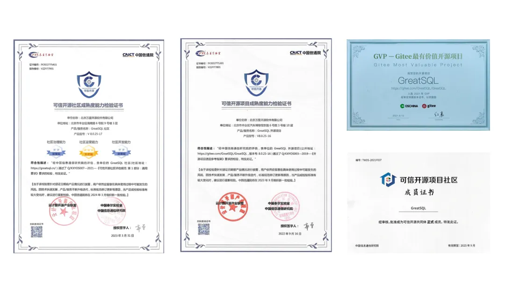
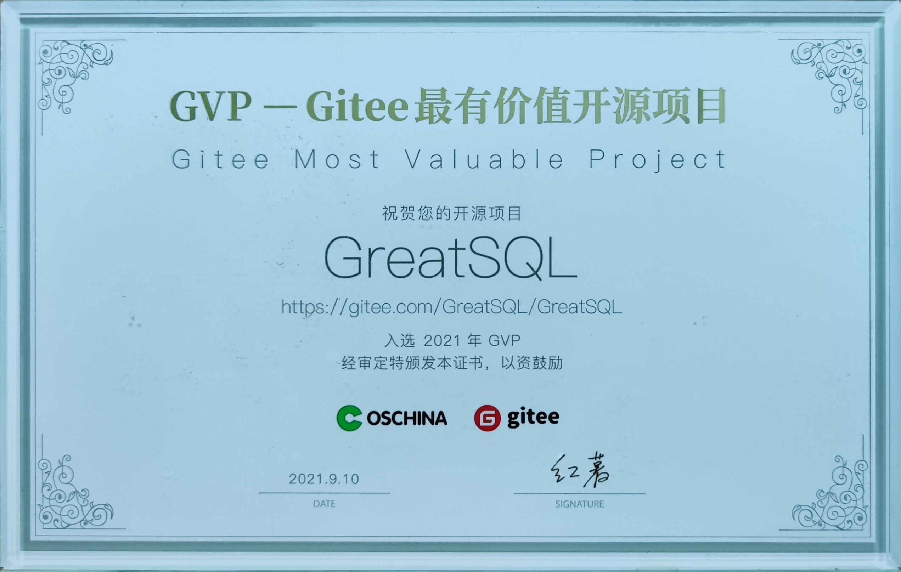
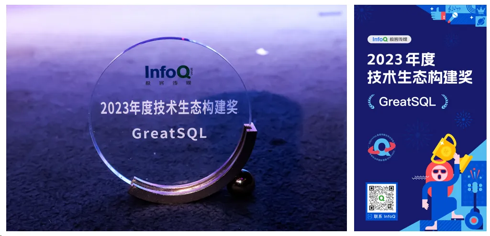
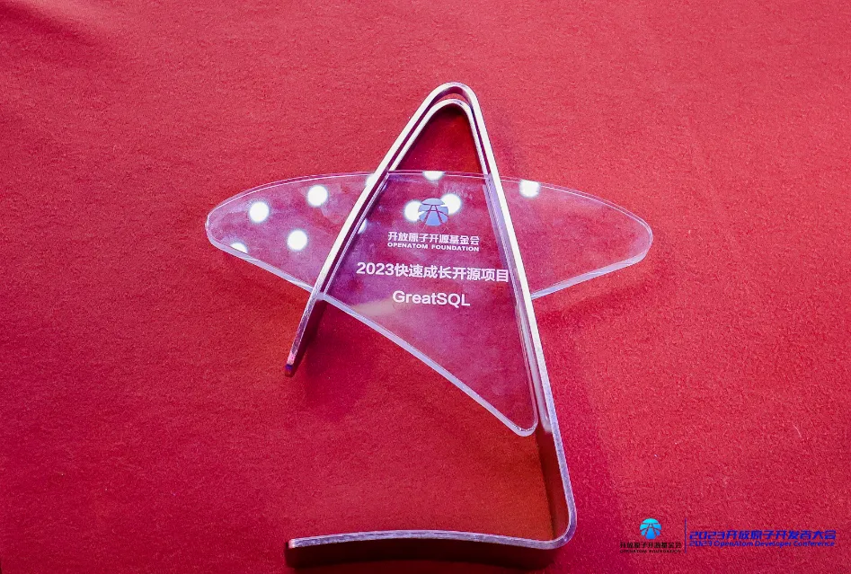
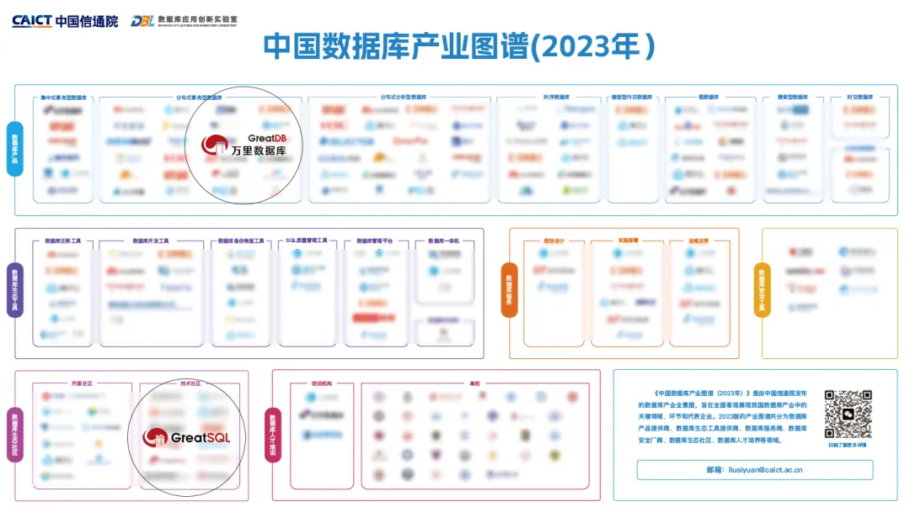
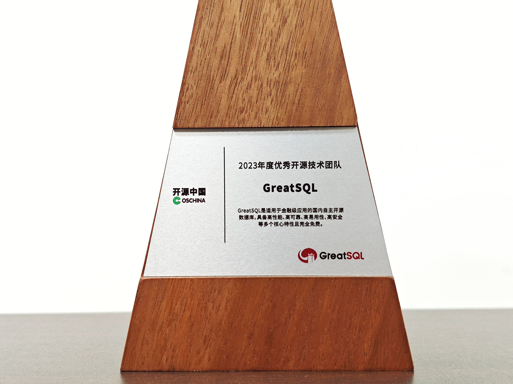

# Certifications & Honors
---

## Certifications

GreatSQL is a donation project under the OpenAtom Open Source Foundation and has obtained the **Trusted Open Source Community** and **Trusted Open Source Project** dual certifications from the China Academy of Information and Communications Technology (CAICT).

GreatSQL is also a GVP project on the Gitee platform, see: [https://gitee.com/gvp/database-related](https://gitee.com/gvp/database-related) in the **Database Related** category.

## Honors

The following is the list of honors received by GreatSQL:

- [InfoQ "Technology Ecosystem Building Award"](https://mp.weixin.qq.com/s/-ogZVcuKR15_xR3zVhOSJQ)

- [OpenAtom Foundation "2023 Fast-Growing Open Source Project"](https://mp.weixin.qq.com/s/V75OB7oTCUGgOEz3uUFM6Q)

- [Selected into the 2023 China Database Industry Map](https://mp.weixin.qq.com/s/tlmnmzxlDPOSaJlxT809Rg)

- [OSChina 2023 Outstanding Open Source Technology Team](https://mp.weixin.qq.com/s/tlmnmzxlDPOSaJlxT809Rg)

**Scan the QR code to follow the WeChat official account**

