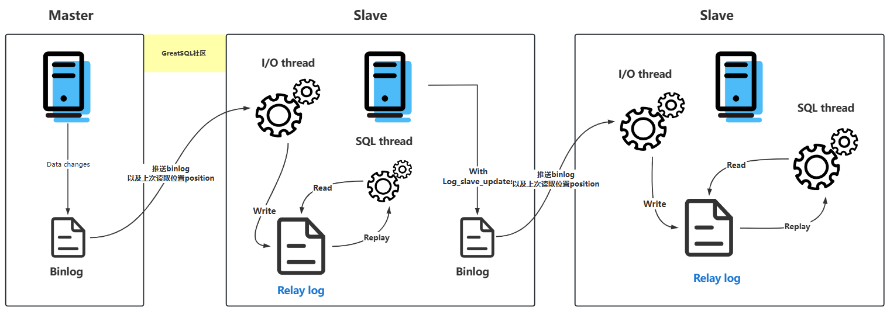

# Relay Log

## What Is the Relay Log

### Introduction
The Relay Log is a key component used in the replication process. It dumps and records the binary log events received from the primary server on the secondary server. The secondary server then reads the relay log and replays these events, keeping its data consistent with the primary server. The relay log helps implement data synchronization and fault tolerance mechanisms.

Relying on the relay log, a secondary server can also become a cascading node in a multi-level replication structure. For example, in a replication relationship such as A => B => C, the relay log needs to be enabled on server B, so that server C can ultimately keep its data consistent with server A. It is for this reason that it is called the relay log.

### The Role of the Relay Log

The main functions of the relay log include:

1. **Data replication**: The relay log is a log file used in the replication architecture to record the binary log events on the primary server. It ensures that the secondary server can obtain and execute these events, keeping its data consistent with the primary server.
2. **Fault tolerance and recovery**: In the case of network interruptions or temporary unavailability of the primary server, the relay log allows the secondary server to continue processing received but not yet applied events, ensuring data consistency and integrity.
3. **Asynchronous replication**: Through the relay log, the secondary server can asynchronously replay the log events of the primary server without processing them in real time, enhancing the fault tolerance and stability of the system.

## Management and Configuration

The main configuration parameters related to the relay log are as follows:

- `relay_log`
  
  Specifies the name and path of the relay log file. Only the file name can be set, or the full path can be set. For example: `relay_log=/data/GreatSQL/relay-log`, then relay log files starting with relay-log and ending with a numeric suffix are generated in the /data/GreatSQL directory. For example:

```bash
$ ls -la relay-log*

...
-rw-r----- 1 mysql mysql 204 Jul  5 14:49 relay-log.000001
-rw-r----- 1 mysql mysql 204 Jul  5 14:49 relay-log.000002
-rw-r----- 1 mysql mysql 204 Jul  5 14:49 relay-log.000003
-rw-r----- 1 mysql mysql 204 Jul  5 14:49 relay-log.000004
-rw-r----- 1 mysql mysql 204 Jul  5 14:49 relay-log.000005
-rw-r----- 1 mysql mysql 204 Jul  5 14:49 relay-log.000006
-rw-r----- 1 mysql mysql 157 Jul  5 14:49 relay-log.000007
-rw-r----- 1 mysql mysql 133 Jul  5 14:49 relay-log.index
```
Among them, `relay-log.index` is the relay log index file, which will be introduced below.

If a replication channel name (Replication channel) is specified when configuring source-replica replication on the current server, the relay log file name looks different, for example:

```sql
-- Specify the replication channel name when configuring source-replica replication
CHANGE MASTER TO MASTER_AUTO_POSITION=1 FOR CHANNEL 'repl-channel-01';
```

At this time, the relay logs look like this:

```bash
ls -la relay-log*

...
-rw-r----- 1 mysql mysql 180 Jul  5 14:56 relay-log.000001
-rw-r----- 1 mysql mysql  19 Jul  5 14:56 relay-log.index
-rw-r----- 1 mysql mysql 228 Jul  5 14:57 relay-log-repl@002dchannel@002d01.000001
-rw-r----- 1 mysql mysql 228 Jul  5 14:57 relay-log-repl@002dchannel@002d01.000002
-rw-r----- 1 mysql mysql 157 Jul  5 14:57 relay-log-repl@002dchannel@002d01.000003
-rw-r----- 1 mysql mysql 129 Jul  5 14:57 relay-log-repl@002dchannel@002d01.index
```

Similarly, if the current server is a member node of an MGR group replication, its relay log file names look different, for example:

```bash
$ ls -la relay-log*

...
-rw-r----- 1 mysql mysql 180 Jul  5 14:56 relay-log.000001
-rw-r----- 1 mysql mysql 231 Jul  5 14:57 relay-log-group_replication_recovery.000001
-rw-r----- 1 mysql mysql 231 Jul  5 14:57 relay-log-group_replication_recovery.000002
-rw-r----- 1 mysql mysql 157 Jul  5 14:57 relay-log-group_replication_recovery.000003
-rw-r----- 1 mysql mysql 138 Jul  5 14:57 relay-log-group_replication_recovery.index
-rw-r----- 1 mysql mysql  19 Jul  5 14:56 relay-log.index
```

From this, it is not hard to imagine that when a server is both a secondary server in source-replica replication and a member node in MGR group replication, its relay logs coexist in several groups, for example:

```bash
$ ls -la relay-log*

...
-rw-r----- 1 mysql mysql 180 Jul  5 14:56 relay-log.000001
-rw-r----- 1 mysql mysql 231 Jul  5 15:00 relay-log-group_replication_recovery.000001
-rw-r----- 1 mysql mysql 231 Jul  5 15:00 relay-log-group_replication_recovery.000002
-rw-r----- 1 mysql mysql 157 Jul  5 15:00 relay-log-group_replication_recovery.000003
-rw-r----- 1 mysql mysql 138 Jul  5 15:00 relay-log-group_replication_recovery.index
-rw-r----- 1 mysql mysql  19 Jul  5 14:56 relay-log.index
-rw-r----- 1 mysql mysql 228 Jul  5 14:57 relay-log-repl@002dchannel@002d01.000001
-rw-r----- 1 mysql mysql 228 Jul  5 14:57 relay-log-repl@002dchannel@002d01.000002
-rw-r----- 1 mysql mysql 228 Jul  5 15:00 relay-log-repl@002dchannel@002d01.000003
-rw-r----- 1 mysql mysql 228 Jul  5 15:00 relay-log-repl@002dchannel@002d01.000004
-rw-r----- 1 mysql mysql 157 Jul  5 15:00 relay-log-repl@002dchannel@002d01.000005
-rw-r----- 1 mysql mysql 215 Jul  5 15:00 relay-log-repl@002dchannel@002d01.index
```

- `relay_log_index`

  Specifies the name and path of the relay log index file. This file contains the list of all relay log files. For example: `relay_log_index=/data/GreatSQL/relay-log.index`.

- `relay_log_purge`

  Controls whether no-longer-needed relay log files are automatically cleaned up. The default is ON. For example: `relay_log_purge=ON`.

- `relay_log_recovery`

  Enables or disables automatic recovery of the relay log after a crash. The default is OFF, but it is strongly recommended to enable it to ensure data consistency. For example: `relay_log_recovery=ON`.

- `relay_log_space_limit`

  Limits the total space used by all relay log files. If this limit is exceeded, replication stops. The default is 0, meaning space usage is not limited. This parameter can be set appropriately to prevent disk space exhaustion. For example: `relay_log_space_limit=0` means space usage is not limited.

- `max_relay_log_size`

  Sets the size limit of each Relay Log file. If this value is 0, it means the same as `max_binlog_size`.

- `sync_relay_log`

  Controls the synchronization strategy when the secondary server writes the relay log to disk. This parameter determines whether, when writing the relay log from the memory buffer to disk, each write is also immediately flushed to disk at the same time, to ensure that data is immediately persisted to disk. If immediate synchronous flushing to disk is required on every write, data consistency and security can be increased, but the I/O burden also increases, which may affect system performance.

  This parameter supports the following different setting modes:

    - 0: means no immediate synchronous flushing to disk. When the system crashes, some data may be lost.
    - 1: means each time the relay log is written, it is immediately synchronously flushed to disk, ensuring data persistence to disk.
    - N: means flushing to disk only after every N writes of the relay log. This is a compromise, providing a certain level of security while reducing the I/O burden.
    - The default value is 10000.

## Management and Maintenance

### Cleaning Up the Relay Log

After setting `relay_log_purge=ON`, no-longer-needed relay log files are automatically cleaned up.

### Viewing Relay Log Events

[Similar to Binlog, the `mysqlbinlog` tool can be used to parse and view the relay log, and the `SHOW` command can also be used to view it](./4-3-greatsql-binary-log.md#viewing-binlog). The usage is as follows:

```sql
SHOW RELAYLOG EVENTS [IN 'log_name'] [FROM pos] [LIMIT [offset,] row_count]
```

### Checking the Relay Log

The `SHOW SLAVE STATUS` command can be used to view the status of the relay log and the current processing position.

::: details View the result
```sql
greatsql> SHOW SLAVE STATUS\G

...
               Relay_Log_File: relay-log.000001
                Relay_Log_Pos: 4
        Relay_Master_Log_File:
              Relay_Log_Space: 157
      Slave_SQL_Running_State: Replica has read all relay log; waiting for more updates
...
```
:::

In the above result, the current latest file name of the relay log and the current event processing position can be seen from the `Relay_Log_File` and `Relay_Log_Pos` fields.

In the above result, other irrelevant information has been filtered out.

### Recovering the Relay Log

When the secondary server recovers from a crash, set `relay_log_recovery=ON`, and GreatSQL will automatically recover from the crash point, ensuring data consistency.

## The Role of the Relay Log

The following figure shows how the relay log works in a cascading source-replica replication structure:



The I/O thread (`io_thread`) on the secondary server receives the Binlog from the primary server and dumps it into a local file on the secondary server as the relay log. Then the SQL thread (`sql_thread`) on the secondary server reads the relay log and replays and applies it to the secondary server, keeping the secondary server's data consistent with the primary server. During the replay process on the secondary server, Binlog is also recorded again, which is what enables it to become a new primary server.

## Usage Notes

1. **Disk space management**: Ensure sufficient disk space to store the relay log, especially when the replication load is high, to avoid replication interruptions due to insufficient space.
2. **Regular monitoring**: Use the `SHOW SLAVE STATUS` command to regularly monitor the replication status, ensure the relay log works normally, and promptly detect and handle replication delay or errors.
3. **Automatic cleanup**: Enable the `relay_log_purge` parameter to automatically clean up no-longer-needed relay log files, avoiding disk space exhaustion.
4. **Security**: Protect the access permissions of the relay log files, preventing unauthorized access and modification, and ensuring data security.
5. **Consistency checks**: Regularly check the data consistency of the secondary server, ensuring that no events are missed or incorrectly applied during the replication process.

Through reasonable configuration and management, the MySQL relay log can be ensured to work efficiently and reliably during the replication process, guaranteeing data consistency and system stability.


**Scan the QR code to follow our WeChat Official Account**


