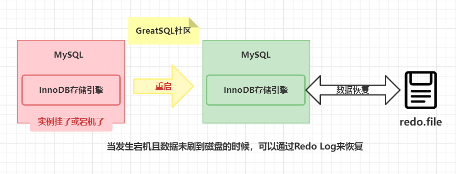
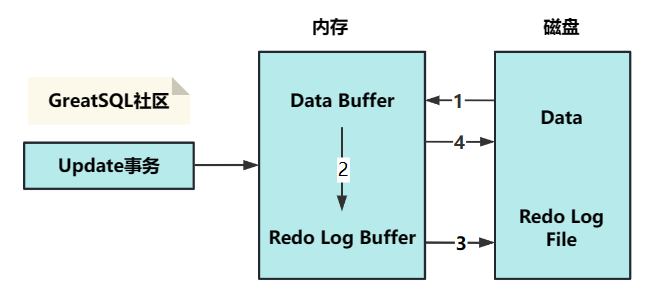
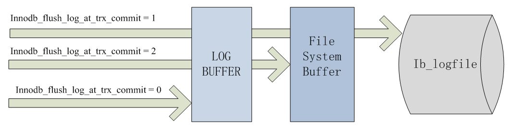

# Redo Log

## What Is the Redo Log

The Redo Log is a key component of the mechanism used in InnoDB to ensure data durability and consistency. The Redo Log records all transaction operations that modify data, so that even when the system crashes, recovery can be performed through the redo log.

The Redo Log is important to InnoDB mainly for the following reasons:

1. **Data recovery**: The Redo Log ensures that after a system crash, data that has been committed but not yet written to disk can be recovered, ensuring data integrity.
2. **Transaction durability**: It records the modifications of all committed transactions, ensuring that data is not lost after transaction commits.
3. **Performance improvement**: By first writing to the Redo Log (i.e., WAL, Write-Ahead Logging), and then batch-merging the transaction data and writing to disk, frequent disk I/O operations are reduced, greatly improving database performance.

Without the Redo Log, InnoDB cannot provide data recovery and transaction durability guarantees, seriously affecting data reliability and database performance.



## Configuring the Redo Log

Starting from 8.0.30, only the parameter `innodb_redo_log_capacity` needs to be set to define the total capacity limit of the Redo Log.

It supports online dynamic modification and takes effect immediately:

```sql
-- Modify the total Redo Log capacity to 8GB
SET GLOBAL innodb_redo_log_capacity=8589934592;
```
After adjusting the total Redo Log capacity, the dirty pages in the buffer pool first need to be flushed to disk, and then shrinking or expansion is completed; if shrinking, the dirty pages need to be flushed as soon as possible; if expanding, the dirty page flushing action is slower.

It can also be modified through my.cnf. Add/modify the following content, and it takes effect after restart:

```ini
[mysqld]
innodb_redo_log_capacity=8G
```

When `innodb_redo_log_capacity` is set, then whether `innodb_log_file_size` or `innodb_log_files_in_group` is also set or not, they do not take effect; the total Redo Log size is based on `innodb_redo_log_capacity`.

When `innodb_redo_log_capacity` is not set, and `innodb_log_file_size` or `innodb_log_files_in_group` are also not set, the total Redo Log size equals the default value of `innodb_redo_log_capacity`, i.e., *100MB*.

When `innodb_redo_log_capacity` is not set, but one or both of `innodb_log_file_size` and `innodb_log_files_in_group` are set, the total Redo Log capacity is *`innodb_log_file_size \* innodb_log_files_in_group`*.

### Redo Log Files

Redo Log files are stored in the `#innodb_redo` directory, which by default is located in the `datadir` directory, unless the `innodb_log_group_home_dir` parameter is additionally set.

There are two types of Redo Log: ordinary (in use) and spare. InnoDB tries to maintain *32* Redo Log files, each with a size of `1/32 * innodb_redo_log_capacity`. In the `#innodb_redo` directory, the log file name is *#ib_redoXX*, where XX is a **number** or **number_tmp**. The former indicates used files, and the latter indicates spare files. For example:

```
#ib_redo1310      #ib_redo1314_tmp  #ib_redo1318_tmp  #ib_redo1322_tmp  #ib_redo1326_tmp  #ib_redo1330_tmp  #ib_redo1334_tmp  #ib_redo1338_tmp
#ib_redo1311      #ib_redo1315_tmp  #ib_redo1319_tmp  #ib_redo1323_tmp  #ib_redo1327_tmp  #ib_redo1331_tmp  #ib_redo1335_tmp  #ib_redo1339_tmp
#ib_redo1312_tmp  #ib_redo1316_tmp  #ib_redo1320_tmp  #ib_redo1324_tmp  #ib_redo1328_tmp  #ib_redo1332_tmp  #ib_redo1336_tmp  #ib_redo1340_tmp
#ib_redo1313_tmp  #ib_redo1317_tmp  #ib_redo1321_tmp  #ib_redo1325_tmp  #ib_redo1329_tmp  #ib_redo1333_tmp  #ib_redo1337_tmp  #ib_redo1341_tmp
```

Each used Redo Log file has corresponding start and end LSN values:

```sql
greatsql> SELECT FILE_ID, FILE_NAME, START_LSN, END_LSN, SIZE_IN_BYTES, IS_FULL, CONSUMER_LEVEL
          FROM performance_schema.innodb_redo_log_files;
+---------+-----------------------------+-------------+-------------+---------------+---------+----------------+
| FILE_ID | FILE_NAME                   | START_LSN   | END_LSN     | SIZE_IN_BYTES | IS_FULL | CONSUMER_LEVEL |
+---------+-----------------------------+-------------+-------------+---------------+---------+----------------+
|    1310 | ./#innodb_redo/#ib_redo1310 | 21996097536 | 22012872704 |      16777216 |       1 |              0 |
|    1311 | ./#innodb_redo/#ib_redo1311 | 22012872704 | 22029647872 |      16777216 |       0 |              0 |
+---------+-----------------------------+-------------+-------------+---------------+---------+----------------+
```

After the Redo Log performs a checkpoint, the corresponding checkpoint LSN is stored in the header information of the log file where it resides. When crash recovery is needed, the header information of these files is scanned to find the last checkpoint LSN for recovery.

### Automatic Configuration of the Redo Log

When the parameter `innodb_dedicated_server=ON` is set, it is assumed that the GreatSQL database instance uses server resources optimally, and InnoDB automatically adjusts related parameter configurations, including the total Redo Log capacity. This parameter is not enabled by default. For more details, refer to: [Enabling Automatic Configuration for a Dedicated MySQL Server](https://dev.mysql.com/doc/refman/8.0/en/innodb-dedicated-server.html).

### Disabling the Redo Log
Starting from 8.0.21, the SQL command `ALTER INSTANCE DISABLE INNODB REDO_LOG` can be executed to disable the Redo Log (in fact, this also disables the Doublewrite Buffer). This is a dangerous operation and generally should not be done. It can only be considered in the following special scenarios:

- For performance testing purposes only.
- During downtime maintenance, to speed up batch data import.

::: danger Special Reminder
At other times, **strictly prohibited** from executing the operation to disable the Redo Log, **otherwise there is a great possibility of major risks such as data loss and even instance corruption**.
:::

When such a risk occurs, the [error log](./4-1-greatsql-error-log.md) may contain a prompt similar to the following:

```
[ERROR] [MY-013598] [InnoDB] Server was killed when Innodb Redo logging was disabled. Data files could be corrupt. You can try to restart the database with innodb_force_recovery=6
```
In this case, only the highest level of InnoDB recovery can be used, with a great possibility of data loss, and the instance may even fail to start.

Execute the SQL command `ALTER INSTANCE ENABLE INNODB REDO_LOG` to re-enable the Redo Log.

## Understanding the Redo Log

### Redo Log Write Process

Taking an Update transaction as an example, the Redo Log flow process is described as shown in the figure below:



Process description:

1. Determine whether the data to be Updated is already in the InnoDB buffer pool. If not, first read it from disk into the buffer pool, and modify it (generating dirty pages).

2. Generate a Redo Log record and write it to the Redo Log Buffer.

3. When the transaction commits, flush the contents of the Redo Log Buffer to the Redo Log disk file.

4. Then flush the modified data in memory (dirty pages) to the corresponding tablespace disk file.

The collaboration process of the Redo Log and Undo Log is not listed here. For this part of the content, refer to: [Collaboration of Undo Log and Redo Log in Transactions](./4-6-greatsql-undo-log.md#collaboration-of-undo-log-and-redo-log-in-transactions).

### Redo Log Flush Strategy

As mentioned above, the Redo Log is first written to the log buffer, and then flushed to the Redo Log file. The Redo Log flush strategy is introduced below.

The following situations trigger the immediate write of the Redo Log Buffer to the Redo Log file:

- When the available Redo Log Buffer space is less than 1/2.
- When a transaction commits and `innodb_flush_log_at_trx_commit=1` is set.
- The background thread periodically schedules flushing to disk every second.
- When a Checkpoint is performed.
- When the instance Shuts down.
- When switching Binlog files.

::: tip Tip
When the Redo Log Buffer is written to the Redo Log file, it may not be immediately synchronously flushed to the disk file; it may only be written to the page cache of the operating system, and then the operating system performs the flush and sync to the disk file.

In this case, if an outage occurs, data may be lost.

Therefore, in environments requiring high data reliability, be sure to set `innodb_flush_log_at_trx_commit=1`.
:::

### Checkpoint

The Redo Log Checkpoint mechanism is used to identify the part of the Redo Log that has been persisted to disk, avoiding repeated writes and improving system performance. Timely checkpoints also improve the efficiency of crash recovery, because the logs to be recovered can be scanned starting from the last Checkpoint LSN position, without scanning all logs.

When executing a Checkpoint
- Write dirty pages from the buffer pool to the data files.
- Update the last checkpoint LSN position.

## Two-Phase Commit (2PC)

To ensure transaction consistency and durability, when transaction processing is involved, the Two-Phase Commit (2PC) mechanism is used to synchronize the Binary Log (Binlog) and the Redo Log. These two log systems assume different responsibilities: Binlog is mainly used for replication and auditing, while the Redo Log is one of the mechanisms used by the InnoDB storage engine to ensure transaction reliability. The following is a detailed explanation of the 2PC working mechanism:

### Phase 1: Prepare Phase

1. **Transaction preparation**: When all changes of a transaction are completed but not yet committed, the GreatSQL server writes these changes to the Redo Log and marks them as "prepare" state, rather than committing directly. At the same time, GreatSQL records a corresponding Binlog entry, but does not immediately write it to disk; instead, it is placed in the memory buffer (Binlog cache) to wait for subsequent processing.

2. **Checkpoint update**: If Binlog is enabled, after the transaction enters the prepare phase, GreatSQL writes the transaction's Binlog entry to the Binlog file on disk. This step ensures that even if the system crashes, the Binlog contains the information of all prepared but uncommitted transactions.

3. **Write confirmation**: Once the Binlog entry is successfully written to disk, GreatSQL notifies the InnoDB storage engine that the transaction has been prepared and the Binlog has been safely written to disk.

### Phase 2: Commit or Rollback Phase

1. **Commit the transaction**: If everything is normal, GreatSQL sends a commit command to InnoDB. At this time, InnoDB changes the transaction state from "prepare" to "committed" (commit), and writes the final data changes to the Redo Log on disk. Then, InnoDB returns a successful response to the GreatSQL server.

2. **Update Binlog state**: After receiving the successful commit response, GreatSQL updates the transaction state, indicating that the transaction has been committed. If Binlog was previously written asynchronously, the successful write is confirmed at this phase.

3. **Roll back the transaction**: If an error occurs during the prepare phase or the commit process, GreatSQL chooses to roll back the transaction. In this case, InnoDB undoes all completed operations, ensuring the database returns to the state before the transaction began.

### Benefits and Performance Overhead of 2PC

1. Benefits

  - **Data consistency**: Through this mechanism, GreatSQL can ensure that the transaction state remains consistent even in the event of a failure. Specifically, if a transaction has been written to the Binlog, these transactions can be reapplied through the Binlog during the recovery process, ensuring source-replica replication consistency.
  - **Fault recovery**: If the system crashes before the transaction commit, the recovery process can read the uncompleted transactions from the Binlog and decide whether to continue committing or roll back based on the transaction's prepare state.
  - **Source-replica replication consistency**: By synchronously writing the Binlog and Redo Log, two-phase commit ensures that the data modifications of the primary database and the log synchronization of the replica database remain consistent, avoiding data inconsistency during source-replica replication.
  
2. Performance overhead

  - Two-phase commit increases disk IO operations, especially in high-concurrency scenarios, which may affect database performance.
  - Two-phase commit involves coordination between multiple log systems, increasing the complexity of transaction processing.

In summary, the 2PC mechanism plays a vital role in GreatSQL and is an important means of ensuring data consistency and integrity. Although it brings certain performance overhead and complexity, it plays an irreplaceable role in ensuring that data is not lost and in source-replica database synchronization.

## Redo Log Optimization

The adjustment and optimization operations related to the Redo Log mainly refer to the following principles:
- Redo Log is mainly sequential I/O, whether reading or writing, and the overall I/O performance is quite good.
- Increasing the Redo Log capacity helps reduce the frequency of checkpoints. Shrinking it may cause excessive unnecessary flushing operations, and may even lead to insufficient Redo Log, causing the risk of database loss and damage.
- Appropriately increasing `innodb_log_buffer_size` can buffer more transaction data in memory and reduce the flush frequency.
- Appropriately adjust `innodb_log_write_ahead_size`. It is generally recommended to set it consistent with the operating system or file system block size, for example *4KB*. If set too small, *read-on-write* is more likely to occur, while if set too large, *fsync* performance may be affected to a certain extent (because multiple data blocks need to be flushed at once).
- Starting from 8.0.11, a dedicated log writer thread was added, responsible for writing Redo Log records to the log buffer and then from the log buffer to the Redo Log file. Starting from 8.0.22, this thread can be enabled or disabled by setting `innodb_log_writer_threads`. It is recommended to enable it in high-concurrency scenarios and disable it in low-concurrency scenarios.
- Optimize the spin delay of user threads when waiting for Redo flushing. Spin delay can reduce user response latency. In low-concurrency scenarios, reducing response latency is not urgent; avoiding spin delay during this period can also reduce energy consumption; while in high-concurrency scenarios, spin delay should be minimized. The high and low watermarks of the spin delay can be set through the following parameter variables.
  - `innodb_log_wait_for_flush_spin_hwm` defines the maximum average log flush time after which user threads no longer spin while waiting for Redo flushing. Default value: *400 (microseconds)*.
  - `innodb_log_spin_cpu_abs_lwm` defines the minimum CPU usage. Below this value, user threads no longer spin while waiting for Redo flushing. This value represents the sum of all CPU cores. Default value: *80(%)*. When there are multiple CPU cores, it can be defined above 100; for example: 150, meaning the first CPU core is 100% utilized and the second core is 50% utilized.
  - `innodb_log_spin_cpu_pct_hwm` defines the maximum CPU usage. Above this value, user threads no longer spin while waiting for Redo flushing. This value represents the percentage of the total processing capacity of all CPU cores. Default value: *50(%)*. For example, with 4 CPU cores, 2 CPU cores at 100% utilization is 50% of the total CPU processing capacity. In addition, this parameter takes CPU affinity settings into account; for example, if a server has 48 CPU cores, but the mysqld process is fixed to only 4 CPU cores, the other 44 CPU cores are ignored.


## Related Parameter Variables
- `innodb_redo_log_capacity`

  Used to configure the InnoDB Redo Log capacity. Default value: *100MB*, value range: [*8MB - 512GB*]. In most cases, setting it to the *1GB - 8GB* range is sufficient. It supports online dynamic modification and takes effect immediately. Introduced in 8.0.30 and later versions. Before that, it could be configured by setting `innodb_log_file_size` and `innodb_log_files_in_group`, see below.

- `innodb_log_file_size` & `innodb_log_files_in_group`
  
  Before version 8.0.30, the total Redo Log size was configured through the combination of `innodb_log_file_size` and `innodb_log_files_in_group`. The former represents the size of each Redo Log file, and the latter represents how many files there are in total. The default value of the former is *48MB*, with a value range of [*4MB - 512GB / innodb_log_files_in_group*]. The default value of the latter is *2*, with a value range of [*2 - 100*]. Multiplying the two gives the Redo Log capacity, but the maximum must not exceed *512GB*.
  
- `innodb_log_group_home_dir`

  Specifies the path where Redo Log files are stored. The default value is empty, meaning Redo Log files are stored in the `#innodb_redo` subdirectory under the `datadir` directory. Generally, no configuration is needed.

- `innodb_log_buffer_size`

  Used to configure the memory size used by InnoDB to buffer the Redo Log. Before transaction commit, the transaction's modifications are first written to this log buffer. Default value: *16MB*, value range: [*1MB - 4GB*]. In most cases, setting it to the *16MB - 64MB* range is sufficient. It supports online dynamic modification and takes effect immediately.

- `innodb_log_write_ahead_size`

  Configures the write-ahead block size of the Redo Log, in units of *bytes*. Default value: *8192* (bytes), value range: [*512 bytes - innodb_page_size*]. To avoid *read-on-write*, it is recommended to set it consistent with the operating system or file system cache block size. When the Redo Log write-ahead block size is inconsistent with the operating system (or file system) cache block size, *read-on-write* occurs. It must be set to an integer multiple of the InnoDB Redo Log block size (*512 bytes*). When set to the minimum value, i.e., *512 bytes*, *write-ahead* is no longer performed on the Redo Log. If set too small, *read-on-write* is more likely to occur, while if set too large, *fsync* performance may be affected to a certain extent (because multiple data blocks need to be flushed at once).

- `innodb_log_writer_threads`

  Starting from 8.0.11, a dedicated log writer thread was added, responsible for writing Redo Log records to the log buffer and then from the log buffer to the Redo Log file. Starting from 8.0.22, this thread can be enabled or disabled by setting `innodb_log_writer_threads`.

- `innodb_log_wait_for_flush_spin_hwm`

  Defines the maximum average log flush time after which user threads no longer spin while waiting for Redo flushing. Default value: *400 (microseconds)*.

- `innodb_log_spin_cpu_abs_lwm`

  Defines the minimum CPU usage. Below this value, user threads no longer spin while waiting for Redo flushing. This value represents the sum of all CPU cores. Default value: *80(%)*.

- `innodb_log_spin_cpu_pct_hwm`

  Defines the maximum CPU usage. Above this value, user threads no longer spin while waiting for Redo flushing. This value represents the percentage of the total processing capacity of all CPU cores. Default value: *50(%)*. This parameter takes CPU affinity settings into account.

- `innodb_flush_log_at_trx_commit`

  Used to control the flushing behavior mode of the Redo Log when transactions commit. Different settings affect database performance and data reliability risks. Default value: *1*, value range:
  - **0**: The redo log buffer is not flushed to disk when transactions commit. Flushing is done once per second. **Best performance, worst security**.
  - **1**: At each transaction commit, the redo log buffer is written to disk and the file system buffer is flushed. **Worst performance, best security**.
  - **2**: At transaction commit, the redo log buffer is only written to the file system buffer, and flushing is done once per second. **A compromise between performance and security**.
  - To ensure data security and reliability, be sure to set both `innodb_flush_log_at_trx_commit=1` & `sync_binlog=1`, commonly known as setting **double 1**.



::: tip Tip
Log flushing related to DDL changes and other InnoDB internal activities is not affected by this parameter.
:::

- `innodb_flush_log_at_timeout`

  Used to control the time interval at which the InnoDB Redo Log buffer is flushed to disk when no transactions commit, to enhance data durability and security. Unit: *seconds*, default value: *1*, value range: [*1 - 2700*].

## Related Status Variables

The Redo Log related status variables are as follows

```sql
greatsql> SHOW GLOBAL STATUS LIKE 'innodb%redo%';
+-------------------------------------+-------------+
| Variable_name                       | Value       |
+-------------------------------------+-------------+
| Innodb_redo_log_read_only           | OFF         | <= Whether the Redo Log is in read-only state
| Innodb_redo_log_uuid                | 1075899837  | <= Redo Log UUID
| Innodb_redo_log_checkpoint_lsn      | 22026843368 | <= The LSN at which checkpoint was completed
| Innodb_redo_log_current_lsn         | 22026843368 | <= The latest LSN
| Innodb_redo_log_flushed_to_disk_lsn | 22026843368 | <= The LSN that has been flushed to disk
| Innodb_redo_log_logical_size        | 512         | <= Block size (unit: bytes), representing the LSN range of the in-use Redo Log, from the oldest block required by redo log consumers to the most recently written block
| Innodb_redo_log_physical_size       | 33554432    | <= Physical size (used Redo Log)
| Innodb_redo_log_capacity_resized    | 536870912   | <= Total capacity size of the Redo Log, 512MB
| Innodb_redo_log_resize_status       | OK          | <= The progress and status of Redo Log resizing
| Innodb_redo_log_enabled             | ON          | <= Whether the Redo Log is enabled
+-------------------------------------+-------------+
```

The above are the configuration and status viewing methods for 8.0.30 and later versions. The configuration methods before 8.0.30 are not described here. For details, refer to: [Configuring Redo Log Capacity](https://dev.mysql.com/doc/refman/8.0/en/innodb-redo-log.html#innodb-redo-log-file-reconfigure).

## Appendix: Changes in Redo Log in 8.0 Relative to 5.7
- Added the `innodb_redo_log_capacity` parameter, replacing the original `innodb_log_file_size` & `innodb_log_files_in_group`.
- Added several optimization-related parameters such as `innodb_log_wait_for_flush_spin_hwm`, `innodb_log_spin_cpu_abs_lwm`, `innodb_log_spin_cpu_pct_hwm`.
- Supports parallel writing of the Redo Log.
- Supports online disabling/enabling of the Redo Log.
- Supports Redo Log encryption.
- Supports Redo Log archiving (used by the Enterprise Edition mysqlbackup).

Extended reading:
- [Redo Log](https://dev.mysql.com/doc/refman/8.0/en/innodb-redo-log.html)
- [Redo Log Configuration](https://dev.mysql.com/doc/refman/8.0/en/innodb-init-startup-configuration.html#innodb-startup-log-file-configuration)
- [Optimizing InnoDB Redo Logging](https://dev.mysql.com/doc/refman/8.0/en/optimizing-innodb-logging.html)

**Scan the QR code to follow our WeChat Official Account**


