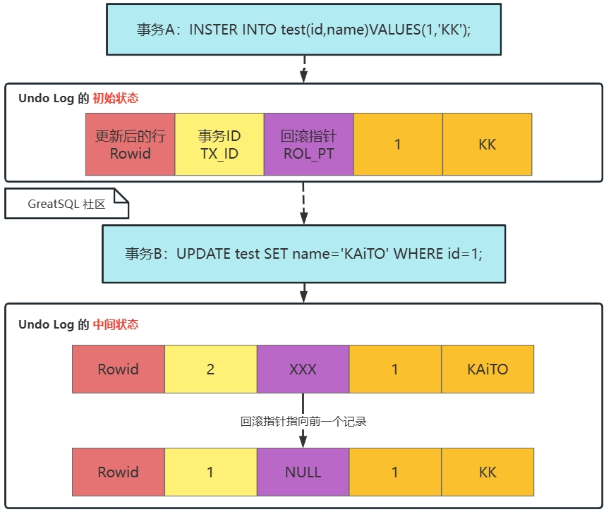
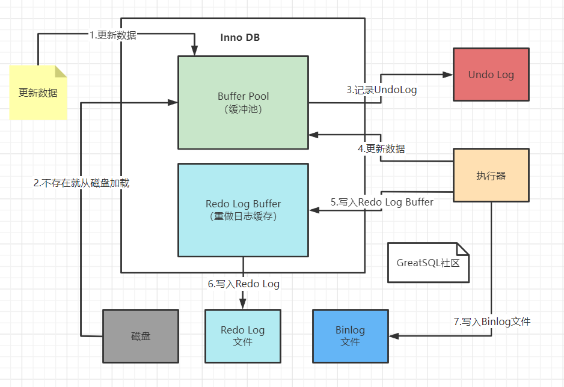

# Undo Log

## What Is the Undo Log

The Undo Log is a key component used by the InnoDB storage engine to ensure transaction consistency and isolation. When a transaction modifies user data during execution, InnoDB records the data before modification in the undo log, so that its modifications can be undone when the transaction rolls back or when the database crashes. The Undo Log is also the foundation for InnoDB's implementation of the [MVCC (multi-version concurrency control) mechanism](../12-dev-guide/12-6-3-trx-mvcc-and-locking.md#mvcc), allowing read operations to see the database state at the beginning of the transaction without being affected by concurrent write operations.

## The Role of the Undo Log

Transactions need to guarantee **atomicity** (Atomic in ACID), meaning that the operations in a transaction either all complete or none are done. But sometimes situations occur during transaction execution, such as:

1. Various errors may be encountered during transaction execution, such as errors in the server itself, operating system errors, or even errors caused by sudden power failure.

2. Executing the `ROLLBACK` statement to end the current transaction during transaction execution.

When the above situations occur, the modifications to the database need to be undone and reset to their original state. This process is called rollback.

Whenever the database is to be modified (mainly `INSERT, DELETE, UPDATE` and other operations), what is needed for transaction rollback needs to be recorded. For example:

- If a new record is inserted, at least the primary key value of this record needs to be recorded. During rollback, the record corresponding to this primary key value only needs to be deleted; for `INSERT` operations, rollback corresponds to the `DELETE` operation.
- If an old record is deleted, the entire record data needs to be recorded. During rollback, this record is re-written back to the table; for `DELETE` operations, rollback corresponds to the `INSERT` operation.
- If a record is modified, the data of this record before modification needs to be recorded. During rollback, this record is updated back to the old value; for `UPDATE` operations, rollback corresponds to the reverse `UPDATE` operation.

The data recorded for transaction rollback is called the **undo log** or **rollback log** in the database, and is collectively called **Undo Log** in this document.

::: tip Tip
The read-only operation `SELECT` does not modify user data, so it does not need to record the corresponding Undo Log.
:::

## Undo Tablespaces

Undo Logs are managed by rollback segments, which exist in undo tablespaces and the global temporary tablespace.

Undo Logs generated by transactions on ordinary user tables are allocated in undo tablespaces; while Undo Logs generated by transactions on user-defined temporary tables are allocated in the global temporary tablespace. The two are different.

An undo tablespace includes Undo Log files and is a collection of Undo Logs. Undo Logs contain information about how to undo the latest changes made by transactions to clustered index records.

### Default Undo Tablespaces

Before version 8.0, undo tablespaces were stored in the system tablespace. Starting from 8.0, they are independent.

When the GreatSQL database is initialized, *2* undo tablespaces are initialized by default. InnoDB requires at least *2* undo tablespaces to ensure support for automatic truncation operations of undo tablespaces.

The *2* undo tablespace files created by default during initialization are located in the location defined by the `innodb_undo_directory` parameter. If it is not defined, it equals `datadir`. The *2* default undo tablespace files are named *undo_001* and *undo_002*, with corresponding tablespace names *innodb_undo_001* and *innodb_undo_002*:

### Creating/Deleting Undo Tablespaces Online

During operation, the appearance of large transactions and long transactions may cause undo tablespaces to grow continuously. To avoid a single undo tablespace file growing too much, new undo tablespaces can be created online, for example:

```sql
CREATE UNDO TABLESPACE greatsql_undo_001 ADD DATAFILE 'greatsql_undo_001.ibu';
```

Undo tablespace files created by users must end with the *.ibu* suffix. Custom relative paths are not supported for now, but custom absolute paths are supported, and the absolute path must be within the scope defined by `innodb_directory`.

During GreatSQL startup, InnoDB scans all directories defined by the `innodb_directory` parameter and their subdirectories to confirm whether there are undo tablespace files. The directories defined by the parameters `innodb_data_home_dir`, `innodb_undo_directory`, and `datadir` are also appended to the `innodb_directory` scan scope.

::: tip Tip
Although InnoDB automatically scans and discovers all undo tablespace files during startup, please do not move these files at will, to avoid affecting crash recovery work.
:::

Starting from 8.0.14, undo tablespaces created by administrators with `CREATE UNDO TABLESPACE` can be deleted with `DROP UNDO TABLESPACE`, provided that the undo tablespace is empty (not in use).

Before deletion, the undo tablespace to be deleted needs to be set to inactive first, so that no new transactions are allocated to this tablespace. After all active transactions end and the Purge thread also cleans up the related rollback segments, it can be deleted.

```sql
-- View which undo tablespace files currently exist
greatsql> SELECT FILE_ID, TABLESPACE_NAME, FILE_NAME, STATUS FROM INFORMATION_SCHEMA.FILES
          WHERE FILE_TYPE LIKE 'UNDO LOG';
+------------+-------------------+-------------------------+--------+
| FILE_ID    | TABLESPACE_NAME   | FILE_NAME               | STATUS |
+------------+-------------------+-------------------------+--------+
| 4294967279 | innodb_undo_001   | ./undo_001              | NORMAL |
| 4294967278 | innodb_undo_002   | ./undo_002              | NORMAL |
| 4294967023 | greatsql_undo_001 | ./greatsql_undo_001.ibu | NORMAL |
+------------+-------------------+-------------------------+--------+

greatsql> SELECT SPACE, NAME, FILE_SIZE, STATE FROM information_schema.INNODB_TABLESPACES 
          WHERE SPACE_TYPE = 'Undo';
+------------+-------------------+-----------+--------+
| SPACE      | NAME              | FILE_SIZE | STATE  |
+------------+-------------------+-----------+--------+
| 4294967279 | innodb_undo_001   | 134217728 | active |
| 4294967278 | innodb_undo_002   | 117440512 | active |
| 4294967023 | greatsql_undo_001 |  16777216 | active |
+------------+-------------------+-----------+--------+

-- Set greatsql_undo_001 to inactive before deleting
greatsql> ALTER UNDO TABLESPACE greatsql_undo_001 SET INACTIVE;
greatsql> DROP UNDO TABLESPACE greatsql_undo_001;
```

### Cleaning Up Undo Tablespaces

InnoDB supports both automatic and manual methods to clean up (truncate) undo tablespaces.

- Manual cleanup

The process of manually setting an undo tablespace to inactive and finally deleting it has been demonstrated above, and will not be repeated.

- Automatic cleanup

InnoDB requires at least two active and available undo tablespaces to enable automatic cleanup, because when one undo tablespace is being cleaned up, at least one must remain active and available.

Set the system parameter `innodb_undo_log_truncate=ON` to enable automatic cleanup mode:

```sql
SET GLOBAL innodb_undo_log_truncate=ON;
```

In automatic cleanup mode, once an undo tablespace file size exceeds the threshold set by the `innodb_max_undo_log_size` parameter, automatic cleanup begins. The `innodb_max_undo_log_size` parameter can be dynamically adjusted online, with a default value of *1GB*.

Automatic cleanup works in the following way:

1. Loop through and scan each undo tablespace file to check whether it exceeds the `innodb_max_undo_log_size` threshold.

2. Confirm whether the rollback segments in this undo tablespace are all in the inactive state, ensuring they will not be allocated to new transactions.

3. Confirm that the Purge thread has cleaned up the related rollback segments and released the corresponding Undo Logs.

4. Start automatic cleanup and try to re-initialize the undo tablespace file to its default size.

5. Re-set the rollback segments in this undo tablespace to the active state, so they can be allocated to new transactions.

The main job of the Purge thread is to clear and release the undo tablespace. By default, after every *128* purge operations, it confirms whether the undo tablespace can be cleaned up. This frequency is defined by the `innodb_purge_rseg_truncate_frequency` parameter, with a default value of *128*. It can be dynamically adjusted online.

If the database server currently has large transactions/long transactions that remain active for a long time without ending (committing/rolling back), or there are a large number of rollback segments waiting to be cleaned up, the Undo Log files can become very large, even exceeding the TB level, for example:

```
2.0T        undo_001
3.8T        undo_002
```

In this case, execute `SHOW ENGINE INNODB STATUS\G` to view the transaction and rollback segment cleanup status:

```sql
greatsql> SHOW ENGINE INNODB STATUS\G

...
------------
TRANSACTIONS
------------
Trx id counter 68724736927
Purge done for trx's n:o < 74690025805 undo n:o < 0 state: running
History list length 2009890459
...
---TRANSACTION 68724705927, ACTIVE 13610 sec recovered trx
ROLLING BACK 1 lock struct(s), heap size 1136, 0 row lock(s), undo log entries 365137207
...
```
From the above result, it can be seen that there are **a large number (over 2 billion records) of rollback segments in the current database that have not been cleaned up yet**, and there is also a transaction that **remains active for 13610 seconds without ending**, and this transaction generated 365137207 rollback segments. This is a very alarming phenomenon. In normal times, monitoring of large transactions/long transactions and the accumulation of rollback segments must be done well.

When encountering the above situation, you can first appropriately reduce the request volume of front-end application business to reduce the read/write pressure on the database. In addition, you can try increasing `innodb_buffer_pool_size` to improve InnoDB processing performance, while patiently waiting for the rollback segments to be cleaned up. By periodically observing the changes in the **History list length** value, the rollback segment cleanup rate can be calculated, thus estimating when the cleanup will be completed.

### Undo Tablespace Related Status Variables

The following status variables can be used to observe the usage of undo tablespaces:

```sql
greatsql> SHOW STATUS LIKE 'Innodb_undo_tablespaces%';
+----------------------------------+-------+
| Variable_name                    | Value |
+----------------------------------+-------+
| Innodb_undo_tablespaces_total    | 3     |
| Innodb_undo_tablespaces_implicit | 2     |
| Innodb_undo_tablespaces_explicit | 1     |
| Innodb_undo_tablespaces_active   | 3     |
+----------------------------------+-------+
```

Their explanations are as follows:

- `Innodb_undo_tablespaces_total` The total number of undo tablespaces.
- `Innodb_undo_tablespaces_implicit` The number of implicitly created (created during InnoDB initialization) undo tablespaces.
- `Innodb_undo_tablespaces_explicit` The number of explicitly created (manually created by administrators) undo tablespaces.
- `Innodb_undo_tablespaces_active` The number of currently active undo tablespaces.

## Undo Log Storage Mechanism



As shown in the figure above, in addition to storing the content before data updates, the Undo Log also needs to record *ROW_ID (6-byte DB_ROW_ID or clustered index key value)*, *TRX_ID (6 bytes, transaction ID)*, and *ROLL_PTR (7 bytes, rollback segment pointer)*. The rollback pointer always points to the previous version of the same record, eventually forming a rollback chain, making it convenient to find the various historical versions of the record.

## The Relationship Between Rollback Segments and Transactions

### Rollback Segments and Undo Slots

Undo Logs are managed by rollback segments, which exist in undo tablespaces and the global temporary tablespace.

Each undo tablespace and the global temporary tablespace each support up to 128 rollback segments. The parameter `innodb_rollback_segments` is used to define the maximum number of rollback segments. The default and maximum values are both 128.

The maximum number of concurrent transactions supported in one rollback segment depends on how many undo slots the transaction needs at the same time. The relationship between the maximum number of undo slots supported in one rollback segment and the InnoDB page size is shown in the following table:

| InnoDB Page Size   | Maximum Undo Slots Supported in One Rollback Segment (InnoDB Page Size / 16)|
| :--- | :--- |
| 4096 (4KB)    | 256   |
| 8192 (8KB)    | 512   |
| 16384 (16KB)  | 1024  |
| 32768 (32KB)  | 2048  |
| 65536 (64KB)  | 4096  |

The InnoDB page size is 16 KB by default, so a rollback segment can support up to 1024 undo slots.

Different request types in a transaction are allocated to different undo slots:
- `INSERT` on ordinary user tables is allocated to the ordinary table `insert_undo` slot;
- `UPDATE, DELETE` on ordinary user tables are allocated to the ordinary table `update_undo` slot;
- `INSERT` on session-level temporary tables is allocated to the temporary table `insert_undo` slot;
- `UPDATE, DELETE` on session-level temporary tables are allocated to the temporary table `update_undo` slot;

Corresponding Undo Logs are allocated separately for each request type (i.e., each Undo Log has its own dedicated purpose). For example, the Undo Log allocated for `INSERT` operations on ordinary user tables is also used for all `INSERT` operations executed by this transaction on ordinary user tables, and a new Undo Log is not requested again.

Undo Logs generated by transactions on ordinary user tables are allocated in undo tablespaces; while Undo Logs generated by transactions on user-defined temporary tables are allocated in the global temporary tablespace. The two are different.

Based on the above content, it can be known that the maximum number of concurrent transactions supported by InnoDB is related to the undo tablespaces, rollback segments, and the complexity of each transaction.

The following scenarios attempt to infer the maximum number of concurrent read/write transactions InnoDB can support:

| Table Where the Transaction Occurs | Operation Types in the Transaction | Maximum Concurrent Transactions |
| :--- | :--- | :--- |
|Ordinary tables | Only `INSERT` | innodb_page_size / 16 * innodb_rollback_segments * Number of undo tablespaces |
|Ordinary tables | Only `UPDATE` or `DELETE` | innodb_page_size / 16 * innodb_rollback_segments * Number of undo tablespaces |
|Ordinary tables | Both `INSERT` and `UPDATE` or `DELETE` | innodb_page_size / 16 / 2 * innodb_rollback_segments * Number of undo tablespaces |
|User-created temporary tables | Only `INSERT` |  innodb_page_size / 16 * innodb_rollback_segments |
|User-created temporary tables | Only `UPDATE` or `DELETE` | innodb_page_size / 16 * innodb_rollback_segments |
|User-created temporary tables | Both `INSERT` and `UPDATE` or `DELETE` | innodb_page_size / 16 / 2 * innodb_rollback_segments |


::: tip Tip
1. In versions before MySQL 5.5 (excluding 5.5), InnoDB only supported 1 rollback segment, so the upper limit of concurrent transactions it could support was 1024.

2. Starting from MySQL 5.5, InnoDB supports up to 128 rollback segments, so the upper limit of concurrent transactions it can support has been increased to 128*1024=131072.

3. The parameter `innodb_rollback_segments` was formerly named `innodb_undo_logs` before version 8.0.
:::

### Rollback Segments and Transactions

1. Each transaction is only allocated to one rollback segment. One rollback segment may serve multiple transactions at the same time. The relationship between rollback segments and transactions is one-to-many.

2. When a transaction starts, it is allocated to a rollback segment. When data is modified during the transaction, the original data before modification is copied to the rollback segment.

3. In the rollback segment, new transactions keep being filled until the transaction ends or all rollback segments are used up. If a prompt appears that rollback segments are insufficient, the number of undo tablespaces needs to be appropriately increased.

4. Rollback segments are managed by undo tablespaces. Multiple active undo tablespaces can exist in the database, but only one undo tablespace can be used at the same time.

### Collaboration of Undo Log and Redo Log in Transactions

Assume there are 2 records, A=1 and B=2, modified to 3 and 4 respectively in the transaction. The following is the simplified process of Undo + Redo collaboration in the InnoDB storage engine within a transaction:

```sql
1. Start the transaction
2. Record A=1 to the Undo Log
3. Update A=3
4. Record A=3 to the Redo Log
5. Record B=2 to the Undo Log
6. Update B=4
7. Record B=4 to the Redo Log
8. Flush the Redo Log to disk
9. Commit the transaction
```

There are several situations:

- If an outage occurs at any step between steps 1-8, the transaction has not yet had time to commit, and this transaction will not really modify user data.
- If an outage occurs between steps 8-9, then
  - Scan the Redo Log for recovery.
  - Scan the Undo Log, find that a transaction has not completed, and roll it back.
- If the system crashes after step 9, the changed data in the memory mapping has not had time to be flushed back to disk. After system recovery, the data can be flushed back to disk based on the Redo Log.

::: tip Tip
During InnoDB crash recovery, the Redo Log and Binlog are further checked to determine whether the transaction has also written to Binlog. If so, it is committed again. If a transaction is only in the Prepare state in the Redo Log, but the Binlog has not been successfully written, it is rolled back.
:::

Flow chart: 

## Related Parameter Variables

- `innodb_max_undo_log_size`

  Used to control the upper limit of the Undo Log size. When the total size of the Undo Log exceeds the threshold set by this parameter, InnoDB starts cleaning up to reduce the log size and avoid disk space exhaustion. The default value is *1GB*. Setting too small a value may cause frequent Undo Log cleanup, affecting performance. In general, the default value is sufficient.

- `innodb_undo_directory`

  Used to specify the directory for storing Undo Logs. The default is empty, i.e., consistent with `datadir`, and generally no adjustment is needed. If conditions permit, consider storing various log files such as Undo Log, Redo Log, and Binlog, and user data on separate high-speed storage devices for better performance.

- `innodb_undo_log_encrypt`

  Used to specify whether to encrypt the Undo Log. This is especially important for protecting the security of sensitive data, particularly in scenarios where data is saved on disk. The default value is *OFF*, i.e., not enabled; set to *ON* to enable. Encryption operations increase CPU load and may cause performance degradation, especially in environments with high concurrency or high I/O load. Whether to enable it can be decided based on actual needs.

- `innodb_undo_log_truncate`
 
  Used to control whether automatic cleanup of the Undo Log tablespace is enabled. The default value is *ON*, i.e., enabled, and enabling it is also recommended; set to *OFF* to disable. When this parameter is enabled, InnoDB periodically releases unused Undo Log tablespace, reducing disk space usage. Adjusting the parameter `innodb_purge_rseg_truncate_frequency` can affect the frequency of automatic cleanup. 

- `innodb_undo_tablespaces`

  Sets the number of undo tablespaces. The minimum and default values are both *2*. Starting from 8.0.14, it is recommended that this parameter no longer be used.

- `innodb_rollback_segments`

  Used to configure the number of rollback segments in each undo tablespace. Each rollback segment can process the Undo Log records of one or more transactions at the same time. The default and maximum values are both *128*, and the minimum value is *1*. Increasing the number of rollback segments helps improve concurrent transaction processing capability, because more transactions can write to different rollback segments simultaneously, reducing conflicts and waiting time; setting it too high may cause waste of system resources and increase memory and disk overhead. Generally no adjustment is needed.

- `innodb_purge_rseg_truncate_frequency`

  Used to control the frequency of rollback segment cleanup operations. This parameter determines how often cleanup operations are performed in purge operations to release space. The default and maximum values are both *128*, and the minimum value is *1*. Generally no adjustment is needed. Frequent cleanup operations (lower values) make rollback segments release space quickly, but may increase system load and performance overhead.

## Appendix: Changes in Undo Log in 8.0 Relative to 5.7

- By default, two undo tablespaces are created during initialization. Undo tablespaces are no longer stored in the system tablespace, but are independent.
- Starting from version 8.0.14, the `CREATE/DROP/ALTER UNDO TABLESPACE` commands can be used to create/delete/enable/disable undo tablespaces.
- The parameter `innodb_undo_log_truncate` has a default value of *ON*, i.e., automatic cleanup of undo tablespaces is enabled by default.
- The parameter `innodb_rollback_segments` controls the maximum number of rollback segments that can be used per undo tablespace. Previously, it defined the maximum number of rollback segments available across all undo tablespaces. This greatly increases the maximum number of supported concurrent transactions.
- The new parameter `innodb_rollback_segments` replaces the old parameter `innodb_undo_logs`. 
- The status variable `Innodb_available_undo_logs` was removed.
- The parameter `innodb_undo_tablespaces` is recommended no longer to be used starting from 8.0.14.
- Added encryption support for undo tablespaces.

Extended reading:
- [Undo Logs](https://dev.mysql.com/doc/refman/8.0/en/innodb-undo-logs.html)
- [Undo Tablespaces](https://dev.mysql.com/doc/refman/8.0/en/innodb-undo-tablespaces.html)

**Scan the QR code to follow our WeChat Official Account**


