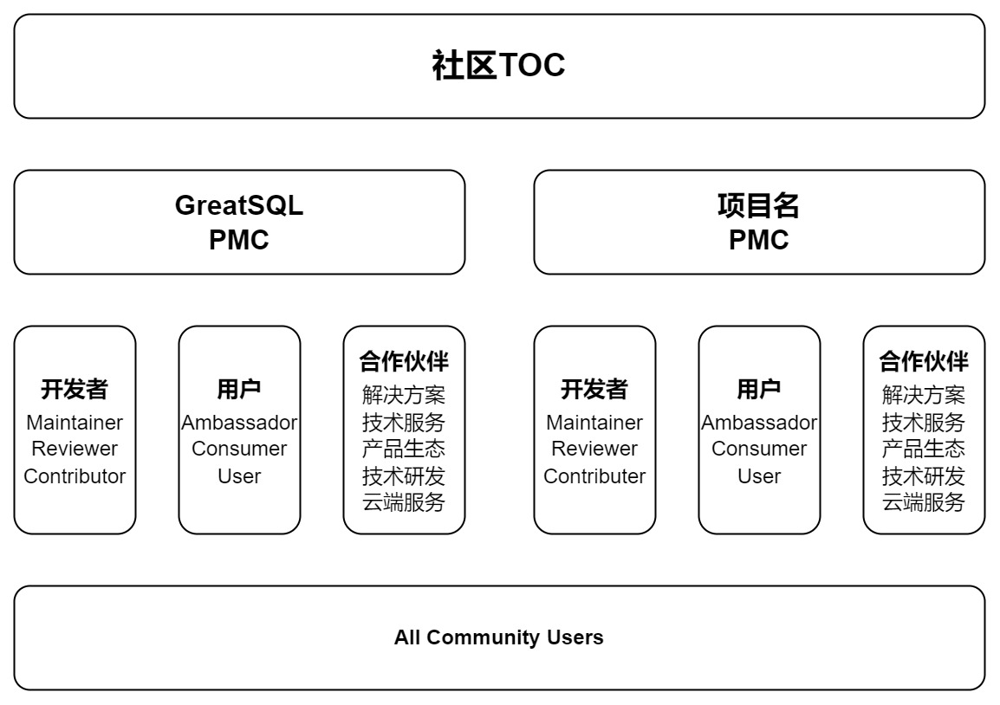

# Community Governance

The Technical Observe Committee (TOC)
The Project Management Committee (PMC)
- Developer track: Maintainer, Reviewer, Contributor
- User track: Ambassador, Consumer, User
- Partners: Solution, Technical Service, Industry Ecosystem, Technology R&D, Cloud Service

# Technical Observe Committee (TOC)
The Technical Observe Committee (TOC) of the open source community is the technical management body of the community projects. It is responsible for the overall planning and management of all projects, providing technical guidance, decision-making, and supervision.

**Responsibilities and Authority**

The Technical Observe Committee is the technical leadership body of the community. Its main responsibilities are:
- Having the final decision-making authority on technical decisions for all projects under the community.
- Guiding and deciding the technical vision and direction of all community projects.
- Leading community technological innovation to ensure that the community maintains sustained technical competitiveness.
- Guiding the community to establish original open source projects and continuously build the community's technical influence.

A Chair is also appointed. The Chair's responsibilities are:
- Convening and presiding over Technical Observe Committee meetings, and ensuring that participants have full rights to express their technical opinions.
- Representing the community for promotion at various meetings and events.
- The Chair is also a member of the Technical Observe Committee, with the same voting rights as other members.

**Members**
- The TOC Chair and members of the open source community are appointed by the community, including those who have made significant contributions to the community and are willing to continue their involvement.
- To ensure the effective operation of the Technical Observe Committee, members who fail to attend TOC meetings twice in a row may be removed from office by a decision made at regular TOC meetings. TOC members who apply to resign for personal reasons should notify all TOC members.

**Meetings and Decision-Making Mechanism**
- The Technical Observe Committee holds a regular meeting every two weeks, or an extraordinary meeting may be convened upon the proposal of more than half of the committee members.
- The regular meeting is convened by the Chair, who notifies all committee members via email on the mailing list 5 calendar days before the meeting. The meeting notice should include the location, date, time, format, and agenda of the meeting as well as available reference sources, so that members can obtain relevant information and prepare for the meeting. Meetings are open to the public; any community member may attend and express technical opinions but has no voting rights.
- A Technical Committee meeting is valid only when at least 2/3 (including) of the committee members attend.
- All resolutions must be voted on at a valid regular meeting, and the voting is conducted as an open recorded vote. Votes are divided into in favor, against, and abstention. A resolution is passed only when more than 2/3 (including) of the attending committee members and more than 1/2 of all committee members vote in favor. Members who are absent cannot entrust others to vote on their behalf.

# Project Management Committee (PMC)
The Project Management Committee (PMC) is the management body of a single project under the community. It ensures high technical quality of the project, maintains normal development iterations, and provides various support for project operations.

**Responsibilities and Authority**
- Carrying out the daily development work of the project and ensuring high-quality releases of the project distribution.
- Providing important support for the project's development iterations and the operation of community activities. Project consulting support.
- Guiding the project's open source advocacy and future development direction.
- Organizing project discussions and providing advice on major project decisions.
- Making decisions on matters such as the establishment, dissolution, and merger of project SIGs (Special Interest Groups). Resolving collaboration conflicts between SIG groups, and coaching, reviewing, and supervising the daily operations of SIG groups.
A Chair is also appointed. The Chair's responsibilities are:
- Convening and presiding over Project Management Committee meetings, and ensuring that participants have full rights to express their technical opinions.
- Representing the project for promotion at various meetings and events.
- The Chair is also a member of the Project Management Committee, with the same voting rights as other members.

**Members**
- The PMC Chair is nominated by the TOC and elected through an internal vote within the TOC. The nomination passes when it receives more than 1/2 of the votes of the incumbent TOC members.
- The initial PMC members will be directly appointed by the TOC. The PMC Chair may also nominate initial members, who will then be elected by the TOC.
- After the PMC is established, the PMC Chair may nominate project personnel to join the PMC, subject to a vote by the incumbent PMC members.
- Maintainers and Ambassadors who have made significant contributions to the project and are willing to continue their involvement may also apply to join after the PMC is established, subject to a vote by the PMC. The application passes when it receives more than 1/2 of the votes of the incumbent PMC members.

## Developer Track
### Maintainer
Maintainers are promoted from Reviewers. They are responsible for the planning and maintenance of GreatSQL, have the permission to merge into the main branch, have good judgment of project performance, participate in and lead project updates, attend and deliver GreatSQL-related technical sharing sessions, and participate in writing related technical articles.

 **Promotion Criteria**
 - Deeply understand the principles of GreatSQL and have a clear understanding of its future planning;
 - Be capable of promptly handling various issues arising in the project;
 - Lead the development and iteration of the project and control the overall optimization direction;
 - Must be a Reviewer and be nominated by at least two Maintainers;

 **Responsibilities**
 - Ensure the code quality of the project, and lead and control the pace of development and iteration;
 - Participate in GreatSQL's future planning and technical design, and attend version planning and RFC review meetings;
 - Participate in community activities (such as online or offline meetups), further understand related knowledge, communicate with other developers in the community, and guide and help other contributors to engage in project development;

 **Benefits**
 - After obtaining authorization, be listed as a Maintainer on the GreatSQL official website's contributor list;
 - Share GreatSQL-related technical insights on platforms provided by the community or at major technology summits, grow and progress together with community members, and enhance personal influence;
 - Receive the GreatSQL community Maintainer commemorative certificate;
 - Participate in the planning and organization of the project's online/offline activities;
 - After becoming a Maintainer, apply to receive 1 set of customized community souvenirs (a U-shaped pillow, a thermos cup, and a backpack) and 1 book of your choice from the community coin mall;

### Reviewer
Reviewers are promoted from Contributors. They participate in the planning and maintenance of GreatSQL, have good judgment of project performance, follow and participate in project updates, attend GreatSQL-related technical sharing sessions, and participate in writing related technical articles.

 **Promotion Criteria**
 - Users who have submitted at least 5 important PRs that were merged into the GreatSQL project; or have participated in and led the fixing of major bugs, and written and revised related documentation;
 - Be nominated by at least 2 Reviewers or 1 Maintainer;
 - Be capable of promptly handling various issues arising in the project, helping others resolve doubts, and answering questions in Issues;
 - Pay attention to unknown errors, propose and help fix bugs;
 - Help standardize and improve documentation, and test the project;
 - Actively participate in the project's online/offline activities and discussions;

 **Responsibilities**
 - Monitor and control the code quality of the project, and actively participate in development and iteration;
 - Review community code and approve newly submitted code;
 - Participate in community activities (such as online or offline meetups), further understand related knowledge, communicate with other developers in the community, and guide and help other contributors to engage in project development;

 **Benefits**
 - After obtaining authorization, be listed as a Reviewer on the GreatSQL official website's contributor list;
 - Receive the GreatSQL community Reviewer commemorative certificate;
 - Participate in the organization of the project's online/offline activities;
 - After becoming a Reviewer, apply to receive 1 set of customized community souvenirs (an umbrella and a backpack);

### Contributor
Anyone who makes contributions to the GreatSQL open source community can become a Contributor. We welcome all contributors and will provide help to everyone who wishes to contribute to the project.

 **Promotion Criteria**
 - Users who have submitted at least 1 important PR that was merged into the GreatSQL project.

 **Responsibilities**
 - Actively raise your questions and participate in the iteration and optimization of GreatSQL;
 - Participate in community activities (such as online or offline meetups), further understand related knowledge, and communicate with other developers in the community;
 - Actively participate in contributor tasks;

 **Benefits**
 - Be listed as a Contributor on the GreatSQL official website's contributor list;
 - After becoming a Contributor, apply to receive 1 customized community souvenir (a short-sleeved T-shirt);

## User Track
### Ambassador
 **Eligibility Criteria**
 - Enterprise users who have deployed GreatSQL in a production environment;
 - Enterprise users who are willing to actively promote their GreatSQL usage experience through case studies, blogs, project activities, project meetings, etc.;

 **Benefits**
 - Participate in the project's future planning and technical design, and attend version planning and RFC review meetings;
 - Be specially invited as sharing guests at online/offline events, enhancing corporate/personal influence;
 - All benefits included in Consumer;

### Consumer
 **Eligibility Criteria**
 - Enterprise users who have deployed GreatSQL in a production environment.

 **Benefits**
 - Receive free technical support from the development team;
 - Apply to become speakers at online/offline events, enhancing corporate/personal influence;
 - Get first access to testing qualification for new versions of the project;
 - All benefits included in User;

### User
 **Eligibility Criteria**
 - Enterprise/personal users who test and use GreatSQL products.

 **Benefits**
 - Access the latest official product documentation on the project website;
 - Participate in official online/offline meetups and exchange sessions organized by the project;
 - Apply for official technical support by submitting Issues on Gitee;
 - Get help by communicating with other developers and users on the official forum;

## Partners
To better promote the development of the GreatSQL community and provide better services to GreatSQL community users, the community sincerely invites enterprise partners to exchange, cooperate, and jointly build the open source community!

Becoming a community partner entitles you to the following benefits:
- Official endorsement: Partner enterprises will be showcased in the partner section of the community's official website, with official certification qualifications provided;
- In-depth support: The community will provide professional product technical support and build joint solutions;
- Joint promotion: Multiple marketing approaches to help partners with joint market promotion;
- Event presentations: At online/offline exchange events hosted by the community, partners will have priority and free content-sharing eligibility;
- Deep enablement: The community provides various training programs and technical certification to fully empower partners;

### Solution Partners
Targeting independent software vendors, helping them formulate and promote solutions based on GreatSQL products.
For such partners, the GreatSQL community will provide commercial market promotion and product technical support around solutions, assisting partners in implementing their solutions in industry customer scenarios, jointly serving industry customers, and ultimately achieving deep and lasting development cooperation with partners.

### Technical Service Partners
Targeting third-party technical support service providers, who are required to have GreatSQL product service delivery capabilities and provide customers with system integration, architecture design, database migration, implementation, and operation and maintenance management, etc.
For such partners, the GreatSQL community will provide the GreatSQL training program, GreatSQL community certification, open source community support, etc., to help community partners cultivate professionals familiar with GreatSQL and provide customers with technical service capabilities guaranteed by GreatSQL quality.

### Industry Ecosystem Partners
Targeting upstream and downstream vendors in the database industry ecosystem, including operating systems, chips, middleware, storage, etc.
For such partners, the GreatSQL community will provide product compatibility testing and corresponding product adaptation certification programs.

### Technology R&D Partners
Targeting technology vendors with a certain level of R&D capability who can perform customized development of GreatSQL based on their own understanding of databases, industries, operations, and services. For example: independent storage engines; interoperability across heterogeneous platforms; platform products with operation and maintenance expertise, etc.
For such partners, the GreatSQL community will jointly conduct product development and subsequent product operations with you.

### Cloud Service Partners
Targeting cloud vendors that can provide their own cloud services, a cooperation program based on GreatSQL, combining public cloud, private cloud, and industry cloud.
For such partners, the GreatSQL community will provide port and access testing for partners' enterprise clouds, and assist partners in GreatSQL adaptation, optimization, and debugging to ensure smooth operation on partners' clouds, providing more choices for cloud vendors' industry customers.

[def]: ../community-toc.jpg

**Scan the QR code to follow our WeChat Official Account**

