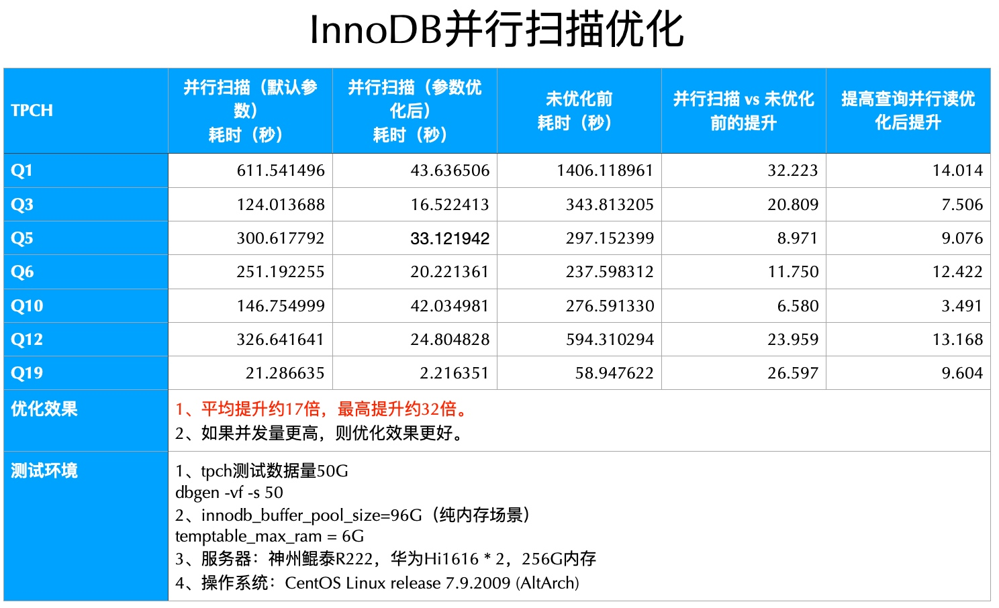

# InnoDB Parallel Query (InnoDB PQ)
---

## InnoDB PQ Overview

Based on the characteristics of the binary tree, the binary tree can be divided into several subtrees, allowing multiple threads to scan different parts of the same InnoDB table in parallel.

In GreatSQL, the execution plan has been transformed to be multi-threaded. Each worker thread executes the same plan as the original MySQL execution plan, but each worker thread only needs to scan part of the table data. After the worker threads finish scanning, the results are aggregated.

Through this multi-threaded transformation, GreatSQL InnoDB PQ can fully utilize multi-core resources to improve query performance.

After optimization, GreatSQL performs excellently in TPC-H benchmarks, with a maximum improvement of 30x and an average improvement of 15x. This feature is suitable for businesses such as SAP and financial statistics that require periodic data aggregation reports.

The following are the test results of TPC-H 50G on Huawei Kunpeng Hi1616*2 with 256G memory and NVMe SSD storage:



Usage limitations:

- Subqueries are not supported yet; you can try to rewrite them as JOINs.

## Enabling InnoDB PQ
There are two ways to use parallel query:

### Setting System Parameters
Use the global parameter `force_parallel_execute` to control whether parallel query is enabled; use the global parameter `parallel_default_dop` to control how many threads are used for parallel query. The above parameters can be modified at any time during use without restarting the database.

For example, to enable parallel execution with a degree of parallelism of 4, modify the *[mysqld]* section of the *my.cnf* configuration file:
```ini
force_parallel_execute = on;
parallel_default_dop = 4;
```
You can adjust the value of the `parallel_cost_threshold` parameter according to the actual situation. If it is set to 0, all queries will use parallelism; if set to non-zero, only queries whose estimated cost is greater than this value will use parallelism.

### Using HINT Syntax
Using HINT syntax, you can control whether a single statement executes in parallel. When parallel execution is disabled by default in the system, you can use hints to accelerate specific SQL. Conversely, you can also restrict certain types of SQL from entering parallel execution.

- `SELECT /*+ PQ */ … FROM …` uses the default degree of parallelism of 4 for parallel query.

- `SELECT /*+ PQ(8) */ … FROM …` uses a degree of parallelism of 8 for parallel query.

- `SELECT /*+ NO_PQ */ … FROM …` this statement does not use parallel query.

## Parallel Query Related Parameters and Status Variables

### New Parameters
In the parallel framework, 6 parallel-related parameters have been added:

| System Variable Name	| force_parallel_execute |
| --- | --- | 
| Variable Scope	| global, session |
| Dynamic Variable	| YES |
| Permitted Values |	ON/OFF |
| Default	| OFF |
| Description	| Sets the parallel query switch, a bool value, on/off. Default is off, disabling the parallel query feature. |

<br/>

| System Variable Name	| parallel_cost_threshold |
| --- | --- | 
| Variable Scope	| global, session |
| Dynamic Variable	| YES |
| Permitted Values |	[0, ULONG_MAX] |
| Default	| 1000 |
| Description	| Sets the threshold for SQL statements to use parallel query. Only when the estimated cost of the query is higher than this threshold will parallel query be executed. If the estimated cost of the SQL statement is lower than this threshold, the native query process is executed. |

<br/>

| System Variable Name	| parallel_default_dop |
| --- | --- | 
| Variable Scope	| global, session |
| Dynamic Variable	| YES |
| Permitted Values |	[0, 1024] |
| Default	| 4 |
| Description	| Sets the maximum degree of parallelism of parallel query for each SQL statement.<br/>The query degree of parallelism of a SQL statement is dynamically adjusted based on the table size. If the table's binary tree is too small (the number of table slices is less than the degree of parallelism), the query's degree of parallelism is set based on the number of table slices. The maximum parallelism of each query will not exceed the value set by the `parallel_default_dop` parameter.<br/>When set to 0, it means the degree of parallelism is 0, that is, the parallel query feature is not enabled.|

<br/>

| System Variable Name	| parallel_max_threads |
| --- | --- | 
| Variable Scope	| global, session |
| Dynamic Variable	| YES |
| Permitted Values |	[0, ULONG_MAX] |
| Default	| 64 |
| Description	| Sets the total number of parallel query threads in the system. |

<br/>

| System Variable Name	| parallel_memory_limit |
| --- | --- | 
| Variable Scope	| global, session |
| Dynamic Variable	| YES |
| Permitted Values |	0 - 4294967295 |
| Default	| 104857600（100MB） |
| Description	| The upper limit of the total memory used by leader and worker threads during parallel execution.<br/>In a scenario with heavy TP and light AP, innodb_buffer_pool_size can be set to about 50% of physical memory, and parallel_memory_limit can be set to about 20% ~ 30% of physical memory.<br/>When the memory used by parallel execution exceeds this value, new SQL queries will not be executed in parallel.|

<br/>

| System Variable Name	| parallel_queue_timeout |
| --- | --- | 
| Variable Scope	| global, session |
| Dynamic Variable	| YES |
| Permitted Values |	[0, ULONG_MAX] |
| Default	| 0 |
| Description	| Sets the wait timeout for parallel queries in the system. If system resources are insufficient, for example, when the running parallel query threads have reached the value of parallel_max_threads, the parallel query statement will wait. If resources are still not obtained after the timeout, the native query process is executed. <br/>Unit: milliseconds|

### New Status Variables
In the parallel framework, 4 status variables have also been added:

- **PQ_threads_running**

Global level, the total number of threads currently running parallel execution.

- **PQ_memory_used**

Global level, the total amount of memory currently used by parallel execution.

- **PQ_threads_refused**

Global level, the total number of queries that failed to execute in parallel due to the total thread number limit.

- **PQ_memory_refused**

Global level, the total number of queries that failed to execute in parallel due to the total memory limit.

## What Is the Difference Between InnoDB PQ and MySQL Parallel Reads

Starting from MySQL 8.0.14, InnoDB supports parallel reads of clustered indexes, which can improve the performance of CHECK TABLE. However, this feature does not apply to secondary index scans. The `innodb_parallel_read_threads` option must be set to a value greater than 1 to enable parallel reads of clustered indexes. The default value is 4. The actual number of threads used for parallel clustered index reads is determined by the value of the `innodb_parallel_read_threads` option or the number of index subtrees to be scanned, whichever is smaller.

Starting from MySQL 8.0.17, parallel reads of clustered indexes support table partitioning.

As you can see, parallel reads in MySQL only support clustered indexes, not secondary indexes, and are usually only helpful when executing `CHECK TABLE` or executing `COUNT(*)` for statistics based on clustered indexes.

In contrast, GreatSQL InnoDB PQ supports both clustered indexes and secondary indexes, which is especially advantageous for parallel queries on large tables, because there are multiple binary tree subtrees in this case, supporting a higher degree of parallelism.

GreatSQL InnoDB PQ also supports online dynamic enabling/disabling. Even when globally disabled, it can be enabled in a specific session using HINT syntax.

For example, using the TPC-H Q1 query scenario:

```sql
-- First, do not use InnoDB PQ and view the default execution plan
greatsql> explain SELECT
    ->     l_returnflag,
    ->     l_linestatus,
    ->     sum(l_quantity) AS sum_qty,
    ->     sum(l_extendedprice) AS sum_base_price,
    ->     sum(l_extendedprice * (1 - l_discount)) AS sum_disc_price,
    ->     sum(l_extendedprice * (1 - l_discount) * (1 + l_tax)) AS sum_charge,
    ->     avg(l_quantity) AS avg_qty,
    ->     avg(l_extendedprice) AS avg_price,
    ->     avg(l_discount) AS avg_disc,
    ->     count(*) AS count_order
    -> FROM
    ->     lineitem
    -> WHERE
    ->     l_shipdate <= CAST('1998-09-02' AS date)
    -> GROUP BY
    ->     l_returnflag,
    ->     l_linestatus
    -> ORDER BY
    ->     l_returnflag,
    ->     l_linestatus;
+----+-------------+----------+------------+------+---------------+------+---------+------+----------+----------+----------------------------------------------+
| id | select_type | table    | partitions | type | possible_keys | key  | key_len | ref  | rows     | filtered | Extra                                        |
+----+-------------+----------+------------+------+---------------+------+---------+------+----------+----------+----------------------------------------------+
|  1 | SIMPLE      | lineitem | NULL       | ALL  | NULL          | NULL | NULL    | NULL | 29988970 |    33.33 | Using where; Using temporary; Using filesort |
+----+-------------+----------+------------+------+---------------+------+---------+------+----------+----------+----------------------------------------------+
1 row in set, 1 warning (0.00 sec)

-- Modify innodb_parallel_read_threads=16 and execute the Q1 query
greatsql> set global innodb_parallel_read_threads=16;

-- Actually execute the Q1 SQL
greatsql> SELECT ...;
4 rows in set (41.45 sec)

-- Enable InnoDB PQ. First modify parallel_memory_limit and innodb_buffer_pool_size to the same value
greatsql> select @@innodb_buffer_pool_size;
+---------------------------+
| @@innodb_buffer_pool_size |
+---------------------------+
|                8589934592 |
+---------------------------+
1 row in set (0.00 sec)

greatsql> set global parallel_memory_limit=8589934592;
Query OK, 0 rows affected (0.00 sec)

-- Add the PQ HINT and view the execution plan again
greatsql> explain SELECT /*+ PQ(16) */ ...;
+----+-------------+-----------+------------+------+---------------+------+---------+------+----------+----------+----------------------------------------------+
| id | select_type | table     | partitions | type | possible_keys | key  | key_len | ref  | rows     | filtered | Extra                                        |
+----+-------------+-----------+------------+------+---------------+------+---------+------+----------+----------+----------------------------------------------+
|  1 | SIMPLE      | <gather2> | NULL       | ALL  | NULL          | NULL | NULL    | NULL | 29988970 |    33.33 | Parallel execute (16 workers)                |
|  2 | SIMPLE      | lineitem  | NULL       | ALL  | NULL          | NULL | NULL    | NULL | 29988970 |    33.33 | Using where; Using temporary; Using filesort |
+----+-------------+-----------+------------+------+---------------+------+---------+------+----------+----------+----------------------------------------------+
2 rows in set, 1 warning (0.04 sec)

-- Actually execute the Q1 SQL
greatsql> SELECT /*+ PQ(16) */ ...;
4 rows in set (8.33 sec)
```

As you can see, the execution time of the Q1 SQL has decreased significantly, and the efficiency has improved by nearly 5 times at least.

## When Is It Recommended to Enable InnoDB PQ

For full table scan scenarios without filtering conditions, such as `SELECT COUNT(*) FROM t1` or `SELECT * FROM t1`, there is no need to enable InnoDB PQ; you can continue using the native parallel reads of clustered indexes.

For example, the following scenario:
```sql
-- The orders table in the tpc-h test database
greatsql> SHOW CREATE TABLE orders\G
*************************** 1. row ***************************
       Table: orders
Create Table: CREATE TABLE `orders` (
  `o_orderkey` bigint NOT NULL,
  `o_custkey` bigint NOT NULL,
  `o_orderstatus` char(1) NOT NULL,
  `o_totalprice` decimal(15,2) NOT NULL,
  `o_orderdate` date NOT NULL,
  `o_orderpriority` char(15) NOT NULL,
  `o_clerk` char(15) NOT NULL,
  `o_shippriority` bigint NOT NULL,
  `o_comment` varchar(79) NOT NULL,
  PRIMARY KEY (`o_orderkey`),
  KEY `orders_fk1` (`o_custkey`)
) ENGINE=InnoDB DEFAULT CHARSET=utf8mb4 COLLATE=utf8mb4_0900_ai_ci
1 row in set (0.01 sec)

-- This table has about 150 million rows
greatsql> SHOW TABLE STATUS like 'orders'\G
*************************** 1. row ***************************
           Name: orders
         Engine: InnoDB
        Version: 10
     Row_format: Dynamic
           Rows: 148735762
 Avg_row_length: 164
    Data_length: 24439160832
Max_data_length: 0
   Index_length: 5003739136
      Data_free: 4194304
 Auto_increment: NULL
    Create_time: 2023-12-20 07:09:35
    Update_time: 2023-12-20 07:20:05
     Check_time: NULL
      Collation: utf8mb4_0900_ai_ci
       Checksum: NULL
 Create_options:
        Comment:
1 row in set (0.01 sec)

-- A full-table COUNT(*) generally goes through a secondary index
greatsql> EXPLAIN SELECT COUNT(*) FROM orders\G
*************************** 1. row ***************************
           id: 1
  select_type: SIMPLE
        table: orders
   partitions: NULL
         type: index
possible_keys: NULL
          key: orders_fk1
      key_len: 8
          ref: NULL
         rows: 148735762
     filtered: 100.00
        Extra: Using index
1 row in set, 1 warning (0.00 sec)

-- Takes about 3.5 seconds
greatsql> SELECT COUNT(*) FROM orders;
+-----------+
| count(*)  |
+-----------+
| 150000000 |
+-----------+
1 row in set (0.44 sec)

-- Use the parallel read feature and force the primary key; the time is not significantly shortened
greatsql> SELECT COUNT(*) FROM orders FORCE INDEX(PRIMARY);
+-----------+
| count(*)  |
+-----------+
| 150000000 |
+-----------+
1 row in set (0.42 sec)

-- Use HINT syntax to enable PQ query, but the optimizer still uses the original method for COUNT(*) queries
greatsql> EXPLAIN SELECT /*+ PQ */ COUNT(*) FROM orders\G
*************************** 1. row ***************************
           id: 1
  select_type: SIMPLE
        table: orders
   partitions: NULL
         type: index
possible_keys: NULL
          key: orders_fk1
      key_len: 8
          ref: NULL
         rows: 148735762
     filtered: 100.00
        Extra: Using index
1 row in set, 1 warning (0.00 sec)

greatsql> select /*+ PQ */ count(*) from orders;
+-----------+
| count(*)  |
+-----------+
| 150000000 |
+-----------+
1 row in set (0.47 sec)

greatsql> select /*+ PQ */ count(*) from orders force index(PRIMARY);
+-----------+
| count(*)  |
+-----------+
| 150000000 |
+-----------+
1 row in set (0.43 sec)

-- Change COUNT(*) to SELECT * to use the PQ feature. The current default degree of parallelism is 64 (parallel_default_dop = 64)
greatsql> EXPLAIN SELECT /*+ PQ */ * FROM orders\G
*************************** 1. row ***************************
           id: 1
  select_type: SIMPLE
        table: <gather2>
   partitions: NULL
         type: ALL
possible_keys: NULL
          key: NULL
      key_len: NULL
          ref: NULL
         rows: 148735762
     filtered: 100.00
        Extra: Parallel execute (64 workers)
*************************** 2. row ***************************
           id: 2
  select_type: SIMPLE
        table: orders
   partitions: NULL
         type: ALL
possible_keys: NULL
          key: NULL
      key_len: NULL
          ref: NULL
         rows: 148735762
     filtered: 100.00
        Extra: NULL
2 rows in set, 1 warning (0.00 sec)

-- Actually execute a full table scan for comparison
-- Enable PQ with a degree of parallelism of 64 for the full table scan
greatsql> select /*+ PQ */ * into outfile '/opt/tpch/o.txt' from orders;
Query OK, 150000000 rows affected (9 min 54.45 sec)

-- Use the native parallel reads of clustered indexes for the full table scan
greatsql> set global innodb_parallel_read_threads=64;
Query OK, 0 rows affected (0.00 sec)

greatsql> set session innodb_parallel_read_threads=64;
Query OK, 0 rows affected (0.00 sec)

greatsql> select * into outfile '/opt/tpch/o1.txt' from orders;
Query OK, 150000000 rows affected (3 min 14.68 sec)

-- Force the primary key for parallel reads; the time is similar
greatsql> select * into outfile '/opt/tpch/o1.txt' from orders force index(PRIMARY);
Query OK, 150000000 rows affected (3 min 14.04 sec)
```
As you can see, in the above two full table scan scenarios, `SELECT * FROM orders` and `SELECT COUNT(*) FROM orders`, forcibly using the InnoDB PQ HINT did not achieve the acceleration optimization effect.

In the above two scenarios, you can still use the native default execution method.

**Further reading**: [innodb_parallel_read_threads](https://dev.mysql.com/doc/refman/8.0/en/innodb-parameters.html#sysvar_innodb_parallel_read_threads).


**Scan the QR code to follow the WeChat official account**


