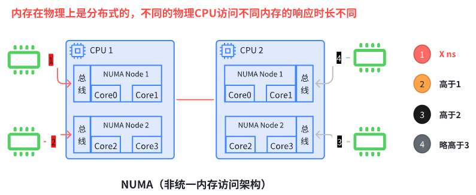
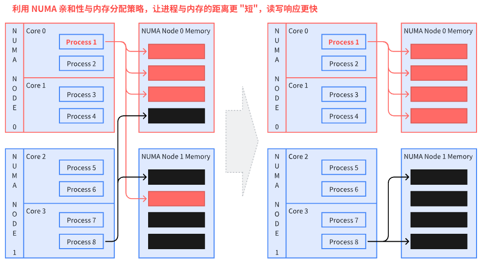
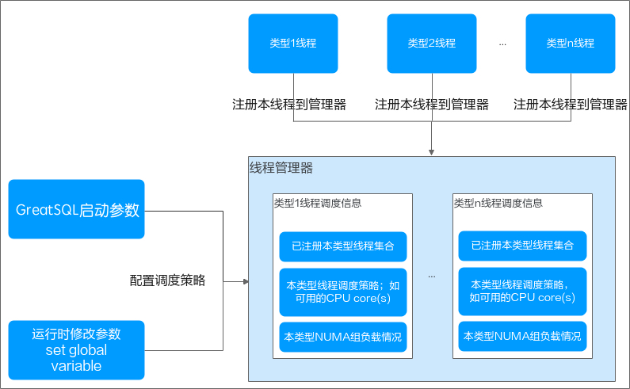
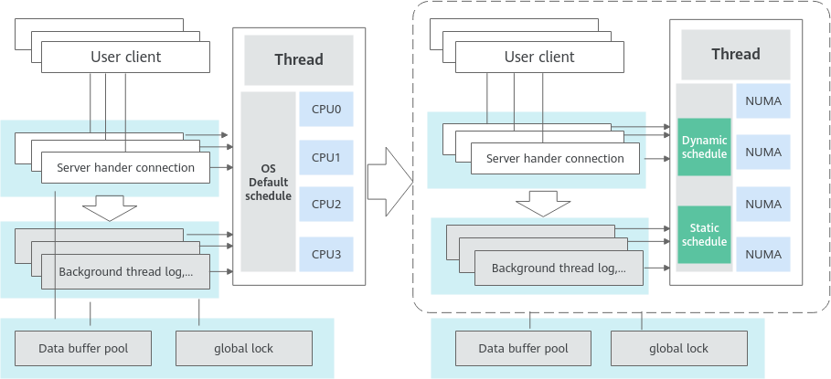
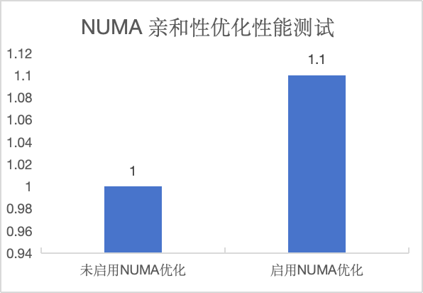

# NUMA Affinity Optimization
---

## NUMA Overview
NUMA (Non Uniform Memory Access) is the non-uniform memory access architecture.

In traditional SMP (Symmetric Multi-Processing), all processors share the system bus. Therefore, as the number of processors increases, bus contention increases, and the system bus becomes a bottleneck. As a result, SMP systems currently generally have only dozens of CPUs, and their scalability is greatly limited.

NUMA technology effectively combines the ease of programming of SMP systems with the ease of scalability of MPP (Massively Parallel Processing) systems, solving the scalability problem of SMP systems well, and has become one of the mainstream architectures of today's high-performance servers.

In the NUMA architecture, when the Linux kernel receives a memory allocation request, it preferentially looks for free memory in the memory node (Node) local or adjacent to the CPU that made the request. This approach is called local allocation. Local allocation makes subsequent memory accesses local relative to the underlying physical resources, closer, and more efficient.

In the NUMA architecture, there are multiple nodes, and each node can have multiple CPUs (each CPU can have multiple cores or threads), sharing a common memory controller within the same node. Therefore, all memory of a node is equivalent to all CPUs in that node, but different for all CPUs in other nodes. Nodes can be divided into three types: Local Node, Neighbour Node, and Remote Node.

As can be seen from the following two figures, NUMA affinity and memory allocation policies are used to keep the distance between processes and memory as short as possible. It is assumed here that the memory allocation policy has already been set, and the NUMA affinity of threads is used to reduce cross-NUMA access.





To determine the NUMA status of a server, you can use the command `numactl --hardware` to get the information. Linux systems usually support it:

```bash
$ numactl --hardware

...
available: 1 nodes (0)
node 0 cpus: 0 1 2 3 4 5 6 7 8 9 10 11 12 13 14 15 16 17 18 19 20 21 22 23 24 25 26 27 28 29 30 31 32 33 34 35 36 37 38 39 40 41 42 43 44 45 46 47 48 49 50 51 52 53 54 55 56 57 58 59 60 61 62 63 64 65 66 67 68 69 70 71 72 73 74 75 76 77 78 79 80 81 82 83 84 85 86 87 88 89 90 91 92 93 94 95 96 97 98 99 100 101 102 103 104 105 106 107 108 109 110 111 112 113 114 115 116 117 118 119 120 121 122 123 124 125 126 127 128 129 130 131 132 133 134 135 136 137 138 139 140 141 142 143 144 145 146 147 148 149 150 151 152 153 154 155 156 157 158 159 160 161 162 163 164 165 166 167 168 169 170 171 172 173 174 175
node 0 size: 370088 MB
node 0 free: 266009 MB
node distances:
node   0
  0:  10
```

The above result shows only 1 node, indicating that this server currently has NUMA disabled. Let's check another server:

```bash
$ numactl --hardware

...
available: 4 nodes (0-3)
node 0 cpus: 0 1 2 3 4 5 6 7 8 9 10 11 12 13 14 15 16 17 18 19 20 21 22 23 24 25 26 27 28 29 30 31
node 0 size: 130059 MB
node 0 free: 125156 MB
node 1 cpus: 32 33 34 35 36 37 38 39 40 41 42 43 44 45 46 47 48 49 50 51 52 53 54 55 56 57 58 59 60 61 62 63
node 1 size: 130937 MB
node 1 free: 127130 MB
node 2 cpus: 64 65 66 67 68 69 70 71 72 73 74 75 76 77 78 79 80 81 82 83 84 85 86 87 88 89 90 91 92 93 94 95
node 2 size: 130937 MB
node 2 free: 113833 MB
node 3 cpus: 96 97 98 99 100 101 102 103 104 105 106 107 108 109 110 111 112 113 114 115 116 117 118 119 120 121 122 123 124 125 126 127
node 3 size: 130935 MB
node 3 free: 130438 MB
node distances:
node   0   1   2   3
  0:  10  16  32  33
  1:  16  10  25  32
  2:  32  25  10  16
  3:  33  32  16  10
```

As you can see, NUMA is not disabled on this server, and there are 4 NUMA nodes.

## NUMA Affinity Scheduling Optimization Mechanism

In high-concurrency scenarios, under the system's default thread scheduling method, user threads and background processing threads frequently sleep and then wake up on CPUs of different NUMA nodes. This situation increases CPU overhead and affects overall performance.

In GreatSQL, to address this problem, NUMA scheduling has been further optimized, mainly in the following aspects:

1. First, threads are classified to distinguish threads generated by user connections, hereinafter referred to as "front-end user threads", and multiple "background threads" of the InnoDB engine, including log checkpointer, log flush, and other threads.

2. Considering that front-end user threads are usually numerous, when setting their affinity binding, it is best to achieve load balancing across NUMA nodes and reduce cross-NUMA node access.

3. Background threads are recommended to be bound to fixed logical CPUs, which can reduce cross-NUMA node access and improve efficiency.

4. During configuration, if the specified logical CPUs span physical NUMA nodes, cross-NUMA access may actually occur. Therefore, try to set logical CPUs within the same NUMA node to achieve static binding.

5. During program operation, the load balancing state can be re-adjusted by modifying parameter values. However, it is not recommended to do this frequently, because when threads migrate to other NUMA nodes, it is actually cross-NUMA access.

The following two figures show the work that GreatSQL has done in NUMA affinity scheduling optimization.

1. Background threads: mainly related to the InnoDB engine's Redo Log and purge processing logic. The number of such threads is fixed, and each type of thread has its own thread instances, started when the GreatSQL instance starts. Through NUMA affinity settings, a certain type of thread can run only on specified CPUs, achieving CPU isolation between various types of threads so that they can all be fully scheduled and avoid becoming system bottlenecks.

2. Front-end user threads are characterized by one-thread-per-connection (one thread per connection), and their number changes with the number of connections. Front-end user threads only migrate among logical CPUs within the same NUMA node during the lifetime of the current session, and never migrate across NUMA nodes, thus benefiting from data locality. To achieve load balancing between groups, newly added front-end threads are scheduled to groups with lighter load. The load level is reflected by the number of sessions in the group.



3. When front-end user threads and background threads wake up after sleeping, they may be scheduled to logical CPUs of different NUMA nodes. Thread switching to other CPUs causes thread-related resource copies, affecting overall performance. It is necessary to dynamically bind front-end user threads to fixed NUMA node CPUs to reduce cross-NUMA access, while ensuring CPU access load balancing; background threads are statically bound to fixed NUMA nodes to reduce cross-NUMA access and improve background thread efficiency.




To enable NUMA affinity support, you need to rely on the libnuma library at the operating system level. You need to install the following dependency packages first:

```bash
yum install -y numactl numactl-devel numactl-libs
```

By default, the GreatSQL binary package or RPM package already supports the NUMA affinity scheduling optimization feature. If you need to compile binaries from the GreatSQL source package, you should add the `-DWITH_NUMA=ON` parameter during compilation to enable NUMA affinity scheduling optimization support.

## Related Parameter Options

### New System Options

NUMA affinity optimization settings are implemented through the following options.

- `sched_affinity_foreground_thread`

| Property            | Value                                  |
| ------------------- | -------------------------------------- |
| Command-Line Format | sched_affinity_foreground_thread=#     |
| System Variable     | sched_affinity_foreground_thread       |
| Scope               | Global                                 |
| Dynamic             | Yes                                    |
| Type                | String                                 |
| Default value       | NULL                                   |

Sets the logical CPUs that front-end user threads are affined to, separated by "," and using "-" to indicate ranges, for example: 1,32-63.

When the option value is empty, it means threads can migrate within the CPUs bound to the parent process. If the parent process is not bound to CPUs, threads can migrate among all CPUs.

- `sched_affinity_log_checkpointer`

| Property            | Value                                  |
| ------------------- | -------------------------------------- |
| Command-Line Format | sched_affinity_log_checkpointer=#      |
| System Variable     | sched_affinity_log_checkpointer        |
| Scope               | Global                                 |
| Dynamic             | Yes                                    |
| Type                | String                                 |
| Default value       | NULL                                   |

Sets the logical CPUs that the InnoDB engine's log checkpointer background thread is affined to, separated by "," and using "-" to indicate ranges, for example: 1,32-63.

When the option value is empty, it means threads can migrate within the CPUs bound to the parent process. If the parent process is not bound to CPUs, threads can migrate among all CPUs.

- `sched_affinity_log_flush_notifier`

| Property            | Value                                  |
| ------------------- | -------------------------------------- |
| Command-Line Format | sched_affinity_log_flush_notifier=#    |
| System Variable     | sched_affinity_log_flush_notifier      |
| Scope               | Global                                 |
| Dynamic             | Yes                                    |
| Type                | String                                 |
| Default value       | NULL                                   |

Sets the logical CPUs that the InnoDB engine's log flush notifier background thread is affined to, separated by "," and using "-" to indicate ranges, for example: 1,32-63.

When the option value is empty, it means threads can migrate within the CPUs bound to the parent process. If the parent process is not bound to CPUs, threads can migrate among all CPUs.

- `sched_affinity_log_flusher`

| Property            | Value                                  |
| ------------------- | -------------------------------------- |
| Command-Line Format | sched_affinity_log_flusher=#           |
| System Variable     | sched_affinity_log_flusher             |
| Scope               | Global                                 |
| Dynamic             | Yes                                    |
| Type                | String                                 |
| Default value       | NULL                                   |

Sets the logical CPUs that the InnoDB engine's log flush background thread is affined to, separated by "," and using "-" to indicate ranges, for example: 1,32-63.

When the option value is empty, it means threads can migrate within the CPUs bound to the parent process. If the parent process is not bound to CPUs, threads can migrate among all CPUs.

- `sched_affinity_log_write_notifier`

| Property            | Value                                  |
| ------------------- | -------------------------------------- |
| Command-Line Format | sched_affinity_log_write_notifier=#    |
| System Variable     | sched_affinity_log_write_notifier      |
| Scope               | Global                                 |
| Dynamic             | Yes                                    |
| Type                | String                                 |
| Default value       | NULL                                   |

Sets the logical CPUs that the InnoDB engine's log write notifier background thread is affined to, separated by "," and using "-" to indicate ranges, for example: 1,32-63.

When the option value is empty, it means threads can migrate within the CPUs bound to the parent process. If the parent process is not bound to CPUs, threads can migrate among all CPUs.

- `sched_affinity_log_writer`

| Property            | Value                                  |
| ------------------- | -------------------------------------- |
| Command-Line Format | sched_affinity_log_writer=#            |
| System Variable     | sched_affinity_log_writer              |
| Scope               | Global                                 |
| Dynamic             | Yes                                    |
| Type                | String                                 |
| Default value       | NULL                                   |

Sets the logical CPUs that the InnoDB engine's log write background thread is affined to, separated by "," and using "-" to indicate ranges, for example: 1,32-63.

When the option value is empty, it means threads can migrate within the CPUs bound to the parent process. If the parent process is not bound to CPUs, threads can migrate among all CPUs.

- `sched_affinity_purge_coordinator`

| Property            | Value                                  |
| ------------------- | -------------------------------------- |
| Command-Line Format | sched_affinity_purge_coordinator=#     |
| System Variable     | sched_affinity_purge_coordinator       |
| Scope               | Global                                 |
| Dynamic             | Yes                                    |
| Type                | String                                 |
| Default value       | NULL                                   |

Sets the logical CPUs that the InnoDB engine's purge coordinator background thread is affined to, separated by "," and using "-" to indicate ranges, for example: 1,32-63.

When the option value is empty, it means threads can migrate within the CPUs bound to the parent process. If the parent process is not bound to CPUs, threads can migrate among all CPUs.

- `sched_affinity_numa_aware`

| Property            | Value                                  |
| ------------------- | -------------------------------------- |
| Command-Line Format | sched_affinity_numa_aware=#            |
| System Variable     | sched_affinity_numa_aware              |
| Scope               | Global                                 |
| Dynamic             | Yes                                    |
| Type                | Bool                                   |
| Default value       | False                                  |

Sets whether NUMA node group changes can be automatically detected and sensed. This option only affects the `sched_affinity_foreground_thread` option.

When the `sched_affinity_foreground_thread` value is not empty and `sched_affinity_numa_aware = ON`, the logical CPUs set by `sched_affinity_foreground_thread` are automatically grouped according to NUMA nodes. A thread can only migrate among logical CPUs of the specific group it belongs to and will not migrate to other NUMA node groups.

When the `sched_affinity_foreground_thread` value is not empty and `sched_affinity_numa_aware = OFF`, all logical CPUs set by `sched_affinity_foreground_thread` belong to the same group. In this case, threads may migrate to other NUMA nodes, affecting their performance.

The other sched_affinity_* background thread affinity options do not automatically sense NUMA node groups; background threads only migrate among the logical CPUs specified by each option.

### Application Reference

Assume the server has a total of 128 CPU cores:

```shell
$ numactl --hardware

...
available: 4 nodes (0-3)
node 0 cpus: 0 1 2 3 4 5 6 7 8 9 10 11 12 13 14 15 16 17 18 19 20 21 22 23 24 25 26 27 28 29 30 31
node 0 size: 130059 MB
node 0 free: 125156 MB
node 1 cpus: 32 33 34 35 36 37 38 39 40 41 42 43 44 45 46 47 48 49 50 51 52 53 54 55 56 57 58 59 60 61 62 63
node 1 size: 130937 MB
node 1 free: 127130 MB
node 2 cpus: 64 65 66 67 68 69 70 71 72 73 74 75 76 77 78 79 80 81 82 83 84 85 86 87 88 89 90 91 92 93 94 95
node 2 size: 130937 MB
node 2 free: 113833 MB
node 3 cpus: 96 97 98 99 100 101 102 103 104 105 106 107 108 109 110 111 112 113 114 115 116 117 118 119 120 121 122 123 124 125 126 127
node 3 size: 130935 MB
node 3 free: 130438 MB
node distances:
node   0   1   2   3
  0:  10  16  32  33
  1:  16  10  25  32
  2:  32  25  10  16
  3:  33  32  16  10
```

The following is a reference template for the *my.cnf* configuration file:

```ini
[mysqld]
sched_affinity_numa_aware = ON
sched_affinity_foreground_thread = 0-31,32-63,64-95
sched_affinity_log_writer = 96-100
sched_affinity_log_flusher = 101-105
sched_affinity_log_write_notifier = 106-110
sched_affinity_log_flush_notifier = 111-115
sched_affinity_log_checkpointer = 116-120
sched_affinity_purge_coordinator = 121-124
```
With the above settings, front-end user threads and background threads can be bound to different physical CPUs (different NUMA nodes), achieving better overall performance.

### New Status Variables

- `Sched_affinity_group_capacity`

| Property        | Value                         |
| --------------- | ----------------------------- |
| Status Variable | Sched_affinity_group_capacity |
| Scope           | Global                        |
| Type            | Integer                       |

Indicates the number of logical CPUs in each NUMA node.

- `Sched_affinity_group_number`

| Property        | Value                         |
| --------------- | ----------------------------- |
| Status Variable | Sched_affinity_group_number   |
| Scope           | Global                        |
| Type            | Integer                       |

Indicates the number of NUMA nodes.

- `Sched_affinity_status`

| Property        | Value                         |
| --------------- | ----------------------------- |
| Status Variable | Sched_affinity_status         |
| Scope           | Global                        |
| Type            | String                        |

Indicates the NUMA affinity setting status. Taking `log_checkpointer: 1/4` as an example, it means there is 1 log checkpointer thread, which can migrate among 4 logical CPUs.

## Constraints and Limitations

1. Enabling NUMA affinity optimization requires the libnuma library, but the libnuma library does not allow interface calls to set logical CPUs beyond the binding range at the parent process startup; otherwise, it is considered a conflict.

2. When the GreatSQL instance starts, if a CPU binding policy is also set at the operating system level (for example, via `taskset / numactl`), the configured thread affinity policy must not conflict with it. If a conflict occurs, the GreatSQL instance fails to start and records the corresponding error log.

3. When the GreatSQL instance is running, if you want to change the NUMA affinity settings of threads, they must not conflict with the CPU binding policy already set at the system level when the GreatSQL process started. If a conflict occurs, the GreatSQL instance continues to run, but the thread NUMA affinity scheduling enters fallback mode, no longer responding to internal thread scheduling requests, and records the corresponding warning log.

4. In summary, after the GreatSQL instance starts, you should not change the CPU binding policy at the system level. Otherwise, the GreatSQL instance can still run normally, but the thread affinity load information will no longer be accurate, affecting the scheduling optimization effect.

## Test Report

Test machine:

```bash
$ cat /etc/os-release

...
cat /etc/os-release
NAME="CentOS Linux"
VERSION="8"
ID="centos"
ID_LIKE="rhel fedora"
VERSION_ID="8"
PLATFORM_ID="platform:el8"
PRETTY_NAME="CentOS Linux 8"
ANSI_COLOR="0;31"
CPE_NAME="cpe:/o:centos:centos:8"
HOME_URL="https://centos.org/"
BUG_REPORT_URL="https://bugs.centos.org/"
CENTOS_MANTISBT_PROJECT="CentOS-8"
CENTOS_MANTISBT_PROJECT_VERSION="8"

$ free -ht

...
              total        used        free      shared  buff/cache   available
Mem:          382Gi       8.4Gi       365Gi        93Mi       9.0Gi       340Gi
Swap:         4.0Gi          0B       4.0Gi
Total:        386Gi       8.4Gi       369Gi

$ lscpu

...
Architecture:                    aarch64
CPU op-mode(s):                  64-bit
Byte Order:                      Little Endian
CPU(s):                          96
On-line CPU(s) list:             0-95
Thread(s) per core:              1
Core(s) per socket:              48
Socket(s):                       2
NUMA node(s):                    4
Vendor ID:                       HiSilicon
Model:                           0
Model name:                      Kunpeng-920
Stepping:                        0x1
CPU max MHz:                     2600.0000
CPU min MHz:                     200.0000
BogoMIPS:                        200.00
L1d cache:                       6 MiB
L1i cache:                       6 MiB
L2 cache:                        48 MiB
L3 cache:                        192 MiB
NUMA node0 CPU(s):               0-23
NUMA node1 CPU(s):               24-47
NUMA node2 CPU(s):               48-71
NUMA node3 CPU(s):               72-95
Vulnerability Itlb multihit:     Not affected
Vulnerability L1tf:              Not affected
Vulnerability Mds:               Not affected
Vulnerability Meltdown:          Not affected
Vulnerability Spec store bypass: Vulnerable
Vulnerability Spectre v1:        Mitigation; __user pointer sanitization
Vulnerability Spectre v2:        Not affected
Vulnerability Tsx async abort:   Not affected
Flags:                           fp asimd evtstrm aes pmull sha1 sha2 crc32 atomics fphp asimdhp cpuid asimdrdm jscvt fcma dcpop asimddp asimdfhm

$ nvme list

...
Node             SN                   Model                                    Namespace Usage                      Format           FW Rev
---------------- -------------------- ---------------------------------------- --------- -------------------------- ---------------- --------
/dev/nvme0n1     PHLN018200FD3P2BGN   INTEL SSDPE2KE032T8                      1           3.20  TB /   3.20  TB    512   B +  0 B   VDV10152

$ df -hT | grep ssd
/dev/nvme0n1            xfs       3.0T  1.5T  1.5T  49% /ssd2

$ dd oflag=direct if=/dev/zero of=./zero bs=1M count=20480

...
20480+0 records in
20480+0 records out
21474836480 bytes (21 GB) copied, 8.69131 s, 2.5 GB/s
```

The main content of the GreatSQL configuration file *my.cnf*:

```ini
[mysqld]
basedir = /usr/local/GreatSQL-8.0.32-26-Linux-glibc2.28-aarch64
datadir = /data/GreatSQL/mysql.sock
port = 3306
user = mysql
pid-file = mysql.pid
character-set-server = UTF8MB4
skip_name_resolve = ON
default_time_zone = "+8:00"
bind_address = "0.0.0.0"
secure_file_priv = /data/GreatSQL

# Performance
lock_wait_timeout = 3600
open_files_limit    = 65535
back_log=4000
max_connections=60000
max_connect_errors = 1000000
table_open_cache = 4096
table_definition_cache = 2048
thread_stack = 512K
sort_buffer_size = 4M
join_buffer_size = 4M
read_buffer_size = 8M
read_rnd_buffer_size = 4M
bulk_insert_buffer_size = 64M
thread_cache_size = 768
interactive_timeout = 600
wait_timeout = 600
tmp_table_size = 96M
max_heap_table_size = 96M
max_allowed_packet = 64M
net_buffer_shrink_interval = 180
sql_generate_invisible_primary_key = ON
loose-lock_ddl_polling_mode = ON
loose-lock_ddl_polling_runtime = 200

# Logs
log_timestamps = SYSTEM
log_error = error.log
log_error_verbosity = 3
slow_query_log = ON
log_slow_extra = ON
slow_query_log_file = slow.log
long_query_time = 0.01
log_queries_not_using_indexes = ON
log_throttle_queries_not_using_indexes = 60
min_examined_row_limit = 100
log_slow_admin_statements = ON
log_slow_replica_statements = ON
log_slow_verbosity = FULL
log_bin = binlog
binlog_format = ROW
sync_binlog = 1
binlog_cache_size = 4M
max_binlog_cache_size = 6G
max_binlog_size = 1G
binlog_space_limit = 500G
binlog_rows_query_log_events = ON
binlog_expire_logs_seconds = 604800
binlog_checksum = CRC32
binlog_order_commits = OFF
gtid_mode = ON
enforce_gtid_consistency = ON

performance_schema=OFF
max_prepared_stmt_count=1280000

innodb_file_per_table
innodb_log_file_size=2048M
innodb_log_files_in_group=32
innodb_open_files=65535
table_open_cache_instances=64

innodb_buffer_pool_size=230G
innodb_buffer_pool_instances=16
innodb_log_buffer_size=2048M

default_time_zone=+8:00
thread_cache_size=2000
sync_binlog=0
innodb_flush_log_at_trx_commit=0
innodb_use_native_aio=1
innodb_spin_wait_delay=20
#innodb_sync_spin_loops=25
innodb_flush_method=O_DIRECT
innodb_use_fdatasync = ON
innodb_io_capacity=30000
innodb_io_capacity_max=40000
innodb_lru_scan_depth=9000
innodb_page_cleaners=16
innodb_spin_wait_pause_multiplier=5
innodb_lock_wait_timeout=100

innodb_flush_neighbors=0
innodb_write_io_threads=24
innodb_read_io_threads=16
innodb_purge_threads=32

skip_log_bin
table_open_cache=30000
innodb_adaptive_hash_index=0

#NUMA
sched_affinity_numa_aware=ON
sched_affinity_foreground_thread=0-26,30-127
sched_affinity_log_writer=28
sched_affinity_log_flusher=27
sched_affinity_log_write_notifier=29
sched_affinity_log_flush_notifier=29
sched_affinity_log_checkpointer=29
sched_affinity_purge_coordinator=29
```

Two GreatSQL binary packages were compiled separately, one with NUMA affinity optimization enabled and one without.

Based on the above configuration file, the two versions of the GreatSQL binary packages were run, with the only difference being the NUMA optimization section at the end.

Using BenchmarkSQL 5.0 for TPC-C testing, the results show that NUMA affinity scheduling optimization can improve overall TPC-C performance by about 10%:




**Feedback**
---


**Contact Us**
---

**Scan the QR code to follow the WeChat official account**


