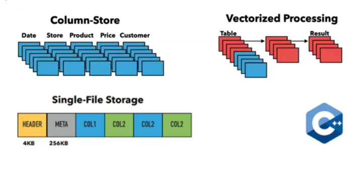
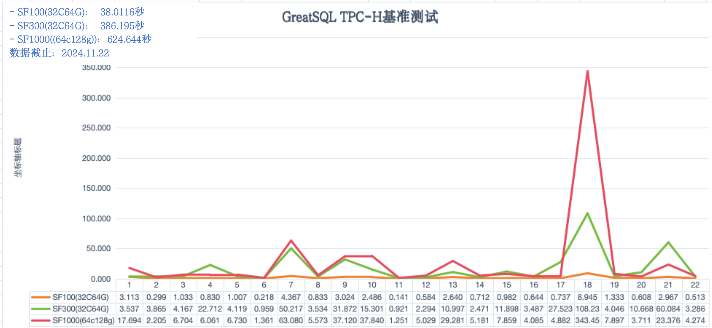

# Rapid Engine
---

## Rapid Engine Overview

Starting from GreatSQL 8.0.32-25, the Rapid storage engine has been added, enabling GreatSQL to serve online analytical processing (OLAP) query requests.

The Rapid engine is embedded into GreatSQL as a plugin and can be dynamically installed or uninstalled online.

The Rapid engine does not directly face clients and applications; users do not need to modify their existing data access methods. It is a shared-nothing, in-memory, hybrid columnar storage query processing engine designed for high-performance processing of analytical queries.

## Using the Rapid Engine to Accelerate Queries

### Enabling the Rapid Engine
To use the Rapid engine, you need to install the Rapid plugin, specify `secondary_engine` as the Rapid engine for tables, and then load the user data into the Rapid engine memory.

First, load the Rapid plugin:
```sql
greatsql> INSTALL PLUGIN Rapid SONAME 'ha_rapid.so';

greatsql> SHOW PLUGINS;
+----------------------------------+----------+--------------------+----------------------+---------+
| Name                             | Status   | Type               | Library              | License |
+----------------------------------+----------+--------------------+----------------------+---------+
| binlog                           | ACTIVE   | STORAGE ENGINE     | NULL                 | GPL     |
| mysql_native_password            | ACTIVE   | AUTHENTICATION     | NULL                 | GPL     |
...
| clone                            | ACTIVE   | CLONE              | mysql_clone.so       | GPL     |
| group_replication                | ACTIVE   | GROUP REPLICATION  | group_replication.so | GPL     |
| Rapid                            | ACTIVE   | STORAGE ENGINE     | ha_rapid.so          | GPL     |
+----------------------------------+----------+--------------------+----------------------+---------+
55 rows in set (0.00 sec)

greatsql> SHOW ENGINES;
+--------------------+---------+----------------------------------------------------------------------------+--------------+------+------------+
| Engine             | Support | Comment                                                                    | Transactions | XA   | Savepoints |
+--------------------+---------+----------------------------------------------------------------------------+--------------+------+------------+
...
| PERFORMANCE_SCHEMA | YES     | Performance Schema                                                         | NO           | NO   | NO         |
| InnoDB             | DEFAULT | Percona-XtraDB, Supports transactions, row-level locking, and foreign keys | YES          | YES  | YES        |
...
| Rapid              | YES     | Rapid storage engine                                                       | NO           | NO   | NO         |
...
+--------------------+---------+----------------------------------------------------------------------------+--------------+------+------------+
```
As you can see, the Rapid engine has been loaded successfully.

### Uninstalling the Rapid Engine
Execute the following SQL command to uninstall the Rapid engine:
```sql
UNINSTALL PLUGIN rapid;
```
If no data tables are currently loaded into the Rapid engine, it can be uninstalled directly. If there are data tables already loaded into the Rapid engine, you will see a prompt similar to the following:
```sql
greatsql> UNINSTALL PLUGIN rapid;
Query OK, 0 rows affected, 1 warning (0.00 sec)

greatsql> SHOW WARNINGS;
+---------+------+----------------------------------------------------+
| Level   | Code | Message                                            |
+---------+------+----------------------------------------------------+
| Warning | 1620 | Plugin is busy and will be uninstalled on shutdown |
+---------+------+----------------------------------------------------+
1 row in set (0.00 sec)
```
This means the Rapid engine is currently in use and cannot be uninstalled yet. In this case, you need to remove the relevant tables from the Rapid engine:
```sql
ALTER TABLE t1 SECONDARY_ENGINE = NULL;
```

Once all tables have been removed from the Rapid engine, running `SHOW ENGINES` again will show that the Rapid engine is no longer supported. You can also see similar content in the log:
```
[Note] [MY-010733] [Server] Shutting down plugin 'Rapid'
```

### Adding the Rapid Secondary Engine to an InnoDB Table
Next, add the `SECONDARY_ENGINE` attribute to an existing InnoDB table:
```sql
greatsql> CREATE TABLE `t1` (
  `id` int unsigned NOT NULL AUTO_INCREMENT,
  `c1` int unsigned NOT NULL DEFAULT '0',
  `c2` varchar(30) NOT NULL DEFAULT '',
  PRIMARY KEY (`id`)
) ENGINE=InnoDB;

greatsql> ALTER TABLE t1 SECONDARY_ENGINE = rapid;

-- View the table DDL, and you will find SECONDARY_ENGINE=rapid has been added
greatsql> SHOW CREATE TABLE t1\G
*************************** 1. row ***************************
       Table: t1
Create Table: CREATE TABLE `t1` (
  `id` int unsigned NOT NULL AUTO_INCREMENT,
  `c1` int unsigned NOT NULL DEFAULT '0',
  `c2` varchar(30) NOT NULL DEFAULT '',
  PRIMARY KEY (`id`)
) ENGINE=InnoDB DEFAULT CHARSET=utf8mb4 COLLATE=utf8mb4_0900_ai_ci SECONDARY_ENGINE=rapid
```

Starting from MySQL 8.0.18, to support the `SECONDARY ENGINE` attribute, the option `show_create_table_skip_secondary_engine` has been added to control whether the `SECONDARY ENGINE` attribute is displayed when executing `SHOW CREATE TABLE`. Its default value is OFF, which means it is displayed by default. In addition, the corresponding option `show-create-table-skip-secondary-engine` has been added to `mysqldump`, with a default value of FALSE (same as OFF), serving the same purpose.

Next, execute the following SQL commands to insert some data:
```sql
greatsql> INSERT INTO t1 SELECT 0, RAND()*1024000, RAND()*1024000;
Query OK, 1 row affected (0.00 sec)
Records: 1  Duplicates: 0  Warnings: 0

-- Run the following SQL command repeatedly to generate some data
greatsql> INSERT INTO t1 SELECT 0, RAND()*1024000, RAND()*1024000 FROM t1;
Query OK, 1 row affected (0.00 sec)
Records: 1  Duplicates: 0  Warnings: 0

greatsql> INSERT INTO t1 SELECT 0, RAND()*1024000, RAND()*1024000 FROM t1;
Query OK, 2 rows affected (0.00 sec)
Records: 2  Duplicates: 0  Warnings: 0
...
greatsql> SELECT COUNT(*) FROM t1;
+----------+
| count(*) |
+----------+
|   131072 |
+----------+
1 row in set (0.00 sec)
```

Then load the user table data into the Rapid engine in one full pass:
```sql
greatsql> ALTER TABLE t1 SECONDARY_LOAD;

-- View the table status to confirm it has been loaded. Keyword: SECONDARY_LOAD="1"
greatsql> SHOW TABLE STATUS like 't1'\G
*************************** 1. row ***************************
           Name: t1
         Engine: InnoDB
        Version: 10
     Row_format: Dynamic
           Rows: 0
 Avg_row_length: 0
    Data_length: 16384
Max_data_length: 0
   Index_length: 0
      Data_free: 0
 Auto_increment: NULL
    Create_time: 2024-01-25 17:33:07
    Update_time: NULL
     Check_time: NULL
      Collation: utf8mb4_0900_ai_ci
       Checksum: NULL
 Create_options: SECONDARY_ENGINE="rapid" SECONDARY_LOAD="1"
        Comment:
```

The process of executing the SQL command `ALTER TABLE ... SECONDARY_LOAD` is as follows: first, a table with the same name is created in the secondary engine, and then the user data is loaded into the secondary engine in one full pass using parallel loading.

After the full load is complete, subsequent DML incremental synchronization is handled by a background incremental import task thread. For details, see **[3. Data Import](./5-1-highperf-rapid-engine.md#data-import)** below.

Executing the SQL command `ALTER TABLE ... SECONDARY_UNLOAD` first checks whether the table exists in the secondary engine; if so, it is removed from the secondary engine, but its base table in the primary engine is not deleted.

### Using the Rapid Engine to Improve Query Efficiency

After loading user data into the Rapid engine, you can use the methods described below to improve query efficiency with the Rapid engine.

The option `use_secondary_engine` is the master switch for using the Rapid engine. It has three selectable values: [OFF, ON, FORCED] (corresponding values are [0, 1, 2]), with a default value of 0/OFF. There are two ways to use the Rapid engine:

**Method 1**
```sql
-- When setting use_secondary_engine=ON, to ensure that queries can use rapid,
-- you usually need to set secondary_engine_cost_threshold = 0, or a small threshold
SET use_secondary_engine = ON;
SET secondary_engine_cost_threshold = 0; 
```

**Method 2 (not recommended)**
```sql
-- Modify the session variable to force the use of the Rapid engine
SET use_secondary_engine = FORCED;

-- Or specify a HINT in the SQL query
SELECT /*+ SET_VAR(use_secondary_engine=forced) */ * FROM t1;
```

The main difference between the two methods is in the error messages. For SQL statements that cannot use the secondary engine (for example, the queried table has no secondary engine specified, or `SECONDARY_LOAD` has not been executed first), if Method 1 is used, the query will fall back to the primary engine; you can check the execution plan to determine whether the secondary engine was used. For Method 2, the secondary engine is always forced, but if it cannot be used, an error is reported, as shown in the example below:
```sql
greatsql> CREATE TABLE t2 (c1 INT PRIMARY KEY, c2 INT);
Query OK, 0 rows affected (0.08 sec)

greatsql> INSERT INTO t2 VALUES (1,1);
Query OK, 1 row affected (0.01 sec)

-- The secondary engine was not specified when creating the table above, so the query reports an error
greatsql> SELECT /*+ SET_VAR(use_secondary_engine=FORCED) */ * FROM t2;
ERROR 3889 (HY000): Secondary engine operation failed. use_secondary_engine is FORCED but query could not be executed in secondary engine.

greatsql> SELECT /*+ SET_VAR(use_secondary_engine=ON) SET_VAR(secondary_engine_cost_threshold=0) */ * FROM t2;
+----+------+
| c1 | c2   |
+----+------+
|  1 |    1 |
+----+------+
1 row in set (0.00 sec)
```

Next, use the method above to query table `t1` and experience the Rapid engine features. HINT syntax is supported in queries:
```sql
-- Supports query HINT usage. The Extra column shows the keyword: Using secondary engine RAPID
greatsql> EXPLAIN SELECT /*+ SET_VAR(use_secondary_engine=1) SET_VAR(secondary_engine_cost_threshold=0) */ * FROM t1\G
*************************** 1. row ***************************
           id: 1
  select_type: SIMPLE
        table: t1
   partitions: NULL
         type: ALL
possible_keys: NULL
          key: NULL
      key_len: NULL
          ref: NULL
         rows: 5
     filtered: 100.00
        Extra: Using secondary engine RAPID

-- When use_secondary_engine = 1 or 2 has already been set
-- and the table has the Rapid secondary engine specified and data has been imported
-- you can directly execute a SELECT query and see that the Rapid engine is used
greatsql> EXPLAIN SELECT * FROM t1\G
*************************** 1. row ***************************
           id: 1
  select_type: SIMPLE
        table: t1
   partitions: NULL
         type: ALL
possible_keys: NULL
          key: NULL
      key_len: NULL
          ref: NULL
         rows: 5
     filtered: 100.00
        Extra: Using secondary engine RAPID

-- You can also set it to not use the Rapid engine for queries. The Extra column no longer shows the keyword: Using secondary engine RAPID
greatsql> EXPLAIN SELECT /*+ SET_VAR(use_secondary_engine=0) */ * FROM t1\G
*************************** 1. row ***************************
           id: 1
  select_type: SIMPLE
        table: t1
   partitions: NULL
         type: ALL
possible_keys: NULL
          key: NULL
      key_len: NULL
          ref: NULL
         rows: 5
     filtered: 100.00
        Extra: NULL
```
For a detailed explanation of the `use_secondary_engine` option, see **[5.1 New System Options](./5-1-highperf-rapid-engine.md#new-system-options)** below.

Let's look at a simple comparative test result, executing a query on a TPC-H 1G table:
```sql
greatsql> SELECT /*+ SET_VAR(use_secondary_engine=0) */ COUNT(*) FROM lineitem;
+----------+
| count(*) |
+----------+
|  6001215 |
+----------+
1 row in set (2.18 sec)

greatsql> SELECT /*+ SET_VAR(use_secondary_engine=1) */ COUNT(*) FROM lineitem;
+----------+
| count(*) |
+----------+
|  6001215 |
+----------+
1 row in set (0.00 sec)
```
As you can see, the query speed improvement is very significant.

You can also specify the `secondary_engine_cost_threshold` option to set the cost threshold for using the Rapid engine:
```sql
-- First view the COST of the execution plan
greatsql> EXPLAIN FORMAT=TREE SELECT COUNT(*) FROM lineitem\G
*************************** 1. row ***************************
EXPLAIN: -> Aggregate: count(0)  (cost=1197779.30 rows=1)
    -> Table scan on lineitem in secondary engine RAPID  (cost=598889.90 rows=5988894)

-- Increase the secondary_engine_cost_threshold to 1197779
greatsql> SELECT /*+ SET_VAR(use_secondary_engine=1) SET_VAR(secondary_engine_cost_threshold=1197779) */ COUNT(*) FROM lineitem;
+----------+
| count(*) |
+----------+
|  6001215 |
+----------+
1 row in set (2.21 sec)
```
As you can see, although the `lineitem` table has been loaded into the Rapid engine, because the `secondary_engine_cost_threshold` threshold has been increased, the Rapid engine is actually not used.

### Rapid Engine Usage Constraints
In GreatSQL 8.0.32-25, the statement scope supported by the Rapid engine is as follows:

- Table types: normal tables with the InnoDB engine.

- SELECT statements: syntax such as `SELECT INTO` and `SELECT locking clause` is not supported.

- PREPARE statements: only `PREPARE SELECT` queries are supported.

Other types of SQL syntax are not supported yet.

The Rapid engine does not currently support table partitioning or foreign keys.

## Data Import

### Importing Data into the Rapid Engine
When the `ALTER TABLE xxx SECONDARY_LOAD` operation is executed successfully, all data in the InnoDB primary engine is loaded into the Rapid engine. This process is called a full import. After a successful full import, the data in the Rapid engine is static: data subsequently inserted, deleted, or modified in the primary engine tables will not be imported into the Rapid engine.

Using the binlog feature, an incremental import task can be started after a successful full import. The incremental task reads the binlog data generated since the full import and parses and applies it to the Rapid engine. This process is called **incremental import**.

Unlike a full import, an incremental import starts a resident background thread that reads and applies incremental binlog data in real time.

### Limitations and Requirements of Incremental Import
1. Table names must be case-insensitive, that is, set `lower_case_table_names = 1`.
1. GTID mode must be enabled, that is, set `gtid_mode = ON` and `enforce_gtid_consistency = ON`.
1. Row-format binlog events are required; statement format is not supported, that is, set `binlog_format = ROW`. If a statement-format DML event is detected while the incremental task is running, the task may report an error and exit.
1. The GIPKs feature must be disabled, that is, set `sql_generate_invisible_primary_key = OFF`. User tables cannot have an **invisible primary key**. If a table contains an implicit invisible primary key, an error is reported during the full import. In addition, user tables cannot contain any invisible columns (**invisible column**).
1. A full import must be performed on the table first before starting the incremental import task; otherwise, the task will report an error when started.
1. Binlog of the **PARTIAL_UPDATE_ROWS_EVENT** type is not supported, that is, do not set `binlog_row_value_options = PARTIAL_JSON`.
1. The `CREATE TABLE SELECT` statement is not supported. If a binlog event generated by this statement is detected while the incremental task is running, the task may report an error and exit.
1. XA transactions are not supported. If an XA transaction is detected while running, an error is reported and the task exits.

### Incremental Import Task Management
Two new system functions are added to manage incremental import tasks: `START_SECONDARY_ENGINE_INCREMENT_LOAD_TASK()` and `STOP_SECONDARY_ENGINE_INCREMENT_LOAD_TASK()`. As the names suggest, they start and stop the task respectively.

#### Starting an Incremental Task
Execute the SQL command `SELECT START_SECONDARY_ENGINE_INCREMENT_LOAD_TASK()` to start the incremental task. You can confirm whether the task started successfully based on the returned information. If startup fails, you can view the specific failure reason in the error log.

This function takes 3 parameters:
- db_name, required, specifies the database name of the incremental import task.
- table_name, required, specifies the table name of the incremental import task.
- gtid, optional, specifies the starting gtid_set value of the incremental import task. By default it does not need to be specified; the task automatically calculates and determines it based on the `gtid_executed` at the time of the `ALTER TABLE ... SECONDARY_LOAD` full import.

After the incremental import task is started, a separate task thread is started for each user table.

If the task starts successfully, `success` is returned; if it fails, `start task error` is returned. The specific failure reason can be checked in the error log, or by querying the `information_schema.SECONDARY_ENGINE_INCREMENT_LOAD_TASK` system table.

Starting incremental import tasks for views (`view`) and temporary tables (`temporary table`) is not supported.

```sql
-- Start the incremental import task
greatsql> SELECT START_SECONDARY_ENGINE_INCREMENT_LOAD_TASK('tpch1g', 't1');
+------------------------------------------------------------+
| START_SECONDARY_ENGINE_INCREMENT_LOAD_TASK('tpch1g', 't1') |
+------------------------------------------------------------+
| success                                                    |
+------------------------------------------------------------+
1 row in set (0.00 sec)

-- View the incremental import task status
greatsql> SELECT * FROM information_schema.SECONDARY_ENGINE_INCREMENT_LOAD_TASK\G
*************************** 1. row ***************************
           DB_NAME: tpch1g
        TABLE_NAME: t1
        START_TIME: 2024-01-26 14:54:41
        START_GTID: 4fb86f5b-b028-11ee-92b8-d08e7908bcb1:1-331
COMMITTED_GTID_SET: 4fb86f5b-b028-11ee-92b8-d08e7908bcb1:1-335
         READ_GTID: 4fb86f5b-b028-11ee-92b8-d08e7908bcb1:335
  READ_BINLOG_FILE: ./greatsql.000002
   READ_BINLOG_POS: 3589965
             DELAY: 0
            STATUS: RUNNING
          END_TIME:
              INFO:
1 row in set (0.00 sec)
```
As shown above, the current incremental import task is running. The GTID position where the task started is `xxx:1-331`, the current latest GTID is `xxx:1-335`, and the GTID of the current incremental task progress is `xxx:335`, with the corresponding binlog file & position being **binlog.000002** and **3589965** respectively.

You can also specify the initial GTID position when starting the incremental import task, for example, by executing the following SQL command:
```sql
SELECT START_SECONDARY_ENGINE_INCREMENT_LOAD_TASK('tpch1g', 't1', '4fb86f5b-b028-11ee-92b8-d08e7908bcb1:1-335');
```
The incremental import task skips transactions in the GTID range 1-335 and continues the incremental import from the next transaction. When the binlog is accidentally cleared, an incremental import task started with the default method (without the GTID parameter) may fail. In this case, you can first stop the incremental import task, perform a full import on the table, and then start the incremental import task again, specifying the GTID parameter when starting it.

#### Stopping an Incremental Task

Execute the SQL command `SELECT STOP_SECONDARY_ENGINE_INCREMENT_LOAD_TASK()` to stop the incremental task. You can confirm whether the task stopped successfully based on the returned information. If it fails, you can view the specific failure reason in the error log.

This function takes 2 parameters:
- db_name, required, specifies the database name of the incremental import task.
- table_name, required, specifies the table name of the incremental import task.

For example:
```sql
greatsql> SELECT STOP_SECONDARY_ENGINE_INCREMENT_LOAD_TASK('tpch1g', 't1');
+-----------------------------------------------------------+
| STOP_SECONDARY_ENGINE_INCREMENT_LOAD_TASK('tpch1g', 't1') |
+-----------------------------------------------------------+
| success                                                   |
+-----------------------------------------------------------+
1 row in set (0.65 sec)
```

#### Viewing Incremental Task Progress

Execute the SQL command `SELECT READ_SECONDARY_ENGINE_TABLE_LOAD_GTID('greatsql', 't1')` to view the GTID progress of the current task import.

This function takes 2 parameters:
- db_name, required, specifies the database name of the incremental import task.
- table_name, required, specifies the table name of the incremental import task.

The function returns the GTID position that the current incremental task has imported to, making it convenient for users to locate information such as the delay relative to the primary engine. You can also query `information_schema.SECONDARY_ENGINE_INCREMENT_LOAD_TASK`.

For example:
```sql
+-------------------------------------------------------+
| READ_SECONDARY_ENGINE_TABLE_LOAD_GTID('tpch1g', 't1') |
+-------------------------------------------------------+
| 4fb86f5b-b028-11ee-92b8-d08e7908bcb1:1-339            |
+-------------------------------------------------------+
1 row in set (0.00 sec)

greatsql> SELECT * FROM information_schema.SECONDARY_ENGINE_INCREMENT_LOAD_TASK\G
*************************** 1. row ***************************
           DB_NAME: tpch1g
        TABLE_NAME: t1
        START_TIME: 2024-01-26 15:14:31
        START_GTID: 4fb86f5b-b028-11ee-92b8-d08e7908bcb1:1-337
COMMITTED_GTID_SET: 4fb86f5b-b028-11ee-92b8-d08e7908bcb1:1-339
         READ_GTID: 4fb86f5b-b028-11ee-92b8-d08e7908bcb1:339
  READ_BINLOG_FILE: ./binlog.000002
   READ_BINLOG_POS: 3591515
             DELAY: 0
            STATUS: RUNNING
          END_TIME:
              INFO:
1 row in set (0.01 sec)
```

The columns of the system table `information_schema.SECONDARY_ENGINE_INCREMENT_LOAD_TASK` are explained as follows:

- `DB_NAME`, `TABLE_NAME`: the user table associated with the specific incremental import task.
- `START_TIME`: the time when the incremental import task was started.
- `START_GTID`: the GTID value when the incremental import task was started.
- `COMMITTED_GTID_SET`: the GTID values imported in real time during the execution of the incremental task.
- `READ_GTID`: the latest GTID value read by the incremental import task of this table.
- `READ_BINLOG_FILE`, `READ_BINLOG_POS`: the BINLOG position information imported in real time during the execution of the incremental task.
- `DELAY`: the real-time delay in seconds during the execution of the incremental task. When the incremental import task is not in the RUNNING state, the delay displayed by `DELAY` is not accurate and does not need further attention.
- `STATUS`: the status of the incremental task, whether it is running.
- `END_TIME`: if the incremental import task exits, normally or abnormally, the time when the task exited.
- `INFO`: shows the task exit or error information.

When the actually imported GTID (`COMMITTED_GTID_SET`) is equal to the latest GTID read (`READ_GTID`), it indicates that the incremental import task has caught up with the latest progress and there is no delay. At this time, you can also see that `READ_BINLOG_FILE` and `READ_BINLOG_POS` no longer change, and the `DELAY` value is 0. As shown in the example below, the tables `customer`, `nation`, `part`, `region`, and `supplier` have caught up with the latest transaction progress:

```sql
greatsql> SELECT TABLE_NAME, STATUS, COMMITTED_GTID_SET, READ_GTID, READ_BINLOG_FILE, READ_BINLOG_POS, DELAY FROM information_schema.SECONDARY_ENGINE_INCREMENT_LOAD_TASK;
+------------+-------------+----------------------------------------------+--------------------------------------------+------------------+-----------------+-------+
| TABLE_NAME | STATUS      | COMMITTED_GTID_SET                           | READ_GTID                                  | READ_BINLOG_FILE | READ_BINLOG_POS | DELAY |
+------------+-------------+----------------------------------------------+--------------------------------------------+------------------+-----------------+-------+
| customer   | RUNNING     | 35e7b1d9-bf0c-11ee-b7ea-d08e7908bcb1:1-42701 | 35e7b1d9-bf0c-11ee-b7ea-d08e7908bcb1:42701 | ./binlog.000003  |       171177719 |     0 |
| lineitem   | RUNNING     | 35e7b1d9-bf0c-11ee-b7ea-d08e7908bcb1:1-42427 | 35e7b1d9-bf0c-11ee-b7ea-d08e7908bcb1:42428 | ./binlog.000001  |      1016454504 |  5528 |
| nation     | RUNNING     | 35e7b1d9-bf0c-11ee-b7ea-d08e7908bcb1:1-42701 | 35e7b1d9-bf0c-11ee-b7ea-d08e7908bcb1:42701 | ./binlog.000003  |       171177719 |     0 |
| orders     | RUNNING     | 35e7b1d9-bf0c-11ee-b7ea-d08e7908bcb1:1-42429 | 35e7b1d9-bf0c-11ee-b7ea-d08e7908bcb1:42430 | ./binlog.000002  |        27569846 |  5466 |
| part       | RUNNING     | 35e7b1d9-bf0c-11ee-b7ea-d08e7908bcb1:1-42701 | 35e7b1d9-bf0c-11ee-b7ea-d08e7908bcb1:42701 | ./binlog.000003  |       171177719 |     0 |
| partsupp   | RUNNING     | 35e7b1d9-bf0c-11ee-b7ea-d08e7908bcb1:1-42431 | 35e7b1d9-bf0c-11ee-b7ea-d08e7908bcb1:42432 | ./binlog.000002  |       231344911 |  5454 |
| region     | RUNNING     | 35e7b1d9-bf0c-11ee-b7ea-d08e7908bcb1:1-42701 | 35e7b1d9-bf0c-11ee-b7ea-d08e7908bcb1:42701 | ./binlog.000003  |       171177719 |     0 |
| supplier   | RUNNING     | 35e7b1d9-bf0c-11ee-b7ea-d08e7908bcb1:1-42701 | 35e7b1d9-bf0c-11ee-b7ea-d08e7908bcb1:42701 | ./binlog.000003  |       171177719 |     0 |
+------------+-------------+----------------------------------------------+--------------------------------------------+------------------+-----------------+-------+
8 rows in set (0.00 sec)
```

After the incremental import task is stopped, the status query result is as follows:
```sql
greatsql> SELECT * FROM information_schema.SECONDARY_ENGINE_INCREMENT_LOAD_TASK\G
*************************** 1. row ***************************
           DB_NAME: tpch1g
        TABLE_NAME: t1
        START_TIME: 2024-01-26 15:14:31
        START_GTID: 4fb86f5b-b028-11ee-92b8-d08e7908bcb1:1-337
COMMITTED_GTID_SET: 4fb86f5b-b028-11ee-92b8-d08e7908bcb1:1-339
         READ_GTID: 4fb86f5b-b028-11ee-92b8-d08e7908bcb1:339
  READ_BINLOG_FILE: ./binlog.000002
   READ_BINLOG_POS: 3591515
             DELAY: 6
            STATUS: NOT RUNNING
          END_TIME: 2024-01-26 15:35:18
              INFO: NORMAL EXIT
1 row in set (0.00 sec)
```
#### Incremental Task Threads
1. Each user table's incremental import task corresponds to a background thread, which is only responsible for importing the incremental data of that table into Rapid. Therefore, if many tables are loaded into Rapid, more thread resources may be consumed.
2. During incremental task execution, according to previous tests, `UPDATE/DELETE` statements execute more slowly in the Rapid engine, which may increase the delay of the incremental import task thread.

### Secondary Query Overview
Since the primary engine of user tables may generate real-time changes to new data, for secondary engine queries, even if the incremental import task is enabled, the data in the Rapid engine may still lag behind the primary engine. To address the data delay issue, the following 5 **SESSION/GLOBAL** options have been added to specify under what conditions data reads are still performed through the Rapid engine.

| Option Name | Type | Default | Min | Max | Description |
| --- | --- | --- | --- | --- | --- |
|secondary_engine_read_delay_time_threshold|ULONG|60|0|ULONG_MAX|Maximum allowed read delay time|
|secondary_engine_read_delay_gtid_threshold|ULONG|100|0|ULONG_MAX|Maximum allowed number of delayed transactions for reads|
|secondary_engine_read_delay_wait_timeout|ULONG|60|0|ULONG_MAX|Maximum wait timeout when there is read delay|
|secondary_engine_read_delay_wait_mode|ENUM|WAIT_FOR_TRX|[WAIT_FOR_TRX, WAIT_FOR_DB]||Query wait mode when there is read delay|
|secondary_engine_read_delay_level|ENUM|TABLE_START_INC_TASK|[ALL_TABLES, TABLE_START_INC_TASK]||Read delay level|

The options are explained as follows:

- `secondary_engine_read_delay_time_threshold`: specifies the maximum allowed data delay time for secondary engine queries, in seconds. The default value is **60**, and the selectable range is **[0 ~ ULONG_MAX]**. If the option value is 0, no delay is allowed, that is, if the Rapid engine data lags behind the primary engine, queries are not allowed. If the value is not 0, queries are allowed when the actual delay is less than the option value; otherwise, queries are not allowed.
- `secondary_engine_read_delay_gtid_threshold`: the maximum number of delayed transactions allowed for secondary engine queries. The default value is **100**, meaning a delay within 100 transactions is allowed; the selectable range is **[0 ~ ULONG_MAX]**. If the option value is 0, no delay is allowed, that is, if the secondary engine data lags behind the primary engine, queries are not allowed. If the value is not 0, queries are allowed when the actual delay is less than the option value; otherwise, queries are not allowed.
- `secondary_engine_read_delay_wait_timeout`: for secondary engine queries, if data delay occurs, whether time-based delay or GTID-based transaction delay, queries are not allowed at that point. This option is used to set a query timeout: before the timeout is triggered, the query can keep waiting and detecting the delay status; if the delay drops to within the allowed range, the query can continue; otherwise, if the timeout is triggered, an error is finally reported. The time unit is seconds, the default value is **60**, and the selectable range is **[0 ~ ULONG_MAX]**. If set to 0, an error is reported directly when the delay exceeds the limit. If not 0, the actual timeout applies.
- `secondary_engine_read_delay_wait_mode`: this option is a supplement to `secondary_engine_read_delay_wait_timeout`; it specifies the wait timeout mode, with two selectable values **[WAIT_FOR_DB, WAIT_FOR_TRX]**, defaulting to **WAIT_FOR_TRX**. If set to **WAIT_FOR_DB**, within the timeout set by `secondary_engine_read_delay_wait_timeout`, the comparison is always made against the latest state of the primary engine; if set to **WAIT_FOR_TRX**, within the timeout set by `secondary_engine_read_delay_wait_timeout`, the comparison is always made against the state when the query statement/transaction started. Therefore, if the **WAIT_FOR_DB** mode is used and `secondary_engine_read_delay_wait_timeout` is set to the maximum value, the query may never satisfy the delay condition.
- `secondary_engine_read_delay_level`: specifies the strictness level of tables that support delayed queries in secondary engine queries. Two selectable values are supported **[ALL_TABLES, TABLE_START_INC_TASK]**, defaulting to **TABLE_START_INC_TASK**. When set to **ALL_TABLES**, the delay is checked for all tables regardless of whether the incremental import task is enabled. If set to **TABLE_START_INC_TASK**, then if a table has no incremental import task enabled, or the incremental import task has stopped for any reason, the delay relative to the primary engine is not checked when querying that table.

## Understanding the Rapid Engine
### System Architecture
The overall architecture of the Rapid engine is shown in the following figure:


- The core code of the Rapid engine is developed in C++11, and the engine has no other dependencies.
- The Rapid engine is suitable for OLAP scenarios. It uses vectorized computing technology and fully leverages CPU SIMD technology.
- Internally, the Rapid engine uses the DataBlocks storage structure, a compressed storage structure that serves both OLTP and OLAP. The basic data storage format is RowGroup based Storage. The storage engine divides a table's data into multiple RowGroups by rows, with each RowGroup storing up to 122880 rows, and data within a RowGroup is stored by column.
- Internally, Rapid is a vectorized push-based model. During execution, vectors flow between operators rather than individual tuples. It uses a Morsel-driven parallel execution approach, splitting an execution plan into multiple pipelines, with each pipeline performing data transfer and invocation in a push-based manner.

### Rapid Data Files

After the Rapid engine is enabled, some new files/directories are generated in the database main directory `datadir`, mainly:

- `duckdb.data`, the Rapid engine data file, stores all user data of Rapid engine tables, similar to the InnoDB system tablespace file ibdata*. Allocated disk space can be reused, but cannot be reclaimed and returned to the operating system after user data is deleted. To release the disk space occupied by the Rapid engine data file, you need to uninstall Rapid first, then delete the relevant files, and re-enable the Rapid engine. Please refer to **[2.1 Enabling the Rapid Engine](./5-1-highperf-rapid-engine.md#enabling-the-rapid-engine)** and **[2.2 Uninstalling the Rapid Engine](./5-1-highperf-rapid-engine.md#uninstalling-the-rapid-engine)**.

- `duckdb.data.wal`, the write-ahead log of the Rapid engine. During Rapid engine operation, all modifications are written to the log before commit to ensure the atomicity and durability of the database system.

- `duckdb.data.tmp`, the directory where the Rapid engine stores temporary files. When the Rapid engine is running, if memory is insufficient during large query requests or loading large amounts of data, the data generated during execution must first be saved in temporary files.

The process of loading user data tables into the Rapid engine is briefly described as follows:

1. The user initiates the `ALTER TABLE ... SECONDARY_LOAD` operation;

1. Read the table data and write it to the WAL write-ahead log file using the Rapid engine data structure;

1. If the table data volume is very large and cannot be fully loaded into the memory set by `rapid_memory_limit`, temporary files are generated and stored in the directory specified by `rapid_temp_directory`;

1. After all table data has been read, it is written back to the Rapid engine data file `duckdb.data` in compressed form. During this process, temporary files are gradually cleaned up, and the corresponding memory consumption gradually decreases;

1. After all writes are complete, the WAL log files and temporary files are automatically cleaned up.

When the amount of data loaded into the Rapid engine is very large, a large number of memory blocks are needed, and an error may occur causing the load to fail. In this case, you can try increasing the kernel parameter `vm.max_map_count`. It determines the maximum number of memory mapping areas a process can have. Memory mapping areas refer to memory-mapped files, anonymous memory mappings, and so on. This parameter is especially important for applications that may use a large amount of memory (especially database server processes), because they create a large number of memory mapping areas while running.

The default value of the kernel parameter `vm.max_map_count` is usually a small value, such as 65530. This value may not be enough for scenarios where large amounts of data are loaded into the Rapid engine, so it needs to be increased appropriately. Edit the system file `/etc/sysctl.conf` and add the following line:
```ini
vm.max_map_count = 6553000
```
Then execute `sysctl -p` to make it take effect:
```bash
$ sysctl -p
vm.max_map_count = 6553000

# Confirm it has taken effect again
$ sysctl -a | grep vm.max_map_count
vm.max_map_count = 6553000
```

### Multiple Execution Engines Coexistence Limitation

It cannot coexist with other SECONDARY ENGINES or Turbo; only one can exist at a time.

If the Turbo engine is already installed, installing the Rapid engine will report an error:

```sql
INSTALL PLUGIN rapid SONAME 'ha_rapid.so';
ERROR 3877 (HY000): rapid or turbo Plugins can't be installed at the same time
```

### Supported Statement Scope

The statement scope supported by the Rapid engine is as follows:

In terms of query types, only regular `SELECT` queries and `INSERT SELECT` are supported; `UPDATE/DELETE/ALTER` and so on are not supported.

1. SELECT queries

Regular queries are supported, but the following forms are not supported:

SELECT ... INTO ...;

SELECT locking statements (... INTO ...FOR UPDATE);

SELECT ... FETCH ... WITH TIES is not supported;

2. INSERT SELECT

INSERT ... SELECT ... ON DUPLICATE KEY UPDATE statements are not supported.

### SELECT Query Support Scope Description

For regular SELECT queries, there are the following limitations:

#### Table Support Limitations

1. Currently, to ensure query efficiency, the number of tables used in a single query statement cannot exceed 20.

2. Tables involved in the statement:

  1）Only InnoDB base tables are supported.
  2）System tables in queries are not supported.
  3）Views, recursive CTEs, table functions, and user-created temporary tables are not supported.
  4）The Rapid engine does not support table partitioning.
  5）Tables with hidden columns are not supported.

#### Column Support Limitations

1. Generated columns are not supported;

2. Unsupported column types include: BIT, DECIMAL (total length exceeding 38 or UNSIGNED), UDT, ENUM, SET, SPATIAL DATATYPE, JSON, BLOB, TEXT;

#### Column Character Set Limitations

1. All column character sets are required to be utf8mb4, Accent insensitive (ai), ci/cs;

2. binary, koi8r, and ucs2 are not supported;

3. pad space type character sets are not supported;

#### Function and Expression Support Scope

1. For all supported functions and operators, refer to: [Supported Functions and Operators](./5-1-highperf-ap-supported-functions.md).

2. Unsupported function types include: `BIT_AND`, `BIT_XOR`, `BIT_OR`, `WM_CONCAT`, `LISTAGG`, `GROUP_CONCAT`.

3. The basic forms of Window functions are fully supported, but the following forms are currently not supported:

* Window functions do not support DISTINCT, and nested Window functions are not supported;

* When `windowing_use_high_precision=OFF`, only `MIN()` and `MAX()` are supported for aggregate functions;

* Window functions do not support the KEEP statement, for example:

```sql
SELECT deptno,
      MAX(sal) KEEP(dense_rank FIRST ORDER BY sal) first_max,
      MAX(sal) KEEP(dense_rank LAST ORDER BY sal) last_max
FROM emp
GROUP BY deptno;
```

4. Aggregate functions: unsupported types include `JSON_OBJECTAGG`, `JSON_ARRAYAGG`, `RATIO_TO_REPORT`, `ST_COLLECT()`, and user-defined functions.

5. The `ROW()` function is not supported: `SELECT ROW(1, 'lilei', 25) AS person`.

6. `ORDER BY @var` is not supported, where @var is a temporary variable. This usage will not use the Rapid engine, but no syntax error is reported.

7. The `NAME_CONST()` function is not supported in constant expressions, for example: `NAME_CONST('flag', 1)`.

8. Addition, subtraction, multiplication, and division between two time-type fields are not supported (addition/subtraction with constants is allowed), for example: `SELECT TO_DATE(f1, 'YYYY-MM-DD') - TO_DATE(f2, 'YYYY-MM-DD') FROM t1;`.

9. Time-type function `CAST(timestamp as bool)` is not supported, for example: `SELECT ... FROM ... WHERE DATE '1998-12-01' - INTERVAL '90' DAY;`.

10. Oracle function compatibility behavior is not supported.

11. Multi-column IN subqueries are not supported, as shown in the example below:

```sql
greatsql> SELECT * FROM t1 WHERE (s1,s2) IN (SELECT s1,MAX(s1) FROM t2...);
```

This usage will not use the Rapid engine, but no syntax error is reported.

#### Other Usage Limitations

1. The time zone does not support settings that contain daylight saving time;

2. Client protocol type Protocol::PROTOCOL_PLUGIN is not supported;

3. Mandatory access control enabled is not supported: when `start_with_mandatory_access_control` is ON, it is not supported;

4. `sql_auto_is_null` enabled is not supported. `sql_auto_is_null` is a parameter in GreatSQL used to enable or disable null value detection. When the parameter value is ON, null value detection is enabled; when it is OFF, null value detection is disabled. The setting of this parameter is global and can control whether null value detection is executed by the system in SQL statements. The setting value can be changed in the GreatSQL configuration file;

5. Setting `max_join_size` is not supported. The `max_join_size` parameter is used to limit the maximum amount of data returned by JOIN operations in SELECT statements. When the data volume returned by a JOIN operation exceeds the value set by this parameter, GreatSQL throws an error to prevent insufficient memory or disk space. If this parameter is set, statements may fail to report errors properly;

6. Result set order difference. Note: for statements without ORDER BY (especially LIMIT statements), the execution result and its order may differ from the native GreatSQL result. You need to determine whether the execution result is correct based on the actual SQL statement;

### EXPLAIN Statement Usage Limitations

Three usages are supported: `EXPLAIN`, `EXPLAIN FORMAT=TREE`, and `EXPLAIN ANALYZE`, and the execution plan results of the latter two contain the Rapid keyword.

The COST in EXPLAIN is unrelated to the native COST and cannot be used as a basis for comparing COST values across different query methods.

### Supported Data Types

The Rapid engine supports the following data types

| Category | Data Type | Remarks |
| --- | --- | --- |
|Numeric|BOOL, BOOLEAN|Boolean type. Stored as TINYINT(1); 0 is false, non-zero is true|
||TINYINT[(M)] [UNSIGNED] [ZEROFILL]|Signed, unsigned, 1 byte|
||SMALLINT[(M)] [UNSIGNED] [ZEROFILL]|Signed, unsigned, 2 bytes|
||MEDIUMINT[(M)] [UNSIGNED] [ZEROFILL]|Signed, unsigned, 3 bytes|
||INT[(M)] [UNSIGNED] [ZEROFILL], INTEGER[(M)] [UNSIGNED] [ZEROFILL]|Signed, unsigned, 4 bytes|
||BIGINT[(M)] [UNSIGNED] [ZEROFILL]|Signed, unsigned, 8 bytes|
||FLOAT[(M,D)] [UNSIGNED] [ZEROFILL]|Single-precision floating point number|
||FLOAT(p) [UNSIGNED] [ZEROFILL]|p in [0, 24] is FLOAT; p in [25, 53] is DOUBLE|
||DOUBLE[(M,D)] [UNSIGNED] [ZEROFILL] DOUBLE PRECISION[(M,D)] [UNSIGNED] [ZEROFILL] REAL[(M,D)] [UNSIGNED] [ZEROFILL]|Double-precision floating point number; if `REAL_AS_FLOAT` mode is enabled, REAL becomes an alias for FLOAT|
||DECIMAL[(M[,D])] [UNSIGNED] [ZEROFILL] DEC[(M[,D])] [UNSIGNED] [ZEROFILL] NUMERIC[(M[,D])] [UNSIGNED] [ZEROFILL] FIXED[(M[,D])] [UNSIGNED] [ZEROFILL]|Numbers with fixed width and precision; the results of +-*/ operations are calculated with a precision of 65|
|Date and Time|DATE|Date|
||TIME[(fsp)]|Time; fsp can be [0, 6]|
||DATETIME[(fsp)]|Date+time; fsp can be [0, 6]|
||TIMESTAMP[(fsp)]|Timestamp. Store: converted from the current time zone to UTC time zone for storage; Retrieve: converted from UTC to the current time zone for retrieval and display|
||YEAR[(4)]|Year|
|Character|CHAR(n)|Fixed-length string|
||VARCHAR(n)|Variable-length string|

The precision range supported by the data is limited:

1. DATE: invalid dates such as "0000-00-00" are not supported. The month value range is [1, 12], the day value range is [1, 31], and the upper limit of the day value range depends on the month;

2. TIME: negative time ranges are not supported, and times greater than 24:00:00.000000 are not supported. Only valid times within the range [00:00:00.000000, 24:00:00.000000] are supported. Rounding-based comparison is not supported; all 6 decimal places are compared by default. It is not restricted by the field definition;

3. DATETIME/TIMESTAMP: the date part supports the same limitations as the date type above; the time part supports the same limitations as the time type above;

4. Numeric constants can only be supported within the precision range of the data, for example: `id < -9223372036854775808`;

### Type Implicit Conversion

1. Data types only support data in strict mode; time and other types in non-strict mode are not supported;

2. String-to-numeric conversion is not supported if a warning occurs in native mode, for example:

```sql
greatsql> SELECT d FROM t1 WHERE d > 'A'; -- The d column is of DOUBLE type
ERROR 3877 (HY000): Conversion Error: Could not convert string 'A' to DOUBLE
```

3. Conversion of constant numbers to time types is not supported, for example:

```sql
greatsql> SELECT * FROM t1 WHERE t <> 20380119061407; -- The t column is of DATETIME type
ERROR 3877 (HY000): Conversion Error: Unimplemented type for cast (BIGINT -> TIMESTAMP)
```

4. For the YEAR type, conversion of negative strings fails, for example:

```sql
greatsql> SELECT * FROM t1 WHERE t > '-1'; -- The t column is of YEAR type
ERROR 3877 (HY000): Conversion Error: Could not convert string '-1' to UINT16
```

## Operations and Maintenance
The option settings related to the Rapid engine mainly include two categories: system options and plugin options:

- **System options**: enable the use of the Rapid engine and set the parallel loading parameters of the Rapid engine.
- **Plugin options**: settings for options internal to the Rapid engine.

### New System Options

| System Variable Name | Variable Scope |  Dynamic Variable | Permitted Values | Type | Default | Description |
| --- | --- | --- | --- | --- | --- | --- |
|use_secondary_engine|Session|YES|[ON/OFF/FORCED]|Boolean|OFF|Whether to use the secondary engine switch|
|secondary_engine_cost_threshold|Global, Session|YES|[0, DBL_MAX]|DOUBLE|100000.000000|Cost threshold for executing queries with the secondary engine|
|secondary_engine_parallel_load_workers|Session|YES|[1, 32]|UINT|4|Number of parallel write threads for full loading into the secondary engine|
|secondary_engine_read_delay_gtid_threshold|Global, Session|YES|[0, ULONG_MAX]|ULONG|100|Maximum number of delayed transactions allowed when executing secondary engine queries|
|secondary_engine_read_delay_level|Global, Session|YES|[ALL_TABLES, TABLE_START_INC_TASK] |ENUM|TABLE_START_INC_TASK|Specifies the strictness level of tables that support delayed queries in secondary engine queries|
|secondary_engine_read_delay_time_threshold|Global, Session|YES|[0, ULONG_MAX]|ULONG|60|Specifies the maximum allowed delay time for data in secondary engine queries|
|secondary_engine_read_delay_wait_mode|Global, Session|YES|[WAIT_FOR_TRX, WAIT_FOR_DB]|ENUM|WAIT_FOR_TRX|Specifies the query wait mode when there is read delay in secondary engine queries|
|secondary_engine_read_delay_wait_timeout|Global, Session|YES|[0, ULONG_MAX]|ULONG|60|Specifies the maximum wait timeout when there is read delay in secondary engine queries|

### New Plugin Options

The following plugin options have been added to set Rapid engine related options.

| System Variable Name | Variable Scope |  Dynamic Variable | Permitted Values | Type | Default | Description |
| --- | --- | --- | --- | --- | --- | --- |
|rapid_memory_limit|Global|YES|[2^26, 2^39]|LONGLONG|1GB(2^30)|Memory available during Rapid engine operation, default 1G|
|rapid_worker_threads|Global|YES|[1, 4]|LONG|4|Number of threads available during Rapid engine operation|
|rapid_temp_directory|Global|NO||String|"duckdb.data.tmp"|Directory where the Rapid engine stores temporary files. Not modifiable after the Rapid engine is enabled; modifiable before enabling|
|rapid_checkpoint_threshold|Global|YES|[0, 2^39]|LONGLONG|16MB(2^24)|WAL size threshold that triggers automatic checkpoint operations. The WAL file is the write-ahead log of the Rapid engine. During Rapid engine operation, all modifications are written to the log before commit to ensure the atomicity and durability of the database system|

### New Status Variables

The new status variable `Secondary_engine_execution_count` is used to count the number of queries executed on secondary engine tables. For example:
```sql
-- View the global status variable
greatsql> SHOW GLOBAL STATUS LIKE 'Secondary_engine_execution_count';
+----------------------------------+-------+
| Variable_name                    | Value |
+----------------------------------+-------+
| Secondary_engine_execution_count | 37    |
+----------------------------------+-------+

-- View the session-level status variable
greatsql> SHOW STATUS LIKE 'Secondary_engine_execution_count';
+----------------------------------+-------+
| Variable_name                    | Value |
+----------------------------------+-------+
| Secondary_engine_execution_count | 0     |
+----------------------------------+-------+

-- View the execution plan to confirm that the Rapid engine can be used
greatsql> EXPLAIN SELECT * FROM t1;
+----+-------------+-------+------------+------+---------------+------+---------+------+------+----------+------------------------------+
| id | select_type | table | partitions | type | possible_keys | key  | key_len | ref  | rows | filtered | Extra                        |
+----+-------------+-------+------------+------+---------------+------+---------+------+------+----------+------------------------------+
|  1 | SIMPLE      | t1    | NULL       | ALL  | NULL          | NULL | NULL    | NULL |   25 |   100.00 | Using secondary engine RAPID |
+----+-------------+-------+------------+------+---------------+------+---------+------+------+----------+------------------------------+
1 row in set, 1 warning (0.00 sec)

-- Execute a query
greatsql> SELECT * FROM t1;

-- View the global/session-level status variables again and find that both have increased by 1
greatsql> SHOW GLOBAL STATUS LIKE 'Secondary_engine_execution_count';
+----------------------------------+-------+
| Variable_name                    | Value |
+----------------------------------+-------+
| Secondary_engine_execution_count | 38    |
+----------------------------------+-------+

greatsql> SHOW STATUS LIKE 'Secondary_engine_execution_count';
+----------------------------------+-------+
| Variable_name                    | Value |
+----------------------------------+-------+
| Secondary_engine_execution_count | 1     |
+----------------------------------+-------+
```

### Usage Notes for Some Memory Parameters

When the GreatSQL instance starts and loads the Rapid engine, it reads the Rapid engine metadata, scans the tables that have been loaded, and then loads these tables' data into memory again. After the instance startup is complete, you can use the Rapid engine to improve query efficiency without manual loading again.

When using the Rapid engine, it is preferable to load all data into memory to improve parallel computing performance.

Therefore, some SQL queries may report out-of-memory errors. If this happens, you can adjust the following options to try to solve the problem.

- Increase `rapid_memory_limit`; at any time, increasing the memory available to the Rapid engine is the preferred solution.

- If the execution plan of the SQL query is complex (such as large data volume + multiple hash joins + multiple aggregations), you can try appropriately lowering `rapid_worker_threads`.

In addition, the `rapid_memory_limit` memory is requested from the operating system as SQL queries are executed, but it is not automatically released back to the operating system after the SQL query requests finish. If needed, you can manually execute `SET GLOBAL rapid_memory_limit = N` to re-set (lower) the memory resource allocation of the Rapid engine.

When the data volume is large but `rapid_memory_limit` is set small, SQL query requests may fail and report an error similar to the following:

```sql
greatsql> SELECT ...
ERROR 3877 (HY000): Out of Memory Error: failed to pin block of size 262KB (234.2MB/134.2MB used)
```
During the execution of the SQL query request, large temporary files may also be generated, for example:
```bash
$ ls -lh duckdb.data.tmp/

...
-rw-r-----. 1 mysql mysql 277M Jan 30 02:38 duckdb_temp_storage-0.tmp
```

Alternatively, when a table needs to be fully imported into the Rapid engine at once, large temporary files may also be generated, for example:
```sql
-- In this example, the lineitem table is 1.4GB in size and has 6 million rows
ALTER TABLE lineitem SECONDARY_LOAD;
```

Observe the temporary file size in another terminal:
```bash
$ ls -lh duckdb.data.tmp/

...
-rw-r-----. 1 mysql mysql 860M Jan 30 02:47 duckdb_temp_storage-0.tmp
```
In this case, the value of `rapid_memory_limit` needs to be increased appropriately.

When the Rapid engine memory (`rapid_memory_limit`) can hold all the data, temporary files are not used; when it is insufficient, temporary files are used to store part of the data on disk, and corresponding tmp files are generated. The directory where temporary files are located is defined by the option `rapid_temp_directory`. Once the Rapid engine starts generating temporary files, this option value can no longer be changed; otherwise, the system will report an error during operation.

For different TPC-H application data scales, the following suggested configurations may be appropriate. **Note**: these are not optimal reference settings, but recommended values suitable for the corresponding data volume. Users can start from this list and fine-tune to find values that suit them. Of course, in theory, larger values are always better.

| TPC-H Warehouse Size | rapid_memory_limit Reference Value | rapid_worker_threads Reference Value |
| --- | --- | --- |
| 10GB | 1GB | 8 |
| 100GB | 30GB | 16 |
| 1TB | 300GB | 64 |

::: tip Tips
In the GreatSQL community edition, the maximum value of the parameter `rapid_worker_threads` in the Rapid engine is 4. If you need higher concurrency performance, you can contact us for a solution.
:::

The Rapid engine also uses some small memory blocks internally, which are not controlled by the `rapid_memory_limit` option. The consumption of these small memory blocks is positively correlated with `rapid_worker_threads` and the number of parallel SQL query requests. Therefore, the actual memory used by the Rapid engine is usually slightly larger than `rapid_memory_limit`.

### Statistics Information
Statistics information of user data tables and index statistics are not currently supported for viewing through Rapid engine views; you can only view the primary engine related views:
```sql
-- View table statistics
SHOW TABLE STATUS LIKE 't1';

-- View index statistics
SHOW INDEX FROM t1;
```

### Execution Plan
To check whether a query uses the Rapid engine, you can use `EXPLAIN SELECT` or `EXPLAIN FORMAT=TREE` to see whether the Rapid keyword is displayed.

Currently, `EXPLAIN FORMAT=TREE` does not support displaying the specific execution plan of the Rapid engine; it can only be used to determine whether a statement uses the Rapid engine.

```sql
greatsql> EXPLAIN SELECT * FROM t1;
+----+-------------+-------+------------+------+---------------+------+---------+------+------+----------+------------------------------+
| id | select_type | table | partitions | type | possible_keys | key  | key_len | ref  | rows | filtered | Extra                        |
+----+-------------+-------+------------+------+---------------+------+---------+------+------+----------+------------------------------+
|  1 | SIMPLE      | t1    | NULL       | ALL  | NULL          | NULL | NULL    | NULL |    2 |   100.00 | Using secondary engine RAPID |
+----+-------------+-------+------------+------+---------------+------+---------+------+------+----------+------------------------------+
1 row in set, 1 warning (0.00 sec)

greatsql> EXPLAIN FORMAT=TREE  SELECT * FROM t1;
+--------------------------------------------------------------------+
| EXPLAIN                                                            |
+--------------------------------------------------------------------+
| -> Table scan on t1 in secondary engine RAPID  (cost=0.70 rows=2)
 |
+--------------------------------------------------------------------+
1 row in set, 1 warning (0.00 sec)
```

Currently, the Rapid engine does not support the `EXPLAIN ANALYZE` usage.

### Metadata

You can execute the following SQL to query which tables currently use the Rapid engine:

```sql
greatsql> SELECT * FROM information_schema.TABLES WHERE TABLE_SCHEMA = 'tpch100' AND CREATE_OPTIONS LIKE '%Rapid%';
+---------------+----------------+------------+------------+--------+---------+------------+------------+----------------+-------------+-----------------+--------------+-----------+----------------+---------------------+-------------+------------+--------------------+----------+---------------------------------------------+---------------+
| TABLE_CATALOG | TABLE_SCHEMA   | TABLE_NAME | TABLE_TYPE | ENGINE | VERSION | ROW_FORMAT | TABLE_ROWS | AVG_ROW_LENGTH | DATA_LENGTH | MAX_DATA_LENGTH | INDEX_LENGTH | DATA_FREE | AUTO_INCREMENT | CREATE_TIME         | UPDATE_TIME | CHECK_TIME | TABLE_COLLATION    | CHECKSUM | CREATE_OPTIONS                              | TABLE_COMMENT |
+---------------+----------------+------------+------------+--------+---------+------------+------------+----------------+-------------+-----------------+--------------+-----------+----------------+---------------------+-------------+------------+--------------------+----------+---------------------------------------------+---------------+
| def           | tpch100g_rapid | customer   | BASE TABLE | InnoDB |      10 | Dynamic    |   14854987 |            210 |  3124756480 |               0 |    330219520 |         0 |           NULL | 2024-01-30 21:23:08 | NULL        | NULL       | utf8mb4_0900_ai_ci |     NULL | SECONDARY_ENGINE="rapid" SECONDARY_LOAD="1" |               |
| def           | tpch100g_rapid | lineitem   | BASE TABLE | InnoDB |      10 | Dynamic    |  582868392 |            168 | 98148810752 |               0 |  30295408640 |         0 |           NULL | 2024-01-30 21:23:08 | NULL        | NULL       | utf8mb4_0900_ai_ci |     NULL | SECONDARY_ENGINE="rapid" SECONDARY_LOAD="1" |               |
| def           | tpch100g_rapid | nation     | BASE TABLE | InnoDB |      10 | Dynamic    |         25 |            655 |       16384 |               0 |        16384 |         0 |           NULL | 2024-01-30 21:23:08 | NULL        | NULL       | utf8mb4_0900_ai_ci |     NULL | SECONDARY_ENGINE="rapid" SECONDARY_LOAD="1" |               |
| def           | tpch100g_rapid | orders     | BASE TABLE | InnoDB |      10 | Dynamic    |  148492582 |            146 | 21699231744 |               0 |   3329179648 |   6291456 |           NULL | 2024-01-30 21:23:08 | NULL        | NULL       | utf8mb4_0900_ai_ci |     NULL | SECONDARY_ENGINE="rapid" SECONDARY_LOAD="1" |               |
| def           | tpch100g_rapid | part       | BASE TABLE | InnoDB |      10 | Dynamic    |   19943155 |            176 |  3525312512 |               0 |            0 |         0 |           NULL | 2024-01-30 21:23:08 | NULL        | NULL       | utf8mb4_0900_ai_ci |     NULL | SECONDARY_ENGINE="rapid" SECONDARY_LOAD="1" |               |
| def           | tpch100g_rapid | partsupp   | BASE TABLE | InnoDB |      10 | Dynamic    |   79832625 |            226 | 18117296128 |               0 |   3886923776 |         0 |           NULL | 2024-01-30 21:23:08 | NULL        | NULL       | utf8mb4_0900_ai_ci |     NULL | SECONDARY_ENGINE="rapid" SECONDARY_LOAD="1" |               |
| def           | tpch100g_rapid | region     | BASE TABLE | InnoDB |      10 | Dynamic    |          5 |           3276 |       16384 |               0 |            0 |         0 |           NULL | 2024-01-30 21:23:08 | NULL        | NULL       | utf8mb4_0900_ai_ci |     NULL | SECONDARY_ENGINE="rapid" SECONDARY_LOAD="1" |               |
| def           | tpch100g_rapid | supplier   | BASE TABLE | InnoDB |      10 | Dynamic    |     989416 |            186 |   184369152 |               0 |     20496384 |         0 |           NULL | 2024-01-30 21:23:08 | NULL        | NULL       | utf8mb4_0900_ai_ci |     NULL | SECONDARY_ENGINE="rapid" SECONDARY_LOAD="1" |               |
+---------------+----------------+------------+------------+--------+---------+------------+------------+----------------+-------------+-----------------+--------------+-----------+----------------+---------------------+-------------+------------+--------------------+----------+---------------------------------------------+---------------+
8 rows in set (0.01 sec)
```

Execute the following SQL to query the current incremental data import status:
```sql
greatsql> SELECT * FROM information_schema.SECONDARY_ENGINE_INCREMENT_LOAD_TASK\G
*************************** 1. row ***************************
           DB_NAME: tpch1g
        TABLE_NAME: t1
        START_TIME: 2024-01-26 15:14:31
        START_GTID: 4fb86f5b-b028-11ee-92b8-d08e7908bcb1:1-337
COMMITTED_GTID_SET: 4fb86f5b-b028-11ee-92b8-d08e7908bcb1:1-339
         READ_GTID: 4fb86f5b-b028-11ee-92b8-d08e7908bcb1:339
  READ_BINLOG_FILE: ./binlog.000002
   READ_BINLOG_POS: 3591515
             DELAY: 6
            STATUS: NOT RUNNING
          END_TIME: 2024-01-26 15:35:18
              INFO: NORMAL EXIT
1 row in set (0.00 sec)
```

## Performance Reference

### TPC-H Benchmark Results
The GreatSQL Rapid engine delivers excellent performance. On a 32C64G test machine, the 22 SQL statements in the TPC-H SF100 benchmark took less than 40 seconds in total (generally speaking, a total time within 100 seconds for SF100 is considered a fairly good OLAP product). The following figure shows the test results of GreatSQL at three data scales, SF100, SF300, and SF1000, for reference only (test cutoff date: 2024.11.22):


### Data Compression Ratio

The following are compression ratio data for several different TPC-H data scales:

| TPC-H Warehouse Size | InnoDB Engine Data File Size (bytes) | Rapid Engine Data File Size (bytes) | Compression Ratio |
| --- | --- | --- | --- |
| TPC-H SF1 | 2003026076 | 276574208 | 7.24 |
| TPC-H SF100 | 184570593436 | 28728373248 | 6.42 |
| TPC-H SF500 | 1167795142848 | 146723045376 | 7.96 |

For more details on the Rapid engine TPC-H benchmark report, please refer to: [GreatSQL TPC-H Performance Benchmark Report](../10-optimize/3-3-benchmark-greatsql-tpch-report.md).

## Building a Dedicated OLAP Query Server

You can use source-replica replication or MGR group replication to build a read/write splitting scenario. The primary node still uses the InnoDB engine. Choose a dedicated secondary node to respond to OLAP query requests, and add the Rapid secondary engine to the data tables on that secondary node, so that the secondary node can use the Rapid engine to respond to OLAP query requests.

However, note that if SQL commands not supported by the Rapid engine are executed on the primary node at this time, such as `ADD COLUMN`, `TRUNCATE`, and so on, the secondary node replication will report errors. In this case, manual intervention is required: first remove the Rapid secondary engine from the table, restart the replication thread so that it works normally, and after the replication thread has applied the transactions, add the Rapid engine back to the table to continue responding to OLAP query requests.

We are continuously optimizing the Rapid engine to support more features and application scenarios.

## Notes

- The current Rapid engine dynamic library files only support CentOS 7/8 systems running on X86/ARM architectures, or the corresponding glibc versions 2.17 and 2.28 respectively. Other environments are not supported yet.
- The primary engine of user data tables can only be the InnoDB engine; other engines such as MyISAM are not supported.
- The Rapid engine is currently still in the Alpha stage and has not yet reached GA (General Availability). Use it with caution in important production environments.
- After the database instance restarts, querying some Rapid engine tables may report that the Rapid engine acceleration cannot be used. In this case, you can try executing `ALTER TABLE ... SECONDARY_LOAD` to load the table into the Rapid engine again. In fact, there is no need to reload it again; it is very fast, and then the Rapid engine can be used.
- Due to differences in the underlying storage structure, when users read data from the InnoDB primary engine and the Rapid secondary engine respectively, if the same sorting rules are not applied, the order of the data read may be inconsistent.
- Running OLAP queries usually requires more memory, and the memory may not be reclaimed immediately after the query finishes, causing an error similar to the following when executing an OLAP query again. In this case, you can wait a while and execute the query again, and it should work. If the error still occurs, you can try appropriately increasing the `rapid_memory_limit` option value.
```
ERROR 3877 (HY000): Out of Memory Error: Failed to allocate block of 8192 bytes
```
- Mixing the InnoDB and Rapid engines in the same SQL query is not supported. That is, when a JOIN query is performed between a Rapid engine table and an InnoDB engine table, the Rapid engine cannot be used to improve query efficiency; only the execution plan where both tables use the InnoDB engine is possible. As shown in the example below (t1 is an InnoDB engine table, t3 is a Rapid engine table):

```sql
greatsql> SELECT TABLE_SCHEMA, TABLE_NAME, CREATE_OPTIONS FROM information_schema.tables WHERE TABLE_SCHEMA = 'test';
+--------------+------------+---------------------------------------------+
| TABLE_SCHEMA | TABLE_NAME | CREATE_OPTIONS                              |
+--------------+------------+---------------------------------------------+
| test         | t1         |                                             |
| test         | t3         | SECONDARY_ENGINE="rapid" SECONDARY_LOAD="1" |
+--------------+------------+---------------------------------------------+
:
greatsql> EXPLAIN SELECT /*+ SET_VAR(use_secondary_engine = ON) */ * FROM t1, t3 WHERE t1.b = t3.b;
+----+-------------+-------+------------+------+---------------+------+---------+------+------+----------+--------------------------------------------+
| id | select_type | table | partitions | type | possible_keys | key  | key_len | ref  | rows | filtered | Extra                                      |
+----+-------------+-------+------------+------+---------------+------+---------+------+------+----------+--------------------------------------------+
|  1 | SIMPLE      | t3    | NULL       | ALL  | NULL          | NULL | NULL    | NULL |    1 |   100.00 | NULL                                       |
|  1 | SIMPLE      | t1    | NULL       | ALL  | NULL          | NULL | NULL    | NULL |    2 |    50.00 | Using where; Using join buffer (hash join) |
+----+-------------+-------+------------+------+---------------+------+---------+------+------+----------+--------------------------------------------+
```

- For Rapid engine tables in GreatSQL 8.4.4-4, after the incremental data synchronization task is enabled, an error may occur when a transaction in the underlying InnoDB table first deletes and then inserts a record with the same primary key. For example:

```sql
-- Construct a transaction that deletes first and then inserts
BEGIN;
DELETE FROM t1 WHERE ID=1024;
INSERT INTO t1 VALUES(1024, 1024);
```

When this transaction is applied to the Rapid engine table, an error occurs and the incremental data synchronization task is terminated. The error message is similar to the following:

```
greatsql> SELECT * FROM information_schema.SECONDARY_ENGINE_INCREMENT_LOAD_TASK\G
...
           DB_NAME: test
        TABLE_NAME: t1
...
              INFO: {"exception_type":"Constraint","exception_message":"Duplicate key \"id: 1024\" violates primary key constraint. If this is an unexpected constraint violation please double check with the known index limitations section in our documentation (https://duckdb.org/docs/sql/indexes)."}
```

When this problem occurs, you can re-run the full data import and then start the incremental import task again. For example:

```sql
-- First unload the full data from the Rapid engine
greatsql> ALTER TABLE t1 SECONDARY_UNLOAD;

-- Perform the full import
greatsql> ALTER TABLE t1 SECONDARY_LOAD;

-- Start the incremental import task again; the third parameter of the function can specify the corresponding transaction GTID value
greatsql> SELECT START_SECONDARY_ENGINE_INCREMENT_LOAD_TASK('test', 't1');
```

This problem is expected to be resolved in the next version.

**Scan the QR code to follow the WeChat official account**


