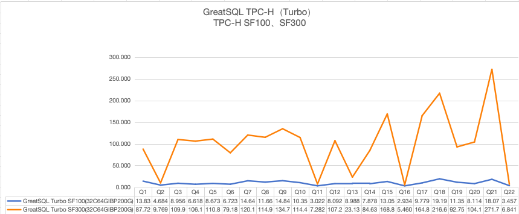

# Turbo Engine

## Turbo Overview

Turbo is a high-performance parallel query execution engine that exists as a plugin. By embedding DuckDB, it gives GreatSQL multi-threaded concurrent vectorized query capabilities, greatly improving SQL query speed while maintaining compatibility with the GreatSQL ecosystem.

Compared with Rapid, Turbo does not require loading data into the engine. Instead, during query execution, GreatSQL extracts data in parallel for the Turbo engine to use.

The Turbo engine is embedded into GreatSQL as a plugin and can be dynamically installed or uninstalled online.

On a 32C64G test machine, the 22 SQL statements in the TPC-H SF100 benchmark took about 214 seconds in total. The following figure shows the test results of Turbo at two data scales, SF100 and SF300, for reference only:



Note: The above test used a version with no limit on the number of Turbo concurrent threads.

## Enabling the Turbo Engine

To use the Turbo engine, you need to install the Turbo plugin:

```sql
INSTALL PLUGIN turbo SONAME 'turbo.so';
```

View the plugin information:

```sql
SHOW PLUGINS;
```

```shell{8}
+----------------------------------+----------+--------------------+----------------------+---------+
| Name                             | Status   | Type               | Library              | License |
+----------------------------------+----------+--------------------+----------------------+---------+
| binlog                           | ACTIVE   | STORAGE ENGINE     | NULL                 | GPL     |
...
| clone                            | ACTIVE   | CLONE              | mysql_clone.so       | GPL     |
| group_replication                | ACTIVE   | GROUP REPLICATION  | group_replication.so | GPL     |
| turbo                            | ACTIVE   | QUERY PLAN         | turbo.so             | GPL     |
+----------------------------------+----------+--------------------+----------------------+---------+
```

As you can see, the Turbo engine has been installed successfully.

## Uninstalling the Turbo Engine

Execute the following SQL command to uninstall the Turbo engine:

```sql
UNINSTALL PLUGIN turbo;
```

During uninstallation, if there are unfinished queries currently being executed with Turbo, you need to wait for them to complete before the plugin can be fully uninstalled.

## Using the Turbo Engine

After installing the Turbo engine, you can use the methods described below to improve query efficiency with the Turbo engine.

The parameter `turbo_enable` is the master switch for using the Turbo engine. It has three selectable values: [OFF, ON, FORCED] (corresponding values are [0, 1, 2]), with a default value of OFF. There are two ways to use the Turbo engine:

**Method 1**

1. First set `turbo_enable=ON` to ensure that query statements can use the Turbo engine;

2. Then set `turbo_cost_threshold=0` or a small threshold.

The configuration parameter `turbo_cost_threshold` specifies the cost threshold for executing queries with the Turbo engine. If the cost of the current query is less than or equal to this threshold, the Turbo engine is not used. In this case, you can lower the threshold so that the current query cost is greater than this threshold, and the Turbo engine can be used. If you do not lower the `turbo_cost_threshold` threshold, you can use **Method 2** below to force the use of the Turbo engine.

Example:
```sql
SET turbo_enable=ON;
SET turbo_cost_threshold=0;
```

```sql
EXPLAIN FORMAT=TREE SELECT /*+ SET_VAR(turbo_enable=ON) SET_VAR(turbo_cost_threshold=0) */ * FROM t1;
```

If the query plan display contains the *Turbo scan* keyword, it means the statement used the Turbo engine, as shown below:

```shell
+---------------------------------------------------------------------------+
| EXPLAIN                                                                   |
+---------------------------------------------------------------------------+
| -> Turbo scan
    -> Table scan on t1, column(c1,c2)  (cost=0.1, row=1)
+---------------------------------------------------------------------------+
```

**Method 2**

1. Modify the session variable to force the use of the Turbo engine.

2. Specify a HINT in the SQL query to use the Turbo engine.

Example 1:
```sql
SET turbo_enable=FORCED;
```

Example 2:
```sql
SELECT /*+ SET_VAR(turbo_enable=FORCED) */ * FROM t1;
```

The main difference between the two methods is in the error messages. For SQL statements that cannot use the Turbo engine (for example, queries containing certain unsupported functions), if Method 1 is used, the query will be completed directly by the primary engine (such as the InnoDB engine); you can check the execution plan to determine whether the Turbo engine was used. For Method 2, the Turbo engine is always forced, but if it cannot be used, an error is produced, as shown in the example below:

```sql
CREATE TABLE t1(c1 INT, c2 VARCHAR(10));
INSERT INTO t1 VALUES(1, 'Turbo');
```

Since the parameterized `RAND()` function is currently not supported, the query reports an error, as follows:

```sql
SELECT /*+ SET_VAR(turbo_enable=FORCED) */ RAND(c1) FROM t1;
```

```shell
ERROR 8700 (HY000): turbo_enable is FORCED but query could not be executed in Turbo.
```

With the first method, if an unsupported situation is found, the primary engine is used directly for the query, as follows:

```sql
EXPLAIN FORMAT=TREE SELECT /*+ SET_VAR(turbo_enable=ON) SET_VAR(turbo_cost_threshold=0) */ RAND(c1) FROM t1;
```

```shell
+------------------------------------------+
| EXPLAIN                                  |
+------------------------------------------+
| -> Table scan on t1  (cost=0.35 rows=1)
+------------------------------------------+
```

For the above query, you can enable the configuration parameter `turbo_enable_warning=ON` and then execute `SHOW WARNINGS` to view the detailed unsupported reason. For example:

```sql
greatsql> EXPLAIN FORMAT=TREE SELECT /*+ SET_VAR(turbo_enable=FORCED) SET_VAR(turbo_cost_threshold=0) */ * FROM t1 WHERE c1 LIKE 'abc'\G
ERROR 8700 (HY000): turbo_enable is FORCED but query could not be executed in Turbo

greatsql> SET turbo_enable_warning=ON;
Query OK, 0 rows affected (0.00 sec)

greatsql> SHOW WARNINGS;
+---------+------+-----------------------------------------------------------------------------------------------------+
| Level   | Code | Message                                                                                             |
+---------+------+-----------------------------------------------------------------------------------------------------+
| Warning | 8700 | : {"exception_type":"INTERNAL","exception_message":"unsupport collation with attribute: PAD_SPACE"} |
| Error   | 8700 | turbo_enable is FORCED but query could not be executed in Turbo                                     |
+---------+------+-----------------------------------------------------------------------------------------------------+
2 rows in set (0.00 sec)
```

As you can see, this is because an unsupported collation was used. After investigation, it was found that the connection character set was set incorrectly:

```sql
greatsql> \s
...
Server characterset:    utf8mb4
Db     characterset:    utf8mb4
Client characterset:    latin1
Conn.  characterset:    latin1
...
```

Execute `SET NAMES utf8mb4` to modify the connection character set, and view the execution plan again; it will then be normal:

```sql
greatsql> SET NAMES utf8mb4;
Query OK, 0 rows affected (0.00 sec)

greatsql> EXPLAIN FORMAT=TREE SELECT /*+ SET_VAR(turbo_enable=FORCED) SET_VAR(turbo_cost_threshold=0) */ * FROM t1 WHERE c1 LIKE 'abc'\G
*************************** 1. row ***************************
EXPLAIN: -> Turbo scan
    -> projection: (t1.id, t1.c1, t1.c2)  (cost=13829.9, row=19757)
        -> Filter: ilike_escape(t1.c1, 'abc', '\')  (cost=11854.2, row=19757)
            -> Table scan on t1, column(c1,id,c2)  (cost=9878.5, row=98785)


1 row in set (0.00 sec)
```

## Turbo Engine Usage Notes

### Supported Statement Types

In terms of query types, only regular `SELECT` queries and `INSERT SELECT` are supported; `UPDATE/DELETE/ALTER` and so on are not supported.

#### SELECT Queries

Regular queries are supported, but the following forms are not supported:

* SELECT ... INTO ...;

* SELECT locking statements (... INTO ...FOR UPDATE);

* SELECT ... FETCH ... WITH TIES is not supported;

#### INSERT SELECT

INSERT ... SELECT ... ON DUPLICATE KEY UPDATE statements are not supported.

### SELECT Query Support Limitations

For regular `SELECT` queries, there are the following limitations:

#### Multiple Execution Engines Coexistence Limitation

The Turbo engine cannot coexist with any other SECONDARY ENGINE (such as the Rapid engine); only one can be used at a time.

If the Turbo engine is already installed, installing the Rapid engine will report an error:

```sql
INSTALL PLUGIN rapid SONAME 'ha_rapid.so';
ERROR 3877 (HY000): rapid or turbo Plugins can't be installed at the same time
```

#### Execution Plan Support Limitations

CONST execution plans and execution plans that do not involve table scans are not supported.

```sql
CREATE TABLE t1 (c1 INT PRIMARY KEY, c2 INT);
INSERT INTO t1 VALUES (1, 1), (4, 2);
```

1. CONST execution plans, such as equality filtering on primary key columns

```shell
EXPLAIN FORMAT=TREE SELECT * FROM t1 WHERE c1=4;
+-------------------------------------------------------------+
| EXPLAIN                                                     |
+-------------------------------------------------------------+
| -> Rows fetched before execution  (cost=0.00..0.00 rows=1)  |
+-------------------------------------------------------------+
```

2. Plans that do not involve table scans

```shell
EXPLAIN FORMAT=TREE SELECT * FROM t1 WHERE c1 is NULL;
+------------------------------------------------------------+
| EXPLAIN                                                    |
+------------------------------------------------------------+
| -> Zero rows (Impossible WHERE)  (cost=0.00..0.00 rows=0)  |
+------------------------------------------------------------+
```

#### Table Support Limitations

1. To ensure query efficiency, the number of tables used in a single query statement cannot exceed 20.

2. The tables used in a query statement only support InnoDB base tables and InnoDB partitioned tables; system tables, views (VIEW), recursive CTEs, TABLE_FUNCTION, and user-created temporary tables in queries are not supported.

#### Column Support Limitations

1. Generated columns / virtual columns (Generated Columns) are not supported.

2. Unsupported column types include: BIT, DECIMAL (total length exceeding 38 or UNSIGNED), UDT, ENUM, SET, SPATIAL DATATYPE, JSON, BLOB, TEXT.

#### Column Character Set Limitations

1. All column character sets are required to be utf8mb4, Accent insensitive (ai), ci/cs.

2. binary, koi8r, and ucs2 are not supported.

3. pad space type character sets are not supported.

#### Function and Expression Support Notes

1. For all functions and operators supported by the Turbo engine, refer to: [Supported Functions and Operators](./5-1-highperf-ap-supported-functions.md).

2. Unsupported function types include: `BIT_AND`, `BIT_XOR`, `BIT_OR`, `WM_CONCAT`, `LISTAGG`, `GROUP_CONCAT`.

3. The basic forms of Window functions are fully supported, but the following forms are currently not supported:

* Window functions do not support DISTINCT, and nested Window functions are not supported;

* When `windowing_use_high_precision=OFF`, only `MIN()` and `MAX()` are supported for aggregate functions;

* Window functions do not support the KEEP statement, for example:

```sql
SELECT deptno,
      MAX(sal) KEEP(dense_rank FIRST ORDER BY sal) first_max,
      MAX(sal) KEEP(dense_rank LAST ORDER BY sal) last_max
FROM emp
GROUP BY deptno;
```

4. Aggregate functions: unsupported types include `JSON_OBJECTAGG`, `JSON_ARRAYAGG`, `RATIO_TO_REPORT`, `ST_COLLECT()`, and user-defined functions.

5. The `ROW()` function is not supported: `SELECT ROW(1, 'lilei', 25) AS person`.

6. `ORDER BY @var` is not supported, where @var is a temporary variable. This usage will not use the Turbo engine, but no syntax error is reported.

7. The `NAME_CONST()` function is not supported in constant expressions, for example: `NAME_CONST('flag', 1)`.

8. Addition, subtraction, multiplication, and division between two time-type fields are not supported (addition/subtraction with constants is allowed), for example: `SELECT TO_DATE(f1, 'YYYY-MM-DD') - TO_DATE(f2, 'YYYY-MM-DD') FROM t1;`.

9. Time-type function `CAST(timestamp as bool)` is not supported, for example: `SELECT ... FROM ... WHERE DATE '1998-12-01' - INTERVAL '90' DAY;`.

10. Oracle function compatibility behavior is not supported.

11. Multi-column IN subqueries are not supported, as shown in the example below:

```sql
greatsql> SELECT * FROM t1 WHERE (s1,s2) IN (SELECT s1, MAX(s1) FROM t2...);
```

This usage will not use the Turbo engine, but no syntax error is reported.

#### Other Usage Limitations

1. The time zone does not support settings that contain daylight saving time.

2. For `PREPARE` and stored procedure statements, the `turbo_enable_ps_and_sp` parameter needs to be enabled. This parameter defaults to ON and can be disabled as needed.

3. Client protocol type `Protocol::PROTOCOL_PLUGIN` is not supported.

4. Mandatory access control enabled is not supported, that is, when `start_with_mandatory_access_control=ON`, it is not supported.

5. `sql_auto_is_null` enabled is not supported. `sql_auto_is_null` is a parameter in GreatSQL used to enable or disable null value detection. When the parameter value is ON, null value detection is enabled; when it is OFF, null value detection is disabled. The setting of this parameter is global and can control whether null value detection is executed by the system in SQL statements. The setting value can be changed in the GreatSQL configuration file.

6. Setting `max_join_size` is not supported. The parameter `max_join_size` is used to limit the maximum amount of data returned by JOIN operations in `SELECT` statements. When the data volume returned by a JOIN operation exceeds the value set by this parameter, GreatSQL throws an error to prevent insufficient memory or disk space. If this parameter is set, statements may fail to report errors properly.

7. The result set order may differ from that of the primary engine. Note: Turbo shuffles the order of rows internally. Therefore, for statements without `ORDER BY` (especially `LIMIT` statements), the execution result and its order may differ from the native result. You need to determine whether the execution result is correct based on the actual SQL statement.

### EXPLAIN Statement Usage Limitations

The execution plan results of `EXPLAIN FORMAT=TREE` and `EXPLAIN ANALYZE` contain the Turbo keyword, while `EXPLAIN` still displays the execution plan information of the primary engine.

The COST displayed in the EXPLAIN result is unrelated to the COST in the native EXPLAIN result. It cannot be used as a basis for comparing COST values across different query methods and has no reference value.

### Data Type Support

The precision range supported by the data is limited:

1. DATE: invalid dates such as "0000-00-00" are not supported. The month value range is [1, 12], the day value range is [1, 31], and the upper limit of the day value range depends on the month.

2. TIME: negative time ranges are not supported, and times greater than 24:00:00.000000 are not supported. Only valid times within the range [00:00:00.000000, 24:00:00.000000] are supported. Rounding-based comparison is not supported; all 6 decimal places are compared by default. It is not restricted by the field definition.

3. DATETIME/TIMESTAMP: the DATE part supports the same limitations as the DATE type above; the TIME part supports the same limitations as the TIME type above.

4. Numeric constants can only be supported within the precision range of the data, for example: `id < -9223372036854775808`.

### Type Implicit Conversion

1. Data types only support data in strict mode; time and other types in non-strict mode are not supported.

2. String-to-numeric conversion is not supported if a warning occurs in native mode, for example:

```sql
greatsql> SELECT d FROM t1 WHERE d > 'A'; -- The d column is of DOUBLE type
ERROR 1815 (HY000): Internal error: Conversion Error: Could not convert string 'A' to DOUBLE
```

3. Conversion of constant numbers to time types is not supported, for example:

```sql
greatsql> SELECT * FROM t1 WHERE t <> 20380119061407; -- The t column is of DATETIME type
ERROR 8700 (HY000): execute turbo query failed: Conversion Error: Unimplemented type for cast (BIGINT -> TIMESTAMP)
```

4. For the YEAR type, conversion of negative strings fails, for example:

```sql
greatsql> SELECT * FROM t1 WHERE t > '-1'; -- The t column is of YEAR type
ERROR 8700 (HY000): execute turbo query failed: Conversion Error: Could not convert string '-1' to UINT16
```

### Slow Log Usage Limitations

After the slow log is enabled, you can determine which Turbo-executed statements are slow statements based on the `long_query_time` setting, the same as for GreatSQL queries.

However, since Turbo currently does not record the number of table scan rows, when `min_examined_row_limit` is set to a value greater than 0, slow SQL query requests cannot be recorded.

## Operations and Maintenance

### New Plugin Parameters

| System Variable Name | Variable Scope |  Dynamic Variable | Permitted Values | Type | Default | Description |
| --- | --- | --- | --- | --- | --- | --- |
|turbo_enable|Session|YES|[ON/OFF/FORCED]|ENUM|OFF|Whether Turbo queries are enabled in the current session|
|turbo_compat_func|Session|YES|[ON/OFF]|Boolean|ON|Whether functions compatible with GreatSQL are used in Turbo; if used, more GreatSQL functions are supported, but performance is affected|
|turbo_enable_ps_and_sp|Session|YES|[ON/OFF]|Boolean|ON|Whether Turbo is allowed to run in stored procedures or prepared statements|
|turbo_enable_warning|Session|YES|[ON/OFF]|Boolean|OFF|Whether internal error messages are thrown|
|turbo_max_temp_directory_size|Global|YES|[0, 549755813888]|ULONGLONG|1073741824|Maximum temporary tablespace size available to Turbo|
|turbo_memory_limit|Global|YES|[67108864, 549755813888]|ULONGLONG|268435456|Maximum memory upper limit used by Turbo|
|turbo_release_retries|Global|YES|[0, ULONG_MAX]|ULONG|600|Number of uninstall plugin retries|
|turbo_retry_pause|Global|YES|[100, 31536000]|ULONG|1000|Wait time for uninstall plugin retries (ms)|
|turbo_temp_directory|Global|NO||String|duckdb_dp.data.tmp|Temporary directory name. Not modifiable after the Turbo engine is enabled; modifiable before enabling|
|turbo_worker_threads|Global|YES|[1, 4]|UINT|4|Total number of threads that can be used by Turbo execution plans|
|turbo_condition_pushdown|Session|YES|[ON/OFF]|Boolean|OFF|Whether condition pushdown is enabled in Turbo execution plans|
|turbo_cost_threshold|Session|YES|[0, DBL_MAX]|Double|100000.000000|Cost threshold for executing queries with Turbo|

InnoDB related parameters:

| System Variable Name | Variable Scope |  Dynamic Variable | Permitted Values | Type | Default | Description |
| --- | --- | --- | --- | --- | --- | --- |
|innodb_parallel_read_threads|Global|YES|[1, 256]|ULONG|4|For a single table in a single SQL statement, enable n threads to perform scans|
|innodb_parallel_max_read_threads|Global|YES|[128, 2048]|ULONG|256|Maximum number of parallel read threads enabled by all SQL statements within the database scope|

### New Status Statistics Information

Turbo execution status statistics information can be viewed by executing the following statement:

```sql
SHOW GLOBAL STATUS LIKE 'turbo%';
```

| Status Name | Values | Description |
| --- | --- | --- |
|turbo_memory_used|0|Memory occupied by Turbo in execution|
|turbo_statements|0|Sessions using Turbo, including prepare|
|turbo_runtime|0|Number of statements currently being executed with Turbo|
|turbo_release|OFF|Whether the plugin is being uninstalled|

### Usage Notes for Some Memory Parameters

Compared with the Rapid storage engine, Turbo, as a parallel execution engine, does not store data. When using Turbo, GreatSQL extracts data in parallel for Turbo to perform parallel computing, improving parallel computing performance by loading data into memory. Therefore, some SQL queries may report out-of-memory errors. If this happens, you can adjust the following parameters to try to solve the problem.

* Increase `turbo_memory_limit`; at any time, increasing the memory available to the Turbo engine is the preferred solution.

* If the execution plan of the SQL query is complex (such as large data volume + multiple HASH JOINs + multiple aggregations), you can try appropriately lowering `turbo_worker_threads`.

::: tip Tips
In the GreatSQL community edition, the maximum value of the parameter `turbo_worker_threads` in the Turbo engine is 4. If you need higher concurrency performance, you can contact us for a solution.
:::

When the data volume is large but `turbo_memory_limit` is set small, SQL query requests may fail and throw an Out of Memory Error.

### Execution Plan

To check whether a query uses the Turbo engine, you can use `EXPLAIN FORMAT=TREE` to see whether the Turbo keyword is displayed.

```sql
greatsql> EXPLAIN FORMAT=TREE SELECT * FROM t1;
+---------------------------------------------------------------------------+
| EXPLAIN                                                                   |
+---------------------------------------------------------------------------+
| -> Turbo scan
    -> Table scan on t1, column(c1,c2)  (cost=0.1, row=1)
+---------------------------------------------------------------------------+
```

Turbo supports the `EXPLAIN ANALYZE` usage.

```shell
greatsql> EXPLAIN ANALYZE SELECT * FROM t1;
+-----------------------------------------------------------------------------------------------------+
| EXPLAIN                                                                                             |
+-----------------------------------------------------------------------------------------------------+
| -> Turbo scan
    -> Table scan on t1, column(c1,c2)  (cost=0.1, row=1) (actual time=109.298 rows=1 loops=1)
+-----------------------------------------------------------------------------------------------------+
```

## Notes

* The current Turbo engine dynamic library files only support CentOS 7/8 systems running on X86/ARM architectures, or the corresponding glibc versions 2.17 and 2.28 respectively. Other environments are not supported yet.

* Due to differences in parallel computing, group processing, and other operations, when using Turbo for computing, if the same sorting rules are not applied, the order of the data read may be inconsistent.

* When multiple different GreatSQL instances coexist on the same server, you need to set different temporary file directories (`turbo_temp_directory`) for the corresponding Turbo execution engines to avoid cross-use problems.

**Scan the QR code to follow the WeChat official account**


