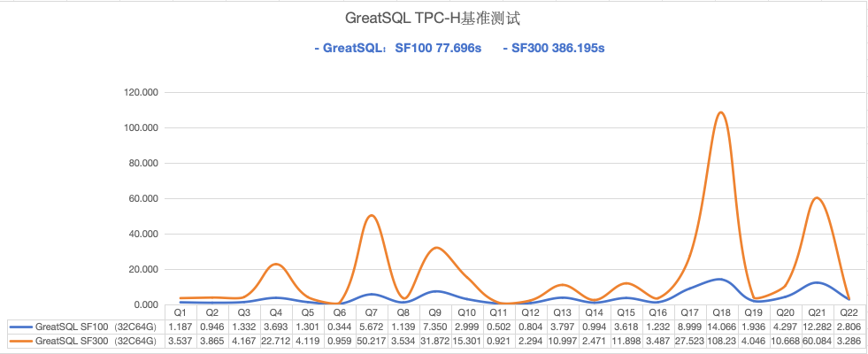
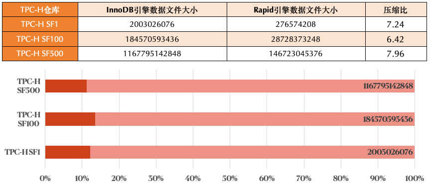
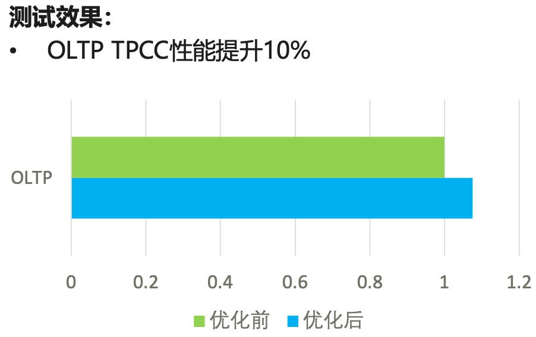

# High Performance
---

Compared with MySQL and Percona, GreatSQL delivers more stable and superior performance. It supports the Rapid Engine, lock-free transactions, parallel LOAD DATA, asynchronous drop of large tables, thread pool, non-blocking DDL, NUMA affinity scheduling optimization, and other features. In TPC-C benchmarks, GreatSQL outperforms MySQL by more than 30%, and in TPC-H benchmarks, its performance is dozens or even hundreds of times better than MySQL.

- Supports the [high-performance Rapid Engine](./5-1-highperf-rapid-engine.md) with massively parallel, in-memory querying and a high compression ratio, which can improve data analytics performance by several orders of magnitude. On a 32C64G test machine, the 22 SQL statements in the TPC-H SF100 benchmark took less than 80 seconds in total. Moreover, the average compression ratio for TPC-H test data can reach more than 7x.

- The InnoDB transaction system is optimized with various schemes such as splitting large locks and lock-free design, improving overall OLTP performance by about 20%.

MySQL uses a red-black tree structure to quickly map transaction IDs to transaction objects. However, in high-concurrency scenarios, heavy lock contention on this data structure can become a bottleneck in transaction processing.

GreatSQL adopts a brand-new lock-free hash structure, which significantly reduces the critical-section cost of locks and improves transaction processing capability by at least 10%.

- Supports [parallel LOAD DATA](./5-1-highperf-parallel-load.md), suitable for scenarios with frequent bulk data imports, improving performance by about 20+ times; there is also optimization for tables without an explicitly defined primary key.

- Supports [asynchronous drop of large tables](./5-1-highperf-async-purge-big-table.md) to improve the runtime performance stability of the InnoDB engine.

- Supports [thread pool](./5-1-highperf-thread-pool.md), reducing the cost of thread creation and destruction and ensuring stable performance under high concurrency without obvious degradation.

- Supports [non-blocking DDL](./5-1-highperf-nonblocking-ddl.md), which avoids the problem of a large number of business requests being blocked because DDL operations must be completed as soon as possible.

- Supports [NUMA affinity optimization](./5-1-highperf-numa-affinity.md). Through NUMA affinity scheduling optimization, front-end user threads and background threads are bound to fixed NUMA nodes to improve thread processing performance.

**Scan the QR code to follow the WeChat official account**

