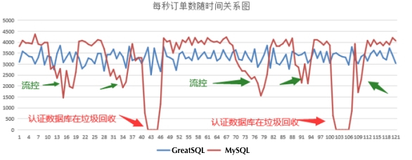

# MGR New Flow Control Algorithm
---

## Introduction

The native MGR flow control algorithm has significant flaws. After the flow control threshold is triggered, there is a brief flow control pause action, after which transactions continue to be released. This may cause repeated 1-second performance jitters and does not truly provide sustained flow control.

GreatSQL no longer uses the native mechanism, but instead optimizes the flow control algorithm. In addition to evaluating the certification database queue size, it also evaluates multiple factors such as large transaction processing and primary-secondary node synchronization. The flow control granularity is finer, and the small jitter every 1 second seen in native MGR no longer occurs.

After optimization, when flow control is enabled, transaction performance is more stable without particularly large fluctuations. The effect before and after optimization is shown in the following figure:


When the system variable `group_replication_flow_control_mode` is set to **DISABLED**, flow control is disabled. When set to **QUOTA**, flow control is enabled and the new flow control mechanism is used.

## New System Variable

The new option `group_replication_flow_control_replay_lag_behind` is added to control the replication lag threshold between MGR primary and secondary nodes. When the lag between MGR primary and secondary nodes exceeds the threshold due to large transactions or other reasons, the flow control mechanism is triggered.

| System Variable Name  | group_replication_flow_control_replay_lag_behind |
| --- | --- |
| Variable Scope        | global |
| Dynamic Variable      | YES |
| Type | Integer |
| Permitted Values |    [0, 86400] |
| Default       | 600 |
| Description   | Unit: seconds.<br/>Used to control the replication lag threshold between MGR primary and secondary nodes. When the lag between MGR primary and secondary nodes exceeds the threshold due to large transactions or other reasons, the flow control mechanism is triggered. |

The default value of this option is 600, and it can be dynamically modified online. For example:
```sql
SET GLOBAL group_replication_flow_control_replay_lag_behind=600;
```
Under normal circumstances, this parameter does not need to be adjusted and the default value can be used.

In the GreatSQL global status, two new status variables are also added:
- `group_replication_flow_control_count`, indicating the cumulative number of times flow control was triggered.
- `group_replication_flow_control_time`, indicating the cumulative waiting time after flow control is triggered (unit: microseconds).

Based on these two metrics, the impact of MGR flow control can be determined. It is also possible to determine whether transaction commits during a certain period were affected by flow control by monitoring the changes in the metrics during that period.

## Notes

1. In GreatSQL, after the new flow control mechanism is enabled (`group_replication_flow_control_mode=QUOTA`), only the `group_replication_flow_control_replay_lag_behind` parameter takes effect. The original flow control options such as `group_replication_flow_control*` no longer take effect, although they can still be viewed and modified.

2. In Percona 8.0.30, a new optional value **MAJORITY** was added to the option `group_replication_flow_control_mode`, but it does not actually take effect and has the same effect as setting it to **DISABLED**.

**Scan the QR code to follow our WeChat official account**


