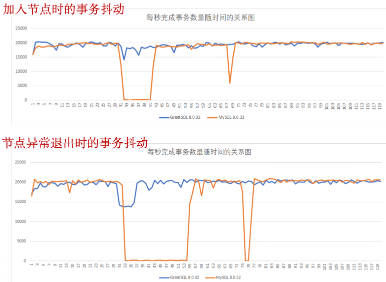
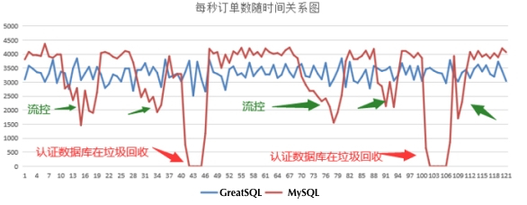

# High Availability
---

GreatSQL has made extensive improvements and enhancements to MGR, supporting features such as zone tags, arbitrator nodes, dynamic read/write VIP, fast single-primary mode, and smart primary election. In addition, it has deeply optimized several underlying MGR working mechanisms and algorithms, including the flow control algorithm, the transaction certification queue cleanup algorithm, the node join/leave mechanism, and the recovery mechanism, further improving the high availability guarantee and performance stability of MGR.

- Supports the [zone tag](./5-2-ha-mgr-zoneid.md) feature to improve data reliability in multi-data-center architectures.
- Supports the [arbitrator node](./5-2-ha-mgr-arbitrator.md) feature to achieve higher availability at lower server cost.
- Supports the [dynamic read/write VIP](./5-2-ha-mgr-vip.md) feature, making high availability switchover more convenient and achieving read load balancing faster. Supports [proactively disconnecting active connections when the primary node is switched](./5-2-ha-mgr-kill-conn-after-switch.md) to shorten application unavailability time.
- Supports the [fast single-primary mode](./5-2-ha-mgr-fast-mode.md), which is faster and delivers higher performance in single-primary mode.
- Supports the [smart primary election](./5-2-ha-mgr-election-mode.md) feature, making the primary election mechanism in high availability switchover more reasonable.
- Optimizes the [flow control algorithm](./5-2-ha-mgr-new-fc.md) to make transactions more stable and avoid severe jitter.
- Supports [recording events when MGR network communication overhead exceeds the threshold](./5-2-ha-mgr-request-time.md) for further analysis and optimization.
- Supports the [loop prevention mechanism in primary-primary bidirectional replication](./5-2-ha-repl-server-mode.md) in cross-data-center disaster recovery scenarios.
- Optimizes the problem of severe performance jitter that may occur when nodes join or leave.

- Solves the problem of the MGR cluster being blocked as a whole when the disk space on an individual node is full.
- Optimizes the transaction certification queue cleanup algorithm, eliminating the performance jitter every 60 seconds under high load.

- Solves the problem of failing to elect a primary due to long-running transactions.
- Fixes the problem of long waits during the recovery process.
- Optimizes the handling mechanism when compression exceeds the limit during MGR large transaction transmission.

When a large transaction in MGR exceeds the `group_replication_compression_threshold` threshold, LZ4 compression is triggered. However, due to the inherent limitations of LZ4, compression may fail with an error, causing the transaction to fail. An error similar to the following is reported:

```log
[GCS] Gcs_packet's payload is too big. Only packets smaller than 2113929216 bytes can be compressed. Payload size is 2197817290
```

GreatSQL has adjusted and optimized this mechanism to achieve the following two goals:

1. When the transaction size exceeds the `group_replication_compression_threshold` threshold, compression is started.

2. However, when the transaction size exceeds the LZ4 compression limit, an error is no longer reported. Instead, the original uncompressed transaction data is used for transmission, which is similar to the effect of setting `group_replication_compression_threshold=0` (compression disabled).

For more details on other high availability improvements, please refer to: [Other High Availability Improvements](./5-2-ha-mgr-improved.md).

**Scan the QR code to follow our WeChat official account**


