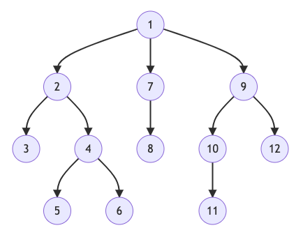

# Oracle Compatibility - Syntax - Hierarchical Query
---

GreatSQL supports hierarchical queries.

## 1. Syntax

```sql
{ CONNECT BY [ NOCYCLE ] condition [ START WITH condition ]
| START WITH condition CONNECT BY [ NOCYCLE ] condition
}
```

## 2. Definition and Usage

- 1. Introduction to hierarchical queries

To find the child rows of a parent row, GreatSQL evaluates the `PRIOR` expression of the `CONNECT BY` condition of the parent row and another expression for each row in the table. Rows for which the condition is true are children of the parent. The `CONNECT BY` condition can contain other conditions to further filter the rows selected by the query.

If the `CONNECT BY` condition results in a loop in the hierarchy, an error is returned. A loop occurs if a row is both a parent (or grandparent, or a direct ancestor) of another row and a child (or grandchild, or a direct descendant) of that row.

- 2. Hierarchical queries are processed as follows:
  - 1.) If there is a join, it is evaluated first, regardless of whether the join is specified in the FROM clause or the WHERE clause.
  - 2.) The CONNECT BY condition is evaluated.
  - 3.) Any remaining WHERE clause predicates are evaluated.

- 3. The processing order of a hierarchical query is:
  - 1.) The root rows of the hierarchy are selected—those rows that satisfy the START WITH condition.
  - 2.) The child rows of each root row are selected. Each child row must satisfy the CONNECT BY condition with respect to one of the root rows.
  - 3.) The child rows of successive generations are selected. The children of the rows returned in step 2 are selected first, then the children of those children, and so on.
  - 4.) If the query contains a WHERE clause without a join, all rows that do not satisfy the WHERE clause condition are removed from the hierarchy.
  - 5.) The results are returned in preorder traversal order.

Example:



## 3. Oracle Compatibility Notes

- 1. The sorting of the query output may be inconsistent with Oracle.

Due to the difference in how the table data is traversed compared with Oracle, the data sorting results within a single level of `CONNECT BY` are inconsistent.

```sql
-- Initialize the test table and data
greatsql> CREATE TABLE student(
id INT NOT NULL,
name VARCHAR2(20) NOT NULL,
grade INT NOT NULL
);

-- Case 1: insert test data in order
-- Insert four records in order (id value order: 1,2,3,4)
greatsql> INSERT INTO student VALUES (1, 'John', -1);
greatsql> INSERT INTO student VALUES (2, 'Paul', 1);
greatsql> INSERT INTO student VALUES (3, 'Nancy', 1);
greatsql> INSERT INTO student VALUES (4, 'Sarah', 2);

greatsql> SELECT * FROM student;
+------+-------+-------+
| id   | name  | grade |
+------+-------+-------+
|    1 | John  |    -1 |
|    2 | Paul  |     1 |
|    3 | Nancy |     1 |
|    4 | Sarah |     2 |
+------+-------+-------+

-- In this case, the query result data order of GreatSQL and Oracle is consistent
greatsql> SELECT id, name, grade, LEVEL FROM student CONNECT BY PRIOR id = grade;
+------+-------+-------+-------+
| id   | name  | grade | LEVEL |
+------+-------+-------+-------+
|    1 | John  |    -1 |     1 |
|    2 | Paul  |     1 |     2 |
|    4 | Sarah |     2 |     3 |
|    3 | Nancy |     1 |     2 |
|    2 | Paul  |     1 |     1 |
|    4 | Sarah |     2 |     2 |
|    3 | Nancy |     1 |     1 |
|    4 | Sarah |     2 |     1 |
+------+-------+-------+-------+
8 rows in set (0.00 sec)

-- The result obtained by querying in Oracle is as follows; the two are consistent (the table creation and data insertion process is omitted)
SQL> SELECT id, name, grade, LEVEL FROM student CONNECT BY PRIOR id = grade;

        ID NAME                      GRADE      LEVEL
---------- -------------------- ---------- ----------
         1 John                         -1          1
         2 Paul                          1          2
         4 Sarah                         2          3
         3 Nancy                         1          2
         2 Paul                          1          1
         4 Sarah                         2          2
         3 Nancy                         1          1
         4 Sarah                         2          1

8 rows selected.

-- Case 2: insert test data out of order
-- Empty the table and adjust the data insertion order (id value order: 3,4,1,2)
greatsql> TRUNCATE TABLE student;

greatsql> INSERT INTO student VALUES (3, 'Nancy', 1);
greatsql> INSERT INTO student VALUES (4, 'Sarah', 2);
greatsql> INSERT INTO student VALUES (1, 'John', -1);
greatsql> INSERT INTO student VALUES (2, 'Paul', 1);

greatsql> SELECT * FROM student;
+------+-------+-------+
| id   | name  | grade |
+------+-------+-------+
|    3 | Nancy |     1 |
|    4 | Sarah |     2 |
|    1 | John  |    -1 |
|    2 | Paul  |     1 |
+------+-------+-------+
4 rows in set (0.00 sec)

-- In this case, the query result data order of GreatSQL and Oracle is inconsistent
greatsql> SELECT id, name, grade, LEVEL FROM student CONNECT BY PRIOR id = grade;
+------+-------+-------+-------+
| id   | name  | grade | LEVEL |
+------+-------+-------+-------+
|    3 | Nancy |     1 |     1 |
|    4 | Sarah |     2 |     1 |
|    1 | John  |    -1 |     1 |
|    3 | Nancy |     1 |     2 |
|    2 | Paul  |     1 |     2 |
|    4 | Sarah |     2 |     3 |
|    2 | Paul  |     1 |     1 |
|    4 | Sarah |     2 |     2 |
+------+-------+-------+-------+
8 rows in set (0.00 sec)

-- The result obtained by querying in Oracle is as follows; the two are inconsistent (the table creation and data insertion process is omitted)
SQL> SELECT id, name, grade, LEVEL FROM student CONNECT BY PRIOR id = grade;

        ID NAME                      GRADE      LEVEL
---------- -------------------- ---------- ----------
         1 John                         -1          1
         3 Nancy                         1          2
         2 Paul                          1          2
         4 Sarah                         2          3
         3 Nancy                         1          1
         2 Paul                          1          1
         4 Sarah                         2          2
         4 Sarah                         2          1

8 rows selected.
```

It can be seen that, due to the inconsistent sorting of the first level query results, the order of the hierarchical query results is inconsistent.

- 2. When used with `LISTAGG` to output the combined order, the implementation of `LISTAGG` depends on `ORDER BY`; therefore, the internal query sorts according to `GROUP BY`.

- 3. In `ORACLE` mode, the behavior of `SYSDATE` is consistent with Oracle; in `DEFAULT` mode, loop queries may cause errors.

- 4. Similar to the previous item, definitions in custom PACKAGE and FUNCTION may contain `DETERMINISTIC`, which may also cause the loop check to fail.

- 5. When the `CONNECT BY` contains a condition that is always true, a dead loop error is reported regardless of whether `PRIOR` or `CONNECT_BY_ROOT` conditions are used.

- 6. The data table may contain special data that causes dead loops, or a single traversal may generate very many child nodes; the iteration data size is limited according to the `cte_max_recursion_depth` option.

- 7. When used together with the `ROWNUM` pseudocolumn, the `ROWNUM` result as a query condition in `WHERE` may differ, as shown in the following example:

Difference from Oracle: the value of `ROWNUM` is saved according to the results sorted by `CONNECT BY`, instead of being recalculated.

  - Example 1:

```sql
greatsql> SELECT LEVEL, ROWNUM FROM DUAL WHERE ROWNUM < 3 AND LEVEL = 2 CONNECT BY LEVEL <= 10;
+-------+--------+
| LEVEL | rownum |
+-------+--------+
|     2 |      2 |
+-------+--------+

-- The execution result in Oracle is as follows
SQL> SELECT LEVEL, ROWNUM FROM DUAL WHERE ROWNUM < 3 AND LEVEL = 2 CONNECT BY LEVEL <= 10;

     LEVEL     ROWNUM
---------- ----------
         2          1
```

  - Example 2

```sql
greatsql> SELECT LEVEL, SYS_CONNECT_BY_PATH(ROWNUM, '->') FROM DUAL WHERE
 ROWNUM < 3 AND LEVEL = 2
 CONNECT BY LEVEL <= 10;
+-------+-----------------------------------+
| LEVEL | SYS_CONNECT_BY_PATH(ROWNUM, '->') |
+-------+-----------------------------------+
|     2 | ->1->2                            |
+-------+-----------------------------------+

-- The execution result in Oracle is as follows
     LEVEL   SYS_CONNECT_BY_PATH(ROWNUM,'->')
----------  -------------------------------------
         2                                 ->1->1
```

- 8. In GreatSQL, `BLOB` columns are supported in the `CONNECT BY` condition, while Oracle does not support this.

## 3. Hierarchical Query Pseudocolumns

Hierarchical query pseudocolumns are valid only in hierarchical queries and include the following three pseudocolumns.

### 3.1 Hierarchical query pseudocolumn `CONNECT_BY_ISCYCLE`

Indicates whether the current data causes a loop in a hierarchical query. That is, according to the hierarchical relationship, whether the leaf node of the current level of data is also its parent node. This column is meaningful only when the `NOCYCLE` keyword is also specified. If the current data causes a loop, the result is 1; otherwise, it is 0.

### 3.2 Hierarchical query pseudocolumn `CONNECT_BY_ISLEAF`

Indicates whether the current data is a leaf node in the tree structure formed by the hierarchical query. If it is a leaf node, the value is 1; otherwise, it is 0. This information indicates whether a given row can be further expanded to display more hierarchy.

### 3.3 Hierarchical query pseudocolumn `LEVEL`

Indicates the current level in the tree structure formed by the hierarchical query. The value of this column always starts from 1, that is, the LEVEL value of the data corresponding to `START WITH` is always 1, and the LEVEL values of subsequent descendant nodes increase one by one.

The figure below shows the nodes of an inverted tree and their LEVEL values:


## 4. Hierarchical Query Operators

GreatSQL provides the following two operators, which can be used to specify an attribute of a node in the hierarchy.

### 4.1 Hierarchical query operator `PRIOR`

In a hierarchical query, one expression in the `CONNECT BY` condition must be qualified by the `PRIOR` operator. There can be multiple `PRIOR` conditions, but only one condition needs the `PRIOR` operator. The argument following the `PRIOR` operator is treated as the parent node in the hierarchical query. `PRIOR` evaluates the expression immediately following it for the parent row of the current row in the hierarchical query.

`PRIOR` uses the value of the parent row of the column.

`PRIOR` is most commonly used to compare column values with the equality operator; the `PRIOR` keyword can be on either side of the operator.

In theory, operators other than the equality sign `=` can be used in the `CONNECT BY` clause, but conditions created with other operators may cause infinite loops of possible combinations.

### 4.2 Hierarchical query operator `CONNECT_BY_ROOT`

`CONNECT_BY_ROOT` is a unary operator that is valid only in hierarchical queries. When a column is qualified with this operator, the column value is returned using the data from the root row.

**Note:**

1. Only basic data types are supported; special data types such as JSON and GEO are not supported.

2. The argument cannot be a virtual column, a hierarchical query function, an operator, a pseudocolumn, or a subquery.

3. Neither the `PRIOR` nor the `CONNECT_BY_ROOT` operator can be used in the `START WITH` clause.

## 5. Hierarchical Query Function `SYS_CONNECT_BY_PATH()`

### 5.1 Syntax

```sql
SYS_CONNECT_BY_PATH(column_name, DELIMITER)
```

Where `DELIMITER` represents the delimiter. This function obtains the values of the nodes named column_name on the path from the root node to the current node, separated by DELIMITER. `SYS_CONNECT_BY_PATH()` cannot be used in clauses such as `CONNECT BY`, `START WITH`, and `GROUP BY`.

### 5.2 Definition and Usage

The `SYS_CONNECT_BY_PATH()` function is mainly used for **tree queries (hierarchical queries)** and **multiple columns to rows**.

`SYS_CONNECT_BY_PATH()` is valid only in hierarchical queries. It returns the path of column values from root to node; for each row returned by the `CONNECT BY` condition, the column values are separated by `char`.

For calculations involving pseudocolumns, when a `WHERE` filter condition exists, the value of `ROWNUM` is saved according to the results sorted by `CONNECT BY`, instead of being recalculated. For example:

- GreatSQL execution result:
```sql
greatsql> SELECT LEVEL, SYS_CONNECT_BY_PATH(ROWNUM, '->') FROM DUAL WHERE ROWNUM < 3 AND LEVEL=2 CONNECT BY LEVEL<=10;
+-------+--------+
| LEVEL | ROWNUM |
+-------+--------+
|     2 | ->1->2 |
+-------+--------+
```

- Oracle execution result:
```sql
SQL> SELECT LEVEL, SYS_CONNECT_BY_PATH(ROWNUM, '->') FROM DUAL WHERE ROWNUM < 3 AND LEVEL=2 CONNECT BY LEVEL<=10;

     LEVEL    SYS_CONNECT_BY_PATH(ROWNUM,'->')
----------   ----------------------------------
         2                               ->1->1
```

## 6. Examples

Initialize the test table and data.

```sql
greatsql> CREATE TABLE student(
id INT NOT NULL,
name VARCHAR2(20) NOT NULL,
grade INT NOT NULL
);

greatsql> INSERT INTO student VALUES (1, 'John', -1), (2, 'Paul', 1), (3, 'Nancy', 1), (4, 'Sarah', 2);
```

Several examples.

```sql
greatsql> SELECT id, name, grade, LEVEL FROM student CONNECT BY PRIOR id = grade;
+------+-------+-------+-------+
| id   | name  | grade | LEVEL |
+------+-------+-------+-------+
|    1 | John  |    -1 |     1 |
|    2 | Paul  |     1 |     2 |
|    4 | Sarah |     2 |     3 |
|    3 | Nancy |     1 |     2 |
|    2 | Paul  |     1 |     1 |
|    4 | Sarah |     2 |     2 |
|    3 | Nancy |     1 |     1 |
|    4 | Sarah |     2 |     1 |
+------+-------+-------+-------+

greatsql> SELECT id, name, grade, PRIOR name FROM student CONNECT BY PRIOR id = grade;
+------+-------+-------+------------+
| id   | name  | grade | PRIOR name |
+------+-------+-------+------------+
|    1 | John  |    -1 | NULL       |
|    2 | Paul  |     1 | John       |
|    4 | Sarah |     2 | Paul       |
|    3 | Nancy |     1 | John       |
|    2 | Paul  |     1 | NULL       |
|    4 | Sarah |     2 | Paul       |
|    3 | Nancy |     1 | NULL       |
|    4 | Sarah |     2 | NULL       |
+------+-------+-------+------------+
8 rows in set (0.00 sec)

greatsql> SELECT id, CONNECT_BY_ROOT name FROM student CONNECT BY PRIOR id = grade;
+------+----------------------+
| id   | CONNECT_BY_ROOT name |
+------+----------------------+
|    1 | John                 |
|    2 | John                 |
|    4 | John                 |
|    3 | John                 |
|    2 | Paul                 |
|    4 | Paul                 |
|    3 | Nancy                |
|    4 | Sarah                |
+------+----------------------+
8 rows in set (0.01 sec)

-- Modify the current timestamp
greatsql> SET TIMESTAMP = 1;

greatsql> SELECT id, grade, NOW() FROM student CONNECT BY NOCYCLE PRIOR id = (grade + 1);
+------+-------+---------------------+
| id   | grade | NOW()               |
+------+-------+---------------------+
|    1 |    -1 | 1970-01-01 03:00:01 |
|    2 |     1 | 1970-01-01 03:00:01 |
|    3 |     1 | 1970-01-01 03:00:01 |
|    4 |     2 | 1970-01-01 03:00:01 |
|    3 |     1 | 1970-01-01 03:00:01 |
|    4 |     2 | 1970-01-01 03:00:01 |
|    4 |     2 | 1970-01-01 03:00:01 |
+------+-------+---------------------+
7 rows in set (0.00 sec)

greatsql> SELECT id, name, grade, CONNECT_BY_ISCYCLE FROM student CONNECT BY NOCYCLE PRIOR id = (grade + 1);
+------+-------+-------+--------------------+
| id   | name  | grade | CONNECT_BY_ISCYCLE |
+------+-------+-------+--------------------+
|    1 | John  |    -1 |                  0 |
|    2 | Paul  |     1 |                  1 |
|    3 | Nancy |     1 |                  0 |
|    4 | Sarah |     2 |                  0 |
|    3 | Nancy |     1 |                  0 |
|    4 | Sarah |     2 |                  0 |
|    4 | Sarah |     2 |                  0 |
+------+-------+-------+--------------------+
7 rows in set (0.01 sec)

greatsql> SELECT id, name, grade, CONNECT_BY_ISLEAF FROM student CONNECT BY NOCYCLE PRIOR id = (grade + 1);
+------+-------+-------+-------------------+
| id   | name  | grade | CONNECT_BY_ISLEAF |
+------+-------+-------+-------------------+
|    1 | John  |    -1 |                 1 |
|    2 | Paul  |     1 |                 0 |
|    3 | Nancy |     1 |                 0 |
|    4 | Sarah |     2 |                 1 |
|    3 | Nancy |     1 |                 0 |
|    4 | Sarah |     2 |                 1 |
|    4 | Sarah |     2 |                 1 |
+------+-------+-------+-------------------+
7 rows in set (0.01 sec)

greatsql> SELECT id, grade, LEVEL, SYS_CONNECT_BY_PATH(id ,'->'), PRIOR name, CONNECT_BY_ROOT id FROM student CONNECT BY PRIOR id = grade;
+------+-------+-------+-------------------------------+------------+--------------------+
| id   | grade | LEVEL | SYS_CONNECT_BY_PATH(id ,'->') | PRIOR name | CONNECT_BY_ROOT id |
+------+-------+-------+-------------------------------+------------+--------------------+
|    1 |    -1 |     1 | ->1                           | NULL       |                  1 |
|    2 |     1 |     2 | ->1->2                        | John       |                  1 |
|    4 |     2 |     3 | ->1->2->4                     | Paul       |                  1 |
|    3 |     1 |     2 | ->1->3                        | John       |                  1 |
|    2 |     1 |     1 | ->2                           | NULL       |                  2 |
|    4 |     2 |     2 | ->2->4                        | Paul       |                  2 |
|    3 |     1 |     1 | ->3                           | NULL       |                  3 |
|    4 |     2 |     1 | ->4                           | NULL       |                  4 |
+------+-------+-------+-------------------------------+------------+--------------------+
8 rows in set (0.00 sec)
```

**Scan the QR code to follow our WeChat official account**


