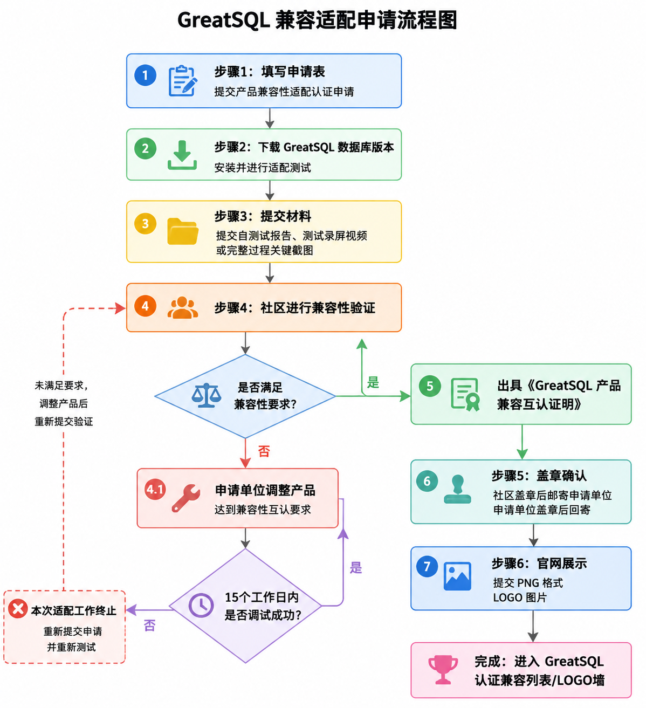
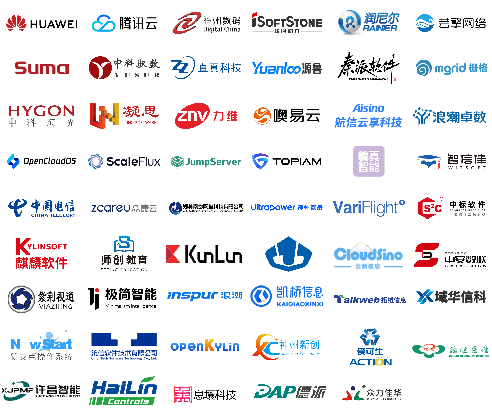

# Compatibility Adaptation

The GreatSQL community provides product compatibility adaptation testing and corresponding product compatibility adaptation certification for upstream and downstream vendors in the database industry ecosystem, including operating systems, chips, middleware, storage, servers, and application software.

Products that pass the compatibility adaptation testing and meet the certification requirements will receive an official certification certificate issued by the community, and will be listed in the "Logo Wall of Certified Enterprises" and the "Compatibility Adaptation Certified List" on this page.

## 1. Preparation Before Application

If the applicant organization has not yet registered a GreatSQL community account, you can first register/login to the [GreatSQL Community account](https://greatsql.cn) and then visit the [**Personal Profile**](https://greatsql.cn/home.php?mod=space&do=profile) page, and note down your **Community UID** (a number).

Click the [**Learning Center**](https://learn.greatsql.cn) menu at the top of the GreatSQL official website to complete the GCA or GCP certification exam.

- [GreatSQL Community](https://greatsql.cn)
- [Personal Profile](https://greatsql.cn/home.php?mod=space&do=profile)
- [Learning Center](https://learn.greatsql.cn)

> It is also acceptable if you have already obtained the GDCA or GDCP certification.

## 2. How to Apply for Compatibility Adaptation

### Step 1: Fill in the Application Form

Download and fill in the [GreatSQL Database Product Compatibility Mutual Recognition Application Form](https://gitee.com/GreatSQL/GreatSQL-Doc/raw/master/GreatSQL数据库兼容性互认申请表.doc).

### Step 2: Download GreatSQL and Conduct Compatibility Adaptation Testing

Download the GreatSQL database installation package that needs to be adapted; the latest version is recommended. After completing the installation and deployment, conduct product compatibility adaptation testing on your own.

- [GreatSQL Database Installation Packages and Versions](https://gitee.com/GreatSQL/GreatSQL/releases)

During testing, you may refer to the [GreatSQL Product Compatibility Mutual Recognition Self-Test Report Template](https://gitee.com/GreatSQL/GreatSQL-Doc/raw/master/GreatSQL-产品兼容互认自测报告模板.doc) and organize information such as the test environment, installation and deployment, functional verification, and test results according to the template.

### Step 3: Submit Materials

After completing the self-test, organize and submit the following materials:

- Organize the compatibility adaptation self-test report referring to the document "GreatSQL Product Compatibility Mutual Recognition Self-Test Report Template";
- A screen recording of the testing process, or key screenshots of the complete process;
- The GreatSQL Database Product Compatibility Mutual Recognition Application Form;
- Other materials required by the community, if any.

For the test report, please refer to:

- [GreatSQL Product Compatibility Mutual Recognition Self-Test Report Template](https://gitee.com/GreatSQL/GreatSQL-Doc/raw/master/GreatSQL-产品兼容互认自测报告模板.doc)

Send the materials to the GreatSQL community email address:

**greatsql@greatdb.com**

If you encounter any issues during testing, you can also contact the GreatSQL Community Assistant through the "Contact Us" page on the official website.

### Step 4: Compatibility Verification and Certification Result

The GreatSQL community will confirm compatibility based on the submitted materials and the verification results. Generally, we will complete the review of the self-test report within about 3-5 business days after receiving the email.

#### Passed

After both parties complete the compatibility adaptation verification and meet the certification requirements, the community will issue:

**GreatSQL Product Compatibility Mutual Recognition Certificate**

This is followed by the stamping and official website showcase process.

#### Not Passed

If the compatibility requirements are not met, the applicant organization needs to adjust the product within the specified time and re-conduct compatibility verification until the compatibility adaptation mutual recognition requirements are met.

> Per the official website regulations: if the debugging is not completed successfully within **15 business days**, or if the applicant does not cooperate with the adjustment, this compatibility adaptation work will be terminated. If compatibility adaptation testing is needed again, a new application must be submitted and the compatibility adaptation testing process must be restarted.

## 3. Stamping

When the community issues the paper version of the compatibility adaptation certificate, two copies are stamped with the community seal and delivered to the applicant organization by courier.

After receiving it, the applicant organization should:

1. Stamp it with the applicant organization's seal;
2. Return one copy of the certificate document to the community;
3. Keep one copy for each party.

## 4. Official Website Showcase

We will add the LOGO image you provided to the Logo Wall below for display. Meanwhile, certified products will be added to the "Compatibility Adaptation Certified List" on the official website.

## 5. Complete Process Overview

## Compatibility Adaptation Certified List

### Logo Wall of Certified Enterprises

### Compatibility Adaptation Certified List

| No. | Category | Product Name | Version | Vendor |
| :---: | :---: | :---: | :---: | ----- |
| 1 | Operating System | TencentOS Server | v2 | 腾讯云计算（北京）有限责任公司 |
| 2 | Operating System | TencentOS Server | v3 | 腾讯云计算（北京）有限责任公司 |
| 3 | Operating System | OpenCloudOS | v8 | OpenCloudOS操作系统开源社区 |
| 4 | Operating System | OpenCloudOS | v9 | OpenCloudOS操作系统开源社区 |
| 5 | Operating System | 凝思安全操作系统 | v6.0 | 北京凝思软件股份有限公司 |
| 6 | Operating System | 天鹤操作系统 | ISSEOS V22 | 软通动力信息技术（集团）股份有限公司 |
| 7 | Operating System | 域华信科服务器操作系统 | V8 | 北京域华信息科技有限公司 |
| 8 | Operating System | 新支点服务器操作系统 | V7 | 广东中兴新支点技术有限公司 |
| 9 | Operating System | 新支点服务器操作系统（ARM） | V7 | 广东中兴新支点技术有限公司 |
| 10 | Operating System | 统信服务器操作系统 | V20 | 统信软件技术有限公司 |
| 11 | Operating System | openKylin | 2.0 | openKylin社区 |
| 12 | Operating System | 统信服务器操作系统 | V25 | 统信软件技术有限公司 |
| 13 | Operating System | 服务器操作系统FFusionOS22(X86) | -- | 超聚变数字技术有限公司 |
| 14 | Operating System | 服务器操作系统FFusionOS22(ARM) | -- | 超聚变数字技术有限公司 |
| 15 | Operating System | 服务器操作系统FFusionOS23(X86) | -- | 超聚变数字技术有限公司 |
| 16 | Operating System | 服务器操作系统FFusionOS23(ARM) | -- | 超聚变数字技术有限公司 |
| 17 | Storage | OceanStor Pacific 系列分布式存储 | -- | 华为技术有限公司 |
| 18 | Storage | OceanStor 闪存存储 | -- | 华为技术有限公司 |
| 19 | Storage | 参天存储引擎 | -- | 华为技术有限公司 |
| 20 | Storage | ScaleFlux CSD 3000 NVMe SSD | -- | 锐开（北京）科技有限公司 |
| 21 | CPU | 海光CPU | 7000 | 海光信息技术股份有限公司 |
| 22 | CPU | 海光CPU | 5000 | 海光信息技术股份有限公司 |
| 23 | CPU | 海光CPU | 3000 | 海光信息技术股份有限公司 |
| 24 | Server |                 KunLun（基于鲲鹏）                 | 2280、2480、5280 | 河南昆仑技术有限公司                 |
| 25 | Server | KunLun（基于鲲鹏920） | 5580 | 河南昆仑技术有限公司 |
| 26 | DPU | KPU CONFLUX-2200D 数据查询加速 DPU 卡 | -- | 中科驭数（北京）科技有限公司 |
| 27 | DPU | KPU SWIFT-2200N 超低时延 DPU 卡 | -- | 中科驭数（北京）科技有限公司 |
| 28 | Server | Suma | R62 系列 | 中科可控信息产业有限公司 |
| 29 | Server | Suma | R52 系列 | 中科可控信息产业有限公司 |
| 30 | Server | Suma | R32 系列 | 中科可控信息产业有限公司 |
| 31 | Server | Suma | R64 系列 | 中科可控信息产业有限公司 |
| 32 | Application Software | TOPIAM 企业数字身份管控平台 | -- | 济南源创网络科技有限公司 |
| 33 | Application Software | Mgrid 综合运维管理平台 | V1.0 | 深圳栅格信息技术有限公司 |
| 34 | Application Software | Mgrid 数据中心基础设施监控管理系统软件 | V3.0 | 深圳栅格信息技术有限公司 |
| 35 | Application Software | Mgrid 数据中心动力环境监控系统 | V5.0  | 深圳栅格信息技术有限公司 |
| 36 | Application Software | 动力环境监控系统软件 | V1.0 | 北京羲真智能科技有限公司 |
| 37 | Application Software | 基础设施集成管理系统软件 | V1.0 | 北京羲真智能科技有限公司 |
| 38 | Application Software | 基础设施运维管理系统软件 | V1.0 | 北京羲真智能科技有限公司 |
| 39 | Application Software | 校级开放式虚拟仿真教学及资源共享平台 UOWSLab | V2.0 | 北京润尼尔科技股份有限公司 |
| 40 | Application Software | 开放式实验教学与实验室管理系统 OpenLab | V2.0 | 北京润尼尔科技股份有限公司 |
| 41 | Application Software | 校级开放式实验教学及实验室综合管理平台 UOWMLab ETS | V1.0 | 北京润尼尔科技股份有限公司 |
| 42 | Application Software | 校级开放式虚拟仿真实训教学及资源共享平台 SOVSPTRSP | V1.0 | 北京润尼尔科技股份有限公司 |
| 43 | Application Software | JumpServer 开源堡垒机 | -- | 杭州飞致云信息科技有限公司 |
| 44 | Application Software | APS 低代码平台 | V1.10 | 航信云享科技有限公司 |
| 45 | Application Software | 源鲁内外网文件交换系统 | V1.0 | 山东源鲁信息科技有限公司 |
| 46 | Application Software | 恒生芸擎云收费交易管理软件 | -- | 杭州恒生芸擎网络科技有限公司 |
| 47 | Application Software | 秦派软件 ATOMDB 数据库管理客户端 | -- | 湘西极语言信息技术有限公司 |
| 48 | Application Software | 智慧社区综合信息平台 | -- | 浪潮卓数大数据产业发展有限公司 |
| 49 | Application Software | 力维 PEIM 平台 | -- | 深圳力维智联技术有限公司 |
| 50 | Application Software | 噢易多架构融合桌面云平台 | -- | 武汉噢易云计算股份有限公司 |
| 51 | Application Software | 故障管理系统 | -- | 北京直真科技股份有限公司 |
| 52 | Application Software | 神州数码 TDMP 数据脱敏系统 | -- | 北京神州数码云计算有限公司 |
| 53 | Application Software | 流程引擎能力中台系统 (Ultra-BPC) | V2.3.0 | 北京神州泰岳软件股份有限公司 |
| 54 | Application Software | 银河麒麟安全电子邮件系统 | V8 | 麒麟软件有限公司 |
| 55 | Application Software | 中标麒麟安全电子邮件系统 | V8 | 中标软件有限公司 |
| 56 | Application Software | 机场协同决策系统（A-CDM） | -- | 飞友科技有限公司 |
| 57 | Application Software | 本研一体化研究生管理系统 | V2.0 | 北京智信佳科技有限公司 |
| 58 | Application Software | 本研一体化教务管理系统 | V2.0 | 北京智信佳科技有限公司 |
| 59 | Application Software | 研究生一体化综合管理平台 | V7.0 | 北京智信佳科技有限公司 |
| 60 | Application Software | 智慧研招平台 | V2.0 | 北京智信佳科技有限公司 |
| 61 | Application Software | 智慧教务管理平台 | V3.0 | 北京智信佳科技有限公司 |
| 62 | Application Software | 学位与研究生教育管理系统 | V5.0 | 北京智信佳科技有限公司 |
| 63 | Application Software | 数据中台 | V1.0 | 郑州南数网络科技有限公司 |
| 64 | Application Software | 互联网医疗健康服务平台 | V4.0 | 重庆众康云科技有限责任公司 |
| 65 | Application Software | 基层一体化信息平台 | -- | 中电信翼康科技有限公司 |
| 66 | Application Software | 县域医共体平台 | -- | 中电信翼康科技有限公司 |
| 67 | Application Software | 师创教育智能化校园综合服务软件 | -- | 师创教育软件研究院（江苏）有限公司 |
| 68 | Application Software | 天地自动化智能化矿山基础信息平台 | V1.0 | 中国煤炭科工集团常州研究院有限公司 |
| 69 | Application Software | CloudSino DCM、CloudSino SAD、CloudSino iBSM | -- | 广州云新信息技术有限公司 |
| 70 | Application Software | 中安数联备份与恢复系统 | V1.0 | 陕西中安数联信息技术有限公司 |
| 71 | Application Software | 云视频平台软件 | V3.0 | 北京紫荆视通科技有限公司 |
| 72 | Application Software | 全景DevOps  Engine智能管理软件 | V7.0 | 北京极简智能科技有限公司 |
| 73 | Application Software | 数字化二期应用软件 | -- | 山东浪潮数字服务有限公司 |
| 74 | Application Software | 数字化转转型基础设施 | -- | 山东浪潮数字服务有限公司 |
| 75 | Application Software | 自助机终端系统 | -- | 重庆凯桥信息技术有限公司 |
| 76 | Application Software | 智慧医院系统平台 | -- | 重庆凯桥信息技术有限公司 |
| 77 | Application Software | 统一支付对帐平台 | -- | 重庆凯桥信息技术有限公司 |
| 78 | Application Software | 互联网医院系统 | -- | 重庆凯桥信息技术有限公司 |
| 79 | Application Software | 异构数据库适配中间件软件 | V5.0 | 拓维信息系统股份有限公司 |
| 80 | Application Software | 梧桐云原生平台 | V3.0 | 拓维信息系统股份有限公司 |
| 81 | Application Software | 溪数KetaOps智能运维平台软件 | V3.0 | 安徽溪数科技有限公司 |
| 82 | Application Software | 中服物联网平台 | V4.0 | 中服软件（西安）有限公司 |
| 83 | Application Software | 物资全流程管理系统 | V1.0 | 四川神州新创信息技术有限公司 |
| 84 | Application Software | 云树数据库集群管理平台 | V8.0 | 上海爱可生信息技术股份有限公司 |
| 85 | Application Software | 血液净化中心智能管理系统 | -- | 深圳市瑞健医信科技有限公司 |
| 86 | Application Software | 先锋数据库管理软件 | -- | 北京永乐时代科技有限责任公司 |
| 87 | Application Software | 智慧教育平台 | V1.0 | 成都元素科技有限公司 |
| 88 | Application Software | 互普ZTNA网官零信任网络准入软件 | V4.0 | 上海互普网络科技有限公司 |
| 89 | Application Software | 珍琅“爱可优”体检中心管理系统 | V5.0 | 成都珍琅科技有限公司 |
| 90 | Application Software | 病理信息管理系统 | V3.0 | 91360医学科技杭州有限公司 |
| 91 | Application Software | 病理信息管理系统 | V1.0 | 91360医学科技南京有限公司 |
| 92 | Application Software | 东软智慧教育平台 | V3.0 | 东软教育科技集团有限公司 |
| 93 | Application Software | 网络设备监控工具软件 | -- | 重庆石谷科技有限公司 |
| 94 | Application Software | IP地址扫描工具软件 | -- | 重庆石谷科技有限公司 |
| 95 | Application Software | 御名安全DNS网络服务系统 | -- | 北京国御网络安全技术有限公司 |
| 96 | Application Software | 虎盾零信任访问控制安全系统 | V2.0 | 杭州虎符网络有限公司 |
| 97 | Application Software | 智慧教室中控管理软件产品 | -- | 成都海普迪科技有限公司 |
| 98 | Application Software | 天地自动化KJ1580煤矿井下人员精确定位系统软件 | V1.0 | 天地（常州）自动化股份有限公司 |
| 99 | Application Software | 天地自动化矿用IP网络广播系统软件 | V1.0 | 天地（常州）自动化股份有限公司 |
| 100 | Application Software | 多媒体资源管理平台软件 | -- | 成都海普迪科技有限公司 |
| 101 | Application Software | 横渡数据库审计系统（防统方版） | V6.10 | 南京横渡医疗技术有限公司 |
| 102 | Application Software | 横渡数据库审计系统（防统方版） | V7.10 | 南京横渡医疗技术有限公司 |
| 103 | Application Software | 企业数据备份与恢复管理软件 | -- | 重庆石谷科技有限公司 |
| 104 | Application Software | CDZ8100智能变配电系统 | -- | 许昌继电器研究所有限公司 |
| 105 | Application Software | HAI平台产品 | -- | 北京海林自控科技股份有限公司 |
| 106 | Application Software | 德奥思仿真设计一体化软件 | V3.0 | 成都德奥思软件有限公司 |
| 107 | Application Software | 指标中枢管理平台 | -- | 南京诚勤教育科技有限公司 |
| 108 | Application Software | 心理测评管理系统 | -- | 广东医龙医疗科技有限公司 |
| 109 | Middleware | DBPrisma | -- | 长春息壤科技有限公司 |
| 110 | Application Software | 企业战略合作管理平台 | V1.0 | 四川神州新创信息技术有限公司 |
| 111 | Application Software | 德派EDC系统 | V3.5 | 德派软件（北京）有限公司 |
| 112 | Application Software | 多云管理工作平台 | V1.0 | 四川众力佳华信息技术有限公司 |

## Contact Us

If you encounter any issues while conducting compatibility adaptation testing with the GreatSQL database product, please scan the QR code below to add the "GreatSQL Community Assistant" and contact us.

**Scan the QR code to follow our WeChat Official Account**

