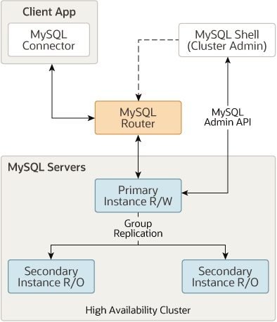

# Read/Write Splitting
---

This article describes how to build a read/write splitting solution for an MGR cluster.

## Introduction to InnoDB Cluster
MySQL InnoDB Cluster (abbreviated as MIC) is a complete solution launched by MySQL, consisting of several parts:
- MySQL Server, whose core is Group Replication (MGR).
- MySQL Shell, a programmable advanced client that supports standard SQL syntax, JavaScript syntax, Python syntax, and API interfaces, making it more convenient to manage and use MySQL servers.
- MySQL Router, a lightweight middleware that supports transparent routing rules (read/write splitting and read load balancing).

MySQL Router is a lightweight middleware that uses a multi-port solution to implement read/write splitting and read load balancing, and supports both MySQL and MySQL X protocols.

The overall system architecture is shown in the following figure:



## MySQL Router Installation & Initialization

MySQL Router is best deployed together with the application server, so this time MySQL Router is installed on another server with IP address *172.16.16.14*.

The advantage of deploying MySQL Router together with the application server is that when a backend database server goes down and is taken offline, causing an MGR switchover, the router program deployed on the application side can detect this change through the MGR metadata information and automatically update the MGR topology, without any changes to the application and without deploying a high availability switchover solution for the router again.

[Click here to download the MySQL Router RPM installation package](https://gitee.com/GreatSQL/GreatSQL/releases/GreatSQL-8.0.32-25), select the following installation package:

- greatsql-mysql-router-8.0.32-25.1.el8.x86_64.rpm

After downloading to the local machine, execute the installation:
```bash
$ rpm -ivh greatsql-mysql-router-8.0.32-25.1.el8.x86_64.rpm

...
Verifying...                          ################################# [100%]
Preparing...                          ################################# [100%]
Updating / installing...
   1:greatsql-mysql-router-8.0.32-25.1################################# [100%]
```

The server-side program file corresponding to MySQL Router is `/usr/bin/mysqlrouter`. It must be initialized first on first startup:
```bash
# Parameter explanation
# Parameter --bootstrap indicates starting initialization
# Parameter GreatSQL@172.16.16.10:3306 is the MGR cluster administrator account
# --user=mysqlrouter is the system username for running the mysqlrouter process

$ mysqlrouter --bootstrap GreatSQL@172.16.16.10:3306 --user=mysqlrouter

...
Please enter MySQL password for GreatSQL:   <-- Enter the password
# Then mysqlrouter starts automatic initialization
# It automatically reads the MGR metadata information and automatically generates the configuration file
# Bootstrapping system MySQL Router instance...

- Creating account(s) (only those that are needed, if any)
- Verifying account (using it to run SQL queries that would be run by Router)
- Storing account in keyring
- Adjusting permissions of generated files
- Creating configuration /etc/mysqlrouter/mysqlrouter.conf

Existing configuration backed up to '/etc/mysqlrouter/mysqlrouter.conf.bak'

# MySQL Router configured for the InnoDB Cluster 'GreatSQLMGR'

After this MySQL Router has been started with the generated configuration

    $ /etc/init.d/mysqlrouter restart
or
    $ systemctl start mysqlrouter
or
    $ mysqlrouter -c /etc/mysqlrouter/mysqlrouter.conf

the cluster 'GreatSQLMGR' can be reached by connecting to:

## MySQL Classic protocol  <-- The two ports of the MySQL protocol

- Read/Write Connections: localhost:6446
- Read/Only Connections:  localhost:6447

## MySQL X protocol  <-- The two ports of the MySQL X protocol

- Read/Write Connections: localhost:6448
- Read/Only Connections:  localhost:6449
```

This completes the initialization. According to the above prompt, directly start the mysqlrouter service:
```bash
$ systemctl start mysqlrouter

$ ps -ef | grep -v grep | grep mysqlrouter
mysqlro+  6026     1  5 09:28 ?        00:00:00 /usr/bin/mysqlrouter

$ netstat -lntp | grep mysqlrouter

...
tcp        0      0 0.0.0.0:6446            0.0.0.0:*               LISTEN      6026/mysqlrouter
tcp        0      0 0.0.0.0:6447            0.0.0.0:*               LISTEN      6026/mysqlrouter
tcp        0      0 0.0.0.0:6448            0.0.0.0:*               LISTEN      6026/mysqlrouter
tcp        0      0 0.0.0.0:6449            0.0.0.0:*               LISTEN      6026/mysqlrouter
tcp        0      0 0.0.0.0:8443            0.0.0.0:*               LISTEN      6026/mysqlrouter
```
It can be seen that the mysqlrouter service has started normally.

## MySQL Router Configuration

The configuration file automatically generated during MySQL Router initialization is `/etc/mysqlrouter/mysqlrouter.conf`, mainly about R/W, RO different ports and request forwarding rules, for example:
```ini
[routing:GreatSQLMGR_rw]
bind_address=0.0.0.0
bind_port=6446
destinations=metadata-cache://GreatSQLMGR/?role=PRIMARY
routing_strategy=first-available
protocol=classic

[routing:GreatSQLMGR_ro]
bind_address=0.0.0.0
bind_port=6447
destinations=metadata-cache://GreatSQLMGR/?role=SECONDARY
routing_strategy=round-robin-with-fallback
protocol=classic
```
The bound IP address and port, as well as the request forwarding rules, can be modified as needed.

For a more detailed explanation of request forwarding rules, refer to the following content:

- [Can MySQL Router be configured to poll between MGR primary and secondary nodes](https://gitee.com/GreatSQL/GreatSQL-Doc/blob/master/docs/GreatSQL-FAQ.md#24-mysql-router%E5%8F%AF%E4%BB%A5%E9%85%8D%E7%BD%AE%E5%9C%A8MGR%E4%B8%BB%E4%BB%8E%E8%8A%82%E7%82%B9%E9%97%B4%E8%BD%AE%E8%AF%A2%E5%90%97)
- [routing_strategy parameter/option](https://dev.mysql.com/doc/mysql-router/8.0/en/mysql-router-conf-options.html#option_mysqlrouter_routing_strategy)

After modifying the configuration, restart the mysqlrouter service.

## Confirming Read/Write Splitting

Now, connect to the 6446 (read/write) port with the client and confirm that the connection is to the PRIMARY node:
```sql
-- mysql -h172.16.16.14 -uGreatSQL -p -P6446

greatsql> SELECT @@server_uuid;
+--------------------------------------+
| @@server_uuid                        |
+--------------------------------------+
| 66c5a894-07e6-11ed-b1ff-00155d064000 |
+--------------------------------------+

greatsql> SELECT MEMBER_ID,MEMBER_HOST,MEMBER_ROLE FROM performance_schema.replication_group_members;
+--------------------------------------+--------------+-------------+
| MEMBER_ID                            | MEMBER_HOST  | MEMBER_ROLE |
+--------------------------------------+--------------+-------------+
| 62edd23f-07fa-11ed-aad1-00155d064000 | 172.16.16.13 | SECONDARY   |
| 66c5a894-07e6-11ed-b1ff-00155d064000 | 172.16.16.10 | PRIMARY     |
| 6e65ef68-07e6-11ed-a6d8-00155d064000 | 172.16.16.11 | SECONDARY   |
| 6f367f17-07e6-11ed-825d-00155d064000 | 172.16.16.12 | ARBITRATOR  |
+--------------------------------------+--------------+-------------+
```
It is indeed connecting to the PRIMARY node.

Similarly, connect to the 6447 (read-only) port and confirm that the connection is to a SECONDARY node:
```sql
-- mysql -h172.16.16.14 -uGreatSQL -p -P6447

greatsql> SELECT @@server_uuid;
+--------------------------------------+
| @@server_uuid                        |
+--------------------------------------+
| 62edd23f-07fa-11ed-aad1-00155d064000 |
+--------------------------------------+
```
It is indeed connecting to a SECONDARY node.

Keep this connection alive, continue to create a new connection to port 6447, and check `server_uuid`. It should be found that the value of another SECONDARY node is read, because the default read load balancing mechanism of MySQL Router is automatic polling among the read-only nodes. Unless all SECONDARY nodes are unavailable, read-only requests are not forwarded to the PRIMARY node.

::: tip Special Note
Because the ARBITRATOR role is unique to GreatSQL, the native MySQL Router does not support it. This node does not store user data, logs, etc., and only participates in MGR network voting. Therefore, when MySQL Router polls and connects to this node, a prompt similar to the following may appear:
:::

```bash
$ mysql -h172.16.16.14 -uGreatSQL -p -P6447

mysql: [Warning] Using a password on the command line interface can be insecure.
ERROR 1045 (28000): Access denied for user 'GreatSQL'@'172.16.16.14' (using password: YES)
```
Ignore this error prompt and try reconnecting.

Of course, the ARBITRATOR node can also be excluded from the read-only node list by modifying the MySQL Router configuration file `/etc/mysqlrouter/mysqlrouter.conf`, for example:
```ini
[routing:GreatSQLMGR_ro]
bind_address=0.0.0.0
bind_port=6447
#destinations=metadata-cache://GreatSQLMGR/?role=SECONDARY
destinations=172.16.16.11,172.16.11.13
#routing_strategy=round-robin-with-fallback
routing_strategy=round-robin
protocol=classic
```
Since the read-only node list is directly specified, the *round-robin-with-fallback* strategy can no longer be used; it can be changed to the *round-robin* strategy.

## Confirming Automatic Fault Transfer

If the PRIMARY node goes down or switches, mysqlrouter can also implement automatic failover. The application side does not need any changes; it only needs to try reconnecting or re-initiate requests at most.

Log into any node of the MGR cluster:
```js
-- First connect with the mysqlsh client
-- mysqlsh --uri GreatSQL@172.16.16.10:3306
-- Execute the following command in the mysqlsh client

MySQL  172.16.16.10:3306 ssl  JS > c=dba.getCluster();
MySQL  172.16.16.10:3306 ssl  JS > c.setPrimaryInstance('172.16.16.11:3306');   <-- Switch the PRIMARY node
Setting instance '172.16.16.11:3306' as the primary instance of cluster 'GreatSQLMGR'...

Instance '172.16.16.10:3306' was switched from PRIMARY to SECONDARY.   <-- Switched, from PRIMARY to SECONDARY
Instance '172.16.16.11:3306' was switched from SECONDARY to PRIMARY.   <-- Switched, from SECONDARY to PRIMARY
Instance '172.16.16.12:3306' remains ARBITRATOR.   <-- Unchanged
Instance '172.16.16.13:3306' remains SECONDARY.   <-- Unchanged

WARNING: The cluster internal session is not the primary member anymore. For cluster management operations please obtain a fresh cluster handle using dba.getCluster().

The instance '172.16.16.11:3306' was successfully elected as primary.
```

Return to the session that previously connected to port 6446 and query **server_uuid** again. At this time, it will be found that the connection is automatically disconnected:
```sql
greatsql> SELECT @@server_uuid;
ERROR 2013 (HY000): Lost connection to MySQL server during query

greatsql> SELECT @@server_uuid;
ERROR 2006 (HY000): MySQL server has gone away
No connection. Trying to reconnect...
Connection id:    157990
Current database: *** NONE ***

+--------------------------------------+
| @@server_uuid                        |
+--------------------------------------+
| 6e65ef68-07e6-11ed-a6d8-00155d064000 |   <-- Confirm that server_uuid has become the value of the 172.16.16.11 node
+--------------------------------------+
```
This implements automatic failover.

View the MGR cluster status after the switchover again:
```js
MySQL  172.16.16.10:3306 ssl  JS >  c.status();
...
        "topology": {
            "172.16.16.10:3306": {
                "address": "172.16.16.10:3306",
                "memberRole": "SECONDARY",   <-- Switched to a SECONDARY node
                "mode": "R/O",
                "readReplicas": {},
                "replicationLag": null,
                "role": "HA",
                "status": "ONLINE",
                "version": "8.0.32"
            },
            "172.16.16.11:3306": {
                "address": "172.16.16.11:3306",
                "memberRole": "PRIMARY",   <-- The new PRIMARY node
                "mode": "R/W",
                "readReplicas": {},
                "replicationLag": null,
                "role": "HA",
                "status": "ONLINE",
                "version": "8.0.32"
            },
...
```

Using MySQL Router, an MGR cluster supporting read/write splitting, read load balancing, and automatic failover has been deployed.


**Scan the QR code to follow our WeChat Official Account**


