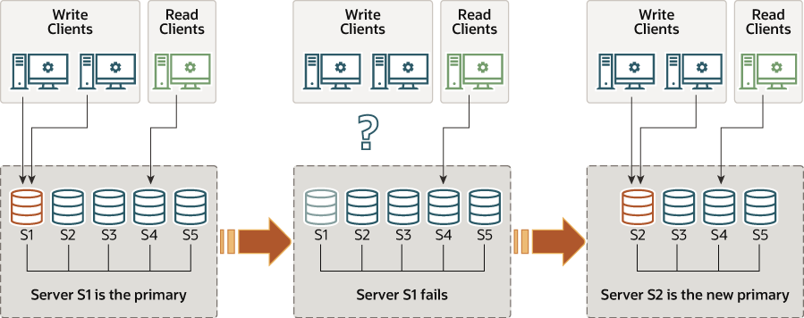
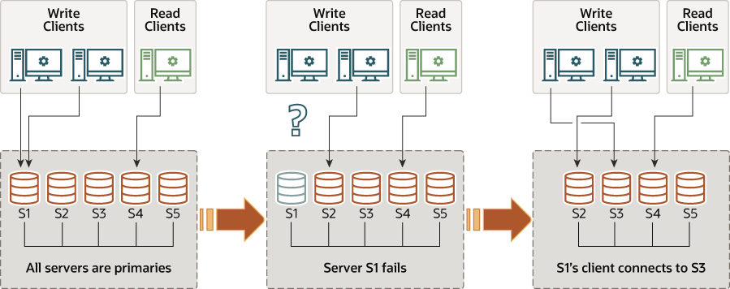
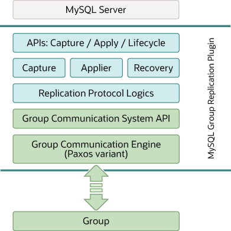

# MGR Fundamentals

---

## Why MGR
MGR is the abbreviation of MySQL Group Replication, that is, MySQL group replication.

In the past, high availability solutions were usually implemented using MySQL source-replica replication or semi-synchronous replication, but this has the following serious problems:
1. Replication delay is likely to occur in source-replica replication, especially in versions before 5.6, and when tables without an explicit primary key exist in the database instance.
2. Data consistency between source-replica replication nodes cannot achieve eventual consistency on its own.
3. When the primary node fails, if there are multiple secondary nodes, it is impossible to automatically select a suitable node from them as the new primary node.
4. If (enhanced) semi-synchronous replication is adopted, then when a secondary node cannot confirm transactions in time due to high load, network latency, or other unexpected factors, it will in turn affect the transaction commit on the primary node.

Because of the obvious shortcomings mentioned above, GreatSQL launched a brand-new high availability solution — **Group Replication**, which is the new feature that this series of articles focuses on.

MGR was introduced starting from MySQL 5.7.17. However, as version 5.7 gradually fades out of the historical stage (since October 2020, MySQL 5.7 has not received major feature updates, and only patches and security updates are provided), if there is still an MGR environment based on MySQL 5.7 in production, it is recommended to upgrade and migrate to GreatSQL 8.0 as soon as possible.

A further reminder: GreatSQL 8.0.22 and later versions are recommended, as they are more stable and reliable overall, and also have some very good new features (not just MGR-related ones).

## MGR Technical Overview
MGR has the following characteristics:
1. It is based on the shared-nothing model; every node holds a complete copy of the data, so failover can be performed directly when a failure occurs.
2. MGR provides data consistency guarantees, with **eventual consistency** by default; the consistency level can be adjusted according to business characteristics.
3. Nodes can be added or removed online, making node management more convenient.
4. It supports automatic failure detection and automatic switchover; when a failure occurs, it can automatically switch to a new primary node. Combined with the MySQL Router middleware, the application layer requires no intervention or adjustment.
5. It supports both single-node and multi-node write modes, and you can choose either solution according to architecture or business needs. However, **the single-primary mode is strongly recommended**.

MGR supports the Single-Primary mode

As shown in the figure above, initially node S1 has the Primary role and provides read/write services. When it fails, the remaining S2-S5 nodes vote to elect S2 as the new Primary to provide read/write services, while node S1 will be expelled after reaching a certain timeout threshold.

It can also use the Multi-Primary mode (again, **the single-primary mode is strongly recommended**)

As shown in the figure above, initially all S1-S5 nodes have the Primary role and can provide read/write services. When any node fails, you only need to switch the traffic directed to that node.

In both architecture modes above, the application connects to the MGR service at the backend through MySQL Router. When a backend node switchover occurs, the Router automatically detects it, which is almost transparent to the application, with minimal impact and a more flexible architecture.

## MGR Technical Architecture
First, here is the MGR technical architecture diagram:

MGR is embedded in GreatSQL as a Plugin, making deployment more flexible and convenient.

Transactions enter the MGR API interface layer from the Server layer through hooks, and are then distributed to the component layers. In the component layer, transaction Capture/Apply/Recover is completed, and transactions are transmitted through the Replication Protocol Logics layer. Finally, the eventual consistency of transactions across nodes is coordinated by GCS.

MGR nodes are supported by the Group Communication System (GCS), which provides failure detection mechanisms, group membership role management, and secure and ordered message delivery. These mechanisms ensure consistent data replication across nodes. The core of this technology is the implementation of the Paxos algorithm, called XCom in GreatSQL, which acts as MGR's communication engine.

For transactions to be committed, the majority of nodes in the group must agree on the order of a given transaction in the global transaction sequence. Each node makes its own decision to commit or abort the transaction, but all nodes must make the same decision. If a network partition occurs, preventing nodes from reaching an agreed decision, MGR members cannot communicate until the network recovers, and replication between MGR nodes cannot work normally.

MGR supports both single-primary and multi-primary modes. In single-primary mode, each node automatically elects a primary node, and only that primary node can read and write at the same time, while the other (secondary) nodes are read-only. In multi-primary mode, all nodes can read and write.

Compared with MariaDB Galera Cluster (and Percona XtraDB Cluster based on this technology, collectively referred to as PXC below for convenience), in my opinion MGR has the following advantages:
1. PXC's message broadcast mechanism circulates among nodes and requires all nodes to confirm each message, so a single node failure causes the entire PXC cluster to fail. In contrast, MGR uses a majority vote model; when a minority node fails, overall availability is generally not affected. This is also the biggest problem with PXC.
2. In addition to binlog, PXC also has a gcache for data transfer between nodes, which is equivalent to adding two more black boxes to MySQL. MGR, however, is entirely based on native binlog with no additional black boxes, making it more reliable to run and easier to troubleshoot.
3. When a network partition occurs, the entire PXC cluster becomes unavailable, while MGR members can at least still provide read-only services (though replication between MGR nodes cannot work normally).
4. PXC's flow control mechanism has a greater impact; once flow control is triggered, all nodes are affected. In MGR, once flow control is triggered, only the local node is affected, not remote nodes. Of course, MySQL's flow control is also relatively crude and has been further improved and optimized in GreatSQL.
5. During DDL execution, the entire PXC cluster cannot execute DML at the same time, meaning Online DDL is not supported. MGR supports it, which is also a great advantage.

Compared with traditional source-replica replication, MGR has the following advantages:
1. Source-replica replication is very prone to replication delay, especially when tables have no explicit primary key. In MGR, tables are required to have a primary key (or a non-null unique index usable as a clustered index), which avoids this problem.
2. In semi-synchronous replication, once a slave responds slowly due to locks or other reasons, the master's transactions can also be blocked. MGR adopts a majority confirmation mechanism, so a slow response from an individual node has much less impact on the Primary node (do not choose the AFTER mode).
3. Source-replica replication does not provide transaction data consistency guarantees like MGR does. MGR comes with a built-in transaction data consistency guarantee mechanism.

**Scan the QR code to follow our WeChat official account**

