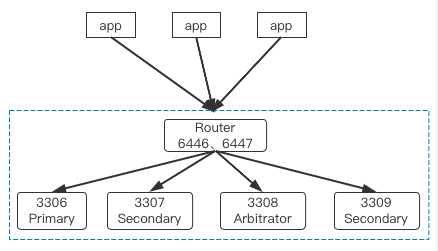

# Single-Server Multi-Instance HA

---

This document describes how to build a GreatSQL high availability architecture in a single-server multi-instance environment.

Note that in production environments, **the single-server multi-instance architecture is generally NOT recommended; this solution is intended for development and testing environments only**.

## Choosing a High Availability Solution

The HA solution for a single-server multi-instance environment is relatively simple, and the following options are commonly available:

1. LVS/Haproxy.
2. MySQL Router middleware.

This document focuses on building an HA solution with MySQL Router. Please search on your own for the LVS/Haproxy solution.

## Deploying an MGR Cluster with Multiple Instances on a Single Server

First, refer to the document: [Multiple Instances on a Single Server](../6-oper-guide/5-multi-instances.md) to deploy the single-server multi-instance environment and build an MGR cluster.
```sql
greatsql> SELECT MEMBER_ID,MEMBER_HOST,MEMBER_PORT,MEMBER_ROLE FROM performance_schema.replication_group_members;
+--------------------------------------+-------------+-------------+-------------+
| MEMBER_ID                            | MEMBER_HOST | MEMBER_PORT | MEMBER_ROLE |
+--------------------------------------+-------------+-------------+-------------+
| 62edd23f-07fa-11ed-aad1-00155d064000 | 127.0.0.1   |        3309 | SECONDARY   |
| 66c5a894-07e6-11ed-b1ff-00155d064000 | 127.0.0.1   |        3306 | PRIMARY     |
| 6e65ef68-07e6-11ed-a6d8-00155d064000 | 127.0.0.1   |        3307 | SECONDARY   |
| 6f367f17-07e6-11ed-825d-00155d064000 | 127.0.0.1   |        3308 | ARBITRATOR  |
+--------------------------------------+-------------+-------------+-------------+
```
This is an MGR cluster with 4 instances on a single server, including 1 ARBITRATOR node.

## Deploying MySQL Router

As introduced in [Read/Write Splitting](../6-oper-guide/2-oper-rw-splitting.md), MySQL Router is best deployed alongside the application.

For how to deploy MySQL Router, please refer to the document: [Read/Write Splitting](../6-oper-guide/2-oper-rw-splitting.md).

The application only needs to connect to the Router's read/write splitting port, without having to care about the actual topology of the backend database. When the Primary node switches over, or when a Secondary node goes offline, the application side is not affected.

At this point, the high availability architecture looks roughly like this:



In this case, since it is a single-server multi-instance environment, MySQL Router is deployed directly on the same server as the database, without being separated.


**Scan the QR code to follow our WeChat official account**


