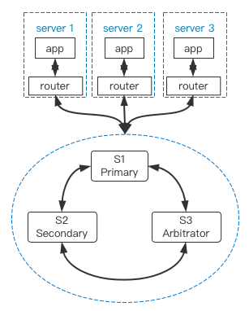

# Single-IDC HA

---

This document mainly describes how to build a high availability architecture with GreatSQL + MySQL Router in a single-IDC scenario.

## Choosing a Single-IDC HA Solution

The HA solution in a single-IDC scenario is also relatively simple, and the following options are commonly available:

1. LVS/Haproxy.
2. MySQL Router middleware.

This document focuses on building an HA solution with MySQL Router. Please search on your own for the LVS/Haproxy solution.

## Achieving Single-IDC HA with MySQL Router + GreatSQL MGR

First, build a three-node MGR cluster, which contains Primary, Secondary, and Arbitrator nodes.
```sql
greatsql> SELECT * FROM performance_schema.replication_group_members;
+---------------------------+--------------------------------------+--------------+-------------+--------------+-------------+----------------+
| CHANNEL_NAME              | MEMBER_ID                            | MEMBER_HOST  | MEMBER_PORT | MEMBER_STATE | MEMBER_ROLE | MEMBER_VERSION |
+---------------------------+--------------------------------------+--------------+-------------+--------------+-------------+----------------+
| group_replication_applier | af39db70-6850-11ec-94c9-00155d064000 | greatsql-01  |        3306 | ONLINE       | PRIMARY     | 8.4.4          |
| group_replication_applier | b05c0838-6850-11ec-a06b-00155d064000 | greatsql-02  |        3306 | ONLINE       | SECONDARY   | 8.4.4          |
| group_replication_applier | b0f86046-6850-11ec-92fe-00155d064000 | greatsql-03  |        3306 | ONLINE       | ARBITRATOR  | 8.4.4          |
+---------------------------+--------------------------------------+--------------+-------------+--------------+-------------+----------------+
```

As usual, deploy MySQL Router on the application server side rather than the database server side, so that there is no need to set up a separate HA solution for MySQL Router.

The overall architecture looks like this:




**Scan the QR code to follow our WeChat official account**


