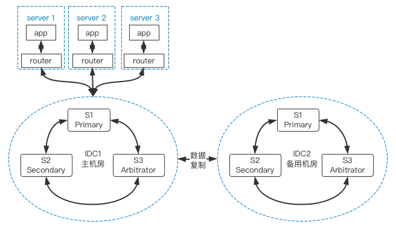
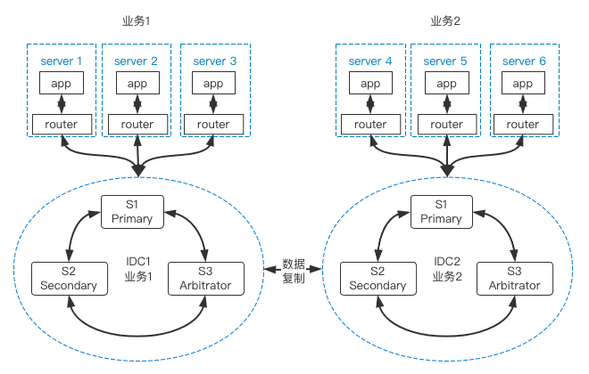
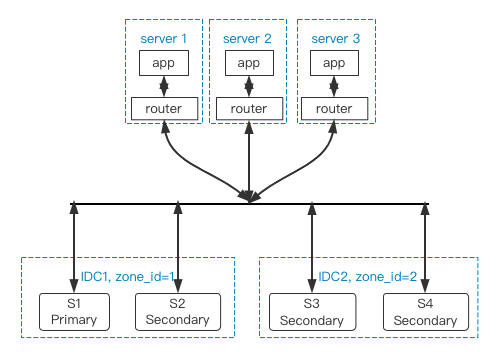

# Same-City Cross-IDC HA

---

This document mainly describes how to build a high availability architecture with GreatSQL + MySQL Router in a same-city cross-IDC scenario.

For a database architecture across multiple IDCs in the same city, the following solutions are commonly available:

## Primary-Backup Architecture

This does not refer to MySQL source-replica replication, but to a primary IDC serving the business while another IDC acts as backup resources, which can be switched over as a whole in emergency situations and can also handle part of the read-only business.

## Vertically Partitioning Business

The two IDCs each handle part of the business. At the architecture design level, the business is vertically partitioned: part of the business is placed in IDC A, and the rest in IDC B. A data replication channel is established between the two databases to ensure the data on both sides is eventually consistent. When one IDC fails, only part of the business is affected. When data consistency is guaranteed, the business of the failed IDC can also be switched to the healthy IDC.

## Full MGR Solution

Build a cross-IDC MGR cluster between the two IDCs. In this case, the network latency between the two IDCs must not be too high. Besides ensuring that the IDC where the Primary node resides has a standby node, the other IDC must also be able to replicate all the data. At this point, GreatSQL's **zone id** feature can be used to guarantee this.

**Scan the QR code to follow our WeChat official account**

