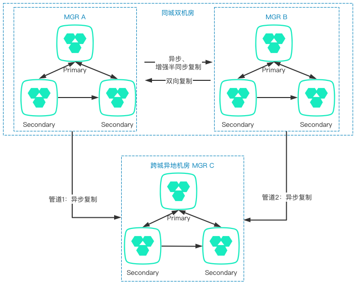

# Cross-City Multi-IDC HA

---

This document mainly describes how to build a high availability architecture with GreatSQL + MySQL Router in a cross-city multi-IDC scenario.

A cross-city multi-IDC architecture is basically based on the same-city multi-IDC database architecture, with an additional offsite backup IDC. When all data centers in the local city experience major failures, a backup system is available in the offsite data center to temporarily respond to business needs with degraded service in emergency situations.

In addition, the backup IDC can take advantage of the Async Replication Auto Failover feature, so that no extra operations are required when the primary node switches over.

The overall architecture is shown below:

**Scan the QR code to follow our WeChat official account**

