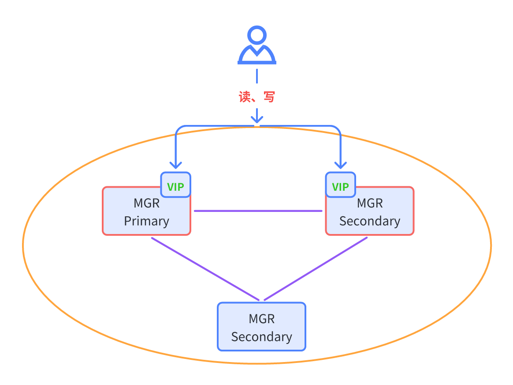

# Single-VLAN HA

---

This document mainly describes how to build a high availability architecture with GreatSQL + VIP in a single-VLAN scenario.

GreatSQL supports binding a dynamic VIP to the read/write node in single-primary mode, making HA switchover more convenient.

The overall architecture is shown below:




## Enabling the Built-in VIP Plugin

- Enable the new plugin

```ini
plugin_load_add=greatdb_ha.so
```

Or, after starting the database instance, run

```sql
INSTALL PLUGIN greatdb_ha SONAME 'greatdb_ha.so';
```

## New Configuration Parameters

- Configure to enable the built-in VIP feature

```ini
loose-greatdb_ha_enable_mgr_vip = ON
```

- Configure the VIP to be bound on the Primary node

```ini
loose-greatdb_ha_mgr_vip_ip = "172.17.140.250"
```

- Configure the number of ARP packet broadcasts. After a node binds the floating IP, ARP packets are broadcast to update the ARP cache in the broadcast domain. This parameter specifies the number of broadcasts; the default is 5, and the valid range is 3-20.

```ini
loose-greatdb_ha_send_arp_packge_times = 5
```

- Configure the dedicated communication port for dynamically binding the VIP service. Communication data is transmitted through this port. When the state of an MGR node changes, the Primary node re-allocates the VIP binding relationships according to the preset VIP binding plan, following the principle of **minimal changes and even distribution**, and sends the binding relationships to the Secondary nodes through the dedicated communication port. The Secondary nodes then unbind or bind the specified VIPs accordingly.

```ini
loose-greatdb_ha_port = 33062
```

- Configure the name of the network interface to bind. The plugin binds the VIP to the specified interface on the machine where the MGR primary node resides, for example eth0. To prevent the original IP of the interface from being overwritten, after binding, the VIP is actually bound to an interface named eth0:0.

```ini
loose-greatdb_ha_mgr_vip_nic = 'eth0'
```

- Configure the netmask

```ini
loose-greatdb_ha_mgr_vip_mask = '255.255.255.0'
```

- The built-in VIP feature can currently only be enabled in single-primary mode, so the following parameters also need to be set:

```ini
loose-group_replication_single_primary_mode = ON
loose-group_replication_enforce_update_everywhere_checks = OFF
```

- The parameter `greatdb_ha_mgr_vip_broad` is deprecated and no longer used.
- If the parameters above are not configured, or the configuration format is incorrect, the built-in VIP feature will not work (there is currently no format-checking/error-reporting function for this).
- In addition to the new parameters above, all other MGR-related parameters follow the regular single-primary MGR configuration requirements.
- All the parameters above support dynamic online modification.


A complete example of the configuration described above is as follows (every instance in the MGR group needs to be configured):

```ini
[mysqld]
#GreatSQL MGR vip
plugin-load-add=greatdb_ha.so
loose-greatdb_ha_enable_mgr_vip = ON
loose-greatdb_ha_mgr_vip_ip = "172.17.140.250"
loose-greatdb_ha_mgr_vip_mask = "255.255.255.0"
loose-greatdb_ha_mgr_vip_nic = "eth0"
loose-greatdb_ha_port = 33062
loose-greatdb_ha_send_arp_packge_times = 5
report_host = "172.17.140.10"
report_port = 3306

#single-primary mode
loose-group_replication_single_primary_mode = ON
loose-group_replication_enforce_update_everywhere_checks = OFF
```

When the VIP bound on the MGR Primary node is manually removed, or an abnormal configuration causes incorrect VIP binding behavior, you can run `set global greatdb_ha_force_change_mgr_vip = on` on the MGR Primary node to re-fetch the MGR topology and rebind the VIP. After this command is executed, the value of the parameter `greatdb_ha_force_change_mgr_vip` remains off, which is expected behavior.

## Startup Notes
Configuring the VIP requires related kernel permissions. There are two ways to obtain the permissions; choose any one of the following (Method 1 is recommended):

1. [Recommended] Modify the systemd service file and add the AmbientCapabilities parameter, for example:
```ini
[Unit]
Description=GreatSQL Server
Documentation=man:mysqld(8)
Documentation=http://dev.mysql.com/doc/refman/en/using-systemd.html
After=network.target
After=syslog.target
[Install]
WantedBy=multi-user.target
[Service]
# some limits
# file size
LimitFSIZE=infinity
# cpu time
LimitCPU=infinity
# virtual memory size
LimitAS=infinity
# open files
LimitNOFILE=65535
# processes/threads
LimitNPROC=65535
# locked memory
LimitMEMLOCK=infinity
# total threads (user+kernel)
TasksMax=infinity
TasksAccounting=false

User=mysql
Group=mysql
Type=notify
TimeoutSec=10
PermissionsStartOnly=true
ExecStartPre=/usr/local/GreatSQL-8.0.32-25-Linux-glibc2.28-x86_64/bin/mysqld_pre_systemd
ExecStart=/usr/local/GreatSQL-8.0.32-25-Linux-glibc2.28-x86_64/bin/mysqld $MYSQLD_OPTS
EnvironmentFile=-/etc/sysconfig/mysql
Restart=on-failure
RestartPreventExitStatus=1
Environment=MYSQLD_PARENT_PID=1
PrivateTmp=false
# Add this line to ensure the MGR VIP feature works
AmbientCapabilities=CAP_NET_ADMIN CAP_NET_RAW
```
Then run `systemctl daemon-reload` to reload the systemd service and start GreatSQL.

**Note**: Thanks to community user **Fenda** for suggesting this method.

2. Use the `setcap` command to add the `CAP_NET_ADMIN` and `CAP_NET_RAW` capabilities to the mysqld binary. The specific command is as follows:
```bash
# This command requires sudo privileges or root
setcap CAP_NET_ADMIN,CAP_NET_RAW+ep /usr/local/GreatSQL-8.0.32-25-Linux-glibc2.28-x86_64/bin/mysqld
```

Then load the `lib/private` subdirectory of the GreatSQL binary package into `LD_LIBRARY_PATH`:
```bash
$ cat /etc/ld.so.conf.d/greatsql.conf

/usr/local/GreatSQL-8.0.32-25-Linux-glibc2.28-x86_64/lib/private
```

Run `ldconfig && ldconfig -p | grep -i libpro` to confirm the configuration is correct:
```bash
$ ldconfig && ldconfig -p | grep -i 'libprotobuf.so'

	libprotobuf.so.3.19.4 (libc6,x86-64) => /usr/local/GreatSQL-8.0.32-25-Linux-glibc2.28-x86_64/lib/private/libprotobuf.so.3.19.4
```

After that, start GreatSQL.

3. [Strongly not recommended] Grant root privileges to the user that starts the mysqld process, for example the mysql user.

**Notes**
- It is recommended to manage the GreatSQL service with `systemd`, or enable sudo permission for the startup user (e.g. mysql) and use sudo to invoke `systemd` to start the GreatSQL service. This ensures that the mysqld process can obtain kernel permissions and successfully bind the VIP.
- After adding capabilities to the mysqld binary with `setcap`, make sure the user logging into the system and the user starting mysqld are the same; otherwise the mysqld process cannot obtain kernel permissions. For example, if you log in as the root user and then start the mysqld process as a regular user (mysql), setcap will not take effect, and binding the VIP will fail with an error.


**Scan the QR code to follow our WeChat official account**


